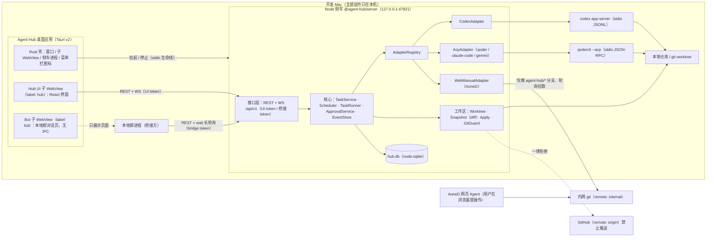

# Agent Hub · 本地编程 Agent 调度台（设计稿）

> **状态**：只有设计文档，还没有任何实现代码。
>
> **读者**：接手实现的 AI Agent 与 owner（JQ-Boss）。读完本文和 [docs/](docs/) 下的分册，应该不需要再问“做成什么样、用什么栈、边界在哪、先做什么”。所有待定事项都已拍板，见 [docs/decisions-and-risks.md](docs/decisions-and-risks.md)（下文用 D 编号引用）。
>
> **信息源优先级**：实现落地后以 `main` 分支代码为准；代码还没覆盖的部分以本目录文档为准；本目录与仓库通用约定（[docs/Cardhub/handoff-context.md](../../docs/Cardhub/handoff-context.md)）冲突时以仓库约定为准，除非本文 §4.3 明确写了偏离理由。

---

## 1. 背景

JQ-Boss 在自己的开发 Mac 上同时使用多个 AI 编程 Agent：ChatGPT 应用内置的 **Codex**、**Qoder**，以后还会有 Claude Code、Gemini CLI 等。另有一个外部桥接方 **Grok Bot「本地郎」**，负责在对话里接需求、派发编程任务、取回结果。

痛点：

1. 这些 Agent 的客户端**不显示外部派发的会话**。本地郎通过协议派出去的任务，在 Codex / Qoder 自己的界面里看不到，进度、权限请求、改动都无处可看。
2. 每个 Agent 一套客户端；本地郎的对话又在另一个窗口。来回切窗口很累。
3. 权限审批（要不要让 Agent 执行某条命令、改某个文件）没有统一入口，桥接方派发的任务遇到审批会卡住。
4. 有的 Agent 只能在浏览器里用（例如内网的 **AoneD** 云端 CLI Agent），没法用本地协议调用。

**Agent Hub** 是本仓库新增的自研桌面客户端：把各家 Agent 通过它们的协议接进来，统一派发、查看、管理编程任务；同一个窗口里内嵌本地郎的对话页面；对本地郎提供本机 HTTP / WebSocket API。

## 2. 目标与非目标

### 2.1 目标

| 编号 | 目标         | 说明                                                                                                                                                                    |
| ---- | ------------ | ----------------------------------------------------------------------------------------------------------------------------------------------------------------------- |
| G1   | 统一派发     | 在一处给 Codex、Qoder、其他 ACP Agent、网页 Agent 下任务；可选 Agent、模型、推理档位、只读或可写、仓库与基线。                                                          |
| G2   | 统一可见     | 任务列表显示每个任务的 Agent、模型与推理档、状态、实时输出、diff、待审批请求、历史；不管任务是在 Hub 里建的还是本地郎派的。                                             |
| G3   | 人工审批     | Agent 发起的权限请求（执行命令、改文件等）汇总到 Hub，由人批准或拒绝；拒绝、超时、取消都有确定的结果。                                                                  |
| G4   | 桥接 API     | 本机 HTTP + WebSocket API：本地郎可以派任务、等待结果、取 diff、追问、取消。                                                                                            |
| G5   | 可插拔适配器 | 统一的适配器接口；Codex（app-server JSON-RPC）与通用 ACP 适配器先行，Qoder 是 ACP 的第一个配置；Claude Code、Gemini CLI 以配置接入；网页 Agent 是第三类适配器。         |
| G6   | 单窗口工作台 | Tauri 桌面应用；主窗口左栏**内嵌本地郎的对话页面**（原生子 WebView），右边是任务列表与详情；不用切窗口。                                                                |
| G7   | 本地与安全   | 只在本机运行；数据只存本机 SQLite；**绝不向 GitHub 推送**；凭据不外泄；默认只读沙箱；API 只监听 `127.0.0.1` 并鉴权。                                                    |
| G8   | 可恢复       | Hub 或 Agent 进程崩溃后，任务正确落为“已中断”，残留进程被清理；追问时从各 Agent 的原生会话恢复（Codex `thread/resume`，ACP `session/resume` / `session/load`）。        |

### 2.2 非目标

- **不自研 Agent 循环，不直连模型 API。** 模型能力全部来自现有 Agent；Hub 只做调度、展示、审批与安全边界。
- **不做多用户、远程访问、云同步、远端数据库。** 不监听非回环地址；本地郎必须作为本机进程调用 API（D47）。
- **只支持 macOS 14+**（D1）。不做 Windows / Linux / 移动端。
- **不推送业务代码，不自动合并、不开 PR。** 唯一例外：网页 Agent 任务把 `agent-hub/<shortId>` 分支推到内网 `internal` 远端，禁止强推（D50）。
- **不接管各 Agent 的登录。** Hub 不读取、不保存 Codex / Qoder / AoneD 的凭据；未登录时提示用户在对应客户端或终端里登录。
- **不做 IDE。** 没有代码编辑器；diff 只读，可以“应用到本地分支”（本地提交 / 合并，不推送）。
- **不开发本地郎本身。** Hub 负责把本地郎页面嵌进窗口、提供 API 和接入示例。
- **不做网页自动化**（v1）。AoneD 用人工协作流程（D40）。
- **不做附件**（D25）、不做 MCP server（D47）、不接任何外部遥测（D27）、界面只做简体中文（D24）。

## 3. 用户场景

| 编号 | 场景                     | 过程                                                                                                                                                                                                                                  |
| ---- | ------------------------ | ------------------------------------------------------------------------------------------------------------------------------------------------------------------------------------------------------------------------------------- |
| S1   | 本地郎派发只读任务       | JQ-Boss 在左栏对本地郎说“让 Codex 看看 X 模块为什么慢”。本地郎调 `POST /api/v1/tasks`（`agentId: "codex"`，不传 `mode` 即只读）。任务列表立刻出现一条“来自本地郎”的任务，输出实时滚动。本地郎用 `wait` 长轮询等到本轮结束，取结果回复。 |
| S2   | 本地郎派发写任务，人审批 | 本地郎派发“用 Qoder 修复 Y 的空指针”（`mode: "write"`）。Hub 建 git worktree、启动 Qoder。Qoder 请求执行 `pnpm test`，右栏弹出审批卡片，JQ-Boss 点“允许一次”。完成后本地郎取 diff 摘要回复；JQ-Boss 在 Hub 里看完整 diff，点“应用”。   |
| S3   | 在 Hub 里直接建任务      | 点“新建任务”，选 Agent、模型、推理档位、只读 / 可写、仓库与基线，填提示词。                                                                                                                                                           |
| S4   | 追问                     | 对已结束的任务追加一轮（“再补一个单测”），沿用同一个原生会话；可以换模型。                                                                                                                                                            |
| S5   | 停止                     | 任务跑偏，点“停止本轮”（协议级中断）；10 秒没停下就强制结束。本地郎也可以取消任务。                                                                                                                                                   |
| S6   | 网页 Agent               | 派发给 AoneD：Hub 建 `agent-hub/<shortId>` 分支并推到 `internal`，显示提示词和“打开 AoneD”按钮；JQ-Boss 在浏览器里让 AoneD 在该分支上工作；Hub 自动拉取新提交并展示 diff；JQ-Boss 点“完成本轮”。                                      |
| S7   | 回看历史                 | 按 Agent、状态、来源、仓库筛选任务；打开上周的任务，回看输出、每轮 diff 与审批记录。                                                                                                                                                  |
| S8   | 在 ChatGPT 里接着聊      | Codex 任务以 `threadSource: "user"` 创建（D31），同一会话也出现在 ChatGPT 应用的 Codex 里。                                                                                                                                           |
| S9   | 崩溃恢复                 | Hub 被强退。重启后，上次运行中的任务标为“已中断”，残留 Agent 进程被清理；追问时从原生会话继续。                                                                                                                                       |

## 4. 选型结论

**Tauri v2 桌面壳（Rust 只做原生必须的部分）+ Vite / React Hub UI + 本机 Node 侧车（NestJS + `node:sqlite`）。**

### 4.1 方案对比

| 方案                                  | 体积 / 内存                                         | 能否把本地郎嵌进同一窗口                                                                                     | 业务逻辑放哪                                 | 结论                       |
| ------------------------------------- | --------------------------------------------------- | ------------------------------------------------------------------------------------------------------------ | -------------------------------------------- | -------------------------- |
| Electron                              | 重：自带 Chromium + Node，安装包上百 MB             | 可以                                                                                                         | Node                                         | 否：owner 明确排除         |
| 纯本地 Web（浏览器访问）              | 轻                                                  | **不行**：第三方页面一般禁止 iframe 嵌入，iframe 里的第三方 Cookie 也会被拦                                  | Node                                         | 只作开发期调试方式         |
| 纯 Tauri（业务逻辑全写在 Rust 里）    | 最轻                                                | 可以                                                                                                         | Rust                                         | 否：owner 不熟 Rust；CI 测不到 |
| **Tauri v2 壳 + Node 侧车（选用）**   | 壳几 MB，用系统 WKWebView；Node 用本机已装的 22.13+ | **可以**：Tauri 多 WebView（`Window::add_child`）在同一窗口放一个原生子 WebView 加载本地郎页面，Cookie 隔离 | Node 侧车（TS），Rust 只有一个约 460 行的文件 | **选用**                   |

### 4.2 理由

1. **轻量**：Tauri 用系统 WKWebView，侧车用本机已有的 Node。
2. **单窗口内嵌本地郎**：只有原生 WebView 能可靠承载第三方登录态页面。Tauri v2 多 WebView 能在同一窗口里放 Hub UI 和 Bot 页面两块原生视图，各自独立 Cookie 存储、独立权限（[desktop-shell.md](docs/desktop-shell.md)）。
3. **尽量用 TypeScript**：Rust 只负责建窗口与子 WebView、Bot 页面的导航与弹窗策略、拉起与停止侧车、关窗隐藏、菜单栏图标，共 5 个 IPC 命令；文档给出已编译通过的全文（D2）。布局、菜单、通知、重启策略都在 TS 里（D3）。
4. **数据只在本机**：`node:sqlite` 是 Node 内置模块，没有原生依赖，一个 `hub.db` 文件（D13、D14）。
5. **核心逻辑能在 CI 里测**：CI 跑在 Ubuntu 上，侧车与 UI 用 jest / vitest 覆盖，假 Agent 回放协议；Rust 壳不进 CI（D53、D54）。
6. **侧车与界面解耦**：关窗口只是隐藏，侧车继续跑，本地郎的 API 不中断；开发时也能单独起侧车 + 浏览器打开 UI。

### 4.3 与仓库约定的对齐与偏离

**对齐**：

- pnpm workspace 已声明 `apps/*/*`，新应用放 `apps/agent-hub/<子项目>/`，包名 `@agent-hub/<name>`。
- TypeScript 6、ESLint 10 flat config（根配置覆盖）、Prettier 3、Husky + lint-staged + commitlint。
- 前端：React 19 + Vite 8 + Tailwind CSS 4 + `@repo/ui-web` + TanStack Query 5 + React Router 7。
- 服务端：NestJS 11 + zod 4；tsconfig 继承 `@repo/config-ts/nest.json`；`nest-cli.json` 与 dev 脚本照 `apps/cardhub/api`（`deleteOutDir: false`、`--preserveWatchOutput`）。
- 共享包（`@agent-hub/contract`）输出 CommonJS，Hub UI 在 `optimizeDeps.include` 里列出（D58）。
- 测试：侧车 jest 30 + ts-jest，contract 与 UI 用 vitest 4。

**偏离**（每条都有理由）：

| 偏离                                                       | 理由                                                                                                       |
| ---------------------------------------------------------- | ---------------------------------------------------------------------------------------------------------- |
| 数据库用 Node 内置 `node:sqlite`，不用 Prisma / Postgres   | 单用户本机工具，不应要求 Docker；没有原生依赖（D13）。                                                     |
| 不用 tRPC，UI 与本地郎共用 REST + WS `/api/v1`             | 本地郎需要语言无关的接口；一套契约、一套鉴权、一套测试（D23）。Cardhub“不引入 REST 业务接口”只适用于 Cardhub。 |
| 不用 MobX                                                  | 状态几乎全来自侧车，TanStack Query 缓存就够（D21）。                                                       |
| Tauri 打开 `unstable` Cargo 特性                           | 多 WebView（`Window::add_child`）只在该特性下可用；版本锁定（R4）。                                        |
| 只支持 macOS 14+                                           | 运行环境唯一；Bot 独立数据存储需要 macOS 14（D1）。                                                        |
| commitlint 新增 scope `agent-hub`                          | 现有白名单都是 Cardhub 的（D56）。                                                                         |

## 5. 总体架构



关键数据流：

1. **派发**：Hub UI 或本地郎 `POST /api/v1/tasks` → `TaskService` 校验并落库（`queued`）→ `Scheduler` 按并发上限挑任务 → `TaskRunner` 准备工作区、启动原生会话、发提示词。
2. **进度**：适配器把协议事件翻译成统一的 `AgentEvent` → `EventStore` 合并增量、分配每任务递增的 `seq`、落库 → `EventBus` 推给所有订阅者。
3. **审批**：适配器收到权限请求 → `ApprovalService` 落库并广播 → 人在 Hub UI 里决定 → 适配器按协议回复 Agent。
4. **结果**：一轮结束 → 树快照算出本轮与整个任务的 diff 并存库 → 任务状态更新 → 本地郎的 `wait` 返回，再取结果与 diff。

细节见 [docs/architecture.md](docs/architecture.md)。

## 6. 主窗口布局

```text
┌─────────────────────────────────────────────────────────────────────────────────────────┐
│ Agent Hub   ● Codex  ● Qoder  ○ AoneD      待审批 2      [＋ 新建任务]  [⚙ 设置]          │ 顶栏 44px
├────────────────────────────┬──────────────────────────┬─────────────────────────────────┤
│ 本地郎    [⟳] [↗] [⇤]       │ [全部▾][Agent▾][来源▾] 🔍 │ 修复 Y 的空指针   Qoder · 可写   │ Bot 工具条 32px
│────────────────────────────│──────────────────────────│ 模型 默认 · 推理 高 · worktree  │
│                            │ ● 运行中 · 本地郎 · Qoder │ [停止本轮] [追问] [应用] [归档] │
│   （Bot 子 WebView，        │   修复 Y 的空指针  待批 2 │─────────────────────────────────│
│    原生视图覆盖这一块）     │ ✓ 已完成 · 本地郎 · Codex │ 输出 │ Diff 3 │ 审批 2 │ 详情     │
│                            │   分析 X 模块性能         │ ▸ 计划 3/5                       │
│                            │ ✕ 失败 · 界面 · Qoder     │ ▸ $ pnpm test   等待审批         │
│                            │   迁移脚本                │   [允许一次][本会话允许][拒绝]   │
│                            │ …                        │ Agent：已定位到 …                │
└────────────────────────────┴──────────────────────────┴─────────────────────────────────┘
  左栏宽 360 / 440 / 560 三档（⌘1 收起 / 展开）· 中栏 360 · 右栏自适应 · 关窗 = 隐藏到菜单栏
```

- 顶栏、Bot 工具条、中栏、右栏都是 Hub UI（React）；左栏工具条下面那一块由 Hub UI 留出空位（`BotSlot`），Rust 创建的**原生 Bot 子 WebView** 按这块的位置和大小盖上去，登录态存在独立的数据存储里。
- Bot 工具条：`⟳` 刷新 Bot 页面，`↗` 用系统浏览器打开，`⇤` 收起左栏。
- 本地郎和 Hub 之间**只通过本地 API 通信**；Hub 不向 Bot 页面注入脚本，Bot 页面也没有任何 Tauri IPC 能力。
- 原生视图会盖住 Hub UI 的弹层：有对话框、下拉框、弹出菜单打开时 Bot 视图临时隐藏（[desktop-shell.md](docs/desktop-shell.md) §5.3）。界面细节见 [docs/hub-ui.md](docs/hub-ui.md)。

## 7. 目录结构

```text
apps/agent-hub/
├── README.md                     # 本文
├── docs/                         # 设计分册（§8）；没有 package.json，pnpm 不会当成包
├── contract/                     # @agent-hub/contract：zod schema 与类型（领域、事件、错误、配置、API DTO），CJS 输出
│   └── src/{index,domain,events,errors,capabilities,config,api,labels}.ts
├── server/                       # @agent-hub/server：Node 侧车（NestJS 11 + ws + node:sqlite）
│   ├── src/
│   │   ├── main.ts               # 参数、自检、ready / fatal 行、生命线、停机
│   │   ├── app.module.ts
│   │   ├── common/               # paths、logger、redact、ids、errors
│   │   ├── config/               # config.json 读写与热更新
│   │   ├── db/                   # sqlite.ts（Db 封装）、migrations.ts、repositories/*
│   │   ├── auth/                 # token、scope、Host / Origin / CORS
│   │   ├── api/                  # REST controllers、ws.gateway、错误过滤、zod 校验
│   │   ├── core/                 # task.service、state-machine、scheduler、task-runner、event-store、event-bus、approval.service、recovery、retention
│   │   ├── workspace/            # git、repo-inspector、worktree、snapshot、apply、git-guard、push
│   │   └── adapters/             # types、registry、jsonrpc/、process/、codex/、acp/、web/
│   └── test/                     # fakes/（假 Codex、假 ACP、场景文件）、helpers/、*.e2e-spec.ts
├── web/                          # @agent-hub/web：Vite + React Hub UI（Tauri 加载；开发时也可用浏览器打开）
│   └── src/{main.tsx,app/,api/,pages/,components/,desktop/,lib/}
└── desktop/                      # @agent-hub/desktop：Tauri v2 壳
    ├── package.json
    └── src-tauri/{Cargo.toml,build.rs,tauri.conf.json,capabilities/hub.json,icons/,src/{main.rs,lib.rs}}
```

运行时数据目录 `AGENT_HUB_HOME`（默认 `~/Library/Application Support/AgentHub`，D18）的内容见 [docs/data-model.md](docs/data-model.md) §1。

## 8. 文档索引与阅读顺序

| 顺序 | 文档                                                       | 内容                                                                           |
| ---- | ---------------------------------------------------------- | ------------------------------------------------------------------------------ |
| 1    | 本文                                                       | 背景、目标、场景、选型、总架构、布局、目录                                     |
| 2    | [docs/decisions-and-risks.md](docs/decisions-and-risks.md) | 全部已拍板的决策（D1…）与风险（R1…）                                           |
| 3    | [docs/architecture.md](docs/architecture.md)               | 进程模型、侧车模块、任务状态机、事件管线、工作区与 diff、配置 schema、启动停机 |
| 4    | [docs/data-model.md](docs/data-model.md)                   | 数据目录、SQLite DDL、`Db` 封装、迁移、保留策略                                |
| 5    | [docs/local-api.md](docs/local-api.md)                     | REST + WS 契约：鉴权、端点、DTO、错误码、本地郎接入示例                        |
| 6    | [docs/adapter-interface.md](docs/adapter-interface.md)     | 适配器接口、统一事件、错误码、审批与模型归一化、JSON-RPC 传输、进程管理        |
| 7    | [docs/adapter-codex.md](docs/adapter-codex.md)             | Codex app-server 协议（按 0.164.0 实测）与映射                                 |
| 8    | [docs/adapter-acp.md](docs/adapter-acp.md)                 | 通用 ACP 适配器；Qoder、Claude Code、Gemini CLI 的 profile                     |
| 9    | [docs/web-agent.md](docs/web-agent.md)                     | 网页 Agent（AoneD）人工协作流程、双远端 git                                    |
| 10   | [docs/desktop-shell.md](docs/desktop-shell.md)             | Tauri 壳：Rust 全文、capability、TS 侧桌面逻辑                                 |
| 11   | [docs/hub-ui.md](docs/hub-ui.md)                           | Hub UI：页面、组件、数据流、交互细则                                           |
| 12   | [docs/security.md](docs/security.md)                       | 威胁模型、推送守卫、凭据、沙箱、WebView 隔离、脱敏                             |
| 13   | [docs/testing.md](docs/testing.md)                         | 测试分层、假 Agent、错误路径矩阵、CI、手工验收清单                             |
| 14   | [docs/milestones.md](docs/milestones.md)                   | **一次实现的分步计划**：依赖清单、每步的文件、检查点、完成定义                 |

## 9. 术语

| 术语                  | 含义                                                                                                                                       |
| --------------------- | ------------------------------------------------------------------------------------------------------------------------------------------ |
| Hub                   | 本应用，包括 Tauri 壳、Hub UI 和 Node 侧车。                                                                                               |
| 侧车（server）        | `@agent-hub/server` 进程，承载全部业务逻辑与 API，由 Tauri 壳拉起。                                                                        |
| 桥接方 / 本地郎       | Grok Bot「本地郎」：本机进程通过 API 派任务、取结果；它的对话页面嵌在主窗口左栏。                                                          |
| Agent                 | 被调度的外部编程 Agent：Codex、Qoder、Claude Code、Gemini CLI、AoneD 等。                                                                  |
| 适配器（Adapter）     | 把某类 Agent 协议翻译成 Hub 统一接口的模块。三类：`codex`、`acp`、`web`。                                                                  |
| Agent 配置（Profile） | `config.json` 里的一项 Agent 定义（id、类型、命令、并发上限等）。同一类适配器可以有多项，例如 `qoder` 和 `claude-code` 都是 `acp`。        |
| 任务（Task）          | 一次派发的工作单元，绑定一个 Agent 配置、一个仓库、一个工作区和一个原生会话，可以有多轮。                                                  |
| 轮（Turn）            | 任务里的一次提示词及 Agent 随后的全部工作；对应 Codex 的 turn、ACP 的一次 `session/prompt`、网页 Agent 的一次“开始 → 完成本轮”。           |
| 原生会话              | Agent 自己的会话：Codex 的 thread、ACP 的 session。                                                                                        |
| 审批（Approval）      | Agent 发起、需要人决定的权限请求。                                                                                                         |
| 工作区                | 任务运行的目录：`in_place`（原仓库目录）、`worktree`（Hub 新建的 git worktree）、`remote_branch`（网页 Agent 的内网任务分支）。            |
| 只读 / 可写           | 任务模式 `read_only` / `write`，默认只读。                                                                                                 |
| 树快照                | 用临时索引把工作区当前内容写成一个 git tree 对象；两个快照之间的差就是 diff（D51）。                                                       |
| shortId               | 任务 id 的 8 位十六进制短号，用于分支名 `agent-hub/<shortId>` 与界面显示。                                                                 |

## 10. 给实现 Agent 的约定

- **按计划一次做完**：照 [docs/milestones.md](docs/milestones.md) 的步骤顺序实现，每一步一个提交，每步末尾跑该步的检查点命令，全部通过再进入下一步（D55）。文档里给了全文的代码（Rust 壳、DDL、`Db` 封装、Codex 协议类型等）直接复制，不要“改进”。
- **提交信息**：`<type>(<scope>): <subject>`。第 1 步给 commitlint 加 scope `agent-hub`（D56），之后用 `feat(agent-hub): …`、`test(agent-hub): …`、`docs(agent-hub): …`。
- **每次提交前**：`pnpm lint && pnpm typecheck && pnpm test && pnpm build` 全绿。Rust 壳不在 `pnpm build` 里；改到 `desktop/` 时在 macOS 上额外跑 `cargo check` 与手工清单（[docs/testing.md](docs/testing.md) §7）。
- **测试不得依赖真实 Agent、真实 GitHub 或真实内网**：CI 用假 Agent、本地裸仓库；真实 Codex / Qoder / AoneD 只在 owner 的 Mac 上按清单手工验收。
- **永远不要**把 token、Cookie、真实内网域名写进代码、测试夹具、文档或 PR 描述；示例一律用 `*.example`、`<内网 git 域名>` 这类占位符。
- **改了协议相关代码**：同步更新对应适配器文档里的兼容表（[adapter-codex.md](docs/adapter-codex.md) §11、[adapter-acp.md](docs/adapter-acp.md) §10）。
- **实现中发现文档没写到或写错的地方**：先在 [docs/decisions-and-risks.md](docs/decisions-and-risks.md) 追加一条决策（新编号），再按它实现，并在提交说明里引用编号。
