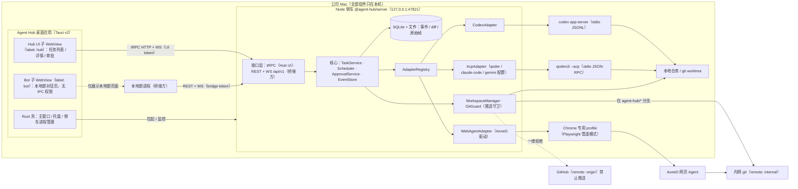

# Agent Hub · 本地编程 Agent 调度台（设计稿）

> **状态**：只有设计文档，还没有任何实现代码。本目录供后续实现的 Agent 领取任务、按图施工。
>
> **读者**：接手实现的 AI Agent 与 owner（JQ-Boss）。读完本文和 [docs/](docs/) 下的分册，应该不需要再问“做成什么样、用什么栈、边界在哪”。
>
> **信息源优先级**：实现落地后以 `main` 分支代码为准；代码还没覆盖的部分以本目录文档为准；本目录与 [docs/Cardhub/handoff-context.md](../../docs/Cardhub/handoff-context.md) 的仓库通用约定冲突时，以仓库通用约定为准，除非本文 §4.3 明确写了偏离理由。

---

## 1. 背景

JQ-Boss 在公司 Mac 上同时使用多个 AI 编程 Agent：ChatGPT 应用内置的 **Codex**、**Qoder**，以后还会有 Claude Code、Gemini CLI 等。另有一个外部桥接方 **Grok Bot「本地郎」**，负责在对话里接需求、派发编程任务、取回结果。

痛点：

1. 这些 Agent 的客户端**不显示外部派发的会话**。本地郎通过协议派出去的任务，在 Codex / Qoder 自己的界面里看不到，进度、权限请求、改动都无处可看。
2. 每个 Agent 一套客户端、一套交互方式；本地郎的对话又在另一个窗口。来回切窗口很累。
3. 权限审批（要不要让 Agent 执行某条命令、改某个文件）没有统一入口，桥接方派发的任务遇到审批会卡住。
4. 有的 Agent 只能在浏览器里用（例如阿里内网的 **AoneD** 云端 CLI agent），没法用本地协议调用。

**Agent Hub** 是本仓库新增的自研桌面客户端：把各家 Agent 的模型能力通过它们的协议接进来，统一派发、查看、管理编程任务；同一个窗口里内嵌本地郎的对话界面；对本地郎提供本地 HTTP/WebSocket API。

## 2. 目标与非目标

### 2.1 目标

| 编号 | 目标         | 说明                                                                                                                                                                      |
| ---- | ------------ | ------------------------------------------------------------------------------------------------------------------------------------------------------------------------- |
| G1   | 统一派发     | 在一处给 Codex、Qoder、后续的 ACP Agent、网页 Agent 下任务；可选 Agent、模型、推理档位、只读或可写。                                                                      |
| G2   | 统一可见     | 任务列表显示每个任务的 Agent、模型与推理档、状态、实时输出、diff、待审批请求、历史；无论任务是在 Hub 界面建的还是本地郎派发的。                                           |
| G3   | 人工审批     | Agent 发起的权限请求（执行命令、改文件、申请额外权限）汇总到 Hub，由人批准或拒绝；拒绝、超时、取消都有确定的结果。                                                        |
| G4   | 桥接 API     | 本机 HTTP + WebSocket API：本地郎可以派任务、订阅进度、取结果和 diff、追问、取消。                                                                                        |
| G5   | 可插拔适配器 | 统一的适配器接口；Codex（app-server JSON-RPC）和通用 ACP 适配器先行，Qoder 是 ACP 的第一个配置实例；Claude Code、Gemini CLI 等以配置方式接入；网页 Agent 是第三类适配器。 |
| G6   | 单窗口工作台 | Tauri 桌面应用，主窗口左侧**内嵌本地郎的对话页面**（原生子 WebView），右侧是任务列表与详情；不用在多个窗口之间切换。                                                      |
| G7   | 本地与安全   | 只在公司 Mac 本机运行；**绝不向 GitHub 推送**；凭据不外泄；默认只读沙箱；API 只监听 `127.0.0.1` 并鉴权。                                                                  |
| G8   | 可恢复       | Hub 或 Agent 进程崩溃后，任务状态正确落地为“已中断”，能从各 Agent 的原生会话恢复（Codex `thread/resume`、ACP `session/load` / `session/resume`）。                        |

### 2.2 非目标

- **不自研 Agent 循环，不直连模型 API。** 模型能力全部来自现有 Agent；Hub 只做调度、展示、审批与安全边界。
- **不做多用户、远程访问、云同步。** 不监听非回环地址，不提供内网穿透；本地郎必须和 Hub 跑在同一台 Mac 上（见 [待决问题 Q3](docs/risks-and-open-questions.md#q3-本地郎运行在哪里)）。
- **只支持 macOS**（Apple Silicon 优先，macOS 14+ 推荐）。不做 Windows / Linux / iOS / Android。
- **不推送业务代码到任何远端，不自动合并、不开 PR。** 唯一的例外是网页 Agent 需要的“任务分支推送到内网 `internal` 远端”，且只允许 `agent-hub/*` 命名空间、禁止强推（见 [web-agent.md](docs/web-agent.md)）。
- **不接管各 Agent 的登录。** Hub 不读取、不保存 Codex / Qoder / AoneD 的凭据；未登录时提示用户在对应客户端或终端里登录。
- **不做 IDE。** 没有代码编辑器；diff 只读，可以一键“应用到本地分支”（本地 merge / cherry-pick，不推送）。
- **不开发本地郎本身。** Hub 负责把本地郎的页面嵌进窗口、提供 API 和接入示例；本地郎的提示词、工具与部署由桥接方维护。
- **界面只做简体中文。** 不接 `@repo/shared` 的 i18n 字典。
- **不接 Sentry 或任何外部遥测。** 提示词和代码都是公司资产，日志只落本机。
- **不考虑 Electron。** 理由见 §4。

## 3. 用户场景

| 编号 | 场景                     | 过程                                                                                                                                                                                                                                                                          |
| ---- | ------------------------ | ----------------------------------------------------------------------------------------------------------------------------------------------------------------------------------------------------------------------------------------------------------------------------- |
| S1   | 本地郎派发只读任务       | JQ-Boss 在左侧 Bot 面板对本地郎说“让 Codex 看看 X 模块为什么慢”。本地郎调 `POST /api/v1/tasks`（`agentId=codex`，未指定 `mode` 即只读）。右侧任务列表立刻出现一条“来自 Bot”的任务，输出实时滚动。任务完成后本地郎收到 WebSocket 事件，取结果回复用户。                        |
| S2   | 本地郎派发写任务，人审批 | 本地郎派发“用 Qoder 修复 Y 的空指针”（`mode=write`）。Hub 默认要求在界面上确认写任务；确认后建 git worktree、启动 Qoder。Qoder 请求执行 `pnpm test`，右侧弹出审批卡片，JQ-Boss 点“允许一次”。完成后本地郎取 diff 摘要回复；JQ-Boss 在 Hub 里看完整 diff，点“应用到本地分支”。 |
| S3   | 在 Hub 里直接建任务      | 点“新建任务”，选 Agent、模型、推理档位、只读/可写、仓库与基线分支，填提示词。                                                                                                                                                                                                 |
| S4   | 追问                     | 对已完成的任务追加一轮（“再补一个单测”），沿用同一个原生会话。                                                                                                                                                                                                                |
| S5   | 取消 / 中断              | 任务跑偏，点“停止本轮”（协议级中断）；无响应时点“强制结束”（结束进程组）。本地郎也可以取消自己派发的任务。                                                                                                                                                                    |
| S6   | 网页 Agent               | 派发给 AoneD：Hub 从本地基线建 `agent-hub/<任务号>` 分支并推到 `internal`，驱动 AoneD 网页会话在该分支上工作；AoneD 把提交推回 `internal`，Hub 拉取后在本地算 diff 展示。                                                                                                     |
| S7   | 回看历史                 | 按 Agent、状态、来源、仓库筛选任务；打开上周的任务，回放输出、查看每轮 diff 与审批记录。                                                                                                                                                                                      |
| S8   | 在 ChatGPT 里接着聊      | Codex 任务以“用户可见”方式创建线程（`threadSource: "user"`，需实测），同一会话也出现在 ChatGPT 应用的 Codex 里，可以在那边继续。                                                                                                                                              |
| S9   | 崩溃恢复                 | Hub 被强退。重启后，上次运行中的任务标为“已中断”，残留的 Agent 进程被清理；点“恢复”从原生会话继续。                                                                                                                                                                           |

## 4. 选型结论：Tauri 桌面壳 + 本地 Node 侧车服务

**结论**：桌面端用 **Tauri v2**（不用 Electron），界面是 Vite + React 19 的 Hub UI；所有业务逻辑（适配器、任务调度、存储、API）放在一个由 Tauri 拉起的 **Node 22 侧车进程**里，技术栈对齐 `apps/cardhub/api`（NestJS 11 + tRPC v11 + Prisma 6）。

### 4.1 方案对比

| 方案                                 | 体积 / 内存                                                 | 能否把本地郎嵌进同一窗口                                                                                                                                       | 协议与自动化实现                                                                        | 与仓库栈的契合                                                                                                | 结论                     |
| ------------------------------------ | ----------------------------------------------------------- | -------------------------------------------------------------------------------------------------------------------------------------------------------------- | --------------------------------------------------------------------------------------- | ------------------------------------------------------------------------------------------------------------- | ------------------------ |
| Electron                             | 重：每个应用自带 Chromium + Node，安装包上百 MB，常驻内存高 | 可以（`WebContentsView`）                                                                                                                                      | Node 原生                                                                               | 仓库没有 Electron 先例                                                                                        | 否：owner 明确排除，太重 |
| 纯本地 Web + Node 服务（浏览器访问） | 轻                                                          | **不行**：本地郎页面一般禁止被 iframe 嵌入（`X-Frame-Options` / CSP `frame-ancestors`），iframe 里的第三方 Cookie 也会被拦，登录态保不住；只能开多个标签页切换 | Node 原生                                                                               | 完全复用                                                                                                      | 只作开发期 / 无头兜底    |
| **Tauri v2 壳 + Node 侧车（选用）**  | 壳只有几 MB，用系统 WKWebView；Node 用本机已装的 Node 22    | **可以**：Tauri v2 多 WebView（`Window::add_child`）在同一窗口里放一个原生子 WebView 加载本地郎页面，Cookie 存储与 Hub 隔离                                    | Node 侧：ACP 官方 TypeScript SDK、Codex `generate-ts` 生成的类型、Playwright 都可直接用 | 前端复用 `@repo/ui-web` 等；服务端复用 NestJS / tRPC / Prisma / zod；Tauri v2 已在 `apps/cardhub/native` 用过 | **选用**                 |
| 纯 Tauri（业务逻辑全写在 Rust 里）   | 最轻                                                        | 可以                                                                                                                                                           | Rust 有 ACP crate，但 Playwright / CDP、Codex 的 TS 类型都用不上，要全部重写            | 仓库没有 Rust 业务代码先例；CI 的 `pnpm build` 不编译 Rust，核心逻辑在 CI 里测不到                            | 否                       |

### 4.2 选用理由

1. **轻量**：满足“Electron 太重”的要求。Tauri 用系统 WKWebView，侧车用本机已有的 Node 22（仓库 `engines.node >= 22`，owner 的 Mac 上一定有）。
2. **单窗口内嵌本地郎**：只有原生 WebView 能可靠承载第三方登录态页面。Tauri v2 的多 WebView 能在同一窗口里放 Hub UI 和 Bot 页面两块原生视图，各自独立 Cookie 存储、独立权限。细节见 [desktop-shell.md](docs/desktop-shell.md)。
3. **协议生态在 TypeScript 这边**：ACP 官方 SDK `@agentclientprotocol/sdk` 是 TypeScript；`codex app-server generate-ts` 能按已安装的 Codex 版本生成精确类型；网页 Agent 的浏览器自动化用 Playwright。放在 Node 里实现成本最低。
4. **核心逻辑能在 CI 里测**：仓库 CI 跑在 Ubuntu 上，`pnpm build` 已经排除了 Tauri 壳。业务逻辑放在 Node 侧车，jest / vitest 照常覆盖；Rust 壳保持很薄（窗口、子 WebView、侧车进程管理、托盘）。
5. **侧车与界面解耦**：窗口关掉（隐藏到菜单栏）时侧车继续跑，本地郎的 API 不中断；开发期也能单独起侧车 + 浏览器打开 UI 调试。

### 4.3 与仓库约定的对齐与偏离

**对齐**（不要改）：

- pnpm workspace 已声明 `apps/*/*`，新应用放 `apps/agent-hub/<子项目>/`，包名 `@agent-hub/<name>`（见根 [README.md](../../README.md) “如何新增一个应用”）。
- TypeScript 6、ESLint 10 flat config、Prettier 3、Husky + lint-staged + commitlint。
- 前端：React 19 + Vite 8 + Tailwind CSS 4 + `@repo/ui-web`（shadcn/ui）+ MobX 6 + TanStack Query（经 `@trpc/react-query`）+ React Router 7。
- 服务端：NestJS 11 + tRPC v11（Express 中间件挂载，不用 `nestjs-trpc`），zod 4，Prisma **6.19.x（不要升 7）**。
- 共享包输出 CommonJS、Vite `optimizeDeps.include` 要列出（见 [handoff-context.md](../../docs/Cardhub/handoff-context.md) §6.1、§6.2）。
- 测试：服务端 jest（同 `apps/cardhub/api`），Web 与共享包 vitest。

**偏离**（每条都有理由）：

| 偏离                                                           | 理由                                                                                                                                                        |
| -------------------------------------------------------------- | ----------------------------------------------------------------------------------------------------------------------------------------------------------- |
| 数据库用 **SQLite**（Prisma 6 sqlite provider），不用 Postgres | 单用户本机工具，不应要求 Docker；数据量小；文件可直接备份。                                                                                                 |
| 对桥接方暴露 **REST + WebSocket**（`/api/v1`）                 | 调用方是本地郎，不是本仓库的 TS 客户端，需要语言无关、可 `curl` 的稳定契约。Hub 自己的 UI 仍走 tRPC。Cardhub “不引入 REST 业务接口”的约定只适用于 Cardhub。 |
| Tauri 打开 **`unstable`** Cargo 特性                           | 多 WebView（`Window::add_child`）目前只在 `unstable` 特性下可用，是单窗口内嵌本地郎的前提；Tauri 版本需锁定，见风险 R4。                                    |
| **只支持 macOS**                                               | 运行环境就是公司 Mac；Codex 的 Seatbelt 沙箱、WKWebView 数据存储隔离都依赖 macOS。                                                                          |
| commitlint 新增 scope **`agent-hub`**                          | 现有白名单都是 Cardhub 的子项目；M0 里加一个 scope 覆盖整个新应用（见 [milestones.md](docs/milestones.md) AH-001）。                                        |

## 5. 总体架构



关键数据流：

1. **派发**：Hub UI 或本地郎创建任务 → `TaskService` 校验并落库 → `Scheduler` 按并发上限排队 → `WorkspaceManager` 准备工作区 → 适配器启动原生会话、发送提示词。
2. **进度**：适配器把各协议的事件翻译成统一的 `AgentEvent` → `EventStore` 分配递增序号、合并高频增量、落库 → 推送给所有订阅者（Hub UI、本地郎）。
3. **审批**：适配器收到 Agent 的权限请求 → `ApprovalService` 落库并广播 → 人在 Hub UI 里决定 → 适配器按协议回复 Agent。
4. **结果**：一轮结束 → `WorkspaceManager` 在工作区用 git 算出权威 diff 并存档 → 任务状态更新 → 桥接方取结果与 diff。

各部分的细节见 [architecture.md](docs/architecture.md)。

## 6. 主窗口布局（内嵌本地郎）

```text
┌──────────────────────────────────────────────────────────────────────────────────────┐
│ ● Agent Hub   Codex ● 正常   Qoder ● 正常   AoneD ○ 需登录      待审批 2   ＋新建任务  ⚙ │
├──────────────────────────┬─────────────────────────┬─────────────────────────────────┤
│                          │ 筛选：状态 Agent 来源 仓库 │ 修复 Y 的空指针        Qoder · 可写 │
│   本地郎（Bot 子 WebView） │─────────────────────────│ 模型 默认 · 推理 高  worktree …/a1b2 │
│                          │ ● 运行中  Bot  Qoder     │ [停止本轮] [强制结束] [追问] [归档] │
│   用户：让 Qoder 修一下… │   修复 Y 的空指针   2 待批 │─────────────────────────────────│
│   本地郎：已派发 #a1b2，│ ✓ 已完成  Bot  Codex     │ 输出 │ Diff(3) │ 审批(2) │ 事件 │ 详情 │
│   正在等你审批…          │   分析 X 模块性能          │                                 │
│                          │ ✕ 失败    UI   AoneD     │ ▸ 计划 3/5                       │
│                          │   迁移脚本                 │ ▸ $ pnpm test   等待审批         │
│                          │ …                        │   [允许一次] [本会话允许] [拒绝]  │
│ [⟳ 刷新] [↗ 浏览器打开]  │                          │ Agent：已定位到 …                │
└──────────────────────────┴─────────────────────────┴─────────────────────────────────┘
  ⌘1 折叠/展开 Bot 面板 · Bot 面板宽度三档（窄 / 中 / 宽）· 关闭窗口 = 隐藏到菜单栏，任务继续
```

- 左栏是**原生子 WebView**，加载本地郎的对话页面（URL 在设置里配置），登录态保存在独立的数据存储里。
- 中栏任务列表、右栏任务详情都在 Hub UI 子 WebView 里，实时刷新。
- 本地郎和 Hub 之间**只通过本地 API 通信**；Hub 不向 Bot 页面注入脚本，Bot 页面也拿不到任何 Tauri IPC 能力。
- 布局、尺寸同步、遮挡问题（原生子 WebView 会盖住 Hub UI 的弹层）等实现细节见 [desktop-shell.md](docs/desktop-shell.md)。

## 7. 目录结构（计划）

```text
apps/agent-hub/
├── README.md                 # 本文
├── docs/                     # 设计分册（见 §8）
├── contract/                 # @agent-hub/contract：zod schema 与类型（API DTO、事件、适配器接口），CJS 输出
│   └── src/{api,events,adapter,errors,config}.ts
├── server/                   # @agent-hub/server：Node 侧车，NestJS 11 + tRPC v11 + REST/WS + Prisma(SQLite)
│   ├── prisma/schema.prisma
│   ├── src/
│   │   ├── main.ts           # 只监听 127.0.0.1；stdout 打印 ready 行给 Tauri
│   │   ├── bootstrap/        # Host/Origin 守卫、鉴权中间件、优雅停机
│   │   ├── config/           # config.json 读取与 zod 校验
│   │   ├── modules/
│   │   │   ├── tasks/        # TaskService、Scheduler、状态机
│   │   │   ├── events/       # EventStore、EventBus、增量合并
│   │   │   ├── approvals/    # ApprovalService
│   │   │   ├── workspaces/   # 仓库注册、worktree、diff、应用到本地分支
│   │   │   ├── git-guard/    # 推送守卫、子进程 git 环境、hooks
│   │   │   ├── auth/         # token、scope
│   │   │   ├── bridge-api/   # /api/v1 REST controllers + WS gateway
│   │   │   └── health/
│   │   ├── adapters/
│   │   │   ├── registry.ts
│   │   │   ├── jsonrpc/      # JSONL 传输、请求表、超时
│   │   │   ├── process/      # 进程组、登录 shell PATH、环境清洗、强杀
│   │   │   ├── codex/        # CodexAdapter + generated/（generate-ts 产物）
│   │   │   ├── acp/          # AcpAdapter + profiles/（qoder、claude-code、gemini）
│   │   │   └── web/          # WebAgentAdapter + drivers/aoned/
│   │   └── trpc/             # Hub UI 用的 appRouter
│   └── test/                 # fake agents（假 Codex / 假 ACP / 假 AoneD 页面）与集成测试
├── web/                      # @agent-hub/web：Vite + React 19 Hub UI（由 Tauri 加载）
└── desktop/                  # @agent-hub/desktop：Tauri v2 壳
    ├── package.json
    └── src-tauri/{Cargo.toml,tauri.conf.json,capabilities/,src/}
```

> `apps/agent-hub/docs/` 也匹配 `apps/*/*`，但目录里没有 `package.json`，pnpm 不会把它当成 workspace 包。

## 8. 文档索引与阅读顺序

| 顺序 | 文档                                                                 | 内容                                                                             |
| ---- | -------------------------------------------------------------------- | -------------------------------------------------------------------------------- |
| 1    | 本文                                                                 | 背景、目标与非目标、场景、选型、总架构、布局、目录                               |
| 2    | [docs/architecture.md](docs/architecture.md)                         | 进程模型、核心模块职责、任务状态机、关键时序、并发与恢复                         |
| 3    | [docs/desktop-shell.md](docs/desktop-shell.md)                       | Tauri 壳：单窗口内嵌本地郎、侧车生命周期、IPC 命令、capability、托盘与通知、打包 |
| 4    | [docs/adapter-interface.md](docs/adapter-interface.md)               | 适配器接口（TypeScript 类型）、统一事件、审批与模型的归一化                      |
| 5    | [docs/adapter-codex.md](docs/adapter-codex.md)                       | Codex app-server 协议细节与实现要点                                              |
| 6    | [docs/adapter-acp.md](docs/adapter-acp.md)                           | 通用 ACP 适配器；Qoder、Claude Code、Gemini CLI 配置                             |
| 7    | [docs/web-agent.md](docs/web-agent.md)                               | 网页 Agent（AoneD）方案、双源 git 流程                                           |
| 8    | [docs/data-model.md](docs/data-model.md)                             | 数据模型、Prisma schema、文件布局、保留策略                                      |
| 9    | [docs/local-api.md](docs/local-api.md)                               | 本地 API 契约：鉴权、REST、WebSocket、错误码、接入示例                           |
| 10   | [docs/security.md](docs/security.md)                                 | 威胁模型、推送守卫、凭据、沙箱、网络与 WebView 隔离                              |
| 11   | [docs/testing.md](docs/testing.md)                                   | 测试分层、假 Agent、错误路径矩阵、CI 与本机验收                                  |
| 12   | [docs/milestones.md](docs/milestones.md)                             | 分阶段里程碑、任务卡（AH-xxx）、验收标准                                         |
| 13   | [docs/risks-and-open-questions.md](docs/risks-and-open-questions.md) | 风险与缓解、待 owner 决策的问题（含默认方案）                                    |

## 9. 术语

| 术语                  | 含义                                                                                                                                  |
| --------------------- | ------------------------------------------------------------------------------------------------------------------------------------- |
| Hub                   | 本应用（Agent Hub），包括 Tauri 壳、Hub UI 和 Node 侧车。                                                                             |
| 侧车（server）        | `@agent-hub/server` 进程，承载全部业务逻辑与 API，由 Tauri 壳拉起。                                                                   |
| 桥接方 / 本地郎       | Grok Bot「本地郎」，通过本地 API 派任务、取结果；它的对话页面嵌在主窗口左栏。                                                         |
| Agent                 | 被调度的外部编程 Agent：Codex、Qoder、Claude Code、Gemini CLI、AoneD 等。                                                             |
| 适配器（Adapter）     | 把某类 Agent 协议翻译成 Hub 统一接口的模块。三类：`codex`、`acp`、`web`。                                                             |
| Agent 配置（Profile） | 配置文件里的一项 Agent 定义（id、类型、命令、默认模型、并发上限）。同一类适配器可以有多项，例如 `qoder` 和 `claude-code` 都是 `acp`。 |
| 任务（Task）          | 一次派发的工作单元，绑定一个 Agent 配置、一个工作区和一个原生会话，可以有多轮。                                                       |
| 轮（Turn）            | 任务里的一次提示词及 Agent 随后的全部工作；对应 Codex 的 turn、ACP 的一次 `session/prompt`。                                          |
| 原生会话              | Agent 自己的会话：Codex 的 thread、ACP 的 session、网页 Agent 的远端会话。                                                            |
| 审批（Approval）      | Agent 发起、需要人决定的权限请求。                                                                                                    |
| 工作区                | 任务运行的目录：`in_place`（原仓库）、`worktree`（Hub 新建的 git worktree）、`remote_branch`（网页 Agent 用的内网任务分支）。         |
| 只读 / 可写           | 任务模式 `read_only` / `write`。默认只读。                                                                                            |

## 10. 给实现 Agent 的约定

- **先领任务卡再动手**：任务卡在 [docs/milestones.md](docs/milestones.md)，每张卡写了范围、验收标准与依赖。一个任务卡一个分支、一个 PR。
- **提交信息**：`<type>(<scope>): <subject>`。AH-001 合并前没有 `agent-hub` scope，文档用 `docs(docs)`、配置用 `config`；AH-001 合并后用 `feat(agent-hub)` / `fix(agent-hub)` 等。
- **每个 PR 必须通过** `pnpm lint && pnpm typecheck && pnpm test && pnpm build`。Tauri 壳不在 `pnpm build` 里（与 `@cardhub/native` 一样），改到 `desktop/` 时在 macOS 上额外跑 `cargo check` 与手工验收清单（见 [testing.md](docs/testing.md)）。
- **测试不得依赖真实 Agent、真实 GitHub 或真实内网**：CI 用假 Agent、本地裸仓库和假网页；真实 Codex / Qoder / AoneD 只在 owner 的 Mac 上按清单手工验收。
- **永远不要**把 token、Cookie、内网域名的真实凭据写进代码、测试夹具、文档或 PR 描述；录制的协议夹具要先脱敏。
- **改了协议相关代码**：同步更新对应的适配器文档与“协议兼容表”（[adapter-codex.md](docs/adapter-codex.md) §9、[adapter-acp.md](docs/adapter-acp.md) §8）。
- **新发现的坑**写进 [risks-and-open-questions.md](docs/risks-and-open-questions.md) 或对应分册的“实现要点”。
