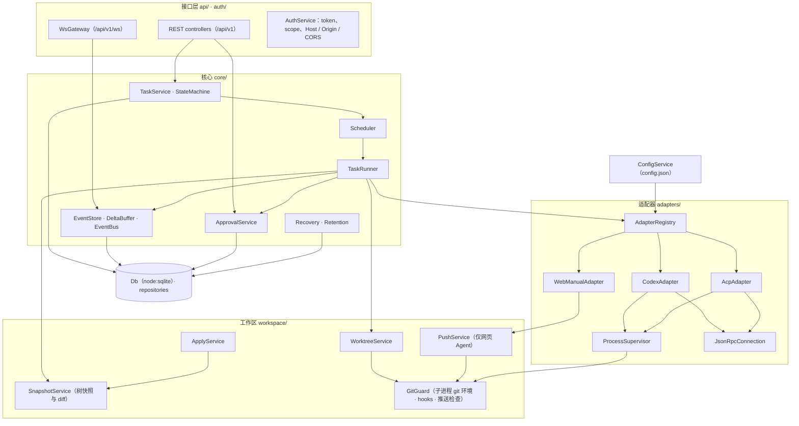
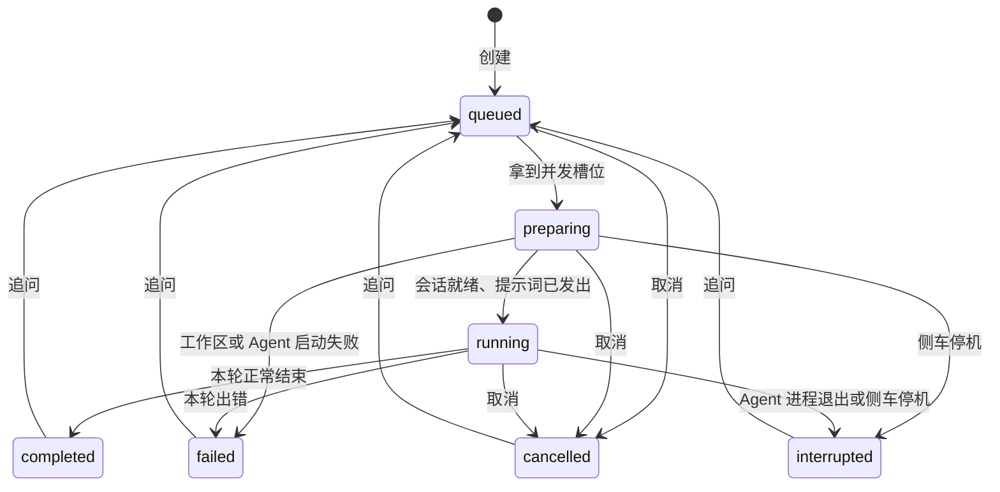
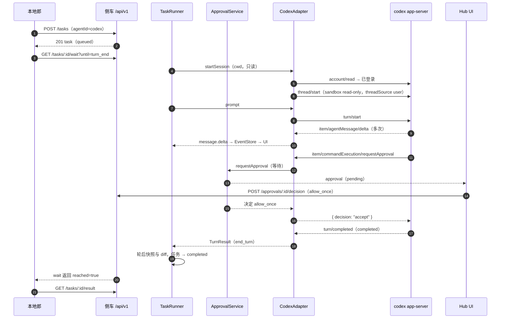
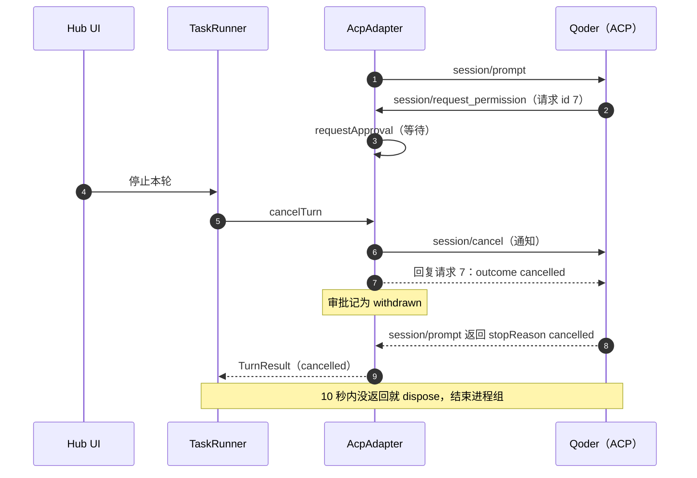
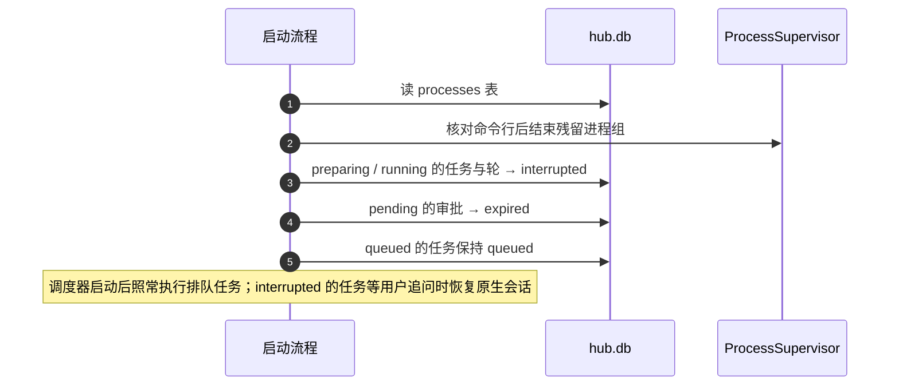

# 架构设计

> 上级文档：[../README.md](../README.md)。本文讲侧车内部怎么分层、任务怎么流转、事件怎么落库和推送、工作区与 diff 怎么算、配置长什么样、怎么启动和停机。Tauri 壳见 [desktop-shell.md](desktop-shell.md)，协议细节见各适配器分册，表结构见 [data-model.md](data-model.md)。

## 1. 进程模型

| 进程                             | 由谁启动                                  | 生命周期                                                              | 崩溃影响与处理                                                                                       |
| -------------------------------- | ----------------------------------------- | --------------------------------------------------------------------- | ---------------------------------------------------------------------------------------------------- |
| Tauri 主进程（Rust）             | 用户打开应用                              | 直到应用退出；关窗口只是隐藏（D11）                                   | 侧车的 stdin 随之关闭，侧车自行优雅停机（D7）；下次启动走恢复流程（§10.3）。                         |
| Hub UI 子 WebView（label `hub`） | Tauri 主进程                              | 与主窗口相同                                                          | 重新加载页面即可，状态全在侧车。                                                                     |
| Bot 子 WebView（label `bot`）    | Hub UI 调 `bot_open`                      | 与主窗口相同；可单独刷新、重建                                        | 只影响左栏显示，不影响任务。                                                                         |
| Node 侧车 `@agent-hub/server`    | Hub UI 调 `sidecar_start`（开发期可手动） | 应用退出时优雅停机                                                    | Hub UI 按退避策略重启（[desktop-shell.md](desktop-shell.md) §5.5）；运行中的任务标为 `interrupted`。 |
| `codex app-server`               | CodexAdapter                              | 每个 Codex 配置**共享一个**常驻进程，每个任务一个 thread（D30）       | 该配置下运行中的任务标为 `interrupted`；下次使用时重启进程，追问时 `thread/resume`。                 |
| ACP Agent（如 `qodercli --acp`） | AcpAdapter                                | **每个任务一个**进程（独立进程组）；任务结束后闲置 10 分钟结束（D35） | 只影响该任务，标为 `interrupted`；追问时按能力 `session/resume` 或 `session/load`。                  |
| 本地郎                           | 桥接方自己                                | 与 Hub 无关                                                           | 断线后用 `afterSeq` 续读事件，不丢事件（[local-api.md](local-api.md) §6）。                          |

网页 Agent（AoneD）在用户自己的浏览器里运行，Hub 只和内网 git 打交道（[web-agent.md](web-agent.md)），没有额外进程。

## 2. 侧车模块与职责



| 模块                | 文件                                   | 职责                                                                                                                                         | 不做什么                           |
| ------------------- | -------------------------------------- | -------------------------------------------------------------------------------------------------------------------------------------------- | ---------------------------------- |
| `ConfigService`     | `config/config.service.ts`             | 读取并用 zod 校验 `config.json`（schema 见 §8）；原子写入；变更后通知订阅者（适配器注册表、调度器）。                                        | 不存任何 token。                   |
| `AuthService`       | `auth/*`                               | UI token（内存）与桥接 token（库里存哈希）校验；scope 检查；Host / Origin 白名单；CORS；WS 首条消息鉴权（[local-api.md](local-api.md) §2）。 | —                                  |
| REST / `WsGateway`  | `api/*`                                | 用 contract 里的 zod schema 校验输入；调用核心服务；统一错误格式；幂等键。                                                                   | 不含业务逻辑。                     |
| `TaskService`       | `core/task.service.ts`                 | 创建、追问、取消、归档、删除；**唯一**修改任务状态的地方（经 `StateMachine`）。                                                              | 不解析任何 Agent 协议。            |
| `Scheduler`         | `core/scheduler.ts`                    | 按并发上限和工作区互斥规则挑选排队任务，交给 `TaskRunner`（§4）。                                                                            | 不轮询。                           |
| `TaskRunner`        | `core/task-runner.ts`                  | 一轮的完整流程：准备工作区 → 建立或恢复原生会话 → 轮前快照 → 发提示词 → 轮后快照与 diff → 落状态（§5）；持有内存中的活动会话表。             | —                                  |
| `ApprovalService`   | `core/approval.service.ts`             | 审批落库、广播、等待决定、超时、撤回；把结果交还给适配器（[adapter-interface.md](adapter-interface.md) §5）。                                | 不自动批准。                       |
| `EventStore`        | `core/event-store.ts`                  | 增量合并、分配 `seq`、落库、广播（§6）。                                                                                                     | —                                  |
| `EventBus`          | `core/event-bus.ts`                    | 进程内发布订阅（RxJS `Subject`）：事件流、任务变化、审批变化；`wait` 长轮询基于它。                                                          | —                                  |
| `Recovery`          | `core/recovery.ts`                     | 启动时清理残留进程、把中断的任务和审批落地（§10.3）。                                                                                        | —                                  |
| `Retention`         | `core/retention.ts`                    | 启动后 1 分钟执行一次、之后每 6 小时执行一次保留策略（[data-model.md](data-model.md) §6）。                                                  | —                                  |
| `WorktreeService`   | `workspace/worktree.service.ts`        | 解析基线、创建 / 移除 worktree、执行 `worktreeSetup`。                                                                                       | —                                  |
| `createGit`         | `workspace/git.ts`                     | 侧车执行 git 的唯一入口：固定环境、超时、输出上限（§7.2）。                                                                                  | 不加推送守卫变量。                 |
| `SnapshotService`   | `workspace/snapshot.ts`                | 树快照、diff 补丁与统计（§7.2）。                                                                                                            | 不改用户的暂存区和工作区。         |
| `ApplyService`      | `workspace/apply.service.ts`           | “应用到本地分支”（§7.4）。                                                                                                                   | **不推送。**                       |
| `RepoInspector`     | `workspace/repo-inspector.ts`          | 仓库体检：是否 git 仓库、远端列表、`origin` 推送是否已禁用、`internal` 推送主机、工作区是否干净。                                            | —                                  |
| `GitGuard`          | `workspace/git-guard.ts`               | 生成 Agent 子进程的环境变量；维护 hooks 目录和 askpass 脚本；推送前的主机检查；轮后远端跟踪分支审计（[security.md](security.md) §3）。       | —                                  |
| `PushService`       | `workspace/push.service.ts`            | 网页 Agent 任务分支的推送与拉取，只允许 `agent-hub/*` → `internal`。                                                                         | 不推送其他分支、不强推。           |
| `AdapterRegistry`   | `adapters/registry.ts`                 | 按配置实例化适配器；健康检查与能力缓存；配置变更时重建空闲的适配器。                                                                         | —                                  |
| `ProcessSupervisor` | `adapters/process/supervisor.ts`       | 用登录 shell 的 PATH 定位可执行文件；以独立进程组启动；pid 落库；结束进程组（[adapter-interface.md](adapter-interface.md) §8）。             | —                                  |
| `JsonRpcConnection` | `adapters/jsonrpc/connection.ts`       | 换行分隔 JSON 的读写、请求表与超时、对端发来的请求、非 JSON 行容错；Codex 与 ACP 共用（[adapter-interface.md](adapter-interface.md) §7）。   | —                                  |
| `Db`                | `db/sqlite.ts`、`db/repositories/*.ts` | `node:sqlite` 的薄封装与按表划分的读写函数（[data-model.md](data-model.md) §3–§4）。                                                         | 不暴露 `DatabaseSync` 给业务代码。 |

依赖方向只能从上往下：接口层 → 核心 → 工作区 / 适配器 / 存储。**适配器不访问数据库**，只通过 `AgentEventSink` 把事件和审批交给核心（[adapter-interface.md](adapter-interface.md) §5）。Nest 只用来组织依赖注入和 HTTP 路由；核心类都是普通 TS 类，单测时直接 `new`。

## 3. 任务生命周期

### 3.1 状态机



| 状态          | 含义                                                                            | 允许的操作                     |
| ------------- | ------------------------------------------------------------------------------- | ------------------------------ |
| `queued`      | 有一个待执行的轮，在等并发槽位。                                                | 取消                           |
| `preparing`   | 正在建工作区、跑 `worktreeSetup`、启动或恢复 Agent 会话。                       | 取消                           |
| `running`     | 本轮进行中。是否在等审批看 `pendingApprovals`（计数字段），**不是**单独的状态。 | 停止本轮、审批、刷新 diff      |
| `completed`   | 最近一轮正常结束。                                                              | 追问、归档、应用到本地分支     |
| `failed`      | 最近一轮或准备阶段出错，`lastError` 有错误码。                                  | 追问（重试）、归档、应用       |
| `cancelled`   | 最近一轮被取消。                                                                | 追问、归档、应用               |
| `interrupted` | Agent 进程或侧车意外退出。                                                      | 追问（自动恢复原生会话）、归档 |

规则：

- 状态只能经 `StateMachine.assert(from, to)` 迁移，表外的迁移抛 `ILLEGAL_TRANSITION`。单测按上表穷举所有 (from, to) 组合。
- 每次迁移在**同一个事务**里写 `tasks.status` 并追加一条 `task.status` 事件。
- 终态 = `completed` / `failed` / `cancelled` / `interrupted`。
- 归档是 `archivedAt` 字段，不是状态；只有终态任务能归档；归档后不能追问，先取消归档。
- 删除只对已归档任务开放，只能由 Hub UI 发起；删除任务时同时删除其 worktree（若还在）、分支 `agent-hub/<shortId>`（只删本地分支）和 `refs/agent-hub/base/<shortId>`；网页任务另删镜像 ref `refs/agent-hub/remote/<shortId>`（[web-agent.md](web-agent.md) §4.4）。
- 同一任务同一时刻最多一个未结束的轮。非终态时追问返回 `TASK_BUSY`。

### 3.2 轮

| 轮状态        | 含义                                        |
| ------------- | ------------------------------------------- |
| `pending`     | 已创建，等任务拿到槽位（任务为 `queued`）。 |
| `running`     | 已发出提示词。                              |
| `completed`   | Agent 正常结束本轮。                        |
| `failed`      | 出错。                                      |
| `cancelled`   | 被取消。                                    |
| `interrupted` | Agent 进程退出或侧车停机。                  |

- 创建任务时同时创建第 1 轮（`pending`）；每次追问新建一轮，`index` 递增。任务处于 `queued` 时恰好有一个 `pending` 的轮。
- 轮的结束原因 `stopReason` 归一为 `end_turn | max_tokens | max_turn_requests | refusal | cancelled | error`（映射见各适配器分册）。`end_turn` → 轮 `completed`；`max_tokens` / `max_turn_requests` / `refusal` → 轮 `completed` 并追加一条 `notice`（`warning`）；`cancelled` → `cancelled`；`error` → `failed`。
- 每轮结束时把最后一条完整的 Agent 消息记为该轮的 `finalMessage`；`GET /tasks/:id/result` 取最近一轮的值。

### 3.3 取消

| 场景           | 实现                                                                                                                                                                        |
| -------------- | --------------------------------------------------------------------------------------------------------------------------------------------------------------------------- |
| `queued`       | 轮 → `cancelled`，任务 → `cancelled`。                                                                                                                                      |
| `preparing`    | 触发该轮的 `AbortController`：正在跑的 `worktreeSetup` 进程组被结束、正在启动的 Agent 会话被 `dispose`；轮和任务 → `cancelled`。已创建的 worktree 保留。                    |
| `running`      | 调 `session.cancelTurn()`（Codex `turn/interrupt`、ACP `session/cancel`、网页任务直接结束本轮）。适配器负责把未决审批按协议回复“取消”。等 `prompt()` 返回，最多 **10 秒**。 |
| 10 秒还没结束  | 强制：`session.dispose('cancelled')`（ACP 结束进程组；Codex 不能杀共享进程，只 `thread/unsubscribe` 并丢弃该会话），本轮记 `cancelled`。                                    |
| 请求里 `force` | 跳过 10 秒等待，直接强制。                                                                                                                                                  |

### 3.4 追问与恢复

- 追问只在终态、未归档时可用：新建一轮 `pending`，任务 → `queued`，可以带新的 `model` / `reasoningEffort`。
- `TaskRunner` 拿到槽位后：活动会话表里有该任务的会话就直接用；没有（进程已闲置结束、侧车重启过、Agent 崩溃过）就调 `adapter.startSession({ resumeNativeSessionId })` 恢复：Codex `thread/resume`；ACP 按新进程声明的能力选 `session/resume` 或 `session/load`，失败时不改试另一种（D35）；不支持或恢复失败时本轮失败，错误码 `SESSION_NOT_RESUMABLE`。
- 没有单独的“恢复”按钮：`interrupted` 的任务在界面上把追问输入框预填为“上次执行被中断，请从中断处继续。”。

## 4. 调度与并发

| 限制                 | 默认值                   | 配置项                                            |
| -------------------- | ------------------------ | ------------------------------------------------- |
| 全局同时运行的任务数 | 3                        | `scheduler.maxConcurrentTasks`                    |
| 每个 Agent 配置      | `codex` 2，其余 1（D41） | `agents[].maxConcurrentTasks`                     |
| 排队上限             | 50                       | `scheduler.maxQueuedTasks`，超出返回 `QUEUE_FULL` |

- `preparing` 和 `running` 占槽位；等待审批的任务照样占（Agent 进程还在）。
- **同目录写互斥**：`in_place` 可写任务独占该仓库目录，期间同一仓库的其他 `in_place` 任务（只读也算）不能开始；`worktree` 和 `remote_branch` 任务不受影响。
- 选择顺序：按轮的创建时间先进先出；队首任务因为 Agent 槽位或目录互斥不能开始时，跳过它看下一个（不阻塞其他 Agent 的任务）。
- 调度器只在这些时刻重新计算：任务入队、任务离开 `preparing` / `running`、配置变更。不轮询。
- Agent 配置在任务排队期间被禁用或删除：拿到槽位时本轮失败，错误码 `AGENT_DISABLED`。

## 5. 一轮的执行流程（`TaskRunner`）

1. 迁移 `queued → preparing`。
2. **准备工作区**（`tasks.base_tree` 为 `NULL` 时执行：第 1 轮，或上次准备失败后的追问；worktree 已被保留策略清理的任务不能追问，见 [local-api.md](local-api.md) §5.4）：
   - `in_place`：工作目录 = 仓库路径；`baseCommit` = 当前 `HEAD`（仓库没有任何提交时失败，`WORKSPACE_SETUP_FAILED`）。
   - `worktree`：见 §7.1，完成后执行 `worktreeSetup`。worktree 目录已存在、且检出的是 `agent-hub/<shortId>`（上次 `worktreeSetup` 失败留下的）时直接复用，只重跑 `worktreeSetup`。
   - `remote_branch`：见 [web-agent.md](web-agent.md) §3.1。
   - 记 `baseTree` = 当时的树快照（§7.2），并 `git update-ref refs/agent-hub/base/<shortId> <baseTree>`。
3. **会话**：活动会话表里没有时调 `adapter.startSession(...)`（追问时带 `resumeNativeSessionId`）；拿到的 `nativeSessionId` 写回任务。
4. **轮前快照** `beforeTree`；本地 Agent（`codex` / `acp`）任务同时记下 `refs/remotes/*` 的快照（[security.md](security.md) §3.4）。
5. 轮 → `running`，任务 `preparing → running`，追加 `turn.started` 事件。
6. `await session.prompt({ turnId, text, model, reasoningEffort })`。期间适配器不断 `emit` 事件、`requestApproval` 审批。
7. `prompt()` 返回 `TurnResult` 后：
   1. `EventStore.flush(taskId)`，确保本轮的增量都已落库；
   2. 轮后快照 `afterTree`，算本轮 diff（`beforeTree → afterTree`）与任务 diff（`baseTree → afterTree`），写入轮记录，追加 `diff.updated`；
   3. 只读任务且 `beforeTree ≠ afterTree`：追加 `notice`（`error` 级，“只读任务的工作区在本轮有改动”），任务打上 `readOnlyViolation`（§7.3）；本地 Agent 任务另做远端跟踪分支审计、读取 `pre-push` 拦截记录（[security.md](security.md) §3.4）；
   4. 写轮的结束状态、`finalMessage`、用量，追加 `turn.completed`；
   5. 按 §3.2 迁移任务状态。
8. 会话留在活动会话表里，启动闲置计时器（ACP 默认 10 分钟、Codex 30 分钟，到点 `dispose('idle')`，Codex 的 `dispose` 只是 `thread/unsubscribe`；网页 Agent 没有子进程，不启动）。
9. 通知调度器有槽位空出。

第 2、3 步出错：本轮 → `failed`，任务 `preparing → failed`，`lastError` 写错误码。第 6 步里适配器的业务错误不会抛异常，而是体现在 `TurnResult.error`（[adapter-interface.md](adapter-interface.md) §6.1）；Agent 进程中途退出时 `TurnResult.stopReason` 为 `error`、错误码 `AGENT_PROCESS_EXITED`，任务记为 `interrupted` 而不是 `failed`。

## 6. 事件管线

1. 适配器调用 `sink.emit(event)`；核心自己的事件（状态、轮、审批、diff）由核心直接写入。事件类型见 [adapter-interface.md](adapter-interface.md) §3。
2. **增量缓冲**：`message.delta`、`reasoning.delta`、`tool.output.delta` 三种事件进入该任务的 `DeltaBuffer`：
   - 与缓冲区最后一条的 `(type, itemId)` 相同就把文本拼接上去，否则追加为新的一条（保持原始顺序）；
   - 满 **200 ms**（从缓冲区由空变非空时计时）或累计 **16 KB** 时整体刷出；
   - **任何非增量事件到来之前，先把该任务的缓冲区刷出**。这样 `tool.started` 不会排到它之前那段消息文字的前面。
3. **落库**：每条事件在一个事务里执行 `UPDATE tasks SET last_event_seq = last_event_seq + 1 … RETURNING last_event_seq` 拿到 `seq`，再 `INSERT INTO events`。同一任务内 `seq` 严格递增；保留策略删除旧增量后**允许出现空号**，客户端只依赖“递增”，不依赖“连续”。
4. **先落库，再广播**：事务提交后才交给 `EventBus`。订阅者收到的每条事件都能用 `afterSeq` 重新取到。
5. **单个工具的输出上限 1 MB**：同一 `itemId` 累计落库的 `tool.output.delta` 文本超过 1 MB 后，后续增量丢弃，只追加一次 `{ type: 'tool.output.delta', text: '', truncated: true }`。
6. **transcript**：诊断开关打开时，适配器的 `sink.raw()` 把原始协议帧脱敏后逐行写 `transcripts/<taskId>.ndjson`；关闭时 `raw()` 是空操作。
7. `EventBus` 同时发布两种“对象变化”：`task`（任务 DTO 变化，列表用）、`approval`（审批 DTO 变化）。它们不进 `events` 表，只用于实时推送（[local-api.md](local-api.md) §6）。

## 7. 工作区与 diff

### 7.1 工作区模式

| 任务类型          | 默认工作区      | 说明                                                                                                                                                |
| ----------------- | --------------- | --------------------------------------------------------------------------------------------------------------------------------------------------- |
| 本地 Agent · 只读 | `in_place`      | 直接在仓库目录里运行；轮前后快照比对（§7.3）。                                                                                                      |
| 本地 Agent · 可写 | `worktree`      | 路径 `<AGENT_HUB_HOME>/worktrees/<repoId>/<shortId>`，分支 `agent-hub/<shortId>`。Hub UI 可以显式选 `in_place`（二次确认）；**桥接方不能**（D45）。 |
| 网页 Agent        | `remote_branch` | 任务分支推到 `internal`，见 [web-agent.md](web-agent.md)。                                                                                          |

创建 worktree：

```bash
# baseRef 依次取：任务指定 → 仓库 defaultBaseRef → HEAD
base=$(git -C "$repo" rev-parse --verify "$baseRef^{commit}")
git -C "$repo" worktree add -b "agent-hub/$shortId" "$AGENT_HUB_HOME/worktrees/$repoId/$shortId" "$base"
```

- worktree 放在仓库外面，不会出现在用户的 `git status` 里，也不会被 Vite / tsc 的监听扫到。
- 原仓库有未提交改动时，新建任务页提示“未提交的改动不会带进 worktree”。
- **worktree 没有 `node_modules`**：仓库配置 `worktreeSetup`（例如 `{"command": ["pnpm", "install", "--offline", "--frozen-lockfile"]}`）在 Agent 启动前执行，用 Agent 子进程同样的环境（含推送守卫），超时默认 600 秒；失败记 `WORKSPACE_SETUP_FAILED`，worktree 保留供排查，setup 输出的最后 4 KB 放进错误详情。

### 7.2 树快照与 diff

侧车里所有 git 调用都经 `createGit()`：固定加 `GIT_TERMINAL_PROMPT=0` 与 `LC_ALL=C`，剔除会把 `git -C` 带到别的仓库的环境变量，超时结束 git 的整个进程组（含 ssh 子进程）。`main.ts` 创建一个实例 `createGit(process.env)`（Rust 壳已把登录 shell 的 PATH 放进侧车环境），以 provider token `GIT` 注入 `SnapshotService`、`WorktreeService`、`ApplyService`、`RepoInspector`、`GitGuard`、`PushService`。

```ts
// server/src/workspace/git.ts
import { spawn } from 'node:child_process';

/** 侧车自己执行 git 时叠加的环境（不含 Agent 子进程的推送守卫，architecture.md §7.2）。 */
export const GIT_FIXED_ENV: Readonly<Record<string, string>> = {
  GIT_TERMINAL_PROMPT: '0',
  /** 要匹配 git 的英文报错（例如 couldn't find remote ref）；不影响提交信息等内容的编码。 */
  LC_ALL: 'C',
};

/** 侧车环境里若带着这些变量，`git -C` 会被带到别的仓库。 */
const LOCATING_VARS = [
  'GIT_DIR',
  'GIT_WORK_TREE',
  'GIT_INDEX_FILE',
  'GIT_OBJECT_DIRECTORY',
  'GIT_ALTERNATE_OBJECT_DIRECTORIES',
  'GIT_COMMON_DIR',
  'GIT_NAMESPACE',
  'GIT_CEILING_DIRECTORIES',
];

export interface GitOptions {
  /** 叠加在基础环境之上，优先级最高。 */
  env?: Record<string, string>;
  /** 默认 30 秒；push / fetch 传 60_000。到时对 git 的进程组发 SIGKILL。 */
  timeoutMs?: number;
  /** stdout 上限，默认 64 MB；超过时结束进程并抛 kind 为 too_large 的 GitError。 */
  maxStdoutBytes?: number;
}

export interface GitResult {
  code: number;
  stdout: string;
  stderr: string;
}

export class GitError extends Error {
  constructor(
    readonly args: readonly string[],
    readonly kind: 'exit' | 'timeout' | 'too_large' | 'spawn',
    readonly result: GitResult | null,
  ) {
    const stderr = (result?.stderr ?? '').trim().split('\n').slice(-3).join(' / ');
    super(
      kind === 'exit'
        ? `git ${args[0]} 失败（退出码 ${result?.code}）：${stderr}`
        : kind === 'timeout'
          ? `git ${args[0]} 超时`
          : kind === 'too_large'
            ? `git ${args[0]} 输出过大`
            : `无法执行 git：${stderr}`,
    );
  }
}

export interface Git {
  /** 退出码非 0 时抛 GitError（kind: 'exit'）。返回 stdout 原文。 */
  run(cwd: string, args: string[], options?: GitOptions): Promise<string>;
  /** 退出码非 0 也返回；超时、输出过大、启动失败仍抛。 */
  exec(cwd: string, args: string[], options?: GitOptions): Promise<GitResult>;
}

export function createGit(baseEnv: NodeJS.ProcessEnv): Git {
  const env: Record<string, string> = {};
  for (const [k, v] of Object.entries(baseEnv)) {
    if (v !== undefined && !LOCATING_VARS.includes(k)) env[k] = v;
  }

  const exec = (cwd: string, args: string[], options: GitOptions = {}): Promise<GitResult> =>
    new Promise((resolve, reject) => {
      const child = spawn('git', ['-C', cwd, ...args], {
        env: { ...env, ...GIT_FIXED_ENV, ...options.env },
        stdio: ['ignore', 'pipe', 'pipe'],
        detached: true,
      });
      const out: Buffer[] = [];
      const err: Buffer[] = [];
      let outBytes = 0;
      let failure: 'timeout' | 'too_large' | null = null;
      const kill = (why: 'timeout' | 'too_large') => {
        failure ??= why;
        try {
          process.kill(-child.pid!, 'SIGKILL');
        } catch {
          child.kill('SIGKILL');
        }
      };
      const timer = setTimeout(() => kill('timeout'), options.timeoutMs ?? 30_000);
      const limit = options.maxStdoutBytes ?? 64 * 1024 * 1024;
      child.stdout.on('data', (b: Buffer) => {
        outBytes += b.length;
        if (outBytes > limit) kill('too_large');
        else out.push(b);
      });
      child.stderr.on('data', (b: Buffer) => err.push(b));
      child.on('error', (e) => {
        clearTimeout(timer);
        reject(new GitError(args, 'spawn', { code: -1, stdout: '', stderr: e.message }));
      });
      child.on('close', (code) => {
        clearTimeout(timer);
        const result = {
          code: code ?? -1,
          stdout: Buffer.concat(out).toString('utf8'),
          stderr: Buffer.concat(err).toString('utf8'),
        };
        if (failure) reject(new GitError(args, failure, result));
        else resolve(result);
      });
    });

  return {
    exec,
    async run(cwd, args, options) {
      const r = await exec(cwd, args, options);
      if (r.code !== 0) throw new GitError(args, 'exit', r);
      return r.stdout;
    },
  };
}
```

快照不碰真实暂存区和工作区：复制一份真实索引，在副本上 `git add -A` 再 `write-tree`。网页任务的快照只读镜像 ref，不联网（[web-agent.md](web-agent.md) §4.1）。

```ts
// server/src/workspace/snapshot.ts
import { copyFile, mkdtemp, rm } from 'node:fs/promises';
import { tmpdir } from 'node:os';
import { join } from 'node:path';
import { remoteMirrorRef } from '../adapters/web/types';
import type { Git } from './git';

/** in_place / worktree：工作目录当前内容（含未跟踪、不含被忽略的文件）的树。不碰真实的索引和工作区。 */
export async function snapshotTree(git: Git, cwd: string): Promise<string> {
  const realIndex = (
    await git.run(cwd, ['rev-parse', '--path-format=absolute', '--git-path', 'index'])
  ).trim();
  const dir = await mkdtemp(join(tmpdir(), 'agent-hub-idx-'));
  const env = { GIT_INDEX_FILE: join(dir, 'index'), GIT_OPTIONAL_LOCKS: '0' };
  try {
    try {
      await copyFile(realIndex, env.GIT_INDEX_FILE); // 复用 stat 缓存，大仓库也快
      await git.run(cwd, ['add', '-A'], { env, timeoutMs: 120_000 });
    } catch {
      // 索引不存在，或复制时正被别的 git 进程改写：从 HEAD 重建
      await rm(env.GIT_INDEX_FILE, { force: true });
      await git.run(cwd, ['read-tree', 'HEAD'], { env });
      await git.run(cwd, ['add', '-A'], { env, timeoutMs: 120_000 });
    }
    return (await git.run(cwd, ['write-tree'], { env })).trim();
  } finally {
    await rm(dir, { recursive: true, force: true });
  }
}

/** remote_branch：镜像 ref 指向的提交的树。不联网，拉取由调用方决定（web-agent.md §4.1）。 */
export async function snapshotRemoteBranch(
  git: Git,
  repoPath: string,
  shortId: string,
): Promise<string> {
  return (
    await git.run(repoPath, ['rev-parse', '--verify', `${remoteMirrorRef(shortId)}^{tree}`])
  ).trim();
}
```

两个树之间的 diff：

```bash
git diff-tree -r -M --no-color --no-ext-diff -p "$from" "$to"     # 补丁（二进制文件只显示 Binary files differ）
git diff-tree -r -M --numstat -z "$from" "$to"                    # 行数统计；二进制为 "-\t-"
git diff-tree -r -M --name-status -z "$from" "$to"                # A / M / D / R<相似度>
```

- 每轮结束存两份补丁与统计：**本轮**（`beforeTree → afterTree`）和**整个任务**（`baseTree → afterTree`）。API 默认返回整个任务的 diff。
- 单份补丁超过 **5 MB** 时不存补丁文本，只存统计，`patchTruncated = true`。
- 运行中的“刷新 diff”是 `TaskRunner.liveDiff(taskId, { fetch })`：现场拍一次快照，算 `baseTree → 现在` 和 `beforeTree → 现在`，追加一条 `diff.updated`（`scope: "live"`，只带统计），补丁随结果返回，不写入轮记录；同一任务同一时刻只算一次，并发调用共享结果。调用方：`GET /tasks/:id/diff?live=true`（`fetch: true`，只对网页任务有意义）和网页任务的 `remote.updated`（`fetch: false`，[web-agent.md](web-agent.md) §4.2）。
- `.gitignore` 忽略的文件不进快照，所以不会出现在 diff 里；未被忽略的新文件会。
- `write-tree` 产生的树对象不被任何分支引用，`git gc` 会在两周后回收。`baseTree` 要在整个任务期间可用，所以用 `refs/agent-hub/base/<shortId>` 指向它（已实测：指向树对象的 ref 能阻止回收，`git log --all`、`git fsck` 不受影响）；删除任务时删掉这个 ref。轮前 / 轮后快照只在本轮内使用，补丁已存库，不需要保护。
- 网页 Agent（`remote_branch`）没有本地工作目录，快照 = 镜像 ref `refs/agent-hub/remote/<shortId>` 指向的提交的树（`snapshotRemoteBranch`），**不联网**；镜像 ref 什么时候拉取见 [web-agent.md](web-agent.md) §4.1。`SnapshotService.snapshot(task)` 按工作区类型分派。
- 侧车执行 git 一律用 `createGit` 的环境，**不**加 Agent 子进程的推送守卫变量（Hub 需要正常的本地 git）。

### 7.3 只读任务的越界检测

只读任务每轮比较 `beforeTree` 与 `afterTree`。不一致时：

1. 追加 `notice`（`error` 级）：“只读任务的工作区在本轮有改动（可能来自 Agent，也可能是你自己同时改的）”，任务打上 `readOnlyViolation`，列表和详情页红色标记；
2. **不自动回滚**，由人决定（diff 页能看到具体改了什么）。

Codex 只读任务有沙箱，正常不会触发；这主要是给没有沙箱的 ACP Agent 用的（D38）。

### 7.4 应用到本地分支

| 工作区          | “应用”做什么                                                                                                                                                                                                                                                   |
| --------------- | -------------------------------------------------------------------------------------------------------------------------------------------------------------------------------------------------------------------------------------------------------------- |
| `worktree`      | ① worktree 还在且有未提交改动时：检查 `user.name` / `user.email`（缺了返回 `GIT_IDENTITY_MISSING`），`git add -A`，`git commit --no-verify -m "<任务标题>" -m "Agent Hub 任务 <shortId>（<Agent 名>）"`。② 分支相对基线没有任何提交时返回 `NOTHING_TO_APPLY`。 |
| `remote_branch` | 把本地 `agent-hub/<shortId>` 快进到镜像 ref（不联网：应用的就是 diff 里看到的提交）；不能快进时 `MERGE_CONFLICT`，任务分支正被检出时 `WORKSPACE_DIRTY`，见 [web-agent.md](web-agent.md) §4.3。                                                                 |
| `in_place`      | 不提供（改动本来就在原目录里），返回 `APPLY_NOT_SUPPORTED`。                                                                                                                                                                                                   |

请求里 `merge: true` 时再做一步合并：

1. 原仓库工作区必须干净（`git status --porcelain` 为空），否则 `WORKSPACE_DIRTY`；
2. `git -C <repo> merge --no-ff --no-verify -m "合并 agent-hub/<shortId>：<任务标题>" agent-hub/<shortId>`；
3. 失败（冲突）时 `git merge --abort`，返回 `MERGE_CONFLICT`，提示用户自己处理。

`--no-verify` 的理由见 D52。**任何情况下都不推送。** 应用是幂等的：重复调用时没有新改动就返回上一次的结果。

worktree 的清理：任务归档满 `retention.archivedWorktreeDays` 天后 `git worktree remove --force`（分支保留）；删除任务时立即清理并删除本地分支。

## 8. 配置

配置文件 `<AGENT_HUB_HOME>/config.json`，纯 JSON。首次启动时写入 `hubConfigSchema.parse({})` 的结果（即下面的默认值）。schema 是**唯一权威定义**，放在 `contract/src/config.ts`，侧车读写、设置页表单、测试共用。

```ts
// contract/src/config.ts
import { z } from 'zod';

const idSchema = z
  .string()
  .regex(/^[a-z][a-z0-9-]{1,31}$/, '只能用小写字母、数字和连字符，2–32 位');
const originSchema = z.string().regex(/^https?:\/\/[^/\s]+$/, '形如 https://chat.example');
const envNameSchema = z.string().regex(/^[A-Z_][A-Z0-9_]*$/);

const agentBase = {
  id: idSchema,
  displayName: z.string().min(1).max(40),
  enabled: z.boolean().default(true),
  maxConcurrentTasks: z.number().int().min(1).max(8).default(1),
  /** 额外透传给 Agent 子进程的环境变量名（值取自侧车自身环境）。 */
  envPassthrough: z.array(envNameSchema).default([]),
};

export const codexAgentSchema = z.object({
  ...agentBase,
  kind: z.literal('codex'),
  command: z.string().min(1).default('codex'),
  args: z.array(z.string()).default(['app-server']),
  defaultModel: z.string().nullable().default(null),
  defaultReasoningEffort: z.string().nullable().default(null),
  idleTimeoutMinutes: z.number().int().min(1).max(240).default(30),
});

export const acpAgentSchema = z.object({
  ...agentBase,
  kind: z.literal('acp'),
  profile: z.enum(['qoder', 'claude-code', 'gemini', 'generic']).default('generic'),
  command: z.string().min(1),
  args: z.array(z.string()).default([]),
  defaultModel: z.string().nullable().default(null),
  defaultReasoningEffort: z.string().nullable().default(null),
  idleTimeoutMinutes: z.number().int().min(1).max(240).default(10),
});

export const webAgentSchema = z.object({
  ...agentBase,
  kind: z.literal('web'),
  driver: z.literal('manual').default('manual'),
  /** “打开 AoneD”按钮的地址；为 null 时按钮不可用。 */
  openUrl: z.url().nullable().default(null),
  pollIntervalSeconds: z.number().int().min(10).max(600).default(30),
  maxTurnMinutes: z.number().int().min(10).max(1440).default(240),
});

export const agentConfigSchema = z.discriminatedUnion('kind', [
  codexAgentSchema,
  acpAgentSchema,
  webAgentSchema,
]);

export const repoConfigSchema = z.object({
  id: idSchema,
  name: z.string().min(1).max(60),
  /** 绝对路径，允许以 ~/ 开头。 */
  path: z.string().regex(/^(\/|~\/)/, '必须是绝对路径'),
  /** 新任务的默认基线；null 表示仓库当前 HEAD。 */
  defaultBaseRef: z.string().min(1).nullable().default(null),
  worktreeSetup: z
    .object({
      command: z.array(z.string().min(1)).min(1),
      timeoutSeconds: z.number().int().min(10).max(3600).default(600),
    })
    .nullable()
    .default(null),
  internalRemote: z.string().min(1).default('internal'),
  /** 由 Hub 在保存设置时根据 internal 的推送地址推导，用户不填。 */
  allowedPushHosts: z.array(z.string()).default([]),
});

export const DEFAULT_AGENTS = [
  { id: 'codex', kind: 'codex', displayName: 'Codex', maxConcurrentTasks: 2 },
  {
    id: 'qoder',
    kind: 'acp',
    profile: 'qoder',
    displayName: 'Qoder',
    command: 'qodercli',
    args: ['--acp'],
  },
  {
    id: 'claude-code',
    kind: 'acp',
    profile: 'claude-code',
    displayName: 'Claude Code',
    command: 'claude-agent-acp',
    enabled: false,
  },
  {
    id: 'gemini',
    kind: 'acp',
    profile: 'gemini',
    displayName: 'Gemini CLI',
    command: 'gemini',
    args: ['--acp'],
    enabled: false,
  },
  { id: 'aoned', kind: 'web', displayName: 'AoneD', enabled: false },
] satisfies z.input<typeof agentConfigSchema>[];

export const hubConfigSchema = z
  .object({
    version: z.literal(1).default(1),
    server: z.object({ port: z.number().int().min(1024).max(65535).default(47821) }).prefault({}),
    scheduler: z
      .object({
        maxConcurrentTasks: z.number().int().min(1).max(10).default(3),
        maxQueuedTasks: z.number().int().min(1).max(500).default(50),
      })
      .prefault({}),
    agents: z.array(agentConfigSchema).prefault(DEFAULT_AGENTS),
    repos: z.array(repoConfigSchema).default([]),
    defaultRepoId: idSchema.nullable().default(null),
    bot: z
      .object({
        url: z.url().nullable().default(null),
        /** Bot 页面可以停留的 origin；url 自身的 origin 自动包含。 */
        allowedOrigins: z.array(originSchema).default([]),
        /** 允许以弹窗打开的登录页 origin（SSO）。 */
        authOrigins: z.array(originSchema).default([]),
        userAgent: z.string().min(1).nullable().default(null),
        /** R4 的退路：不内嵌，改为用系统浏览器打开。 */
        openExternally: z.boolean().default(false),
      })
      .prefault({}),
    security: z
      .object({
        approvalTimeoutMinutes: z.number().int().min(1).max(1440).default(60),
        maxBridgeDiffBytes: z.number().int().min(1024).max(5_242_880).default(524_288),
        blockedPushHosts: z
          .array(z.string())
          .default(['github.com', 'ssh.github.com', 'gist.github.com']),
      })
      .prefault({}),
    retention: z
      .object({
        deltaEventDays: z.number().int().min(1).max(3650).default(30),
        transcriptDays: z.number().int().min(1).max(3650).default(14),
        archivedWorktreeDays: z.number().int().min(1).max(3650).default(30),
        auditDays: z.number().int().min(1).max(3650).default(180),
        logDays: z.number().int().min(1).max(3650).default(14),
      })
      .prefault({}),
    diagnostics: z
      .object({
        recordTranscripts: z.boolean().default(false),
        logLevel: z.enum(['debug', 'info', 'warn', 'error']).default('info'),
      })
      .prefault({}),
  })
  .superRefine((cfg, ctx) => {
    const dup = (ids: string[]) => ids.find((id, i) => ids.indexOf(id) !== i);
    const agentDup = dup(cfg.agents.map((a) => a.id));
    if (agentDup)
      ctx.addIssue({ code: 'custom', path: ['agents'], message: `Agent id 重复：${agentDup}` });
    const repoDup = dup(cfg.repos.map((r) => r.id));
    if (repoDup)
      ctx.addIssue({ code: 'custom', path: ['repos'], message: `仓库 id 重复：${repoDup}` });
    if (cfg.defaultRepoId && !cfg.repos.some((r) => r.id === cfg.defaultRepoId)) {
      ctx.addIssue({ code: 'custom', path: ['defaultRepoId'], message: '默认仓库不存在' });
    }
  });

export type HubConfig = z.output<typeof hubConfigSchema>;
export type HubConfigInput = z.input<typeof hubConfigSchema>;
export type AgentConfig = z.output<typeof agentConfigSchema>;
export type CodexAgentConfig = z.output<typeof codexAgentSchema>;
export type AcpAgentConfig = z.output<typeof acpAgentSchema>;
export type WebAgentConfig = z.output<typeof webAgentSchema>;
export type RepoConfig = z.output<typeof repoConfigSchema>;

export function createDefaultConfig(): HubConfig {
  return hubConfigSchema.parse({});
}
```

要点：

- 嵌套对象用 `.prefault({})` 而不是 `.default({})`：zod 4 的 `.default()` 在输入为 `undefined` 时**直接返回默认值、不再解析**，内层字段的默认值不会生效；`.prefault()` 会把默认值送进 schema 解析。
- `agents[].command` 可以写绝对路径；写命令名时按登录 shell 的 PATH 解析（[adapter-interface.md](adapter-interface.md) §8）。
- `repos[].path` 里的 `~/` 在读取时展开；保存设置时侧车用 `RepoInspector` 体检每个新增或改过路径的仓库：路径必须是 git 仓库的顶层目录（`git rev-parse --show-toplevel` 等于该路径），否则返回 `REPO_INVALID`；`internal` 远端存在时推导 `allowedPushHosts`，推导结果在 `security.blockedPushHosts` 里时拒绝保存。
- 写入：先写 `config.json.tmp`（权限 `0600`）再 `rename`。外部手改后需要重启侧车才生效（不监听文件）。
- 热更新：`PUT /api/v1/settings` 保存后，`agents` 的变更对空闲的适配器立即生效、对有活动会话的适配器在会话全部结束后生效；`scheduler` 立即生效；`bot` 由 Hub UI 重新调用 `bot_open`；`server.port` 需要重启侧车（响应里 `restartRequired: true`）。
- 配置里**不放任何 token**（[security.md](security.md) §4）。

## 9. 关键时序

### 9.1 本地郎派发 Codex 只读任务（含一次审批）



### 9.2 ACP 任务在审批未决时被取消



### 9.3 侧车重启后的恢复



## 10. 启动与停机

### 10.1 命令行与环境变量

| 参数 / 变量            | 含义                                                                                                                |
| ---------------------- | ------------------------------------------------------------------------------------------------------------------- |
| `--lifeline stdin`     | stdin 读到 EOF 时优雅停机（Tauri 拉起时传，D7）。                                                                   |
| `AGENT_HUB_HOME`       | 数据目录，默认 `~/Library/Application Support/AgentHub`。                                                           |
| `AGENT_HUB_LOGIN_PATH` | 登录 shell 的 PATH（Tauri 传入）；解析 Agent 命令用。没有时侧车自己问登录 shell。                                   |
| `AGENT_HUB_PORT`       | 覆盖 `server.port`（测试用）。                                                                                      |
| `AGENT_HUB_DEV=1`      | 开发模式：stderr 打印带 UI token 的开发链接（CORS 不受影响，开发来源始终放行，[local-api.md](local-api.md) §2.1）。 |

### 10.2 启动顺序

任一步失败：stdout 打印一行 `{"event":"fatal","code":"…","message":"…"}`（`message` 是中文，给人看），`exit 1`。

| 步骤 | 内容                                                                                                                                                                 | 失败码                                          |
| ---- | -------------------------------------------------------------------------------------------------------------------------------------------------------------------- | ----------------------------------------------- |
| 1    | 检查 `process.versions.node` ≥ 22.13。                                                                                                                               | `NODE_TOO_OLD`                                  |
| 2    | 创建 `AGENT_HUB_HOME` 及子目录 `logs/`、`transcripts/`、`worktrees/`、`guard/`、`probe/`（权限 `0700`，[data-model.md](data-model.md) §1）。                         | `HOME_NOT_WRITABLE`                             |
| 3    | 读 `server.lock`：记录的 pid 还活着、且 `GET http://127.0.0.1:<port>/api/v1/health` 在 1 秒内返回 `app: "agent-hub"` 时失败；否则覆盖写入 `{pid, port, startedAt}`。 | `ALREADY_RUNNING`                               |
| 4    | 读取并校验 `config.json`（不存在则写默认值）。错误信息带前 5 条 zod issue 的路径。                                                                                   | `CONFIG_INVALID`                                |
| 5    | 打开 `hub.db`，执行迁移（[data-model.md](data-model.md) §5）。                                                                                                       | `DB_OPEN_FAILED` / `DB_MIGRATION_FAILED`        |
| 6    | 恢复流程（§9.3）。                                                                                                                                                   | `STARTUP_FAILED`                                |
| 7    | `GitGuard.ensure()`：写 hooks 目录、askpass 脚本、空的 `gh` 配置目录（[security.md](security.md) §3）。                                                              | `STARTUP_FAILED`                                |
| 8    | `AuthService.ensureDefaultToken()`：按 [local-api.md](local-api.md) §2.2 的四条规则新建或轮换默认桥接 token，明文写 `bridge-token`（`0600`，D44）。                  | `STARTUP_FAILED`                                |
| 9    | 生成 UI token；创建 Nest 应用；**只在 `127.0.0.1:<port>` 上监听**；挂上 WebSocket。                                                                                  | `PORT_IN_USE`（`EADDRINUSE`）/ `STARTUP_FAILED` |
| 10   | stdout 打印 `{"event":"ready","port":47821,"uiToken":"…","version":"0.1.0","pid":12345}`。开发模式再往 stderr 打印 `Hub UI: http://localhost:5174/#uiToken=…`。      | —                                               |
| 11   | 启动调度器；异步做各 Agent 的健康检查（界面先显示“检测中”）；安排保留策略任务。                                                                                      | —                                               |

### 10.3 停机

触发：`--lifeline stdin` 下 stdin 读到 EOF；SIGTERM；SIGINT。只执行一次（重复信号忽略）。

1. 停止接受新的 HTTP 请求和 WS 连接（已有的 `wait` 立即返回 `reached: false`）；调度器停止派发。
2. `ApprovalService.expireAll()`：未决审批按兜底决定回复 Agent、记为 `expired`（[adapter-interface.md](adapter-interface.md) §5.1）；然后对每个 `running` 的任务调 `cancelTurn()`，`preparing` 的任务触发中止。
3. 最多等 **5 秒**；然后对所有会话 `dispose('shutdown')`、所有适配器 `shutdown()`（结束全部 Agent 进程组）。
4. 停机期间结束的轮，除了正常完成（`end_turn`）的，一律记为 `interrupted`（`lastError.code = HUB_SHUTDOWN`，[adapter-interface.md](adapter-interface.md) §6.1 规则 4）；刷出所有增量缓冲。
5. 关闭数据库，删除 `server.lock`，`exit 0`。

Rust 壳在关闭 stdin 后等 10 秒（D7），侧车的 5 秒加上适配器结束进程组的时间要在这之内。

## 11. 日志与诊断

- 侧车日志：`logs/server-YYYY-MM-DD.log`，JSON 行：`{"ts","level","scope","msg",...meta}`；Nest 的 `Logger` 通过自定义 `LoggerService` 写入同一个文件，同时 `warn` 以上级别抄送 stderr（Tauri 壳会把侧车 stderr 的最后 50 行放进崩溃提示里）。保留 `retention.logDays` 天。
- **日志里不出现**：token、Cookie、提示词全文（只记长度与 SHA-256 前 8 位）、带 userinfo 的 git URL；所有写日志的 meta 都先过 `redact()`（[security.md](security.md) §6）。
- 健康检查：`GET /api/v1/health` 免鉴权，只返回 `{ app: "agent-hub", version }`；`GET /api/v1/agents` 返回每个 Agent 的详细状态（需要鉴权）。
- 设置页“导出诊断包”：把最近 3 天的日志、脱敏后的配置、版本信息、`processes` 表快照放进一个目录，用系统自带的 `tar -czf` 打成 `~/Downloads/agent-hub-diagnostics-<时间>.tar.gz`；由用户自己决定是否发给别人。
