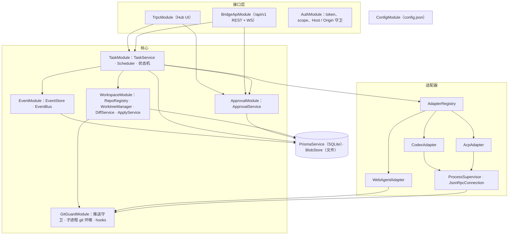
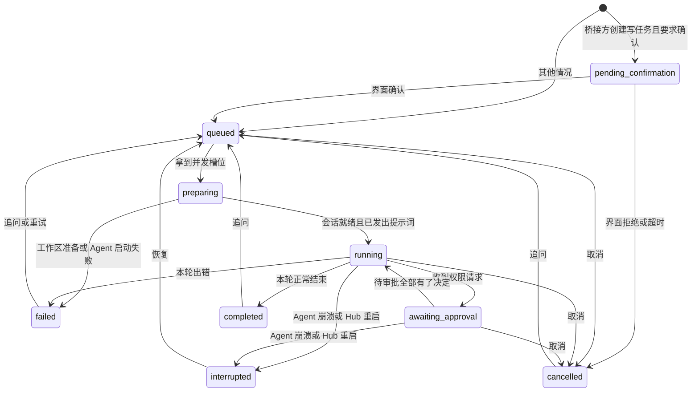
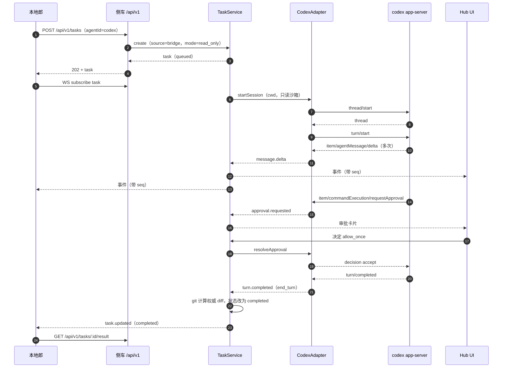
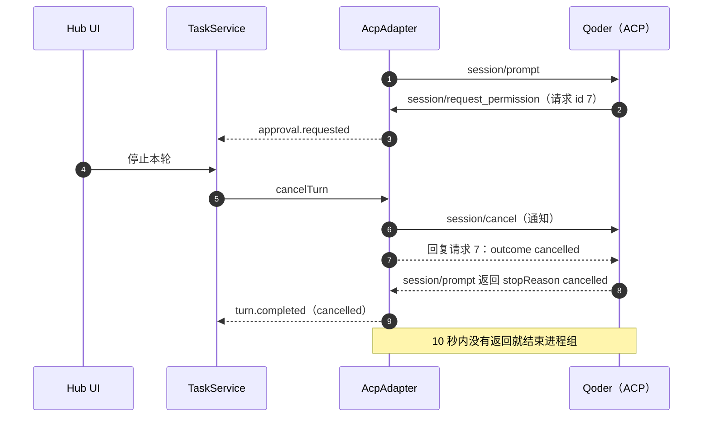
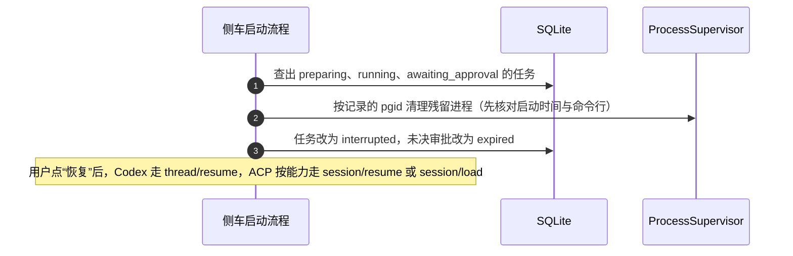

# 架构设计

> 上级文档：[../README.md](../README.md)。本文讲侧车内部怎么分层、任务怎么流转、事件怎么落库和推送、工作区与 diff 怎么算。Tauri 壳见 [desktop-shell.md](desktop-shell.md)，各协议细节见适配器分册。

## 1. 进程模型

| 进程                              | 由谁启动                         | 生命周期                                                         | 崩溃影响与处理                                                                            |
| --------------------------------- | -------------------------------- | ---------------------------------------------------------------- | ----------------------------------------------------------------------------------------- |
| Tauri 主进程（Rust）              | 用户打开应用                     | 应用退出为止；关窗口只隐藏到菜单栏                               | 侧车随之被结束；下次启动走恢复流程（§9）。                                                |
| Hub UI 子 WebView（label `hub`）  | Tauri 主进程                     | 与主窗口相同                                                     | 重新加载页面即可，状态全在侧车。                                                          |
| Bot 子 WebView（label `bot`）     | Tauri 主进程                     | 与主窗口相同；可单独刷新                                         | 只影响左栏显示，不影响任务。                                                              |
| Node 侧车 `@agent-hub/server`     | Tauri 主进程（开发期也可手动起） | 应用退出时优雅停机                                               | Tauri 按退避策略自动重启（见 desktop-shell.md §4）；运行中的任务标为 `interrupted`。      |
| `codex app-server`                | CodexAdapter                     | 侧车内**共享一个**常驻进程，多个任务各自一个 thread              | 所有 Codex 任务标为 `interrupted`；适配器退避重启进程，任务可用 `thread/resume` 恢复。    |
| ACP Agent（如 `qodercli --acp`）  | AcpAdapter                       | 默认**每个任务一个**进程（独立进程组），任务结束或闲置超时后结束 | 只影响该任务，标为 `interrupted`；Agent 支持 `session/load` / `session/resume` 时可恢复。 |
| Chrome（Playwright 持久化上下文） | WebAgentAdapter                  | 每个网页驱动一个浏览器进程，空闲 10 分钟后关闭                   | 该驱动下的任务进入“重新连接”，远端会话通常仍在，重连后继续观察。                          |
| 本地郎                            | 桥接方自己                       | 与 Hub 无关                                                      | 断线后用 `afterSeq` 续订事件，不丢事件（见 local-api.md §6）。                            |

为什么 Codex 共享进程、ACP 每任务一个进程：

- Codex app-server 本身按 thread 多路复用，ChatGPT 桌面应用也是一个进程跑多个会话；共享进程省去每个任务约 1 秒的冷启动，`model/list` 等全局调用也有现成连接。
- ACP Agent 实现参差不齐，Qoder 关闭 stdin 后进程不会退出（见 [adapter-acp.md](adapter-acp.md) §5），每任务一个进程组最容易做到“取消就一定结束干净”。配置项 `processModel: "shared"` 留给多会话稳定的 Agent 以后切换。

## 2. 侧车模块与职责



| 模块                | 职责                                                                                                                                                                                      | 不做什么                                            |
| ------------------- | ----------------------------------------------------------------------------------------------------------------------------------------------------------------------------------------- | --------------------------------------------------- |
| `ConfigModule`      | 读取并用 zod 校验 `config.json`（schema 在 `@agent-hub/contract`）；设置页保存后热更新 Agent、仓库、Bot 面板配置；端口变更需重启。                                                        | 不保存任何 token 明文以外的密钥（见 security.md）。 |
| `AuthModule`        | 校验 `Authorization: Bearer`；区分 UI 会话与桥接 token；scope 检查；Host / Origin 白名单；WS 握手鉴权。                                                                                   | —                                                   |
| `TrpcModule`        | Hub UI 的 `appRouter`：查询、变更、订阅（订阅走 tRPC WebSocket）。                                                                                                                        | 不含业务逻辑，全部调用核心服务。                    |
| `BridgeApiModule`   | `/api/v1` REST controllers 与 WS gateway；请求体用 contract 里的 zod schema 校验；幂等键。                                                                                                | 同上。                                              |
| `TaskModule`        | 任务与轮的创建、状态机迁移、排队与并发控制、取消、追问、恢复、归档。**唯一**能改任务状态的地方。                                                                                          | 不直接解析任何 Agent 协议。                         |
| `EventModule`       | 给事件分配每任务递增的 `seq`；合并高频增量；先落库再广播；按 `afterSeq` 回放；原始协议帧写 transcript 文件。                                                                              | —                                                   |
| `ApprovalModule`    | 审批落库、广播、决定、超时、取消时批量收尾；把决定交回对应适配器。                                                                                                                        | 不自动批准（策略层留扩展点，默认全部给人）。        |
| `WorkspaceModule`   | 仓库注册与体检；worktree 创建 / 清理；轮前后快照；用 git 算权威 diff；“应用到本地分支”。                                                                                                  | 不推送（推送只经 GitGuard）。                       |
| `GitGuardModule`    | 生成 Agent 子进程的 git 环境变量；Hub 自身推送的白名单检查；hooks 目录；轮前后远端跟踪分支审计。                                                                                          | —                                                   |
| `AdapterRegistry`   | 按配置实例化适配器；健康检查；能力与模型列表缓存。                                                                                                                                        | —                                                   |
| `ProcessSupervisor` | 用登录 shell 的 PATH 定位可执行文件；清洗环境变量；以独立进程组启动；记录 pid / pgid；SIGTERM → SIGKILL 升级；孤儿进程清理。                                                              | —                                                   |
| `JsonRpcConnection` | 换行分隔 JSON 的读写、请求表与超时、双向请求（Agent 也会向 Hub 发请求）、非 JSON 行容错。给 Codex 用（线上格式省略 `"jsonrpc":"2.0"`）。ACP 用官方 SDK 自带的连接，见 adapter-acp.md §2。 | —                                                   |

依赖方向只能从上往下：接口层 → 核心 → 适配器 / 存储。**适配器不访问数据库**，只通过 `AgentEventSink` 回调把事件交给核心（接口见 [adapter-interface.md](adapter-interface.md)）。

## 3. 任务生命周期

### 3.1 状态机



| 状态                   | 含义                                                                                                              | 允许的操作                            |
| ---------------------- | ----------------------------------------------------------------------------------------------------------------- | ------------------------------------- |
| `pending_confirmation` | 桥接方创建的写任务，等人在界面确认（`security.bridgeWriteRequiresConfirmation`，默认开）；24 小时未确认自动取消。 | 确认、拒绝、取消                      |
| `queued`               | 等并发槽位。                                                                                                      | 取消                                  |
| `preparing`            | 建工作区、跑 `worktreeSetup`、启动或复用 Agent 进程、建立原生会话。                                               | 取消（会中止准备并清理）              |
| `running`              | 本轮进行中。                                                                                                      | 停止本轮、强制结束                    |
| `awaiting_approval`    | 本轮有未决审批，Agent 在等。                                                                                      | 审批、停止本轮、强制结束              |
| `completed`            | 最近一轮正常结束，原生会话可继续。                                                                                | 追问、归档、应用到本地分支            |
| `failed`               | 最近一轮或准备阶段出错，`lastError` 有错误码。                                                                    | 追问 / 重试（原生会话可恢复时）、归档 |
| `cancelled`            | 被取消。                                                                                                          | 追问（原生会话可恢复时）、归档        |
| `interrupted`          | Agent 进程或 Hub 意外退出。                                                                                       | 恢复、归档                            |

规则：

- 状态迁移只能经 `TaskService.transition(taskId, event)`，非法迁移抛 `ILLEGAL_TRANSITION`（单测按上表穷举）。
- 每次迁移在同一个事务里写 `Task.status` 并追加一条 `task.status_changed` 事件，保证“列表状态”和“事件流”一致。
- 归档是独立的 `archivedAt` 字段，不是状态；运行中的任务不能归档。
- 同一任务同一时刻最多一个进行中的轮；`running` / `awaiting_approval` 时追问返回 `TASK_BUSY`。

### 3.2 轮

- 第一轮的提示词来自创建请求；之后每次追问新建一轮，`index` 递增。
- 轮的结束原因归一为 `end_turn | cancelled | max_tokens | max_turn_requests | refusal | error`（映射见各适配器分册）。
- 每轮结束时由 `DiffService` 计算一次权威 diff 快照，并把最后一条 Agent 消息记为该轮摘要。

### 3.3 取消

| 动作                | 实现                                                                                                                                                                                                           |
| ------------------- | -------------------------------------------------------------------------------------------------------------------------------------------------------------------------------------------------------------- |
| 停止本轮（默认）    | 适配器协议级中断：Codex `turn/interrupt`，ACP `session/cancel` 通知，网页驱动点“停止”。所有未决审批按协议回复“已取消”（ACP 必须回 `outcome: cancelled`），审批记录标 `cancelled`。等待最多 10 秒拿到本轮结束。 |
| 超时或“强制结束”    | 结束该任务的进程组（ACP），或对共享的 Codex 进程只中断该 thread、不杀进程；本轮记 `cancelled`，任务状态 `cancelled`。                                                                                          |
| 排队中 / 准备中取消 | 直接迁移到 `cancelled`；准备中已创建的 worktree 保留（便于排查），归档时一并清理。                                                                                                                             |

### 3.4 追问与恢复

- 追问：`completed` / `failed` / `cancelled` 状态下创建新轮。原生会话还活着就直接发；不在内存里（进程已结束）就按能力恢复：Codex `thread/resume`，ACP 依次尝试 `session/resume`、`session/load`，都不支持则返回 `TASK_NOT_RESUMABLE`。
- 恢复：`interrupted` 状态下用户点“恢复”，流程同上，但不新建轮，而是新建一轮“继续”，提示词默认是“上次执行被中断，请从中断处继续。”（可编辑）。

## 4. 调度与并发

| 限制               | 默认值 | 配置项                         | 说明                                                                                                           |
| ------------------ | ------ | ------------------------------ | -------------------------------------------------------------------------------------------------------------- |
| 全局同时运行任务数 | 3      | `scheduler.maxConcurrentTasks` | `preparing` / `running` / `awaiting_approval` 都占槽位。                                                       |
| 每个 Agent 配置    | 见配置 | `agents[].maxConcurrent`       | 建议 Codex 2、Qoder 1、AoneD 1。                                                                               |
| 排队上限           | 50     | `scheduler.maxQueued`          | 超出返回 `QUEUE_FULL`。                                                                                        |
| 同一目录的写互斥   | —      | —                              | `in_place` 写任务独占该仓库目录；同目录的只读任务可以并行，但不能和 `in_place` 写任务并行。worktree 天然隔离。 |

- 排队按创建时间先进先出；等待审批的任务**照样占槽位**（Agent 进程还在），避免审批回来时没有槽位。
- 调度器只在状态迁移和配置变更时重新计算，不轮询。

## 5. 事件管线

1. 适配器调用 `sink.emit(event)`，事件类型见 [adapter-interface.md](adapter-interface.md) §3。
2. `EventStore` 给事件分配 `seq`（每任务从 1 递增），与 `Task.lastEventSeq` 在同一事务里写入。
3. **高频增量合并**：`message.delta`、`reasoning.delta`、`tool.output` 按 `(taskId, itemId)` 缓冲，满 200 ms、16 KB 或遇到该 item 的结束事件时合并成一条落库。界面看到的流式效果不受影响，库里的行数可控。
4. **先落库，再广播**：订阅者收到的每条事件都能用 `afterSeq` 重新取到，断线续订不会出现空洞。
5. 单个工具调用的输出落库上限 1 MB，超出部分只写 transcript 文件，事件里带 `truncated: true`。
6. 原始协议帧（脱敏后）逐行写 `transcripts/<taskId>.ndjson`，用于排障和录制测试夹具（见 testing.md §3）。
7. 广播用进程内 RxJS `Subject`（NestJS 已依赖 rxjs）；tRPC 订阅和桥接 WS 都从这里取。

## 6. 工作区与 diff

### 6.1 工作区模式

| 任务类型          | 默认工作区      | 说明                                                                                                                           |
| ----------------- | --------------- | ------------------------------------------------------------------------------------------------------------------------------ |
| 本地 Agent · 只读 | `in_place`      | 直接在原仓库目录运行；轮前后做快照比对，发现改动就告警（见 §6.3）。                                                            |
| 本地 Agent · 可写 | `worktree`      | 新建 worktree，路径 `<AGENT_HUB_HOME>/worktrees/<repoId>/<taskShortId>`，分支 `agent-hub/<taskShortId>`。可显式选 `in_place`。 |
| 网页 Agent        | `remote_branch` | 推送 `agent-hub/<taskShortId>` 到内网 `internal`，见 [web-agent.md](web-agent.md)。                                            |

worktree 放在仓库外面，避免出现在用户的 `git status` 里、被 Vite / tsc 的监听扫到。

**worktree 没有 `node_modules`**：仓库配置可设 `worktreeSetup`（例如 `["pnpm", "install", "--offline", "--frozen-lockfile"]`），在 Agent 启动前执行，超时 10 分钟；失败记 `WORKSPACE_SETUP_FAILED`，任务 `failed`，worktree 保留供排查。

基线：创建任务时可指定 `baseRef`（默认是仓库当前 `HEAD`），解析成 commit SHA 记为 `baseCommit`，之后所有 diff 都相对它计算。

### 6.2 diff 计算

- **实时 diff**：来自 Agent 自己的报告（Codex `turn/diff/updated`，ACP 工具调用里的 `diff` 内容），界面上标“Agent 报告”。
- **权威 diff**：每轮结束时用 git 计算，界面与 API 默认展示它。为了把未跟踪文件也算进去、又**不碰用户的暂存区**，用临时索引：

  ```bash
  export GIT_INDEX_FILE="$(mktemp)"        # 临时索引，结束后删除
  git read-tree HEAD
  git add -A                               # 只写临时索引
  git diff --cached --binary --find-renames <baseCommit>
  git diff --cached --numstat --find-renames <baseCommit>
  ```

- 补丁按文件存到 `diffs/<taskId>/<turnIndex>.patch`，库里只存统计与路径。补丁超过 5 MB 时 API 只返回统计并标 `truncated`。
- 二进制文件只记“二进制变更”，不内联内容。

### 6.3 只读任务的越界检测

ACP Agent 没有 Hub 能控制的沙箱，`in_place` 只读任务前后各做一次快照（`HEAD` + `git status --porcelain=v2 -z` + 未跟踪文件的 mtime 与大小）。不一致时：

1. 追加 `notice`（级别 `warning`）事件“只读任务修改了工作区”，任务打上 `readOnlyViolation` 标记，界面红色提示；
2. **不自动回滚**（避免误删用户自己同时做的改动），由人决定。

### 6.4 应用到本地分支

只对 `worktree` 和 `remote_branch` 任务提供：

1. worktree 里有未提交改动时，Hub 以用户本机的 git 身份提交到 `agent-hub/<taskShortId>`，提交信息为任务标题；
2. 用户选“合并到当前分支”：要求原仓库工作区干净，执行 `git merge --no-ff agent-hub/<taskShortId>`；有冲突则 `git merge --abort` 并提示手动处理；
3. 或“只保留分支”（默认），之后用户自己处理；
4. **任何情况下都不推送。**

归档 30 天后自动 `git worktree remove` 清理 worktree（分支保留，由用户决定是否删除）。

## 7. 关键时序

### 7.1 本地郎派发 Codex 只读任务（含一次审批）



### 7.2 ACP 任务在审批未决时被取消



### 7.3 侧车重启后的恢复



## 8. 配置

配置文件 `<AGENT_HUB_HOME>/config.json`（默认 `~/Library/Application Support/AgentHub/config.json`），schema 定义在 `@agent-hub/contract`，首次启动写入默认值。示例（注释仅为说明，实际文件是纯 JSON）：

```jsonc
{
  "server": { "port": 47821 },
  "scheduler": { "maxConcurrentTasks": 3, "maxQueued": 50 },
  "agents": [
    {
      "id": "codex",
      "kind": "codex",
      "command": "codex",
      "args": ["app-server"],
      "maxConcurrent": 2,
    },
    {
      "id": "qoder",
      "kind": "acp",
      "profile": "qoder",
      "command": "qodercli",
      "args": ["--acp"],
      "maxConcurrent": 1,
    },
    {
      "id": "aoned",
      "kind": "web",
      "driver": "aoned",
      "baseUrl": "https://<AoneD 内网地址>",
      "enabled": false,
    },
  ],
  "repos": [
    {
      "id": "multi-apps",
      "path": "~/workspace/multi-apps",
      "pushRemote": "internal",
      "worktreeSetup": ["pnpm", "install", "--offline", "--frozen-lockfile"],
    },
  ],
  "security": {
    "allowedPushRemotes": ["internal"],
    "allowedPushHosts": ["<内网 git 域名>"],
    "blockedPushHosts": ["github.com"],
    "allowedPushProtocols": ["ssh", "https"],
    "bridgeWriteRequiresConfirmation": true,
    "maxBridgeDiffBytes": 524288,
    "bridgeSummaryOnly": false,
  },
  "bot": {
    "enabled": true,
    "url": "<本地郎对话页 URL>",
    "allowedOrigins": ["<本地郎页面 origin>"],
  },
  "retention": { "eventDays": 30, "worktreeDaysAfterArchive": 30 },
}
```

- `agents[].command` 可以写绝对路径；写命令名时按登录 shell 的 PATH 解析（见 desktop-shell.md §4.3）。
- `repos[].path` 支持 `~`；注册时体检（是否 git 仓库、`origin` 的 push URL 是否已禁用、`pushRemote` 是否存在），结果在设置页展示。
- 配置里**不放任何 token**；桥接 token 单独存（见 security.md §4.4）。

## 9. 启动与停机

启动顺序（任一步失败都在 stdout 打印 `{"event":"fatal",...}` 并非零退出，Tauri 展示错误页）：

1. 解析 `AGENT_HUB_HOME`，创建目录（权限 `0700`）；
2. 读取并校验配置；
3. 打开 SQLite（WAL 模式），执行 `prisma migrate deploy`；
4. 恢复流程（§7.3）；
5. 初始化适配器（不阻塞启动，健康检查异步进行，界面显示“检测中”）；
6. 只在 `127.0.0.1:<port>` 上监听；端口被占用直接失败，不换端口（CSP 与桥接方都依赖固定端口）；
7. stdout 打印一行 `{"event":"ready","port":47821,"version":"x.y.z"}`。

停机（收到 SIGTERM 或 SIGINT，做法与 `apps/cardhub/api` 的优雅停机一致）：

1. 停止接受新任务和新连接；
2. 中断所有进行中的轮，未决审批回复“已取消”；
3. 最多等 8 秒，然后结束全部 Agent 进程组、关闭浏览器；
4. 进行中的任务记为 `interrupted`，刷盘，`exit 0`。

## 10. 日志与诊断

- 侧车日志：`logs/server.log`，JSON 行，按 10 MB 轮转保留 5 份。Tauri 壳日志：`logs/desktop.log`。
- **日志里不出现**：token、Cookie、提示词全文（只记长度与 SHA-256 前 8 位）、带 userinfo 的 git URL（统一去掉 `user:pass@`，见 security.md §3.4）。
- 健康检查：`GET /api/v1/health` 返回侧车版本与每个 Agent 的状态（可执行文件路径、版本、登录状态能否探测）。
- 设置页提供“导出诊断包”：脱敏后的日志、配置（不含 token）、版本信息，打成 zip 存到本机，由用户自己决定是否发给别人。
