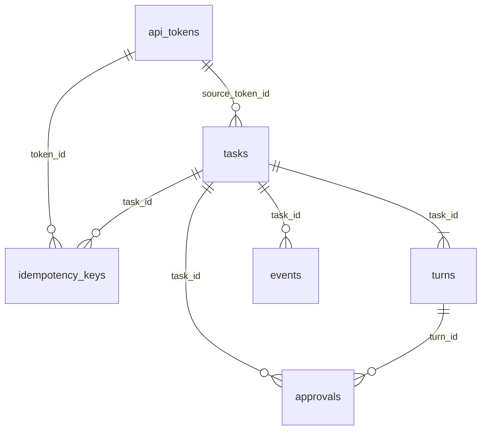

# 数据模型与持久化

> 上级文档：[../README.md](../README.md)。数据只存本机：用户设置在 `config.json`（schema 见 [architecture.md](architecture.md) §8），运行数据在 SQLite 文件 `hub.db`，用 Node 内置的 `node:sqlite`（D13–D17）。本文的 DDL、`Db` 封装和迁移执行器都在 Node 22.13.0 与 22.23.4 上实际跑过，**原样复制**即可。

## 1. 数据目录

`AGENT_HUB_HOME`，默认 `~/Library/Application Support/AgentHub`（D18）。目录权限 `0700`，文件 `0600`。

```text
AgentHub/
├── config.json                     # 用户设置（architecture.md §8）
├── hub.db  hub.db-wal  hub.db-shm  # SQLite（WAL 模式）
├── hub.db.bak-<时间>-v<旧版本>      # 迁移前的自动备份，只留最近 3 份（§5）
├── server.lock                     # {"pid","port","startedAt"}，防止重复启动（architecture.md §10.2）
├── bridge-token                    # 默认桥接 token 明文，一行（D44，security.md §4）
├── logs/server-YYYY-MM-DD.log      # 侧车日志，JSON 行（architecture.md §11）
├── transcripts/<taskId>.ndjson     # 原始协议帧，脱敏；只在 diagnostics.recordTranscripts 打开时写（D14）
├── worktrees/<repoId>/<shortId>/   # 可写任务的 git worktree
└── guard/                          # GitGuard 生成，每次启动重写（security.md §3）
    ├── hooks/                      # 注入给 Agent 子进程的 core.hooksPath
    ├── askpass                     # 永远失败的 GIT_ASKPASS / SSH_ASKPASS 脚本
    ├── gh/                         # 空目录，作为 GH_CONFIG_DIR
    └── blocked.ndjson              # pre-push 钩子拦截记录，GitGuard 每轮结束后读取
```

路径集中在一个文件里，其他模块只从注入的 `HubPaths` 取路径：

```ts
// server/src/common/paths.ts
import { homedir } from 'node:os';
import { join, resolve } from 'node:path';

export interface HubPaths {
  home: string;
  config: string;
  db: string;
  lock: string;
  bridgeToken: string;
  logs: string;
  transcripts: string;
  worktrees: string;
  guard: string;
  hooks: string;
  askpass: string;
  ghConfig: string;
  guardLog: string;
}

export function resolvePaths(env: NodeJS.ProcessEnv = process.env): HubPaths {
  const home = env.AGENT_HUB_HOME
    ? resolve(env.AGENT_HUB_HOME)
    : join(homedir(), 'Library', 'Application Support', 'AgentHub');
  const guard = join(home, 'guard');
  return {
    home,
    config: join(home, 'config.json'),
    db: join(home, 'hub.db'),
    lock: join(home, 'server.lock'),
    bridgeToken: join(home, 'bridge-token'),
    logs: join(home, 'logs'),
    transcripts: join(home, 'transcripts'),
    worktrees: join(home, 'worktrees'),
    guard,
    hooks: join(guard, 'hooks'),
    askpass: join(guard, 'askpass'),
    ghConfig: join(guard, 'gh'),
    guardLog: join(guard, 'blocked.ndjson'),
  };
}
```

`main.ts` 调一次 `resolvePaths()`，把结果交给 Nest 的依赖注入（provider token `HUB_PATHS`）；测试里把 `AGENT_HUB_HOME` 指向 `mkdtemp` 出来的临时目录。

## 2. 存储约定

| 项目       | 约定                                                                                                                                                     |
| ---------- | -------------------------------------------------------------------------------------------------------------------------------------------------------- |
| 主键       | `crypto.randomUUID()`；任务另有 8 位十六进制的 `short_id`（UUID 去掉连字符的前 8 位，`UNIQUE` 冲突就重新生成，D19）。审计表用自增整数。                  |
| 时间       | `TEXT`，`new Date().toISOString()`（UTC，毫秒，带 `Z`），同一格式下字符串顺序就是时间顺序，可以直接比较和排序。                                          |
| 布尔       | `INTEGER` 0 / 1，带 `CHECK`。                                                                                                                            |
| JSON       | `TEXT`，带 `CHECK (json_valid(...))`；写入用 `JSON.stringify`，读出用 `JSON.parse`，读出时**不再**用 zod 校验（写入方都是侧车自己）。                    |
| 空值       | 列值 `NULL` ↔ DTO 字段 `null`。DTO 里不出现 `undefined`。                                                                                                |
| 枚举       | 只有三个状态列（`tasks.status`、`turns.status`、`approvals.status`）带 `CHECK`；其余枚举（类型、原因、决定）由 TS 类型约束，加取值时不需要重建表。       |
| 表模式     | 全部 `STRICT`：类型不符直接报错，不做隐式转换。`events` 与 `idempotency_keys` 另加 `WITHOUT ROWID`（主键就是聚簇键）。                                   |
| 外键       | `PRAGMA foreign_keys = ON`；删除任务时级联删除它的轮、事件、审批、幂等键。审计和子进程表不挂外键（删任务后审计要留着）。                                 |
| 连接       | 整个侧车**一个**连接（`Db` 单例）。`node:sqlite` 是同步 API，Node 单线程，所以同一时刻只有一条语句在执行；事务回调必须是同步函数（`Db.tx` 会检查）。     |

`node:sqlite` 参数绑定的实测行为（22.13 与 22.23 相同），写仓储代码时必须遵守：

| 情况                                         | 结果                                                         |
| -------------------------------------------- | ------------------------------------------------------------ |
| SQL 用 `:name`，参数对象用不带冒号的键 `name` | 正常。全项目统一这种写法，不用 `?` 位置参数。                |
| 参数对象里**多**一个 SQL 没用到的键          | 抛错 `Unknown named parameter 'x'`。                          |
| 参数对象里**少**一个 SQL 用到的键            | **不报错，静默绑定为 `NULL`**。所以参数对象必须逐键写全。     |
| 值是 `true` / `false` / `undefined`          | 抛错 `Provided value cannot be bound to SQLite parameter`。   |
| `get()` 没有匹配的行                         | 返回 `undefined`。                                           |
| 返回的行对象                                 | 原型为 `null` 的普通对象；整数列是 `number`。                |

## 3. 表结构

### 3.1 关系



`audit_log`、`processes` 独立，`task_id` 只是普通列。

### 3.2 DDL（迁移 1）

```ts
// server/src/db/schema.ts
export const MIGRATION_1 = `
CREATE TABLE api_tokens (
  id           TEXT PRIMARY KEY,
  name         TEXT NOT NULL,
  token_hash   TEXT NOT NULL UNIQUE,
  token_prefix TEXT NOT NULL,
  scopes       TEXT NOT NULL CHECK (json_valid(scopes) AND json_type(scopes) = 'array'),
  is_default   INTEGER NOT NULL DEFAULT 0 CHECK (is_default IN (0, 1)),
  created_at   TEXT NOT NULL,
  last_used_at TEXT,
  revoked_at   TEXT
) STRICT;

CREATE TABLE tasks (
  id                  TEXT PRIMARY KEY,
  short_id            TEXT NOT NULL UNIQUE,
  title               TEXT NOT NULL,
  agent_id            TEXT NOT NULL,
  adapter_kind        TEXT NOT NULL,
  repo_id             TEXT NOT NULL,
  repo_path           TEXT NOT NULL,
  source              TEXT NOT NULL,
  source_token_id     TEXT REFERENCES api_tokens (id),
  external_ref        TEXT,
  mode                TEXT NOT NULL,
  workspace_kind      TEXT NOT NULL,
  workspace_path      TEXT,
  branch              TEXT,
  base_ref            TEXT,
  base_commit         TEXT,
  base_tree           TEXT,
  model               TEXT,
  reasoning_effort    TEXT,
  user_visible        INTEGER NOT NULL CHECK (user_visible IN (0, 1)),
  native_session_id   TEXT,
  remote_url          TEXT,
  status              TEXT NOT NULL CHECK (status IN ('queued', 'preparing', 'running', 'completed', 'failed', 'cancelled', 'interrupted')),
  pending_approvals   INTEGER NOT NULL DEFAULT 0 CHECK (pending_approvals >= 0),
  turn_count          INTEGER NOT NULL DEFAULT 0,
  last_event_seq      INTEGER NOT NULL DEFAULT 0,
  last_error          TEXT CHECK (last_error IS NULL OR json_valid(last_error)),
  read_only_violation INTEGER NOT NULL DEFAULT 0 CHECK (read_only_violation IN (0, 1)),
  created_at          TEXT NOT NULL,
  updated_at          TEXT NOT NULL,
  started_at          TEXT,
  ended_at            TEXT,
  archived_at         TEXT,
  worktree_removed_at TEXT
) STRICT;
CREATE INDEX tasks_by_created ON tasks (created_at DESC, id DESC);
CREATE INDEX tasks_by_status ON tasks (status);
CREATE INDEX tasks_by_external_ref ON tasks (external_ref) WHERE external_ref IS NOT NULL;

CREATE TABLE turns (
  id               TEXT PRIMARY KEY,
  task_id          TEXT NOT NULL REFERENCES tasks (id) ON DELETE CASCADE,
  idx              INTEGER NOT NULL CHECK (idx >= 1),
  prompt           TEXT NOT NULL,
  model            TEXT,
  reasoning_effort TEXT,
  status           TEXT NOT NULL CHECK (status IN ('pending', 'running', 'completed', 'failed', 'cancelled', 'interrupted')),
  stop_reason      TEXT,
  error            TEXT CHECK (error IS NULL OR json_valid(error)),
  native_turn_id   TEXT,
  before_tree      TEXT,
  after_tree       TEXT,
  turn_patch       TEXT,
  task_patch       TEXT,
  turn_stats       TEXT CHECK (turn_stats IS NULL OR json_valid(turn_stats)),
  task_stats       TEXT CHECK (task_stats IS NULL OR json_valid(task_stats)),
  patch_truncated  INTEGER NOT NULL DEFAULT 0 CHECK (patch_truncated IN (0, 1)),
  usage            TEXT CHECK (usage IS NULL OR json_valid(usage)),
  final_message    TEXT,
  created_at       TEXT NOT NULL,
  started_at       TEXT,
  ended_at         TEXT,
  UNIQUE (task_id, idx)
) STRICT;

CREATE TABLE events (
  task_id  TEXT NOT NULL REFERENCES tasks (id) ON DELETE CASCADE,
  seq      INTEGER NOT NULL,
  turn_id  TEXT,
  type     TEXT NOT NULL,
  is_delta INTEGER NOT NULL CHECK (is_delta IN (0, 1)),
  payload  TEXT NOT NULL CHECK (json_valid(payload)),
  ts       TEXT NOT NULL,
  PRIMARY KEY (task_id, seq)
) STRICT, WITHOUT ROWID;

CREATE TABLE approvals (
  id                  TEXT PRIMARY KEY,
  task_id             TEXT NOT NULL REFERENCES tasks (id) ON DELETE CASCADE,
  turn_id             TEXT NOT NULL REFERENCES turns (id) ON DELETE CASCADE,
  kind                TEXT NOT NULL,
  title               TEXT NOT NULL,
  request             TEXT NOT NULL CHECK (json_valid(request)),
  options             TEXT NOT NULL CHECK (json_valid(options) AND json_type(options) = 'array'),
  status              TEXT NOT NULL CHECK (status IN ('pending', 'approved', 'rejected', 'expired', 'withdrawn')),
  decision            TEXT,
  decided_by          TEXT,
  decided_by_token_id TEXT,
  note                TEXT,
  created_at          TEXT NOT NULL,
  expires_at          TEXT NOT NULL,
  resolved_at         TEXT
) STRICT;
CREATE INDEX approvals_by_status ON approvals (status, created_at);
CREATE INDEX approvals_by_task ON approvals (task_id, created_at);

CREATE TABLE idempotency_keys (
  token_id     TEXT NOT NULL REFERENCES api_tokens (id) ON DELETE CASCADE,
  key          TEXT NOT NULL,
  request_hash TEXT NOT NULL,
  task_id      TEXT NOT NULL REFERENCES tasks (id) ON DELETE CASCADE,
  turn_id      TEXT REFERENCES turns (id) ON DELETE CASCADE,
  created_at   TEXT NOT NULL,
  PRIMARY KEY (token_id, key)
) STRICT, WITHOUT ROWID;

CREATE TABLE audit_log (
  id      INTEGER PRIMARY KEY,
  ts      TEXT NOT NULL,
  actor   TEXT NOT NULL,
  action  TEXT NOT NULL,
  task_id TEXT,
  detail  TEXT CHECK (detail IS NULL OR json_valid(detail))
) STRICT;
CREATE INDEX audit_by_ts ON audit_log (ts);

CREATE TABLE processes (
  pid        INTEGER PRIMARY KEY,
  pgid       INTEGER NOT NULL,
  label      TEXT NOT NULL,
  command    TEXT NOT NULL,
  task_id    TEXT,
  started_at TEXT NOT NULL
) STRICT;
`;
```

### 3.3 列说明

只列含义不直观的列；DTO 字段名是列名的 camelCase（例外见 §4.1）。

**`tasks`**

| 列                    | 含义                                                                                                                                                      |
| --------------------- | --------------------------------------------------------------------------------------------------------------------------------------------------------- |
| `adapter_kind`        | `codex` / `acp` / `web`。冗余存一份：配置里删掉某个 Agent 后，历史任务仍知道它是哪类。                                                                    |
| `repo_path`           | 创建时仓库路径（`~` 已展开）的快照；仓库后来从配置里删掉也能显示。                                                                                        |
| `source`              | `ui` / `bridge`。                                                                                                                                         |
| `source_token_id`     | 桥接方创建时是它的 token id；用于“只能管理自己创建的任务”（[local-api.md](local-api.md) §2.3）。                                                          |
| `external_ref`        | 桥接方自带的关联标识（例如对话 id），最长 200 字符，原样返回，可按它筛选。                                                                                |
| `mode`                | `read_only` / `write`。                                                                                                                                   |
| `workspace_kind`      | `in_place` / `worktree` / `remote_branch`。                                                                                                               |
| `workspace_path`      | Agent 的工作目录。`in_place` = 仓库路径；`worktree` 在第一轮准备完成后写入；`remote_branch` 为 `NULL`。                                                   |
| `branch`              | `agent-hub/<shortId>`；`in_place` 为 `NULL`。                                                                                                             |
| `base_ref`            | 用户或桥接方指定的基线原文（例如 `main`）；`NULL` = 当前 `HEAD`。                                                                                         |
| `base_commit`         | 解析后的基线提交。                                                                                                                                        |
| `base_tree`           | 第一轮开始前的树快照（[architecture.md](architecture.md) §7.2），整个任务 diff 的起点。同时写 `refs/agent-hub/base/<shortId>` 指向它，防止被 `git gc` 回收。 |
| `model`               | 最近一轮使用的模型；`NULL` = Agent 默认。`reasoning_effort` 同理。                                                                                        |
| `native_session_id`   | Codex 的 thread id 或 ACP 的 session id；追问恢复用。                                                                                                     |
| `remote_url`          | 网页 Agent 的会话链接（人在 Hub 里粘贴，[web-agent.md](web-agent.md) §5）。                                                                               |
| `pending_approvals`   | 当前 `pending` 的审批数；与审批的插入、结束在同一事务里增减。                                                                                             |
| `turn_count`          | 已创建的轮数（含 `pending`）。                                                                                                                            |
| `last_event_seq`      | 已分配的最大事件序号（§4.3）。                                                                                                                            |
| `last_error`          | 最近一次失败的 `AgentError` JSON；任务回到 `queued` 时清空。                                                                                              |
| `started_at`          | 第一次进入 `preparing` 的时间。                                                                                                                           |
| `ended_at`            | 最近一次进入终态的时间；保留策略以它为准。                                                                                                                |
| `worktree_removed_at` | worktree 被保留策略移除的时间；之后追问返回 `WORKSPACE_REMOVED`（[local-api.md](local-api.md) §5.4），应用改动只看分支上已有的提交。                      |

**`turns`**

| 列                            | 含义                                                                                                                  |
| ----------------------------- | --------------------------------------------------------------------------------------------------------------------- |
| `idx`                         | 从 1 开始，DTO 字段名 `index`。                                                                                       |
| `model` / `reasoning_effort`  | 本轮请求时指定的值；`NULL` = 沿用任务当时的设置。                                                                     |
| `stop_reason`                 | `end_turn` / `max_tokens` / `max_turn_requests` / `refusal` / `cancelled` / `error`（[architecture.md](architecture.md) §3.2）。 |
| `native_turn_id`              | Codex 的 turn id；ACP 没有（`NULL`）。                                                                                |
| `before_tree` / `after_tree`  | 轮前、轮后树快照。                                                                                                    |
| `turn_patch` / `task_patch`   | 本轮补丁（`before → after`）与截至本轮的任务补丁（`base → after`）；超过 5 MB 时为 `NULL` 且 `patch_truncated = 1`。 |
| `turn_stats` / `task_stats`   | `DiffStats` JSON，即使补丁被截断也有。                                                                                |
| `usage`                       | `UsageInfo` JSON，取本轮最后一次 `usage.updated`。                                                                    |
| `final_message`               | 本轮最后一条完整的 Agent 消息（`message.completed`）。                                                                |

**`events`**：`type` 是事件的 `type` 字段（如 `message.delta`、`task.status`），`is_delta` 对三种增量事件为 1，`payload` 是事件对象本身（含 `type`），`turn_id` 是事件所属的轮（任务级事件为 `NULL`）。

**`approvals`**：`request` 是 `{ command?, cwd?, paths?, reason?, detail? }`，`options` 是可选决定数组（`ApprovalDecision[]`），`decided_by` 为 `ui` / `bridge` / `system`（超时、撤回、停机），`decided_by_token_id` 是桥接方审批时的 token id。

**`api_tokens`**：`token_hash` 是 token 明文的 SHA-256 十六进制，`token_prefix` 是明文前 12 个字符（`ahb_` + 8 位，界面识别用），`scopes` 是 scope 字符串数组，`is_default` 标记首次启动自动创建的那一个。吊销只写 `revoked_at`，不删行。

**`idempotency_keys`**：`request_hash` = SHA-256（`方法 路径\n规范化请求体`），`turn_id` 只在追问请求上有值（[local-api.md](local-api.md) §3.3）。

**`audit_log`**：`actor` 为 `ui`、`bridge:<tokenId>`、`system`；`action` 取值见 §7。

**`processes`**：Hub 启动的每个子进程（Agent、`worktreeSetup`）一行；`command` 只存可执行文件绝对路径（参数里可能有提示词，不存）；进程退出时删除该行。侧车启动时用它清理残留进程（[adapter-interface.md](adapter-interface.md) §8）。

### 3.4 `Db` 封装

```ts
// server/src/db/sqlite.ts
import { DatabaseSync, type StatementSync } from 'node:sqlite';

export type SqlValue = string | number | bigint | null | Uint8Array;
export type SqlParams = Record<string, SqlValue>;

/**
 * node:sqlite 的唯一入口。业务代码只用 run / get / all / tx，不直接接触 DatabaseSync。
 * SQL 里一律用 :name 命名参数；params 的键不带冒号；值只能是 SqlValue（布尔、undefined 不能绑定）。
 */
export class Db {
  private readonly conn: DatabaseSync;
  private readonly statements = new Map<string, StatementSync>();
  private inTx = false;

  constructor(readonly file: string) {
    this.conn = new DatabaseSync(file);
    this.conn.exec('PRAGMA journal_mode = WAL');
    this.conn.exec('PRAGMA synchronous = NORMAL');
    this.conn.exec('PRAGMA foreign_keys = ON');
    this.conn.exec('PRAGMA busy_timeout = 5000');
  }

  exec(sql: string): void {
    this.conn.exec(sql);
  }

  /** 返回受影响的行数。 */
  run(sql: string, params: SqlParams = {}): number {
    return Number(this.prepare(sql).run(params).changes);
  }

  get<T>(sql: string, params: SqlParams = {}): T | undefined {
    return this.prepare(sql).get(params) as T | undefined;
  }

  all<T>(sql: string, params: SqlParams = {}): T[] {
    return this.prepare(sql).all(params) as T[];
  }

  /** 同步事务。回调里不能 await；嵌套调用并入外层事务。 */
  tx<T>(fn: () => T): T {
    if (this.inTx) return fn();
    this.conn.exec('BEGIN IMMEDIATE');
    this.inTx = true;
    try {
      const result = fn();
      if (result instanceof Promise) throw new Error('Db.tx 的回调必须是同步函数');
      this.conn.exec('COMMIT');
      return result;
    } catch (err) {
      this.conn.exec('ROLLBACK');
      throw err;
    } finally {
      this.inTx = false;
    }
  }

  close(): void {
    this.statements.clear();
    this.conn.close();
  }

  private prepare(sql: string): StatementSync {
    let stmt = this.statements.get(sql);
    if (!stmt) {
      stmt = this.conn.prepare(sql);
      this.statements.set(sql, stmt);
    }
    return stmt;
  }
}

export const toBool = (v: number): boolean => v === 1;
export const fromBool = (v: boolean): number => (v ? 1 : 0);
export const toJson = (v: unknown): string | null => (v == null ? null : JSON.stringify(v));
export const fromJson = <T>(v: string | null): T | null => (v == null ? null : (JSON.parse(v) as T));
```

- `Db` 由 `DbModule` 以单例 provider 提供：`useFactory: (paths) => { const db = new Db(paths.db); migrate(db); return db; }`；侧车停机最后一步 `db.close()`。
- 测试用 `new Db(join(tmp, 'hub.db'))`，每个测试文件一个临时目录；不要用 `:memory:`（WAL 和备份逻辑要走真实文件）。
- `node:sqlite` 加载时会打印 `ExperimentalWarning`；所有启动命令带 `--disable-warning=ExperimentalWarning`（`start` 脚本、Rust 壳、jest 的 `NODE_OPTIONS`，见 [milestones.md](milestones.md) §2）。
- R11 的退路：要换 better-sqlite3 时只改这一个文件（API 一一对应：`new Database(file)`、`prepare().run/get/all`、`exec`）。

## 4. 读写函数（repositories）

### 4.1 文件与职责

`server/src/db/repositories/` 下每张表一个文件，只导出普通函数，第一个参数是 `Db`。**只有这些文件里出现 SQL**。

| 文件                | 函数（签名省略 `db: Db` 参数）                                                                                                                                                                                         |
| ------------------- | ---------------------------------------------------------------------------------------------------------------------------------------------------------------------------------------------------------------------- |
| `tasks.repo.ts`     | `insertTask(row: NewTask)`、`getTask(idOrShortId): TaskDto \| undefined`、`listTasks(filter: TaskFilter): { items: TaskDto[]; nextCursor: string \| null }`、`updateTask(id, patch: TaskPatch)`、`nextEventSeq(id): number`、`listTasksByStatus(statuses): TaskDto[]`、`deleteTask(id)`、`getBaseTree(id): string \| null` |
| `turns.repo.ts`     | `insertTurn(row: NewTurn)`、`getTurn(id)`、`listTurns(taskId): TurnDto[]`、`getTurnByIndex(taskId, index)`、`getLatestTurn(taskId)`、`updateTurn(id, patch: TurnPatch)`、`getTurnPatch(turnId, scope: 'turn' \| 'task'): { patch: string \| null; truncated: boolean }`、`getTurnTrees(turnId): { beforeTree; afterTree }` |
| `events.repo.ts`    | `insertEvent(env: HubEventEnvelope)`、`listEvents(taskId, afterSeq, limit): HubEventEnvelope[]`、`hasEventsAfter(taskId, seq): boolean`                                                                                 |
| `approvals.repo.ts` | `insertApproval(row: NewApproval)`、`getApproval(id): ApprovalDto \| undefined`、`listApprovals(filter): ApprovalDto[]`、`resolveApproval(id, patch): boolean`（只改 `pending` 的行，返回是否改到）、`listPendingApprovals(): ApprovalDto[]` |
| `tokens.repo.ts`    | `insertToken(row)`、`findActiveTokenByHash(hash)`、`listTokens(): ApiTokenDto[]`、`getToken(id)`、`updateTokenScopes(id, scopes)`、`revokeToken(id)`、`touchToken(id, now)`、`hasActiveDefaultToken(): boolean`               |
| `idempotency.repo.ts` | `findIdempotencyKey(tokenId, key)`、`insertIdempotencyKey(row)`、`deleteIdempotencyKeysBefore(cutoff)`                                                                                                                |
| `audit.repo.ts`     | `appendAudit(entry: { actor; action; taskId?; detail? })`、`listAudit(filter: { before?: number; limit: number; action?: string }): AuditDto[]`、`deleteAuditBefore(cutoff)`                                             |
| `processes.repo.ts` | `insertProcess(row)`、`deleteProcess(pid)`、`listProcesses()`                                                                                                                                                          |

`NewTask`、`TaskPatch` 等输入类型写在各自的 repo 文件里；返回值直接是 contract 里的 DTO（[local-api.md](local-api.md) §4），**没有**中间的“实体类型”。

行 → DTO 的转换规则：列名 snake_case → 字段名 camelCase；布尔列用 `toBool`；JSON 列用 `fromJson`；例外只有三处：`turns.idx` → `index`、`tasks.workspace_kind` → `workspace`、`approvals.request` 展开成 `command` / `cwd` / `paths` / `reason` / `detail` 五个顶层字段。不对外的列（`tasks.base_tree`、`turns.before_tree` / `after_tree` / `turn_patch` / `task_patch`、`api_tokens.token_hash`）不进 DTO。

### 4.2 更新语句

`updateTask` / `updateTurn` 用同一个辅助函数拼 `UPDATE`。列名来自代码里的映射表，**从不**来自请求：

```ts
// server/src/db/repositories/update.ts
import type { SqlParams, SqlValue } from '../sqlite';

/** patch 的键是列名；值为 undefined 的键跳过，null 写 NULL。没有可写的列时返回 0。 */
export function updateById(
  run: (sql: string, params: SqlParams) => number,
  table: 'tasks' | 'turns',
  id: string,
  patch: Record<string, SqlValue | undefined>,
): number {
  const sets: string[] = [];
  const params: SqlParams = { id };
  for (const [column, value] of Object.entries(patch)) {
    if (value === undefined) continue;
    sets.push(`${column} = :${column}`);
    params[column] = value;
  }
  if (sets.length === 0) return 0;
  return run(`UPDATE ${table} SET ${sets.join(', ')} WHERE id = :id`, params);
}
```

`tasks.repo.ts` 里的 `updateTask(db, id, patch: TaskPatch)` 先把 camelCase 的 `TaskPatch` 映射成列名并编码（布尔 → 0/1、对象 → JSON），**总是**附带 `updated_at = now`，再调 `updateById((sql, p) => db.run(sql, p), 'tasks', id, columns)`。

### 4.3 关键语句

分配事件序号并落库（`EventStore` 在一个 `db.tx` 里调用，[architecture.md](architecture.md) §6）：

```sql
UPDATE tasks SET last_event_seq = last_event_seq + 1 WHERE id = :id RETURNING last_event_seq AS seq;
INSERT INTO events (task_id, seq, turn_id, type, is_delta, payload, ts)
VALUES (:taskId, :seq, :turnId, :type, :isDelta, :payload, :ts);
```

读事件（REST 分页与 WS 回放共用）：

```sql
SELECT task_id, seq, turn_id, payload, ts FROM events
WHERE task_id = :taskId AND seq > :afterSeq ORDER BY seq LIMIT :limit;
```

任务列表（按创建时间倒序，游标是上一页最后一行的 `created_at` 和 `id`，编码为 base64url 的 `"<createdAt>|<id>"`）：

```sql
SELECT * FROM tasks
WHERE (:cursorCreatedAt IS NULL OR (created_at, id) < (:cursorCreatedAt, :cursorId))
  AND (:archived = 1 AND archived_at IS NOT NULL OR :archived = 0 AND archived_at IS NULL)
  AND (:agentId IS NULL OR agent_id = :agentId)
  AND (:repoId IS NULL OR repo_id = :repoId)
  AND (:source IS NULL OR source = :source)
  AND (:externalRef IS NULL OR external_ref = :externalRef)
  AND (:statuses IS NULL OR status IN (SELECT value FROM json_each(:statuses)))
  AND (:q IS NULL OR instr(lower(title), lower(:q)) > 0)
ORDER BY created_at DESC, id DESC
LIMIT :limitPlusOne;
```

参数对象必须包含上面全部 10 个键（不需要的过滤条件传 `null`，`statuses` 传 JSON 数组字符串或 `null`，`archived` 传 0 或 1）。`limitPlusOne` = `limit + 1`，多取一行判断是否还有下一页。

按 id 或短号取任务（API 的 `:id` 两种都接受）：

```sql
SELECT * FROM tasks WHERE id = :key OR short_id = :key;
```

结束审批（只改还在 `pending` 的行；返回 `undefined` 说明已经被别人结束，调用方据此返回 `APPROVAL_NOT_PENDING`）：

```sql
UPDATE approvals
SET status = :status, decision = :decision, decided_by = :decidedBy,
    decided_by_token_id = :tokenId, note = :note, resolved_at = :now
WHERE id = :id AND status = 'pending'
RETURNING task_id;
UPDATE tasks SET pending_approvals = pending_approvals - 1, updated_at = :now WHERE id = :taskId;
```

第二条只在第一条返回了行时执行；两条在同一个事务里。

## 5. 迁移

```ts
// server/src/db/migrations.ts
import { existsSync, readdirSync, rmSync } from 'node:fs';
import { basename, dirname, join } from 'node:path';
import { MIGRATION_1 } from './schema';
import type { Db } from './sqlite';

/** 只追加，不修改已发布的条目。下标 i 的迁移把 user_version 从 i 升到 i + 1。 */
export const MIGRATIONS: readonly string[] = [MIGRATION_1];

export class MigrationError extends Error {}

export function migrate(db: Db): { from: number; to: number } {
  const from = db.get<{ user_version: number }>('PRAGMA user_version')!.user_version;
  const to = MIGRATIONS.length;
  if (from > to) {
    throw new MigrationError(`数据库版本 ${from} 比程序支持的 ${to} 新，请更新 Agent Hub`);
  }
  if (from === to) return { from, to };
  if (from > 0) backup(db, from);
  for (let v = from; v < to; v++) {
    try {
      db.tx(() => {
        db.exec(MIGRATIONS[v]!);
        db.exec(`PRAGMA user_version = ${v + 1}`);
      });
    } catch (err) {
      throw new MigrationError(`迁移到版本 ${v + 1} 失败：${(err as Error).message}`);
    }
  }
  return { from, to };
}

/** VACUUM INTO 在 WAL 模式下也能得到一致的副本；只保留最近 3 份。 */
function backup(db: Db, fromVersion: number): void {
  const dir = dirname(db.file);
  const name = basename(db.file);
  const stamp = new Date().toISOString().replace(/[:.]/g, '-');
  const target = join(dir, `${name}.bak-${stamp}-v${fromVersion}`);
  if (existsSync(target)) rmSync(target);
  db.exec(`VACUUM INTO '${target.replaceAll("'", "''")}'`);
  const old = readdirSync(dir)
    .filter((f) => f.startsWith(`${name}.bak-`))
    .sort()
    .reverse()
    .slice(3);
  for (const f of old) rmSync(join(dir, f));
}
```

- 每个迁移和它的 `PRAGMA user_version` 在同一个事务里（已实测：事务回滚时 `user_version` 也回滚），失败就整体不生效。
- `main.ts` 把 `MigrationError` 转成 fatal 行 `DB_MIGRATION_FAILED`，其他打开错误转成 `DB_OPEN_FAILED`（[architecture.md](architecture.md) §10.2）。
- 新库（`user_version = 0`）不备份；旧库升级前用 `VACUUM INTO` 备份。
- 以后加列用 `ALTER TABLE … ADD COLUMN`；要改三个状态列的 `CHECK` 时按 SQLite 官方的“新建表 → 拷数据 → 删旧表 → 改名”步骤，写在同一个迁移字符串里。
- 单测：空库迁移到最新；最新库再迁移是空操作；`user_version` 大于 `MIGRATIONS.length` 时抛 `MigrationError`；临时追加一个迁移后生成备份文件且最多 3 份。

## 6. 保留与清理

`Retention` 在侧车启动 1 分钟后执行一次，之后每 6 小时一次；每步独立 `try/catch`，失败只记日志。天数来自 `config.json` 的 `retention`（D17）。`cutoff(n)` = 当前时间减 n 天的 ISO 字符串。

| 顺序 | 数据                  | 规则                                                                                                                                                                         |
| ---- | --------------------- | ---------------------------------------------------------------------------------------------------------------------------------------------------------------------------- |
| 1    | 增量事件              | `DELETE FROM events WHERE is_delta = 1 AND task_id IN (SELECT id FROM tasks WHERE status IN ('completed','failed','cancelled','interrupted') AND ended_at < :cutoff)`，`cutoff(deltaEventDays)`。 |
| 2    | 幂等键                | `deleteIdempotencyKeysBefore(当前时间 − 24 小时)`。                                                                                                                          |
| 3    | 审计                  | `deleteAuditBefore(cutoff(auditDays))`。                                                                                                                                     |
| 4    | 归档任务的 worktree   | 选出 `workspace_kind = 'worktree' AND archived_at < cutoff(archivedWorktreeDays) AND worktree_removed_at IS NULL` 的任务，逐个 `git -C <repo> worktree remove --force <path>`（目录已不存在时 `git worktree prune`），写 `worktree_removed_at`。分支保留。 |
| 5    | transcript            | `transcripts/` 下修改时间早于 `cutoff(transcriptDays)` 的文件删除。                                                                                                          |
| 6    | 日志                  | `logs/` 下文件名日期早于 `cutoff(logDays)` 的 `server-*.log` 删除。                                                                                                          |
| 7    | 收尾                  | `PRAGMA optimize`；日志记一条 `{scope:"retention", deletedEvents, removedWorktrees, …}`。                                                                                    |

- 删除的页由 SQLite 复用，不做 `VACUUM`（文件不会变小，但不会继续增长）。
- 任务、轮、diff 补丁、非增量事件、审批一直保留，直到用户在界面上删除任务（[architecture.md](architecture.md) §3.1）。删除任务在一个事务里删 `tasks` 行（级联删其余），之后再删 worktree、本地分支 `agent-hub/<shortId>`、`refs/agent-hub/base/<shortId>` 和 transcript 文件，并写审计 `task.deleted`。

## 7. 审计动作

| `action`                     | 何时记录                                                                                     | `detail`                                      |
| ---------------------------- | -------------------------------------------------------------------------------------------- | --------------------------------------------- |
| `token.created`              | 新建桥接 token（含首次启动自动创建的默认 token）                                             | `{ tokenId, name, scopes }`                   |
| `token.scopes_changed`       | 修改 token 的 scope                                                                          | `{ tokenId, from, to }`                       |
| `token.revoked`              | 吊销 token                                                                                   | `{ tokenId }`                                 |
| `approval.decided`           | 人或桥接方做出审批决定                                                                       | `{ approvalId, decision, kind, title }`       |
| `approval.expired`           | 审批超时或停机时被系统结束                                                                   | `{ approvalId }`                              |
| `bridge.diff_read`           | 桥接 token 读取 diff（`GET /tasks/:id/diff`）                                                | `{ scope, format, bytes, truncated }`         |
| `task.deleted`               | 删除任务                                                                                     | `{ shortId, title }`                          |
| `git.push` / `git.fetch`     | Hub 自己对 `internal` 的推送、拉取（网页 Agent）                                             | `{ remote, branch, ok, error? }`              |
| `git.apply`                  | 应用到本地分支 / 合并                                                                        | `{ branch, commit?, merged }`                 |
| `repo.origin_push_disabled`  | 注册仓库时禁用 `origin` 的推送地址                                                           | `{ repoId }`                                  |
| `security.push_blocked`      | pre-push 钩子或 PushService 拦截了一次推送                                                   | `{ remote, url, reason }`（URL 去掉 userinfo） |
| `security.remote_ref_changed`| 轮后发现远端跟踪分支有变化（[security.md](security.md) §3.4）                                | `{ refs }`                                    |
| `security.read_only_violation` | 只读任务的工作区在本轮有改动                                                               | `{ turnIndex, filesChanged }`                 |
| `config.changed`             | 设置页保存配置                                                                               | `{ keys }`（只记改了哪些顶层键，不记值）      |
| `diagnostics.exported`       | 导出诊断包                                                                                   | `{ file }`                                    |

## 8. 备份与重置

- **备份**：退出 Agent Hub 后拷贝 `hub.db` 与 `config.json` 即可（退出时 WAL 已合并）。运行中要备份时用 `sqlite3 hub.db ".backup /path/to/copy.db"`。
- **重置**：退出 Agent Hub，删除整个 `AGENT_HUB_HOME` 目录；下次启动重新生成默认配置、空库和新的默认桥接 token（本地郎要重新读 `bridge-token`）。worktree 目录会随之删除，原仓库里残留的 worktree 记录用 `git worktree prune` 清理。
- 诊断包（[architecture.md](architecture.md) §11）**不含** `hub.db`。
