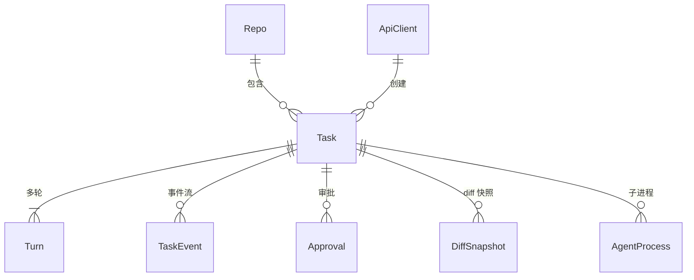

# 数据模型与持久化

> 上级文档：[../README.md](../README.md)。数据库是本机 SQLite，ORM 用 Prisma 6.19.x（与 `apps/cardhub/api` 同一版本线，**不要升 7**）。大块数据（补丁、原始协议帧、截图）存文件，库里只存路径与统计。

## 1. 原则

- **配置在文件，运行数据在库**：Agent 与仓库的定义来自 `config.json`；库里只存它们的 id 字符串。配置里删掉某个 Agent 后，历史任务仍能显示（界面灰显）。
- **不用 Prisma enum 和 `Json` 类型**：SQLite 下这两者的支持随版本变化，且 [handoff-context.md](../../../docs/Cardhub/handoff-context.md) §6.7 记录过 `JsonValue` 透出到前端类型的坑。状态类字段一律 `String`，取值由 `@agent-hub/contract` 的 zod schema 在服务层校验；JSON 内容存 `String` 列（列名以 `Json` 结尾），读写只经仓储层的 `parse` / `stringify` 函数。
- **主键用 ULID**（按时间有序，便于分页），包 `ulid`。任务另有 6 位小写 Crockford base32 的 `shortId`，用于分支名 `agent-hub/<shortId>` 和界面显示。
- 时间一律 UTC 存储，界面按本机时区显示。

## 2. 实体关系



## 3. Prisma schema（草案）

```prisma
generator client {
  provider      = "prisma-client-js"
  binaryTargets = ["native", "darwin-arm64"]
}

datasource db {
  provider = "sqlite"
  url      = env("AGENT_HUB_DATABASE_URL")
}

/// 已注册仓库的运行数据；定义以 config.json 为准
model Repo {
  id            String   @id
  path          String   @unique
  pushRemote    String?
  /// 最近一次体检结果（remote、push URL 是否禁用等）
  lastCheckJson String?
  updatedAt     DateTime @updatedAt
  tasks         Task[]
}

model Task {
  id                String    @id
  shortId           String    @unique
  title             String
  agentId           String
  /// codex | acp | web
  adapterKind       String
  model             String?
  reasoningEffort   String?
  agentMode         String?
  /// read_only | write
  mode              String
  /// in_place | worktree | remote_branch
  workspaceMode     String
  /// TaskStatus
  status            String
  /// ui | bridge
  source            String
  apiClientId       String?
  externalRef       String?
  externalUrl       String?
  repoId            String?
  cwd               String
  worktreePath      String?
  branch            String?
  baseCommit        String?
  nativeSessionId   String?
  userVisible       Boolean   @default(false)
  readOnlyViolation Boolean   @default(false)
  /// AgentError
  lastErrorJson     String?
  lastEventSeq      Int       @default(0)
  idempotencyKey    String?
  createdAt         DateTime  @default(now())
  startedAt         DateTime?
  finishedAt        DateTime?
  archivedAt        DateTime?
  updatedAt         DateTime  @updatedAt

  repo      Repo?          @relation(fields: [repoId], references: [id])
  apiClient ApiClient?     @relation(fields: [apiClientId], references: [id])
  turns     Turn[]
  events    TaskEvent[]
  approvals Approval[]
  diffs     DiffSnapshot[]
  processes AgentProcess[]

  @@unique([apiClientId, idempotencyKey])
  @@index([status])
  @@index([createdAt])
  @@index([agentId, createdAt])
}

model Turn {
  id           String    @id
  taskId       String
  index        Int
  prompt       String
  /// TurnStatus
  status       String
  /// StopReason
  stopReason   String?
  nativeTurnId String?
  finalMessage String?
  usageJson    String?
  errorJson    String?
  startedAt    DateTime  @default(now())
  completedAt  DateTime?

  task Task @relation(fields: [taskId], references: [id], onDelete: Cascade)

  @@unique([taskId, index])
}

model TaskEvent {
  taskId    String
  seq       Int
  turnId    String?
  type      String
  /// HubEvent 的 JSON
  payload   String
  createdAt DateTime @default(now())

  task Task @relation(fields: [taskId], references: [id], onDelete: Cascade)

  @@id([taskId, seq])
  @@index([type])
}

model Approval {
  id                String    @id
  taskId            String
  turnId            String
  /// ApprovalKind
  kind              String
  title             String
  /// ApprovalRequest 的 JSON
  requestJson       String
  /// pending | approved | rejected | cancelled | expired
  status            String
  /// ApprovalDecision
  decision          String?
  /// ui | bridge | policy | system
  decidedBy         String?
  decidedByClientId String?
  note              String?
  createdAt         DateTime  @default(now())
  decidedAt         DateTime?

  task Task @relation(fields: [taskId], references: [id], onDelete: Cascade)

  @@index([status])
  @@index([taskId])
}

model DiffSnapshot {
  id           String   @id
  taskId       String
  turnIndex    Int
  /// git | agent
  source       String
  baseCommit   String
  headCommit   String?
  filesChanged Int
  insertions   Int
  deletions    Int
  /// DiffFileStat[] 的 JSON
  filesJson    String
  /// 相对 AGENT_HUB_HOME 的路径
  patchPath    String
  patchBytes   Int
  truncated    Boolean  @default(false)
  createdAt    DateTime @default(now())

  task Task @relation(fields: [taskId], references: [id], onDelete: Cascade)

  @@index([taskId, turnIndex])
}

/// Hub 启动的子进程，用于重启后清理孤儿进程
model AgentProcess {
  id        String    @id
  taskId    String?
  agentId   String
  pid       Int
  pgid      Int
  /// 可执行文件绝对路径（不记录参数，避免把提示词写进库）
  command   String
  startedAt DateTime  @default(now())
  exitedAt  DateTime?
  exitCode  Int?
  signal    String?

  task Task? @relation(fields: [taskId], references: [id], onDelete: SetNull)

  @@index([exitedAt])
}

/// 桥接方的 API token（只存哈希）
model ApiClient {
  id          String    @id
  name        String
  /// SHA-256(token) 的十六进制
  tokenHash   String    @unique
  /// token 前 8 位，界面识别用
  tokenPrefix String
  /// 空格分隔的 scope 列表
  scopes      String
  createdAt   DateTime  @default(now())
  lastUsedAt  DateTime?
  revokedAt   DateTime?
  tasks       Task[]
}

/// 安全相关操作的审计记录
model AuditEntry {
  id         String   @id
  at         DateTime @default(now())
  /// ui | bridge:<clientId> | system
  actor      String
  /// 见 §4
  action     String
  target     String?
  detailJson String?

  @@index([at])
  @@index([action])
}
```

说明：

- `Task.lastEventSeq` 与 `TaskEvent` 在同一事务里更新（architecture.md §5），`seq` 由它加一得到。
- `@@unique([apiClientId, idempotencyKey])`：SQLite 唯一索引里多个 `NULL` 互不冲突，所以界面创建的任务（两列都为空）不受影响。
- `AgentProcess.command` 只存可执行文件路径；ACP Agent 的参数里一般没有敏感内容，但 Codex 等以后可能把提示词放进参数，统一不存。
- 启动时执行 `PRAGMA journal_mode=WAL`、`PRAGMA busy_timeout=5000`、`PRAGMA foreign_keys=ON`。

## 4. 审计动作

| `action`                                       | 何时记录                                     |
| ---------------------------------------------- | -------------------------------------------- |
| `token.created` / `token.revoked`              | 桥接 token 创建、吊销                        |
| `task.write_confirmed` / `task.write_rejected` | 人在界面确认或拒绝桥接方的写任务             |
| `approval.decided`                             | 每次审批决定（谁、什么决定）                 |
| `git.push` / `git.fetch`                       | Hub 自己对远端的每次推送、拉取（含被拒绝的） |
| `git.apply`                                    | 应用到本地分支                               |
| `security.alert`                               | 推送守卫拦截、只读越界、远端跟踪分支意外变化 |
| `config.changed`                               | 设置页保存配置（记录改了哪些键，不记值）     |

## 5. 文件布局

`AGENT_HUB_HOME` 默认 `~/Library/Application Support/AgentHub/`，可用同名环境变量覆盖（测试必须覆盖到临时目录）。目录权限 `0700`，文件 `0600`。

```text
AgentHub/
├── agent-hub.db                # SQLite（含 -wal / -shm）
├── config.json                 # 用户配置
├── bridge-token                # 默认桥接 token 明文，供本地郎读取（见 security.md §4.4）
├── server.lock                 # 侧车 pid、启动时间、入口路径
├── dev-ui-token                # 仅开发模式
├── logs/
│   ├── server.log              # 侧车日志，10 MB × 5 轮转
│   └── desktop.log             # Tauri 壳日志
├── transcripts/<taskId>.ndjson # 原始协议帧（脱敏）
├── diffs/<taskId>/<turnIndex>.patch
├── screenshots/<taskId>/<时间戳>.png
├── worktrees/<repoId>/<shortId>/
├── git-hooks/                  # 注入给子进程的 hooksPath
├── probe/<agentId>/            # ACP 能力探测用的空目录
└── browser-profiles/<driverId>/  # 网页 Agent 的专用 Chrome profile
```

## 6. 保留与清理

| 数据                                                          | 规则                                                                                                 |
| ------------------------------------------------------------- | ---------------------------------------------------------------------------------------------------- |
| 增量事件（`message.delta`、`reasoning.delta`、`tool.output`） | 任务归档或结束后满 `retention.eventDays`（默认 30 天）删除；`*.completed`、状态、审批、diff 事件保留 |
| transcript 文件                                               | 同上                                                                                                 |
| 截图                                                          | 每个任务只保留最近 20 张；任务结束满 7 天后只留最后一张                                              |
| worktree                                                      | 归档满 `retention.worktreeDaysAfterArchive`（默认 30 天）后 `git worktree remove`；分支保留          |
| diff 补丁、任务、轮、审批、审计                               | 永久保留，直到用户在界面上“删除任务”（二次确认后删除行与文件，审计记录保留）                         |

清理任务每天运行一次（侧车启动时也跑一次），在 `logs/server.log` 里记录删了多少。

## 7. 迁移

- 迁移文件放 `server/prisma/migrations/`，用 `prisma migrate dev` 生成，提交进仓库。
- 侧车启动时执行 `prisma migrate deploy`；失败则启动失败，错误页提示备份位置。
- 每次迁移前把 `agent-hub.db` 复制为 `agent-hub.db.bak-<时间戳>`，只保留最近 3 份。
