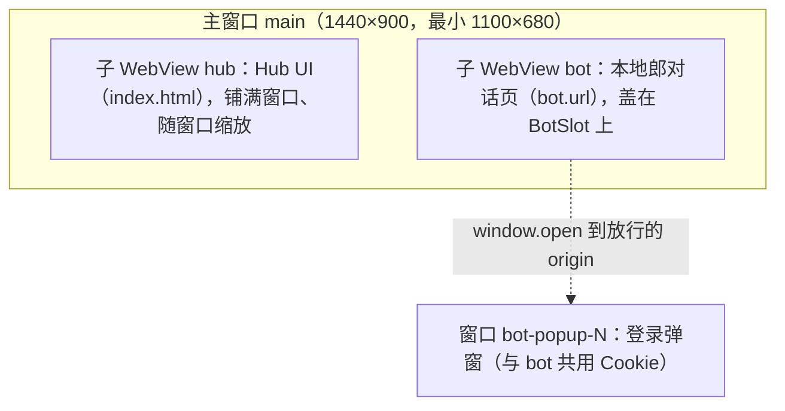
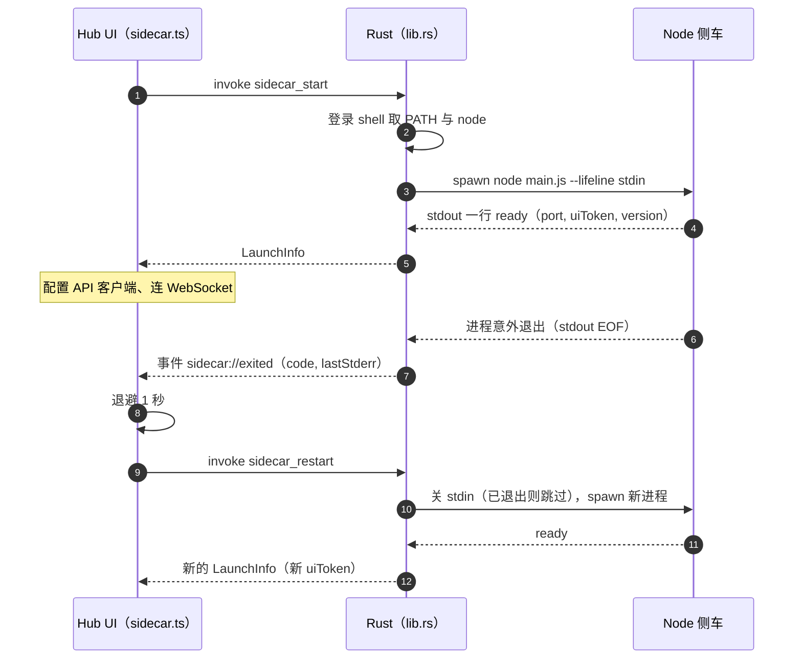
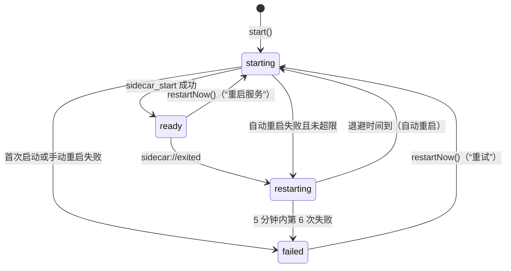

# 桌面壳（Tauri v2）与单窗口布局

> 上级文档：[../README.md](../README.md)。为什么选 Tauri 见 README §4。本文给出 Rust 壳的**全部源码**和 Hub UI 里 `web/src/desktop/` 的**全部 TS 代码**，实现时原样复制，不要“改进”（D2、D3）。
>
> 验证情况（§9）：Rust 部分用 Rust 1.99 + Tauri 2.12.5 在 Linux 上 `cargo check`、`cargo clippy`、`cargo fmt --check` 通过，并把编译出的应用跑起来做了运行时冒烟（假侧车 + 真实 TS 模块）；TS 部分用 TypeScript 6.0.3 编译通过，17 个行为测试通过。macOS 特有的行为（子 WebView 的位置、独立 Cookie 存储、单实例、菜单栏图标点击）只能在 owner 的 Mac 上按 §10 验收。

## 1. 职责边界

| 层                                     | 做什么                                                                                                                                                                                                                           | 不做什么                                           |
| -------------------------------------- | -------------------------------------------------------------------------------------------------------------------------------------------------------------------------------------------------------------------------------- | -------------------------------------------------- |
| Rust（`desktop/src-tauri/src/lib.rs`） | 建主窗口和两个子 WebView；Bot 页面的导航、弹窗、下载策略；拉起、停止侧车（登录 shell 的 PATH、找 node、解析 ready 行、保留 stderr 尾部、stdin 生命线）；关窗即隐藏；菜单栏图标（点击显示主窗口）；单实例；点 Dock 图标重新显示。 | 任何业务逻辑、布局、菜单、通知、重启策略。         |
| TS（`web/src/desktop/`）               | Bot 面板的位置与显隐、浮层遮挡；应用菜单与快捷键；菜单栏图标旁的数字；系统通知；侧车崩溃后的退避重启；外链与“在 Finder 中显示”；浏览器开发模式。                                                                                 | 业务数据：一律走本地 API，不经过 Rust。            |
| Node 侧车（`@agent-hub/server`）       | 全部业务逻辑与 API（[architecture.md](architecture.md)）。                                                                                                                                                                       | 不知道自己跑在 Tauri 里，只认 `--lifeline stdin`。 |

规则：

1. Rust 只有 §4.8 的 5 个 IPC 命令和 1 个事件，**不再加命令**。需要新的原生能力时，先找 Tauri 的 JS API，在 `capabilities/hub.json` 里加对应权限。
2. 所有 Tauri JS API 调用都在 `web/src/desktop/` 里；Hub UI 的其他代码只用这里导出的函数和 hooks。
3. 所有 `unstable` 特性下的 API（多 WebView）都在 `lib.rs` 和 `bot-panel.ts` 里（R4）。

## 2. 窗口与布局

### 2.1 结构



| 视图         | label         | 内容                                         | 谁创建                                    | IPC                | 数据存储                                               |
| ------------ | ------------- | -------------------------------------------- | ----------------------------------------- | ------------------ | ------------------------------------------------------ |
| 主窗口       | `main`        | —                                            | `setup`（`app.windows` 是空数组）         | —                  | —                                                      |
| Hub UI       | `hub`         | 应用内资源；`tauri dev` 时是 Vite 开发服务器 | `setup`，`auto_resize()`                  | §4.6 的 capability | 默认存储（`localStorage` 只放界面偏好，hub-ui.md §1）  |
| Bot 面板     | `bot`         | `config.bot.url`                             | `bot_open`，先隐藏、1×1，由 TS 摆放后显示 | **无**             | 独立存储 `data_store_identifier(*b"agent-hub-bot-01")` |
| Bot 登录弹窗 | `bot-popup-N` | Bot 页面 `window.open` 的地址                | Bot 的 `on_new_window`                    | **无**             | 与 Bot 共用（`window_features` 带上了打开者的配置）    |

多 WebView 窗口不能在 `tauri.conf.json` 里声明，所以 `app.windows` 写空数组，在 `setup` 里用 `WindowBuilder` + `Window::add_child` 创建；这两个 API 需要 Cargo 特性 `unstable`。

### 2.2 布局约定（Hub UI 与原生 Bot 面板之间）

原生子 WebView 不是 DOM 的一部分：它画在 Hub UI 上面，位置只能由代码设置。约定如下：

1. **布局只有一个权威来源：Hub UI 的 CSS。** 左栏里留一个空元素 `BotSlot`，`useBotSlot(ref)`（§5.8）把它的 `getBoundingClientRect()` 交给 `botPanel.setSlot()`，`BotPanel` 调 `Webview.setPosition` / `setSize`（逻辑像素，不乘缩放比）再 `show()`。
2. 页面本身不滚动（`html`、`body` 设 `overflow: hidden`，只在栏内滚动）；`BotSlot` 的祖先元素不用 `transform` / `zoom`。否则 DOM 坐标和原生坐标对不上。
3. **`BotSlot` 必须一直延伸到窗口底边**（高度随窗口高度变化）。macOS 上原生视图的位置是按“当时的父视图高度”从左上角坐标换算成左下角坐标的（wry 的 `set_bounds`），窗口高度一变就必须重新设置一次；`BotSlot` 的高度跟着窗口变，`ResizeObserver` 就一定会报新的矩形。
4. `BotSlot` 只能随“窗口大小”和“左栏宽度”变化。横幅、提示条不许把左栏往下推（`ResizeObserver` 看不到纯位移），放在顶栏里或右栏里。
5. 左栏收起 = 不渲染 `BotSlot` → `setSlot(null)` → 隐藏 Bot 面板。
6. 左栏宽度三档 360 / 440 / 560 px，⌘1 收起 / 展开；具体尺寸与持久化见 [hub-ui.md](hub-ui.md) §1。**不做拖拽调宽**：指针移到原生视图上方后事件就到不了 Hub UI。
7. 浮层（对话框、下拉框、提示）会被原生视图盖住，规则见 §5.3。

### 2.3 Bot 面板的策略

| 项目        | 做法                                                                                                                                                                                                                                                                                                   |
| ----------- | ------------------------------------------------------------------------------------------------------------------------------------------------------------------------------------------------------------------------------------------------------------------------------------------------------ |
| 没有 IPC    | capability 只授给 `webviews: ["hub"]`（§4.6）。Bot 页面和登录弹窗里**有** `window.__TAURI_INTERNALS__` 对象（Tauri 给所有 WebView 注入），但任何命令都会被拒绝（`… not allowed on window "main", webview "bot"`，§9 实测）。不要在 capability 里写 `windows: ["main"]`，那会授给窗口里所有的 WebView。 |
| 独立 Cookie | `data_store_identifier(*b"agent-hub-bot-01")`：固定的 16 字节，重启后登录态还在；需要 macOS 14（D1）。设置页“清除本地郎登录数据”调 `botPanel.clearBrowsingData()`。                                                                                                                                    |
| 不注入脚本  | 不对 Bot 调 `eval`、不设 `initialization_script`；本地郎与 Hub 之间只走本地 API（D47）。                                                                                                                                                                                                               |
| 导航        | 放行 `about:` 和集合 {`bot.url` 的 origin} ∪ `bot.allowedOrigins` ∪ `bot.authOrigins` 里的 origin；其他 `http` / `https` 地址取消导航、交给系统浏览器；其他协议直接取消。                                                                                                                              |
| 新窗口      | 目标 origin 在同一集合里 → 建登录弹窗 `bot-popup-N`（标题“登录”）；否则交给系统浏览器并拒绝。WebKit 只在用户点击时才允许脚本开窗，这是浏览器的正常行为。弹窗本身不设导航白名单（登录流程会经过多个域名），由页面自己关闭或用户关闭。                                                                   |
| 下载        | 一律拒绝。                                                                                                                                                                                                                                                                                             |
| UA          | `bot.userAgent` 非空时覆盖（有的站点拦内嵌 WebView 的 UA，R5）。                                                                                                                                                                                                                                       |
| 改设置      | `bot` 配置有变化、`url` 非空且没开 `openExternally` → TS 再调一次 `bot_open`：Rust 先关掉旧的 Bot 子 WebView 再建新的；`url` 清空或打开 `openExternally` → 只隐藏（§5.3、§7）。                                                                                                                        |

`allowedOrigins` 和 `authOrigins` 在原生层是同一个集合；分成两项只是为了设置页好说明（“对话页会跳转到的站点”与“登录弹窗的站点”）。

## 3. 侧车的启动、退出与重启

Rust 只管“启动一次、停止一次、报告意外退出”；什么时候重启由 TS 决定（§5.2、§5.5）。



### 3.1 `sidecar_start` 的步骤

| 步骤 | 做什么                                                                                                                                                                                                                                                                |
| ---- | --------------------------------------------------------------------------------------------------------------------------------------------------------------------------------------------------------------------------------------------------------------------- |
| 1    | 已有就绪的侧车 → 直接返回同一份 `LaunchInfo`。Hub UI 页面重新加载（开发期热更新、⌘R）时走这里，不会再起一个侧车。                                                                                                                                                     |
| 2    | 有子进程但还没就绪 → 返回错误字符串 `SIDECAR_STARTING`；TS 每 0.5 秒重试，最多 50 次（§5.2）。                                                                                                                                                                        |
| 3    | 问登录 shell：`$SHELL -ilc` 执行 `printf '__AH__%s__AH__%s__AH__' "$PATH" "$(command -v node)"`，5 秒超时，取标记之间的 PATH 和 node 路径（交互式 shell 可能先打印欢迎语）。失败或超时就用 `/opt/homebrew/bin:/usr/local/bin:/usr/bin:/bin:/usr/sbin:/sbin`，不报错。 |
| 4    | 找 node（D6）：`AGENT_HUB_NODE` → 第 3 步的 node → `/opt/homebrew/bin/node` → `/usr/local/bin/node`。版本由侧车自检（`NODE_TOO_OLD`）。                                                                                                                               |
| 5    | 侧车入口（D5）：`AGENT_HUB_SERVER_ENTRY`，否则编译期常量 `desktop/src-tauri/../../server/dist/main.js`，文件必须存在。                                                                                                                                                |
| 6    | 启动 `node --disable-warning=ExperimentalWarning <入口> --lifeline stdin`。环境变量继承 Tauri 进程，另把 `PATH` 和 `AGENT_HUB_LOGIN_PATH` 设为第 3 步的 PATH（侧车用它解析各 Agent 的命令，[adapter-interface.md](adapter-interface.md) §8）。三个标准流都是管道。    |
| 7    | stderr 线程：每行原样转发到 Tauri 进程的 stderr（前缀 `[sidecar] `），并保留最后 50 行。                                                                                                                                                                              |
| 8    | stdout 线程：逐行按 JSON 解析，不是 JSON 的行忽略；第一条 `ready` 或 `fatal` 决定这次启动的结果，之后继续读到 EOF（不读会堵住管道）。                                                                                                                                 |
| 9    | 最多等 20 秒。就绪 → 记下 `LaunchInfo` 并返回。                                                                                                                                                                                                                       |

协议行（D8，[architecture.md](architecture.md) §10.2）：

- `{"event":"ready","port":47821,"uiToken":"…","version":"0.1.0","pid":12345}` → `LaunchInfo { baseUrl: "http://127.0.0.1:<port>", wsUrl: "ws://127.0.0.1:<port>/api/v1/ws", uiToken, serverVersion: version }`。
- `{"event":"fatal","code":"…","message":"…"}` → `sidecar_start` 以 `message` reject（侧车给的中文说明），Rust 等它自己退出（最多 10 秒）。

### 3.2 失败与退出

| 情况                                        | Hub UI 收到                                                                                    |
| ------------------------------------------- | ---------------------------------------------------------------------------------------------- |
| 找不到 node                                 | reject：`找不到 node：请安装 Node 22.13+，或设置 AGENT_HUB_NODE`                               |
| 找不到入口                                  | reject：`找不到侧车入口 <路径>：先运行 pnpm --filter @agent-hub/server build`                  |
| 进程起不来                                  | reject：`无法启动侧车（<node 路径>）：<系统错误>`                                              |
| 侧车打了 `fatal`                            | reject：侧车给的 `message`（如端口被占用、配置无效）                                           |
| 就绪前退出（没打 `fatal`）                  | reject：`侧车在就绪前退出` + 换行 + stderr 最后 50 行；**不发** `sidecar://exited`             |
| 20 秒没就绪                                 | Rust 先停掉它，再 reject：`侧车 20 秒内没有就绪` + stderr 尾部                                 |
| 打了 ready 但在 Rust 记录之前就退出（极少） | reject：`侧车在就绪后立即退出` + stderr 尾部                                                   |
| **就绪后意外退出**                          | 事件 `sidecar://exited`：`{ code, lastStderr }`（被信号结束时 `code` 为 `null`），只发给 `hub` |
| 就绪后被 Hub 停止（重启、退出）             | 什么都不发                                                                                     |

- 每次启动 `generation` 加一。旧进程的读线程发现代数变了就直接返回，所以慢慢死掉的旧进程不会清掉新进程的状态，也不会发出 `sidecar://exited`。
- stdout 读到 EOF 后最多等 stderr 0.5 秒，让尾部带上最后几行；不无限等，因为泄漏的孙进程可能一直占着 stderr 管道。
- 同一次失败只报告一次：就绪前的失败只体现为 reject，就绪后的失败只体现为事件。

### 3.3 停止与退出路径

`stop_sidecar`：关闭 stdin（侧车读到 EOF 后按 [architecture.md](architecture.md) §10.3 停机），每 0.1 秒看一次是否已退出，10 秒后 `SIGKILL`。只结束 node 进程本身；各 Agent 在自己的进程组里，侧车停机时会结束它们，强杀时由下次启动的恢复流程清理（[architecture.md](architecture.md) §9.3）。

| 触发                                    | 路径                                                                                          | 确认                                     |
| --------------------------------------- | --------------------------------------------------------------------------------------------- | ---------------------------------------- |
| ⌘Q、菜单“退出 Agent Hub”                | 原生菜单 → TS `requestQuit()`（[hub-ui.md](hub-ui.md) §5.7）→ `quit_app` → 停侧车 → `exit(0)` | 有进行中的任务时确认                     |
| Dock 图标右键“退出”、注销、关机         | `applicationWillTerminate` → `RunEvent::Exit` → 停侧车                                        | 没有（Hub 不拦截系统退出；任务记为中断） |
| 关闭按钮、⌘W、菜单“关闭窗口”            | `CloseRequested` → 阻止关闭并隐藏（D11）                                                      | —                                        |
| 点 Dock 图标、菜单栏图标、再次打开 .app | `RunEvent::Reopen` / 托盘左键 / 单实例插件 → 显示并聚焦主窗口                                 | —                                        |
| 设置页“重启服务”、错误页“重试”          | TS `restartNow()` → `sidecar_restart`（先停再启）                                             | —                                        |
| Tauri 进程崩溃或被强杀                  | 管道断开 → 侧车 stdin EOF → 自行停机（D7）                                                    | —                                        |

## 4. Rust 源码（原样复制）

### 4.1 文件清单

```text
apps/agent-hub/desktop/
├── package.json                  # §4.9
└── src-tauri/
    ├── .gitignore                # §4.9
    ├── Cargo.toml                # §4.2
    ├── Cargo.lock                # 首次 cargo check 生成，提交（R4）
    ├── build.rs                  # §4.3
    ├── tauri.conf.json           # §4.5
    ├── capabilities/hub.json     # §4.6
    ├── icons/                    # 从 apps/cardhub/native/src-tauri/icons/ 复制 32x32.png、128x128.png、128x128@2x.png、icon.icns、icon.png
    └── src/
        ├── main.rs               # §4.4
        └── lib.rs                # §4.7
```

不要用 `tauri init` 生成再改：直接写下面这些文件。`gen/` 由 `tauri-build` 每次构建时生成，不提交。本文验证时 `Cargo.lock` 锁到的版本：`tauri` 2.12.5、`tauri-build` 2.7.4、`tauri-runtime-wry` 2.12.3、`wry` 0.57.1、`tauri-plugin-notification` 2.7.0、`tauri-plugin-opener` 2.7.2、`tauri-plugin-single-instance` 2.5.4。

### 4.2 `Cargo.toml`

```toml
# desktop/src-tauri/Cargo.toml
[package]
name = "agent-hub-desktop"
version = "0.1.0"
description = "Agent Hub desktop shell (macOS)"
edition = "2021"
rust-version = "1.90"

[lib]
name = "agent_hub_desktop_lib"
crate-type = ["staticlib", "cdylib", "rlib"]

[build-dependencies]
tauri-build = { version = "2.7", features = [] }

[dependencies]
tauri = { version = "2.12", features = ["unstable", "tray-icon"] }
tauri-plugin-single-instance = "2.5"
tauri-plugin-notification = "2.7"
tauri-plugin-opener = "2"
serde = { version = "1", features = ["derive"] }
serde_json = "1"

[features]
custom-protocol = ["tauri/custom-protocol"]
```

### 4.3 `build.rs`

```rust
// desktop/src-tauri/build.rs
fn main() {
    // Declaring the app manifest makes Tauri enforce capabilities for our own
    // commands on local origins too; without it every local page could call them.
    tauri_build::try_build(tauri_build::Attributes::new().app_manifest(
        tauri_build::AppManifest::new().commands(&[
            "sidecar_start",
            "sidecar_restart",
            "bot_open",
            "bot_reload",
            "quit_app",
        ]),
    ))
    .expect("failed to run tauri-build");
}
```

### 4.4 `src/main.rs`

```rust
// desktop/src-tauri/src/main.rs
#![cfg_attr(not(debug_assertions), windows_subsystem = "windows")]

fn main() {
    agent_hub_desktop_lib::run()
}
```

### 4.5 `tauri.conf.json`

`desktop/src-tauri/tauri.conf.json`：

```json
{
  "$schema": "https://schema.tauri.app/config/2",
  "productName": "Agent Hub",
  "version": "0.1.0",
  "identifier": "com.multiapps.agenthub",
  "build": {
    "beforeDevCommand": "pnpm --filter \"@agent-hub/server...\" build && pnpm --filter @agent-hub/web dev",
    "beforeBuildCommand": "pnpm --filter \"@agent-hub/server...\" build && pnpm --filter @agent-hub/web build",
    "devUrl": "http://localhost:5174",
    "frontendDist": "../../web/dist"
  },
  "app": {
    "windows": [],
    "security": {
      "csp": "default-src 'self'; script-src 'self'; style-src 'self' 'unsafe-inline'; img-src 'self' data: blob:; font-src 'self' data:; connect-src 'self' ipc: http://ipc.localhost http://127.0.0.1:* ws://127.0.0.1:*"
    }
  },
  "bundle": {
    "active": true,
    "targets": ["app"],
    "icon": [
      "icons/32x32.png",
      "icons/128x128.png",
      "icons/128x128@2x.png",
      "icons/icon.icns",
      "icons/icon.png"
    ],
    "macOS": { "minimumSystemVersion": "14.0", "signingIdentity": "-" }
  },
  "plugins": {}
}
```

- `beforeDevCommand` / `beforeBuildCommand` 先构建侧车及其依赖（`@agent-hub/server...` 包含 contract），再启动 / 构建 Hub UI。Tauri 在 `desktop/` 目录下执行它们。
- CSP 只作用于 Hub UI 自己的页面，不影响 Bot 页面。端口可以在设置里改而 CSP 是构建期常量，所以 `127.0.0.1` 用端口通配；Hub UI 不加载任何远程内容。
- `minimumSystemVersion` 14.0（D1）；`signingIdentity: "-"` 是 ad-hoc 签名（D12）。

### 4.6 `capabilities/hub.json`

`desktop/src-tauri/capabilities/hub.json`：

```json
{
  "$schema": "../gen/schemas/desktop-schema.json",
  "identifier": "hub-ui",
  "description": "Only the Hub UI child webview. The bot webview and its popups match no capability and therefore have no IPC.",
  "webviews": ["hub"],
  "local": true,
  "permissions": [
    "core:event:default",
    "core:menu:default",
    "core:tray:allow-get-by-id",
    "core:tray:allow-set-title",
    "core:window:allow-is-focused",
    "core:window:allow-show",
    "core:window:allow-unminimize",
    "core:window:allow-set-focus",
    "core:webview:allow-get-all-webviews",
    "core:webview:allow-set-webview-position",
    "core:webview:allow-set-webview-size",
    "core:webview:allow-webview-show",
    "core:webview:allow-webview-hide",
    "core:webview:allow-set-webview-focus",
    "core:webview:allow-clear-all-browsing-data",
    "notification:default",
    {
      "identifier": "opener:allow-open-url",
      "allow": [{ "url": "http://*" }, { "url": "https://*" }]
    },
    "opener:allow-reveal-item-in-dir",
    "allow-sidecar-start",
    "allow-sidecar-restart",
    "allow-bot-open",
    "allow-bot-reload",
    "allow-quit-app"
  ]
}
```

| 权限                                                                              | 谁用                                                |
| --------------------------------------------------------------------------------- | --------------------------------------------------- |
| `core:event:default`                                                              | `ipc.onSidecarExited`（`listen`）                   |
| `core:menu:default`                                                               | `installAppMenu`（建菜单、`setAsAppMenu`）          |
| `core:tray:allow-get-by-id`、`core:tray:allow-set-title`                          | `setTrayCount`                                      |
| `core:window:allow-is-focused`                                                    | `notifyInBackground`                                |
| `core:window:allow-show`、`allow-unminimize`、`allow-set-focus`                   | `showMainWindow`（退出确认前把窗口拉回来）          |
| `core:webview:allow-get-all-webviews`                                             | `Webview.getByLabel('bot')`                         |
| `core:webview:allow-set-webview-position`、`-size`、`allow-webview-show`、`-hide` | `BotPanel` 摆放与显隐                               |
| `core:webview:allow-set-webview-focus`                                            | 隐藏 Bot 后把焦点还给 Hub UI                        |
| `core:webview:allow-clear-all-browsing-data`                                      | `botPanel.clearBrowsingData()`                      |
| `notification:default`                                                            | `notifyInBackground`                                |
| `opener:allow-open-url`（范围 `http://*`、`https://*`）                           | `openExternal`；不写范围时**所有** URL 都会被拒绝   |
| `opener:allow-reveal-item-in-dir`                                                 | `revealInFinder`                                    |
| `allow-sidecar-start` … `allow-quit-app`                                          | §4.8 的 5 个命令（`build.rs` 声明后才有这些权限名） |

没有授予的都不能用，例如 `core:window:allow-hide`、`core:webview:allow-webview-position`（§9 实测被拒）。`local: true` 且不写 `remote`：外部页面无论 label 是什么都拿不到权限。

### 4.7 `src/lib.rs`

```rust
// desktop/src-tauri/src/lib.rs
use std::io::{BufRead, BufReader, Read};
use std::path::PathBuf;
use std::process::{Child, ChildStdin, Command, Stdio};
use std::sync::atomic::{AtomicU32, Ordering};
use std::sync::{mpsc, Arc, Mutex};
use std::time::{Duration, Instant};

use serde::Serialize;
use tauri::tray::{MouseButton, MouseButtonState, TrayIconBuilder, TrayIconEvent};
use tauri::webview::{NewWindowResponse, WebviewBuilder};
use tauri::window::WindowBuilder;
use tauri::{
    AppHandle, Emitter, LogicalPosition, LogicalSize, Manager, RunEvent, Url, WebviewUrl,
    WebviewWindowBuilder, WindowEvent,
};
use tauri_plugin_opener::OpenerExt;

/// Fixed id so the bot's cookies survive restarts (WKWebsiteDataStore, macOS 14+).
const BOT_STORE_ID: [u8; 16] = *b"agent-hub-bot-01";
const READY_TIMEOUT: Duration = Duration::from_secs(20);
const STOP_GRACE: Duration = Duration::from_secs(10);

#[derive(Clone, Serialize)]
#[serde(rename_all = "camelCase")]
pub struct LaunchInfo {
    base_url: String,
    ws_url: String,
    ui_token: String,
    server_version: String,
}

#[derive(Clone, Serialize)]
#[serde(rename_all = "camelCase")]
struct ExitedPayload {
    code: Option<i32>,
    last_stderr: String,
}

#[derive(Default)]
struct Sidecar {
    child: Option<Child>,
    stdin: Option<ChildStdin>,
    info: Option<LaunchInfo>,
    /// Bumped on every spawn so reader threads of an old process never touch a newer one.
    generation: u64,
}

#[derive(Default)]
struct AppState {
    sidecar: Mutex<Sidecar>,
    bot_origins: Arc<Mutex<Vec<String>>>,
    popup_seq: Arc<AtomicU32>,
}

fn server_entry() -> PathBuf {
    if let Ok(path) = std::env::var("AGENT_HUB_SERVER_ENTRY") {
        return PathBuf::from(path);
    }
    PathBuf::from(env!("CARGO_MANIFEST_DIR")).join("../../server/dist/main.js")
}

/// GUI apps on macOS start with a minimal PATH; ask the login shell for the real one.
fn login_shell_env() -> (String, Option<String>) {
    let fallback_path =
        "/opt/homebrew/bin:/usr/local/bin:/usr/bin:/bin:/usr/sbin:/sbin".to_string();
    let shell = std::env::var("SHELL").unwrap_or_else(|_| "/bin/zsh".to_string());
    let script = r#"printf '__AH__%s__AH__%s__AH__' "$PATH" "$(command -v node)""#;
    let Ok(mut child) = Command::new(shell)
        .args(["-ilc", script])
        .stdin(Stdio::null())
        .stdout(Stdio::piped())
        .stderr(Stdio::null())
        .spawn()
    else {
        return (fallback_path, None);
    };
    let deadline = Instant::now() + Duration::from_secs(5);
    while Instant::now() < deadline {
        if let Ok(Some(_)) = child.try_wait() {
            break;
        }
        std::thread::sleep(Duration::from_millis(50));
    }
    if !matches!(child.try_wait(), Ok(Some(_))) {
        let _ = child.kill();
        let _ = child.wait();
        return (fallback_path, None);
    }
    let mut out = String::new();
    if let Some(mut stdout) = child.stdout.take() {
        let _ = stdout.read_to_string(&mut out);
    }
    let parts: Vec<&str> = out.split("__AH__").collect();
    if parts.len() < 4 || parts[1].is_empty() {
        return (fallback_path, None);
    }
    let node = Some(parts[2].trim().to_string()).filter(|s| !s.is_empty());
    (parts[1].to_string(), node)
}

fn resolve_node(login_node: Option<String>) -> Option<PathBuf> {
    if let Ok(path) = std::env::var("AGENT_HUB_NODE") {
        return Some(PathBuf::from(path));
    }
    login_node.map(PathBuf::from).or_else(|| {
        ["/opt/homebrew/bin/node", "/usr/local/bin/node"]
            .iter()
            .map(PathBuf::from)
            .find(|p| p.exists())
    })
}

fn start_sidecar(app: &AppHandle) -> Result<LaunchInfo, String> {
    let state = app.state::<AppState>();
    let (ready_rx, generation, stderr_tail) = {
        let mut sc = state.sidecar.lock().unwrap();
        if let Some(info) = &sc.info {
            return Ok(info.clone());
        }
        if sc.child.is_some() {
            return Err("SIDECAR_STARTING".to_string());
        }
        let (path, login_node) = login_shell_env();
        let node = resolve_node(login_node)
            .ok_or("找不到 node：请安装 Node 22.13+，或设置 AGENT_HUB_NODE")?;
        let entry = server_entry();
        if !entry.exists() {
            return Err(format!(
                "找不到侧车入口 {}：先运行 pnpm --filter @agent-hub/server build",
                entry.display()
            ));
        }
        let mut child = Command::new(&node)
            .arg("--disable-warning=ExperimentalWarning")
            .arg(&entry)
            .args(["--lifeline", "stdin"])
            .env("PATH", &path)
            .env("AGENT_HUB_LOGIN_PATH", &path)
            .stdin(Stdio::piped())
            .stdout(Stdio::piped())
            .stderr(Stdio::piped())
            .spawn()
            .map_err(|e| format!("无法启动侧车（{}）：{e}", node.display()))?;
        let stdout = child.stdout.take().expect("stdout is piped");
        let stderr = child.stderr.take().expect("stderr is piped");
        sc.stdin = child.stdin.take();
        sc.child = Some(child);
        sc.generation += 1;
        let generation = sc.generation;

        let tail = Arc::new(Mutex::new(Vec::<String>::new()));
        let tail_writer = tail.clone();
        let (stderr_done_tx, stderr_done_rx) = mpsc::channel::<()>();
        std::thread::spawn(move || {
            for line in BufReader::new(stderr).lines().map_while(Result::ok) {
                eprintln!("[sidecar] {line}");
                let mut t = tail_writer.lock().unwrap();
                t.push(line);
                if t.len() > 50 {
                    t.remove(0);
                }
            }
            let _ = stderr_done_tx.send(());
        });
        let tail_for_errors = tail.clone();

        let (tx, rx) = mpsc::channel::<Result<LaunchInfo, String>>();
        let app_handle = app.clone();
        std::thread::spawn(move || {
            let mut tx = Some(tx);
            for line in BufReader::new(stdout).lines().map_while(Result::ok) {
                let Ok(msg) = serde_json::from_str::<serde_json::Value>(&line) else {
                    continue;
                };
                match msg["event"].as_str() {
                    Some("ready") => {
                        let port = msg["port"].as_u64().unwrap_or(47821);
                        let info = LaunchInfo {
                            base_url: format!("http://127.0.0.1:{port}"),
                            ws_url: format!("ws://127.0.0.1:{port}/api/v1/ws"),
                            ui_token: msg["uiToken"].as_str().unwrap_or_default().to_string(),
                            server_version: msg["version"].as_str().unwrap_or_default().to_string(),
                        };
                        if let Some(tx) = tx.take() {
                            let _ = tx.send(Ok(info));
                        }
                    }
                    Some("fatal") => {
                        let text = msg["message"]
                            .as_str()
                            .unwrap_or("侧车启动失败")
                            .to_string();
                        if let Some(tx) = tx.take() {
                            let _ = tx.send(Err(text));
                        }
                    }
                    _ => {}
                }
            }
            // stdout closed: the sidecar is gone. Give stderr a moment to drain, but never block
            // on it: a leaked grandchild could keep the pipe open.
            let _ = stderr_done_rx.recv_timeout(Duration::from_millis(500));
            let last_stderr = tail.lock().unwrap().join("\n");
            let state = app_handle.state::<AppState>();
            let mut sc = state.sidecar.lock().unwrap();
            if sc.generation != generation {
                return;
            }
            let expected = sc.child.is_none();
            // Only a sidecar that reached `ready` reports `sidecar://exited`; earlier failures
            // surface once, as the rejected `sidecar_start` / `sidecar_restart` call.
            let was_ready = sc.info.is_some();
            let code = sc
                .child
                .take()
                .and_then(|mut c| c.wait().ok())
                .and_then(|s| s.code());
            sc.stdin = None;
            sc.info = None;
            drop(sc);
            if let Some(tx) = tx.take() {
                let _ = tx.send(Err(with_tail("侧车在就绪前退出", &last_stderr)));
            }
            if !expected && was_ready {
                let _ = app_handle.emit_to(
                    "hub",
                    "sidecar://exited",
                    ExitedPayload { code, last_stderr },
                );
            }
        });
        (rx, generation, tail_for_errors)
    };

    let tail_now = || stderr_tail.lock().unwrap().join("\n");
    match ready_rx.recv_timeout(READY_TIMEOUT) {
        Ok(Ok(info)) => {
            let mut sc = state.sidecar.lock().unwrap();
            if sc.generation != generation || sc.child.is_none() {
                return Err(with_tail("侧车在就绪后立即退出", &tail_now()));
            }
            sc.info = Some(info.clone());
            Ok(info)
        }
        Ok(Err(message)) => {
            stop_sidecar(app, Some(generation));
            Err(message)
        }
        Err(mpsc::RecvTimeoutError::Timeout) => {
            stop_sidecar(app, Some(generation));
            Err(with_tail("侧车 20 秒内没有就绪", &tail_now()))
        }
        Err(mpsc::RecvTimeoutError::Disconnected) => {
            stop_sidecar(app, Some(generation));
            Err(with_tail("侧车在就绪前退出", &tail_now()))
        }
    }
}

fn with_tail(message: &str, last_stderr: &str) -> String {
    if last_stderr.is_empty() {
        message.to_string()
    } else {
        format!("{message}\n{last_stderr}")
    }
}

/// Closing stdin asks the sidecar to shut down gracefully; kill it after the grace period.
/// `only`: stop only if that generation is still the current one.
fn stop_sidecar(app: &AppHandle, only: Option<u64>) {
    let state = app.state::<AppState>();
    let mut sc = state.sidecar.lock().unwrap();
    if only.is_some_and(|g| g != sc.generation) {
        return;
    }
    sc.info = None;
    drop(sc.stdin.take());
    if let Some(mut child) = sc.child.take() {
        let deadline = Instant::now() + STOP_GRACE;
        loop {
            match child.try_wait() {
                Ok(Some(_)) => break,
                Ok(None) if Instant::now() < deadline => {
                    std::thread::sleep(Duration::from_millis(100))
                }
                _ => {
                    let _ = child.kill();
                    let _ = child.wait();
                    break;
                }
            }
        }
    }
}

fn origin_of(url: &Url) -> String {
    url.origin().ascii_serialization()
}

fn show_main(app: &AppHandle) {
    if let Some(window) = app.get_window("main") {
        let _ = window.unminimize();
        let _ = window.show();
        let _ = window.set_focus();
    }
}

#[tauri::command]
async fn sidecar_start(app: AppHandle) -> Result<LaunchInfo, String> {
    tauri::async_runtime::spawn_blocking(move || start_sidecar(&app))
        .await
        .map_err(|e| e.to_string())?
}

#[tauri::command]
async fn sidecar_restart(app: AppHandle) -> Result<LaunchInfo, String> {
    tauri::async_runtime::spawn_blocking(move || {
        stop_sidecar(&app, None);
        start_sidecar(&app)
    })
    .await
    .map_err(|e| e.to_string())?
}

/// (Re)creates the bot child webview, hidden; the Hub UI positions and shows it.
#[tauri::command]
async fn bot_open(
    app: AppHandle,
    url: String,
    allowed_origins: Vec<String>,
    user_agent: Option<String>,
) -> Result<(), String> {
    let url = Url::parse(&url).map_err(|e| format!("Bot URL 无效：{e}"))?;
    if !matches!(url.scheme(), "http" | "https") {
        return Err("Bot URL 只能是 http 或 https".to_string());
    }
    let state = app.state::<AppState>();
    {
        let mut origins = state.bot_origins.lock().unwrap();
        *origins = allowed_origins;
        let own = origin_of(&url);
        if !origins.contains(&own) {
            origins.push(own);
        }
    }
    if let Some(existing) = app.get_webview("bot") {
        existing.close().map_err(|e| e.to_string())?;
    }
    let window = app.get_window("main").ok_or("主窗口不存在")?;

    let nav_origins = state.bot_origins.clone();
    let nav_app = app.clone();
    let popup_origins = state.bot_origins.clone();
    let popup_app = app.clone();
    let popup_seq = state.popup_seq.clone();

    let mut builder = WebviewBuilder::new("bot", WebviewUrl::External(url))
        .data_store_identifier(BOT_STORE_ID)
        .on_navigation(move |target| {
            if target.scheme() == "about"
                || nav_origins.lock().unwrap().contains(&origin_of(target))
            {
                return true;
            }
            if matches!(target.scheme(), "http" | "https") {
                let _ = nav_app.opener().open_url(target.as_str(), None::<&str>);
            }
            false
        })
        .on_new_window(move |target, features| {
            if popup_origins.lock().unwrap().contains(&origin_of(&target)) {
                let label = format!("bot-popup-{}", popup_seq.fetch_add(1, Ordering::Relaxed));
                let blank = WebviewUrl::External("about:blank".parse().expect("valid url"));
                match WebviewWindowBuilder::new(&popup_app, label, blank)
                    .window_features(features)
                    .title("登录")
                    .build()
                {
                    Ok(window) => NewWindowResponse::Create { window },
                    Err(_) => NewWindowResponse::Deny,
                }
            } else {
                if matches!(target.scheme(), "http" | "https") {
                    let _ = popup_app.opener().open_url(target.as_str(), None::<&str>);
                }
                NewWindowResponse::Deny
            }
        })
        .on_download(|_, _| false);
    if let Some(ua) = user_agent.filter(|s| !s.is_empty()) {
        builder = builder.user_agent(&ua);
    }
    let bot = window
        .add_child(
            builder,
            LogicalPosition::new(0.0, 0.0),
            LogicalSize::new(1.0, 1.0),
        )
        .map_err(|e| e.to_string())?;
    bot.hide().map_err(|e| e.to_string())?;
    Ok(())
}

#[tauri::command]
async fn bot_reload(app: AppHandle) -> Result<(), String> {
    app.get_webview("bot")
        .ok_or("Bot 面板未打开")?
        .reload()
        .map_err(|e| e.to_string())
}

#[tauri::command]
async fn quit_app(app: AppHandle) {
    let handle = app.clone();
    let _ = tauri::async_runtime::spawn_blocking(move || stop_sidecar(&handle, None)).await;
    app.exit(0);
}

#[cfg_attr(mobile, tauri::mobile_entry_point)]
pub fn run() {
    let app = tauri::Builder::default()
        .plugin(tauri_plugin_single_instance::init(|app, _args, _cwd| {
            show_main(app)
        }))
        .plugin(tauri_plugin_notification::init())
        .plugin(tauri_plugin_opener::init())
        .manage(AppState::default())
        .invoke_handler(tauri::generate_handler![
            sidecar_start,
            sidecar_restart,
            bot_open,
            bot_reload,
            quit_app
        ])
        .setup(|app| {
            let window = WindowBuilder::new(app, "main")
                .title("Agent Hub")
                .inner_size(1440.0, 900.0)
                .min_inner_size(1100.0, 680.0)
                .build()?;
            let hub =
                WebviewBuilder::new("hub", WebviewUrl::App("index.html".into())).auto_resize();
            let size = window.inner_size()?;
            window.add_child(hub, LogicalPosition::new(0.0, 0.0), size)?;

            let hidden = window.clone();
            window.on_window_event(move |event| {
                if let WindowEvent::CloseRequested { api, .. } = event {
                    api.prevent_close();
                    let _ = hidden.hide();
                }
            });

            let icon = app.default_window_icon().cloned().ok_or("缺少应用图标")?;
            TrayIconBuilder::with_id("main")
                .icon(icon)
                .tooltip("Agent Hub")
                .on_tray_icon_event(|tray, event| {
                    if let TrayIconEvent::Click {
                        button: MouseButton::Left,
                        button_state: MouseButtonState::Up,
                        ..
                    } = event
                    {
                        show_main(tray.app_handle());
                    }
                })
                .build(app)?;
            Ok(())
        })
        .build(tauri::generate_context!())
        .expect("failed to build Agent Hub");

    app.run(|app, event| match event {
        RunEvent::Exit => stop_sidecar(app, None),
        #[cfg(target_os = "macos")]
        RunEvent::Reopen { .. } => show_main(app),
        _ => {}
    });
}
```

### 4.8 IPC 命令与事件

| 命令              | 参数（JS 侧，camelCase）             | 返回               | 说明                                                                         |
| ----------------- | ------------------------------------ | ------------------ | ---------------------------------------------------------------------------- |
| `sidecar_start`   | —                                    | `LaunchInfo`       | §3.1；失败 reject 中文字符串（§3.2）。                                       |
| `sidecar_restart` | —                                    | `LaunchInfo`       | 先停（不发事件）再启。                                                       |
| `bot_open`        | `{ url, allowedOrigins, userAgent }` | `null`             | 只接受 `http` / `https`；关掉旧的 Bot 子 WebView，建一个隐藏的新的（§2.3）。 |
| `bot_reload`      | —                                    | `null`             | Bot 面板未打开时 reject `Bot 面板未打开`。                                   |
| `quit_app`        | —                                    | 不返回（进程退出） | 停侧车后 `exit(0)`；确认由 TS 先做。                                         |

| 事件               | 载荷                                           | 目标  |
| ------------------ | ---------------------------------------------- | ----- |
| `sidecar://exited` | `{ code: number \| null, lastStderr: string }` | `hub` |

Tauri 把 JS 传的 camelCase 参数名映射到 Rust 的 snake_case 参数（`allowedOrigins` → `allowed_origins`），返回值的结构体用 `#[serde(rename_all = "camelCase")]`；两者都经 §9 的运行时冒烟确认。

### 4.9 `package.json` 与 `.gitignore`

`desktop/package.json`：

```json
{
  "name": "@agent-hub/desktop",
  "version": "0.1.0",
  "private": true,
  "description": "Agent Hub Tauri v2 shell (macOS): hosts @agent-hub/web and launches @agent-hub/server.",
  "scripts": {
    "dev": "tauri dev",
    "build": "tauri build --bundles app",
    "tauri": "tauri"
  },
  "devDependencies": {
    "@tauri-apps/cli": "^2.12.4"
  }
}
```

`desktop/src-tauri/.gitignore`：

```gitignore
target/
# tauri-build regenerates the capability schemas on every build.
gen/
```

## 5. TS 侧桌面逻辑（`web/src/desktop/`）

| 文件                | 导出                                                                                | 用在                                            |
| ------------------- | ----------------------------------------------------------------------------------- | ----------------------------------------------- |
| `ipc.ts`            | `ipc`、`LaunchInfo`、`SidecarExited`、`BotOpenArgs`、`errorText`                    | 本目录                                          |
| `sidecar.ts`        | `sidecar`、`SidecarController`、`takeDevToken`、`browserLaunchInfo`、`DEFAULT_PORT` | `main.tsx`、根组件（[hub-ui.md](hub-ui.md) §3） |
| `restart-policy.ts` | `RestartPolicy`、`RESTART_DELAYS_MS`、`RESTART_WINDOW_MS`                           | `sidecar.ts`                                    |
| `bot-panel.ts`      | `botPanel`、`BotPanel`、`BotPanelState`、`SlotRect`                                 | 左栏、设置页                                    |
| `menu.ts`           | `installAppMenu`、`MenuActions`                                                     | 根组件                                          |
| `attention.ts`      | `setTrayCount`、`notifyInBackground`、`showMainWindow`                              | 事件处理（[hub-ui.md](hub-ui.md) §4）           |
| `notify-rules.ts`   | `notificationFor`、`NOTIFY_MAX_AGE_MS`、`NotificationText`                          | 事件处理                                        |
| `external.ts`       | `openExternal`、`revealInFinder`                                                    | 任意页面                                        |
| `hooks.ts`          | `useSidecarState`、`useBotPanelState`、`useBotOcclusion`、`useBotSlot`              | React 组件                                      |

依赖：`@agent-hub/web` 加 `@tauri-apps/api` ^2.12.4、`@tauri-apps/plugin-notification` ^2.7.0、`@tauri-apps/plugin-opener` ^2.7.2。浏览器开发模式下这些模块照样能加载：`isTauri()` 为假时每个函数都退化成无操作或浏览器实现。

### 5.1 `ipc.ts`：命令与事件的类型化封装

```ts
// web/src/desktop/ipc.ts
import { invoke, isTauri } from '@tauri-apps/api/core';
import { listen, type UnlistenFn } from '@tauri-apps/api/event';

/** 与 lib.rs 的 `LaunchInfo` 一致（serde camelCase）。 */
export interface LaunchInfo {
  baseUrl: string;
  wsUrl: string;
  uiToken: string;
  serverVersion: string;
}

/** `sidecar://exited` 的载荷。只有**就绪过**的侧车意外退出时才发。 */
export interface SidecarExited {
  code: number | null;
  lastStderr: string;
}

export type BotOpenArgs = {
  url: string;
  /** 导航与登录弹窗都放行的 origin；Rust 会自动加上 `url` 自己的 origin。 */
  allowedOrigins: string[];
  userAgent: string | null;
};

/** 失败时 reject 的值是 Rust 返回的中文字符串，用 `errorText()` 取。 */
export const ipc = {
  inTauri: (): boolean => isTauri(),
  sidecarStart: (): Promise<LaunchInfo> => invoke<LaunchInfo>('sidecar_start'),
  sidecarRestart: (): Promise<LaunchInfo> => invoke<LaunchInfo>('sidecar_restart'),
  botOpen: (args: BotOpenArgs): Promise<void> => invoke<void>('bot_open', args),
  botReload: (): Promise<void> => invoke<void>('bot_reload'),
  quitApp: (): Promise<void> => invoke<void>('quit_app'),
  onSidecarExited: (handler: (payload: SidecarExited) => void): Promise<UnlistenFn> =>
    listen<SidecarExited>('sidecar://exited', (event) => handler(event.payload)),
};

export function errorText(error: unknown): string {
  return error instanceof Error ? error.message : String(error);
}
```

### 5.2 `sidecar.ts`：侧车状态机



| 状态         | 含义                                       | 界面（[hub-ui.md](hub-ui.md) §5.1）                            |
| ------------ | ------------------------------------------ | -------------------------------------------------------------- |
| `starting`   | 正在调 `sidecar_start` / `sidecar_restart` | 从未就绪过：全屏“服务启动中”；就绪过：顶栏提示“正在重启服务”   |
| `ready`      | 拿到 `LaunchInfo`                          | 正常界面；`info.uiToken` 变了就重新配置 API 客户端和 WebSocket |
| `restarting` | 意外退出，`delayMs` 后自动重启             | 顶栏提示“服务已断开，N 秒后重启”，可展开 `exit.lastStderr`     |
| `failed`     | 不再自动重启                               | 全屏错误页：`message`（含 stderr 尾部）+“重试”按钮             |

- **首次启动失败不自动重试**：多半是环境问题（没装 node、没构建侧车、端口被占），重试也没用，直接给错误页。
- 自动重启失败时按退避继续，5 分钟内累计到第 6 次失败就放弃（§5.5）。
- `SIDECAR_STARTING`：页面在侧车启动期间被重新加载时，Rust 让新页面等着；新页面每 0.5 秒问一次，旧页面发起的那次启动结束后就能拿到同一份 `LaunchInfo`（§9 实测 3 秒慢启动）。
- `sidecar://exited` 可能比 `sidecar_start` 的返回值先到（侧车刚就绪就崩溃），控制器把它暂存，等启动调用结束再处理，不会丢。
- 浏览器开发模式：没有 Rust，只能连**默认端口**上已经在运行的侧车，token 从侧车打印的链接里来（§8.2）。

```ts
// web/src/desktop/sidecar.ts
import type { UnlistenFn } from '@tauri-apps/api/event';
import { errorText, ipc, type LaunchInfo, type SidecarExited } from './ipc';
import { RestartPolicy } from './restart-policy';

export type SidecarState =
  | { kind: 'starting' }
  | { kind: 'ready'; info: LaunchInfo }
  /** 已退出，`delayMs` 后自动重启；`exit.lastStderr` 是侧车 stderr 的最后 50 行或上次重启的报错。 */
  | { kind: 'restarting'; delayMs: number; exit: SidecarExited }
  /** 不再自动重启，等人点“重试”。 */
  | { kind: 'failed'; message: string };

export interface SidecarDeps {
  start(): Promise<LaunchInfo>;
  restart(): Promise<LaunchInfo>;
  onExited(handler: (exit: SidecarExited) => void): Promise<UnlistenFn>;
  setTimeout(callback: () => void, ms: number): unknown;
  clearTimeout(handle: unknown): void;
  now(): number;
}

/** Rust 在另一次启动还没结束时返回的错误（页面在侧车启动期间被重新加载）。 */
const STARTING = 'SIDECAR_STARTING';
const STARTING_RETRY_MS = 500;
/** 50 × 0.5 秒 > Rust 的 READY_TIMEOUT（20 秒）。 */
const STARTING_RETRY_LIMIT = 50;

export class SidecarController {
  private state: SidecarState = { kind: 'starting' };
  private readonly listeners = new Set<() => void>();
  private readonly policy: RestartPolicy;
  private timer: unknown = null;
  private started = false;
  private launching = false;
  private exitWhileLaunching: SidecarExited | null = null;

  constructor(private readonly deps: SidecarDeps) {
    this.policy = new RestartPolicy(() => deps.now());
  }

  readonly getState = (): SidecarState => this.state;

  readonly subscribe = (listener: () => void): (() => void) => {
    this.listeners.add(listener);
    return () => {
      this.listeners.delete(listener);
    };
  };

  /** 应用启动时调用；重复调用无效。 */
  async start(): Promise<void> {
    if (this.started) return;
    this.started = true;
    await this.deps.onExited((exit) => this.handleExit(exit));
    await this.launch('start', false);
  }

  /** 错误页的“重试”、设置页的“重启服务”：清零失败计数，立即重启。启动进行中时忽略。 */
  async restartNow(): Promise<void> {
    if (this.launching) return;
    if (this.timer !== null) {
      this.deps.clearTimeout(this.timer);
      this.timer = null;
    }
    this.policy.reset();
    await this.launch('restart', false);
  }

  private handleExit(exit: SidecarExited): void {
    if (this.launching) {
      // 事件可能比 sidecar_start 的返回值先到；等启动调用结束后再处理。
      this.exitWhileLaunching = exit;
      return;
    }
    if (this.state.kind === 'ready') this.scheduleRestart(exit);
  }

  private scheduleRestart(exit: SidecarExited): void {
    const delayMs = this.policy.nextDelay();
    if (delayMs === null) {
      const tail = exit.lastStderr ? `\n${exit.lastStderr}` : '';
      this.set({ kind: 'failed', message: `侧车 5 分钟内反复退出，已停止自动重启。${tail}` });
      return;
    }
    this.set({ kind: 'restarting', delayMs, exit });
    this.timer = this.deps.setTimeout(() => {
      this.timer = null;
      void this.launch('restart', true);
    }, delayMs);
  }

  /** `automatic`：这是一次自动重启，失败时继续按退避重试，而不是直接显示错误页。 */
  private async launch(how: 'start' | 'restart', automatic: boolean): Promise<void> {
    this.launching = true;
    this.exitWhileLaunching = null;
    this.set({ kind: 'starting' });
    let info: LaunchInfo | null = null;
    let failure = '';
    try {
      info = await this.call(how);
    } catch (error) {
      failure = errorText(error);
    }
    this.launching = false;
    if (info) {
      this.set({ kind: 'ready', info });
      const exit = this.exitWhileLaunching;
      this.exitWhileLaunching = null;
      if (exit) this.scheduleRestart(exit);
    } else if (automatic) {
      this.scheduleRestart({ code: null, lastStderr: failure });
    } else {
      this.set({ kind: 'failed', message: failure });
    }
  }

  private async call(how: 'start' | 'restart'): Promise<LaunchInfo> {
    if (how === 'restart') return this.deps.restart();
    for (let attempt = 0; ; attempt++) {
      try {
        return await this.deps.start();
      } catch (error) {
        if (errorText(error) !== STARTING || attempt >= STARTING_RETRY_LIMIT) throw error;
        await new Promise<void>((resolve) => this.deps.setTimeout(resolve, STARTING_RETRY_MS));
      }
    }
  }

  private set(state: SidecarState): void {
    this.state = state;
    for (const listener of this.listeners) listener();
  }
}

export const DEFAULT_PORT = 47821;
const DEV_TOKEN_KEY = 'agent-hub.devUiToken';
const DEV_TOKEN_HASH = /^#uiToken=(ahu_[A-Za-z0-9_-]{43})$/;

/**
 * 浏览器开发模式：把侧车 stderr 打印的 `http://localhost:5174/#uiToken=…` 里的 token 存进
 * sessionStorage，并把地址改成 `#/`。必须在创建 hash 路由之前调用。
 */
export function takeDevToken(location: Location, history: History, storage: Storage): void {
  const match = DEV_TOKEN_HASH.exec(location.hash);
  if (!match?.[1]) return;
  storage.setItem(DEV_TOKEN_KEY, match[1]);
  history.replaceState(null, '', `${location.pathname}${location.search}#/`);
}

/** 浏览器开发模式下的“启动”：只能连默认端口上已经在运行的侧车。 */
export function browserLaunchInfo(storage: Storage): LaunchInfo {
  const uiToken = storage.getItem(DEV_TOKEN_KEY);
  if (!uiToken) {
    throw new Error(
      '浏览器开发模式：先运行 pnpm --filter @agent-hub/server dev，再打开它在终端里打印的 Hub UI 链接（带 #uiToken=）。',
    );
  }
  const host = `127.0.0.1:${DEFAULT_PORT}`;
  return {
    baseUrl: `http://${host}`,
    wsUrl: `ws://${host}/api/v1/ws`,
    uiToken,
    serverVersion: '',
  };
}

function createSidecar(): SidecarController {
  const timers = {
    setTimeout: (callback: () => void, ms: number): unknown => window.setTimeout(callback, ms),
    clearTimeout: (handle: unknown): void => window.clearTimeout(handle as number),
    now: (): number => Date.now(),
  };
  if (ipc.inTauri()) {
    return new SidecarController({
      start: ipc.sidecarStart,
      restart: ipc.sidecarRestart,
      onExited: ipc.onSidecarExited,
      ...timers,
    });
  }
  const fromStorage = async (): Promise<LaunchInfo> => browserLaunchInfo(window.sessionStorage);
  return new SidecarController({
    start: fromStorage,
    restart: fromStorage,
    onExited: async () => () => {},
    ...timers,
  });
}

/** 全局唯一。React 里用 `useSidecarState()`（hooks.ts）。 */
export const sidecar = createSidecar();
```

### 5.3 `bot-panel.ts`：Bot 面板与遮挡规则

`BotPanel` 是 Hub UI 里唯一调用 `bot_open` 和 `Webview` 方法的地方：

- `configure(config)`：启动后、每次保存设置后调用。配置没变（且上次没出错）什么都不做；`url` 为空 → `unconfigured`（左栏显示“设置本地郎地址”引导，D29）；`openExternally` → `external`（§7）；否则 `bot_open`。
- `setSlot(rect | null)`：`BotSlot` 的位置，四舍五入到整数，没变就不调原生接口。
- `occlude()`：浮层打开时调，返回释放函数；可以嵌套，计数归零才恢复显示。
- 原生调用一次只跑一组，期间的变化合并成下一组；每次 `bot_open` 换一代，旧一代的布局结果作废。隐藏 Bot 之后把焦点还给 Hub UI，否则键盘输入会进被隐藏的页面。
- 显示的条件：状态是 `open`、有 `BotSlot`、宽高都 ≥ 1、没有浮层。

**遮挡规则**（原生视图画在 Hub UI 的所有浮层上面）：

| 浮层                           | 规则                                                                                                                                                                                                                                                                      |
| ------------------------------ | ------------------------------------------------------------------------------------------------------------------------------------------------------------------------------------------------------------------------------------------------------------------------- |
| 对话框、确认框                 | 只用 `HubDialog` / `HubAlertDialog`（[hub-ui.md](hub-ui.md) §2.3）：它们包住 `@repo/ui-web` 的 `Dialog` / `AlertDialog`，打开期间调用 `useBotOcclusion(true)` 隐藏 Bot 面板。ESLint 的 `no-restricted-imports` 禁止在别处从 `@repo/ui-web` 导入 `Dialog`、`AlertDialog`。 |
| 下拉框（`Select`、`Combobox`） | 只放在中栏、右栏和对话框里，向下展开、左对齐触发器（`@repo/ui-web` 的默认值），所以伸不进左栏；不隐藏 Bot 面板（每开一次下拉就闪一下不值得）。顶栏和 Bot 工具条里不放下拉框。                                                                                             |
| 提示（toast）                  | 固定在右下角。                                                                                                                                                                                                                                                            |
| 工具提示                       | 不用 JS 工具提示，用元素的 `title` 属性（系统绘制，在所有视图之上）。                                                                                                                                                                                                     |
| 审批                           | 审批卡片在右栏任务详情里，不用全局弹窗。                                                                                                                                                                                                                                  |
| 右键菜单、拖放                 | 不做。                                                                                                                                                                                                                                                                    |

```ts
// web/src/desktop/bot-panel.ts
import type { HubConfig } from '@agent-hub/contract';
import { LogicalPosition, LogicalSize } from '@tauri-apps/api/dpi';
import { getCurrentWebview, Webview } from '@tauri-apps/api/webview';
import { errorText, ipc } from './ipc';

export type BotConfig = HubConfig['bot'];

export type BotPanelState =
  /** 浏览器开发模式：没有原生子 WebView。 */
  | { kind: 'unsupported' }
  /** `bot.url` 为空（D29）。 */
  | { kind: 'unconfigured' }
  /** `bot.openExternally`：不内嵌，只给“用浏览器打开”（R4 的退路）。 */
  | { kind: 'external'; url: string }
  | { kind: 'opening' }
  | { kind: 'open' }
  | { kind: 'error'; message: string };

/** `BotSlot` 元素在 Hub UI 视口里的位置（CSS 像素 = 逻辑像素）。 */
export interface SlotRect {
  x: number;
  y: number;
  width: number;
  height: number;
}

interface Applied {
  rect: SlotRect | null;
  visible: boolean;
}

/** Hub UI 里原生 Bot 子 WebView 的唯一控制点：只有这里调用 `bot_open` 和 `Webview` 的方法。 */
export class BotPanel {
  private state: BotPanelState;
  private config: BotConfig | null = null;
  private slot: SlotRect | null = null;
  private occluders = 0;
  /** 每次 `bot_open` 加一；旧一代的布局结果作废。 */
  private epoch = 0;
  private applied: Applied | null = null;
  private handle: Webview | null = null;
  private running = false;
  private dirty = false;
  private readonly listeners = new Set<() => void>();

  constructor(private readonly native = ipc.inTauri()) {
    this.state = native ? { kind: 'unconfigured' } : { kind: 'unsupported' };
  }

  readonly getState = (): BotPanelState => this.state;

  readonly subscribe = (listener: () => void): (() => void) => {
    this.listeners.add(listener);
    return () => {
      this.listeners.delete(listener);
    };
  };

  /** 启动后和每次保存设置后调用。配置没变且没有出错时什么都不做；出错后再调用即重试。 */
  async configure(config: BotConfig): Promise<void> {
    if (!this.native) return;
    if (this.config && sameConfig(this.config, config) && this.state.kind !== 'error') return;
    this.config = config;
    if (!config.url) {
      this.set({ kind: 'unconfigured' });
      this.schedule();
      return;
    }
    if (config.openExternally) {
      this.set({ kind: 'external', url: config.url });
      this.schedule();
      return;
    }
    this.epoch += 1;
    this.applied = null;
    this.set({ kind: 'opening' });
    try {
      await ipc.botOpen({
        url: config.url,
        allowedOrigins: [...new Set([...config.allowedOrigins, ...config.authOrigins])],
        userAgent: config.userAgent,
      });
      this.set({ kind: 'open' });
    } catch (error) {
      this.set({ kind: 'error', message: errorText(error) });
    }
    this.schedule();
  }

  /** `BotSlot` 的位置；`null` = 左栏收起或 `BotSlot` 卸载。 */
  setSlot(rect: SlotRect | null): void {
    const next = rect && rounded(rect);
    if (sameRect(this.slot, next)) return;
    this.slot = next;
    this.schedule();
  }

  /** 浮层打开时调用，返回的函数在浮层关闭时调用（§5.3）。可以嵌套。 */
  occlude(): () => void {
    this.occluders += 1;
    this.schedule();
    let released = false;
    return () => {
      if (released) return;
      released = true;
      this.occluders -= 1;
      this.schedule();
    };
  }

  async reload(): Promise<void> {
    if (this.state.kind === 'open') await ipc.botReload();
  }

  /** 设置页“清除本地郎登录数据”：清 Bot 独立数据存储里的 Cookie 与缓存，然后重新加载。 */
  async clearBrowsingData(): Promise<void> {
    if (this.state.kind !== 'open') return;
    const bot = await this.webview();
    await bot?.clearAllBrowsingData();
    await ipc.botReload();
  }

  private visible(): boolean {
    const { slot } = this;
    return (
      this.state.kind === 'open' &&
      slot !== null &&
      slot.width >= 1 &&
      slot.height >= 1 &&
      this.occluders === 0
    );
  }

  /** 原生调用一次只跑一组；期间的变化合并成下一组。 */
  private schedule(): void {
    this.dirty = true;
    if (this.running || !this.native) return;
    this.running = true;
    void (async () => {
      while (this.dirty) {
        this.dirty = false;
        try {
          await this.applyOnce();
        } catch (error) {
          this.applied = null;
          console.warn('[bot-panel]', errorText(error));
        }
      }
      this.running = false;
    })();
  }

  private async applyOnce(): Promise<void> {
    if (this.state.kind === 'opening') return;
    const epoch = this.epoch;
    const visible = this.visible();
    const rect = visible ? this.slot : null;
    const prev = this.applied;
    if (prev && prev.visible === visible && (!rect || sameRect(prev.rect, rect))) return;
    const bot = await this.webview();
    if (!bot) {
      // 还没有 Bot 子 WebView（没配置地址或 bot_open 失败）：没什么可隐藏的。
      if (!visible && epoch === this.epoch) this.applied = { rect: null, visible: false };
      return;
    }
    if (rect && !sameRect(prev?.rect ?? null, rect)) {
      await bot.setPosition(new LogicalPosition(rect.x, rect.y));
      await bot.setSize(new LogicalSize(rect.width, rect.height));
    }
    if (prev?.visible !== visible) {
      if (visible) {
        await bot.show();
      } else {
        await bot.hide();
        // 焦点可能还留在刚隐藏的 Bot 页面里，键盘输入会丢。
        await getCurrentWebview().setFocus();
      }
    }
    if (epoch === this.epoch) this.applied = { rect: rect ?? prev?.rect ?? null, visible };
  }

  /** `Webview` 对象按 label 寻址，`bot_open` 重建后旧对象照样指向新的 Bot 子 WebView。 */
  private async webview(): Promise<Webview | null> {
    this.handle ??= await Webview.getByLabel('bot');
    return this.handle;
  }

  private set(state: BotPanelState): void {
    this.state = state;
    for (const listener of this.listeners) listener();
  }
}

function rounded(rect: SlotRect): SlotRect {
  return {
    x: Math.round(rect.x),
    y: Math.round(rect.y),
    width: Math.round(rect.width),
    height: Math.round(rect.height),
  };
}

function sameRect(a: SlotRect | null, b: SlotRect | null): boolean {
  if (a === null || b === null) return a === b;
  return a.x === b.x && a.y === b.y && a.width === b.width && a.height === b.height;
}

function sameConfig(a: BotConfig, b: BotConfig): boolean {
  return JSON.stringify(a) === JSON.stringify(b);
}

/** 全局唯一。React 里用 `useBotPanelState()` / `useBotSlot()` / `useBotOcclusion()`（hooks.ts）。 */
export const botPanel = new BotPanel();
```

### 5.4 `menu.ts`：应用菜单与快捷键

快捷键必须挂在**原生菜单**上：焦点在 Bot 页面里时 Hub UI 收不到键盘事件，原生菜单的快捷键照样触发，回调在 Hub UI 里执行（§9 实测：先点进 Bot 页面，再按五个快捷键，回调全部到达）。

| 菜单      | 项目                                                                                   |
| --------- | -------------------------------------------------------------------------------------- |
| Agent Hub | 关于 Agent Hub；设置… ⌘,；隐藏 Agent Hub、隐藏其他、全部显示；退出 Agent Hub ⌘Q        |
| 编辑      | 撤销、重做、剪切、复制、粘贴、全选（没有这个菜单时两个 WebView 里的 ⌘C / ⌘V 都不生效） |
| 任务      | 新建任务… ⌘N                                                                           |
| 显示      | 收起 / 展开本地郎 ⌘1；刷新本地郎 ⌘⇧R                                                   |
| 窗口      | 最小化；关闭窗口（⌘W，走 `CloseRequested`，被 Rust 改成隐藏）                          |

“退出”是自定义菜单项而不是系统预置的 Quit：预置项会直接退出，跳过“有任务在跑”的确认。Hub UI 每次加载（含热更新）都重新安装整个菜单，回调总是指向当前页面。

```ts
// web/src/desktop/menu.ts
import { Menu, MenuItem, PredefinedMenuItem, Submenu } from '@tauri-apps/api/menu';
import { ipc } from './ipc';

export interface MenuActions {
  openSettings(): void;
  newTask(): void;
  toggleBot(): void;
  reloadBot(): void;
  /** ⌘Q：有进行中的任务时先确认（hub-ui.md §5.7），再调 `ipc.quitApp()`。 */
  requestQuit(): void;
}

/**
 * 应用菜单（§5.4）。快捷键必须挂在原生菜单上：焦点在 Bot 页面里时 Hub UI 收不到键盘事件，
 * 原生菜单的快捷键照样触发，回调在 Hub UI 里执行。Hub UI 每次加载都重新安装一次。
 */
export async function installAppMenu(actions: MenuActions): Promise<void> {
  if (!ipc.inTauri()) return;
  const separator = (): Promise<PredefinedMenuItem> =>
    PredefinedMenuItem.new({ item: 'Separator' });
  const app = await Submenu.new({
    text: 'Agent Hub',
    items: [
      await PredefinedMenuItem.new({ item: { About: null }, text: '关于 Agent Hub' }),
      await separator(),
      await MenuItem.new({
        text: '设置…',
        accelerator: 'CmdOrCtrl+,',
        action: () => actions.openSettings(),
      }),
      await separator(),
      await PredefinedMenuItem.new({ item: 'Hide', text: '隐藏 Agent Hub' }),
      await PredefinedMenuItem.new({ item: 'HideOthers', text: '隐藏其他' }),
      await PredefinedMenuItem.new({ item: 'ShowAll', text: '全部显示' }),
      await separator(),
      await MenuItem.new({
        text: '退出 Agent Hub',
        accelerator: 'CmdOrCtrl+Q',
        action: () => actions.requestQuit(),
      }),
    ],
  });
  // 没有“编辑”菜单时，两个 WebView 里的 ⌘C / ⌘V / ⌘A 都不生效。
  const edit = await Submenu.new({
    text: '编辑',
    items: [
      await PredefinedMenuItem.new({ item: 'Undo', text: '撤销' }),
      await PredefinedMenuItem.new({ item: 'Redo', text: '重做' }),
      await separator(),
      await PredefinedMenuItem.new({ item: 'Cut', text: '剪切' }),
      await PredefinedMenuItem.new({ item: 'Copy', text: '复制' }),
      await PredefinedMenuItem.new({ item: 'Paste', text: '粘贴' }),
      await PredefinedMenuItem.new({ item: 'SelectAll', text: '全选' }),
    ],
  });
  const task = await Submenu.new({
    text: '任务',
    items: [
      await MenuItem.new({
        text: '新建任务…',
        accelerator: 'CmdOrCtrl+N',
        action: () => actions.newTask(),
      }),
    ],
  });
  const view = await Submenu.new({
    text: '显示',
    items: [
      await MenuItem.new({
        text: '收起 / 展开本地郎',
        accelerator: 'CmdOrCtrl+1',
        action: () => actions.toggleBot(),
      }),
      await MenuItem.new({
        text: '刷新本地郎',
        accelerator: 'CmdOrCtrl+Shift+R',
        action: () => actions.reloadBot(),
      }),
    ],
  });
  const windowMenu = await Submenu.new({
    text: '窗口',
    items: [
      await PredefinedMenuItem.new({ item: 'Minimize', text: '最小化' }),
      // 走 CloseRequested，被 Rust 改成隐藏窗口（D11）。
      await PredefinedMenuItem.new({ item: 'CloseWindow', text: '关闭窗口' }),
    ],
  });
  const menu = await Menu.new({ items: [app, edit, task, view, windowMenu] });
  await menu.setAsAppMenu();
}
```

### 5.5 `restart-policy.ts`：重启退避

第 1–5 次失败后分别等 1、2、5、10、30 秒再重启；只数最近 5 分钟内的失败；第 6 次放弃。手动“重试”清零。

```ts
// web/src/desktop/restart-policy.ts
/** 第 n 次失败后等待 `RESTART_DELAYS_MS[n - 1]` 再重启。 */
export const RESTART_DELAYS_MS = [1_000, 2_000, 5_000, 10_000, 30_000] as const;
/** 只数这段时间内的失败；更早的失败不再计入。 */
export const RESTART_WINDOW_MS = 5 * 60_000;

/** 侧车意外退出后的自动重启节奏（D3）：5 分钟内重启过 5 次仍失败就放弃。 */
export class RestartPolicy {
  private failures: number[] = [];

  constructor(private readonly now: () => number = Date.now) {}

  /** 记一次失败，返回下次重启前等待的毫秒数；返回 `null` 表示放弃自动重启。 */
  nextDelay(): number | null {
    const t = this.now();
    this.failures = this.failures.filter((at) => t - at < RESTART_WINDOW_MS);
    this.failures.push(t);
    return RESTART_DELAYS_MS[this.failures.length - 1] ?? null;
  }

  reset(): void {
    this.failures = [];
  }
}
```

### 5.6 `attention.ts` 与 `notify-rules.ts`：菜单栏数字与系统通知

- 菜单栏图标旁的标题 = 待审批数（D28），0 时不显示；同样的值不重复调用。
- 系统通知只在主窗口不在前台时发；第一次发之前向 macOS 申请权限，被拒后不再申请。
- `notificationFor` 决定哪些事件要通知：新审批、任务进入已完成 / 失败 / 已中断、网页任务的提示词已就绪（`tool.completed` 且 `itemId` 形如 `t<n>-handoff`，[web-agent.md](web-agent.md) §5.2）。早于 60 秒的事件是断线重连时补回来的，不通知。
- 点击通知：macOS 会激活应用，但窗口隐藏时不会自动显示；用户点 Dock 图标或菜单栏图标打开（§3.3）。

```ts
// web/src/desktop/attention.ts
import { TrayIcon } from '@tauri-apps/api/tray';
import { getCurrentWindow } from '@tauri-apps/api/window';
import {
  isPermissionGranted,
  requestPermission,
  sendNotification,
} from '@tauri-apps/plugin-notification';
import { ipc } from './ipc';
import type { NotificationText } from './notify-rules';

let tray: Promise<TrayIcon | null> | null = null;
let trayTitle: string | null | undefined;

/** 菜单栏图标旁的标题 = 待审批数，0 时不显示（D28）。 */
export async function setTrayCount(pendingApprovals: number): Promise<void> {
  if (!ipc.inTauri()) return;
  const title = pendingApprovals > 0 ? String(pendingApprovals) : null;
  if (title === trayTitle) return;
  trayTitle = title;
  tray ??= TrayIcon.getById('main');
  await (await tray)?.setTitle(title);
}

let permission: Promise<boolean> | null = null;

/** 主窗口不在前台时发系统通知（D28）。第一次发之前向 macOS 申请通知权限，被拒后不再申请。 */
export async function notifyInBackground(text: NotificationText): Promise<void> {
  if (!ipc.inTauri()) return;
  if (await getCurrentWindow().isFocused()) return;
  permission ??= (async () =>
    (await isPermissionGranted()) || (await requestPermission()) === 'granted')();
  if (await permission) sendNotification({ title: text.title, body: text.body });
}

/** 关窗只是隐藏（D11）；要弹确认框之前先把主窗口拉回前台。 */
export async function showMainWindow(): Promise<void> {
  if (!ipc.inTauri()) return;
  const main = getCurrentWindow();
  await main.unminimize();
  await main.show();
  await main.setFocus();
}
```

```ts
// web/src/desktop/notify-rules.ts
import { TASK_STATUS_LABELS, type HubEventEnvelope, type TaskDto } from '@agent-hub/contract';

export interface NotificationText {
  title: string;
  body: string;
}

/** 早于这个时间的事件是断线重连时补回来的，不再通知。 */
export const NOTIFY_MAX_AGE_MS = 60_000;

const HANDOFF_ITEM = /^t\d+-handoff$/;

/**
 * D28 的三类系统通知：新审批、任务结束、网页任务的提示词已就绪。其余事件返回 `null`。
 * `agentName` 是任务所用 Agent 配置的 `displayName`。
 */
export function notificationFor(
  envelope: HubEventEnvelope,
  task: TaskDto,
  agentName: string,
  now: number,
): NotificationText | null {
  if (now - Date.parse(envelope.ts) > NOTIFY_MAX_AGE_MS) return null;
  const who = `${agentName} 任务 #${task.shortId}`;
  const { event } = envelope;
  switch (event.type) {
    case 'approval.requested': {
      const { approval } = event;
      return {
        title: `${who} 请求批准`,
        body: approval.command ? `${approval.title}：${approval.command}` : approval.title,
      };
    }
    case 'task.status':
      if (event.to === 'completed' || event.to === 'failed' || event.to === 'interrupted') {
        return { title: `${who} ${TASK_STATUS_LABELS[event.to]}`, body: task.title };
      }
      return null;
    case 'tool.completed':
      if (task.adapterKind === 'web' && HANDOFF_ITEM.test(event.itemId)) {
        return { title: `${who} 等你操作`, body: `提示词已就绪：${task.title}` };
      }
      return null;
    default:
      return null;
  }
}
```

### 5.7 `external.ts`：外链与 Finder

```ts
// web/src/desktop/external.ts
import { openUrl as openInOpener, revealItemInDir } from '@tauri-apps/plugin-opener';
import { ipc } from './ipc';

/** 用系统默认浏览器打开链接；只接受 http / https（capability 的 opener 范围也只放行这两种）。 */
export async function openExternal(url: string): Promise<void> {
  const parsed = new URL(url);
  if (parsed.protocol !== 'http:' && parsed.protocol !== 'https:') {
    throw new Error('只能打开 http / https 链接');
  }
  if (ipc.inTauri()) {
    await openInOpener(parsed.href);
  } else {
    window.open(parsed.href, '_blank', 'noopener,noreferrer');
  }
}

/** 在 Finder 里选中这个路径（worktree 目录、仓库目录、数据目录）。 */
export async function revealInFinder(path: string): Promise<void> {
  if (!ipc.inTauri()) throw new Error('浏览器开发模式不支持在 Finder 中显示');
  await revealItemInDir(path);
}
```

### 5.8 `hooks.ts`：React 接入

```ts
// web/src/desktop/hooks.ts
import { useEffect, useSyncExternalStore, type RefObject } from 'react';
import { botPanel, type BotPanelState } from './bot-panel';
import { sidecar, type SidecarState } from './sidecar';

export function useSidecarState(): SidecarState {
  return useSyncExternalStore(sidecar.subscribe, sidecar.getState);
}

export function useBotPanelState(): BotPanelState {
  return useSyncExternalStore(botPanel.subscribe, botPanel.getState);
}

/** 浮层打开期间隐藏 Bot 面板（§5.3）。`HubDialog` / `HubAlertDialog` 里调用，其他地方不用。 */
export function useBotOcclusion(active: boolean): void {
  useEffect(() => (active ? botPanel.occlude() : undefined), [active]);
}

/** 把 `BotSlot` 元素的位置与大小同步给 Bot 面板；元素卸载（左栏收起）时隐藏面板。 */
export function useBotSlot(ref: RefObject<HTMLElement | null>): void {
  useEffect(() => {
    const element = ref.current;
    if (!element) return;
    let frame = 0;
    const report = (): void => {
      cancelAnimationFrame(frame);
      frame = requestAnimationFrame(() => {
        const rect = element.getBoundingClientRect();
        botPanel.setSlot({ x: rect.left, y: rect.top, width: rect.width, height: rect.height });
      });
    };
    const observer = new ResizeObserver(report);
    observer.observe(element);
    window.addEventListener('resize', report);
    report();
    return () => {
      cancelAnimationFrame(frame);
      observer.disconnect();
      window.removeEventListener('resize', report);
      botPanel.setSlot(null);
    };
  }, [ref]);
}
```

## 6. Hub UI 里的接线顺序

`web/src/main.tsx` 与根组件按这个顺序接上桌面逻辑（页面细节见 [hub-ui.md](hub-ui.md) §3–§5）：

1. `takeDevToken(window.location, window.history, window.sessionStorage)`：必须在创建 hash 路由之前（链接里的 `#uiToken=…` 会被当成路由）。
2. `installLinkGuard(document, openExternal, …)`：页面里的 http(s) 链接交给系统浏览器（[hub-ui.md](hub-ui.md) §2.5）。
3. 渲染前 `installConnection(...)`：侧车每次就绪时配置客户端、连 WebSocket、让全部查询失效（[hub-ui.md](hub-ui.md) §3.3）。
4. `void sidecar.start()`，然后渲染。
5. `AppShell` 挂载时 `installAppMenu`（只装一次，回调经 ref 取当前路由与界面状态）。主界面里的 `useDesktopSync` 负责 `botPanel.configure(settings.bot)` 和 `setTrayCount(待审批数)`。系统通知由 `AttentionWatcher` 发出（[hub-ui.md](hub-ui.md) §4.3）。左栏 `BotSlot` 仍用 `useBotSlot`；确认框和“应用到本地分支”用 `HubDialog` / `HubAlertDialog`。

## 7. R4 的退路：不内嵌本地郎

`unstable` 多 WebView 在某个 Tauri 版本上出问题（布局错位、崩溃）时，不改代码就能退回：

1. 设置页打开“用系统浏览器打开本地郎”（`bot.openExternally: true`）。
2. `botPanel.configure` 进入 `external` 状态，不调 `bot_open`；左栏只显示本地郎地址和“用浏览器打开”按钮（`openExternal(bot.url)`）。
3. 已经创建的 Bot 子 WebView 被隐藏；重启应用后就不会再创建。

任务调度、本地 API、本地郎通过 API 派任务都不受影响。

## 8. 开发模式与打包

### 8.1 脚本

根 `package.json` 增加两个脚本，并把桌面壳排除在 CI 构建之外（与 `@cardhub/native` 一样）：

```json
{
  "scripts": {
    "dev:agent-hub": "pnpm --filter @agent-hub/desktop --fail-if-no-match exec pnpm run dev",
    "desktop:bundle": "pnpm --filter @agent-hub/desktop --fail-if-no-match exec pnpm run build",
    "build": "turbo run build --filter=!@cardhub/native --filter=!@agent-hub/desktop"
  }
}
```

| 命令                                           | 做什么                                                                                                                                                                                                                                                   |
| ---------------------------------------------- | -------------------------------------------------------------------------------------------------------------------------------------------------------------------------------------------------------------------------------------------------------- |
| `pnpm dev:agent-hub`                           | `tauri dev`：先构建 contract 与侧车，再起 Hub UI 的 Vite（5174，`strictPort`），编译并打开应用；应用拉起 `server/dist/main.js`。改了 Hub UI 热更新；改了侧车代码就重新 `pnpm --filter @agent-hub/server build`，然后在设置页“关于”分区点“重启本地服务”。 |
| `pnpm desktop:bundle`                          | `tauri build --bundles app`，产物 `desktop/src-tauri/target/release/bundle/macos/Agent Hub.app`。它通过编译期路径找侧车（D5），源码目录移动后要重新打包。                                                                                                |
| `pnpm --filter @agent-hub/server dev` + 浏览器 | 浏览器开发模式（§8.2）。不编译 Rust，适合只改 Hub UI 或侧车。                                                                                                                                                                                            |

### 8.2 浏览器开发模式

1. `pnpm --filter @agent-hub/server dev`（脚本是 `AGENT_HUB_DEV=1 nest start --watch --preserveWatchOutput`）：侧车在默认端口 47821 上运行，往 stderr 打印 `Hub UI: http://localhost:5174/#uiToken=ahu_…`（D9）。
2. `pnpm --filter @agent-hub/web dev`，用浏览器打开上面的链接。`takeDevToken` 把 token 存进 `sessionStorage` 并把地址改成 `#/`。
3. 没有 Rust：Bot 面板显示“浏览器开发模式不内嵌本地郎”，菜单、菜单栏数字、系统通知都不生效，“在 Finder 中显示”会报错。
4. 侧车每次重启（包括 `--watch` 因改代码而重启）都会换 UI token：用终端里新打印的链接重新打开页面。
5. 只支持默认端口。改过 `server.port` 时用 Tauri 开发。
6. 侧车已经在终端里运行时，`pnpm dev:agent-hub` 拉起的侧车会以 `ALREADY_RUNNING` 失败：两种开发方式一次只用一种。

## 9. 已验证的内容

| 内容                           | 方法与结果                                                                                                                                                                                                                                                                                                                                                                                                                                                                                                                                                                                                                                                                             |
| ------------------------------ | -------------------------------------------------------------------------------------------------------------------------------------------------------------------------------------------------------------------------------------------------------------------------------------------------------------------------------------------------------------------------------------------------------------------------------------------------------------------------------------------------------------------------------------------------------------------------------------------------------------------------------------------------------------------------------------- |
| Rust 编译                      | Rust 1.99.1、Tauri 2.12.5：`cargo check`、`cargo clippy`（无警告）、`cargo fmt --check` 通过；`tauri-build` 校验了 capability 里的每个权限名。                                                                                                                                                                                                                                                                                                                                                                                                                                                                                                                                         |
| TS 编译与行为                  | TypeScript 6.0.3 `tsc --noEmit` 通过；17 个行为测试用 `@tauri-apps/api/mocks` 的 `mockIPC` 断言原生调用序列：退避、6 个侧车状态机场景、开发 token、4 个 Bot 面板场景（含 `bot_open` 期间正在进行的布局）、菜单快捷键、菜单栏标题、通知、通知规则、外链。规格见 [testing.md](testing.md) §3。                                                                                                                                                                                                                                                                                                                                                                                           |
| 运行时冒烟（Linux，WebKitGTK） | 编译出的应用加载真实的 `web/src/desktop/*`，侧车换成假脚本：页面在慢启动期间重新加载 → 走 `SIDECAR_STARTING` 重试拿到同一份 `LaunchInfo`；Bot 页面的 `invoke` 全部被拒；自定义 UA 生效；跨 origin 导航被拦下并在系统浏览器打开；点击开的登录弹窗建出 `bot-popup-0` 且没有 IPC，不放行的弹窗交给系统浏览器；遮挡与收起时隐藏、恢复时显示；未授权的命令和 `file:` 外链被拒；假侧车崩溃 → 收到 `sidecar://exited`（退出码与 stderr 尾部）→ 1 秒后自动重启成功；就绪前退出、`fatal` 的报错文案如 §3.2；手动重启和 `quit_app` 都让侧车读到 stdin EOF 正常退出；`kill -9` 壳进程后侧车同样自行退出；关闭按钮只隐藏窗口；焦点在 Bot 页面里时五个菜单快捷键都触发了 TS 回调，⌘Q 没有直接退出。 |
| 只能在 macOS 上验证            | 子 WebView 的位置与大小（Linux 上 Tauri 把子 WebView 依次塞进 GtkBox，忽略坐标；macOS 用 `NSView` 的 frame）、Bot 的独立 Cookie 存储（macOS 14 才有）、单实例（Linux 用 D-Bus，macOS 用 Unix socket）、菜单栏图标的点击、Dock 重新打开。全部在 §10。                                                                                                                                                                                                                                                                                                                                                                                                                                   |

## 10. 手工验收清单（macOS）

改了 `desktop/` 或 `web/src/desktop/`、升级 Tauri 时都要过一遍，结果贴在 PR 里：

1. **冷启动**：从 Finder 打开 `Agent Hub.app`，20 秒内出现任务列表；Agent 健康检查显示 `codex`、`qodercli` 的绝对路径（验证登录 shell 的 PATH）。
2. **Bot 面板位置**：配置本地郎地址后，Bot 页面与左栏严丝合缝；切换三档宽度、收起再展开、拉大缩小窗口（尤其是只改高度）、拖到不同缩放比的外接屏，位置都正确。
3. **登录态**：在 Bot 页面登录，⌘Q 退出再打开，仍是登录状态；设置页“清除本地郎登录数据”后需要重新登录。
4. **登录弹窗**：需要 SSO 弹窗的登录能完成，登录态回到 Bot 页面；Bot 页面里指向其他站点的链接在系统浏览器打开。
5. **隔离**：在 Bot 页面的 Web 检查器里执行 `window.__TAURI_INTERNALS__.invoke('sidecar_start')`，返回 `not allowed` 错误。
6. **遮挡**：打开确认框和“应用到本地分支”对话框时 Bot 面板隐藏；新建任务、设置是页面，不隐藏 Bot。关闭对话框后键盘输入回到 Hub UI；中栏、右栏的下拉框不被遮挡。
7. **快捷键与编辑**：焦点在 Bot 页面里时 ⌘1、⌘N、⌘,、⌘⇧R 都生效；两个页面里 ⌘C / ⌘V / ⌘A 正常。
8. **关闭与重新打开**：点关闭按钮后任务继续、本地郎的 API 照常可用；点 Dock 图标、菜单栏图标、再次双击 .app 都能把窗口拉回来，且不会出现第二个进程。
9. **退出**：有运行中的任务时 ⌘Q 弹确认，取消则什么都不发生；确认后应用退出，`ps -ax | grep -E 'agent-hub|codex|qodercli'` 没有残留。
10. **侧车崩溃**：用活动监视器强制结束 `node … main.js`：顶栏出现“本地服务已断开，1 秒后自动重启”，随后恢复；原来运行中的任务显示“已中断”；菜单栏数字正确。
11. **壳崩溃**：强制结束 `Agent Hub` 进程：侧车随之退出，Agent 子进程不残留（下次启动时恢复流程清理）。
12. **通知**：窗口不在前台时，有新审批、任务结束、网页任务提示词就绪都弹系统通知；窗口在前台时不弹。
13. **退路**：打开“用系统浏览器打开本地郎”，左栏变成按钮，点击在浏览器打开；关闭后恢复内嵌。
