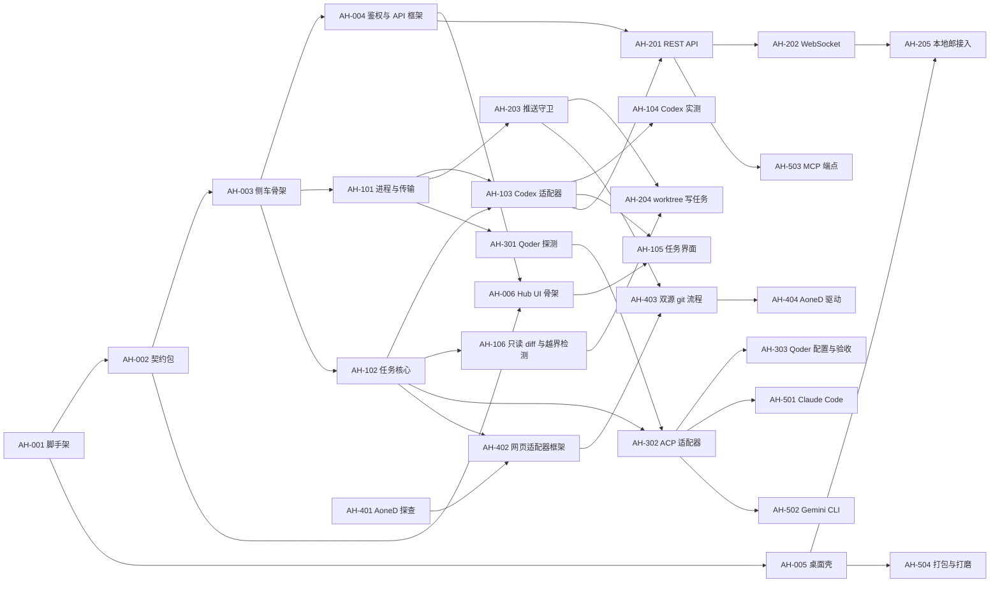

# 分阶段里程碑与任务卡

> 上级文档：[../README.md](../README.md)。每张任务卡一个分支、一个 PR；卡里的“验收”是合并的必要条件。错误路径编号（E01…）见 [testing.md](testing.md) §4，安全清单见 [security.md](security.md) §10，桌面壳清单见 [desktop-shell.md](desktop-shell.md) §10。

## 1. 总览

| 里程碑 | 目标                                              | 对应场景               | 结束时能做什么                                                                |
| ------ | ------------------------------------------------- | ---------------------- | ----------------------------------------------------------------------------- |
| M0     | 地基：四个包、侧车骨架、鉴权、桌面壳、Hub UI 骨架 | —                      | 打开 Hub，左侧是本地郎、右侧是空的任务区；侧车可启动、可鉴权；CI 全绿         |
| M1     | Codex 只读闭环                                    | S3、S4、S5、S7、S8、S9 | 在 Hub 里给 Codex 派只读任务，看实时输出、审批、结果、diff；崩溃后能恢复      |
| M2     | 本地 API、本地郎接入、可写任务、推送守卫          | S1、S2（Codex）        | 本地郎派任务、订阅进度、取结果与 diff；worktree 写任务与“应用到本地分支”      |
| M3     | 通用 ACP 适配器 + Qoder                           | S2（Qoder）            | Qoder 与 Codex 同等可用（模型、模式、审批、取消、恢复）                       |
| M4     | 网页 Agent（AoneD）                               | S6                     | 经内网任务分支把任务交给 AoneD，结束后在本地看 diff                           |
| M5     | 扩展与打磨                                        | —                      | Claude Code / Gemini CLI 配置接入；自包含 .app；可选 MCP 端点；保留策略与诊断 |

M3 和 M4 只依赖 M1、M2 的部分卡片，可以并行。AH-301、AH-401 是探查卡，越早做越好（结论会影响后续卡的范围）。

## 2. 通用完成标准

每张卡都要满足：

- `pnpm lint && pnpm typecheck && pnpm test && pnpm build` 通过；改了 `desktop/` 的，在 macOS 上 `cargo check`、`cargo test` 通过并跑相关手工清单。
- 卡里列出的错误路径编号都有测试，测试名以编号开头。
- 改了协议、接口、数据模型或配置的，同步更新对应文档（本目录）；新发现的坑写进 [risks-and-open-questions.md](risks-and-open-questions.md) 或对应分册。
- 不引入任何外部遥测、自动更新或外网请求。
- 提交信息遵守仓库的 commitlint（AH-001 合并后 scope 用 `agent-hub`）。

## 3. M0 地基

### AH-001 工作区脚手架

- **范围**：新建 `contract/`、`server/`、`web/`、`desktop/` 四个包（`@agent-hub/contract`、`@agent-hub/server`、`@agent-hub/web`、`@agent-hub/desktop`），tsconfig 继承 `@repo/config-ts`，接入根 ESLint 与 Prettier；commitlint 加 scope `agent-hub`；根 `package.json` 加 `dev:agent-hub`；CI 按 [testing.md](testing.md) §5 修改（根 `.gitignore` 已覆盖 `apps/**/src-tauri/target/` 与 `gen/`，无需改动）。
- **依赖**：无。
- **验收**：四个包各有一个占位测试且在 `pnpm test` 中运行；`desktop/` 不进 `pnpm build`；`pnpm install --frozen-lockfile` 在 CI 通过；`git commit -m "chore(agent-hub): …"` 能通过 commitlint。

### AH-002 契约包

- **范围**：把 [adapter-interface.md](adapter-interface.md) §2–§5 的类型落到 `contract/src/`，为对外的 DTO、事件、配置写 zod schema；CJS 输出（与 `@repo/trpc-contract` 一致，供 Nest 侧车引用）；错误路径矩阵检查脚本（[testing.md](testing.md) §4）。
- **依赖**：AH-001。
- **验收**：schema 正反例单测；`AgentEvent` 每个变体都能序列化往返；矩阵检查脚本接入 `pnpm test`（此时允许所有编号“未覆盖”的白名单，后续卡逐步移除）。

### AH-003 侧车骨架

- **范围**：Nest 11 应用；`AGENT_HUB_HOME` 解析与权限；配置读取与校验（[architecture.md](architecture.md) §8）；Prisma schema 与首个迁移（[data-model.md](data-model.md)）；启动时 `migrate deploy`；stdin 读取 UI token、stdin 关闭即停机；ready / fatal 行；只监听 `127.0.0.1`；日志与 `redact`（[security.md](security.md) §5）；`GET /healthz`；优雅停机。
- **依赖**：AH-002。
- **验收**：E33、E68；E47 的单测部分（每种密钥模式）；`lsof` 只显示 `127.0.0.1`。

### AH-004 鉴权与 API 框架

- **范围**：Host / Origin 守卫（HTTP 与 WS 握手）；token 生成、哈希存储、`bridge-token` 文件（`0600`）、scope、吊销；统一错误格式与错误码（[local-api.md](local-api.md) §7）；限流；审计写入；tRPC 挂载与 UI token 鉴权。
- **依赖**：AH-003。
- **验收**：E49；吊销 token 后已连接的 WS 以 `4401` 断开；审计里有 token 创建与吊销记录。

### AH-005 桌面壳（macOS）

- **范围**：按 [desktop-shell.md](desktop-shell.md) 实现 Tauri v2 壳：开启 `unstable` 特性、主窗口加载 Hub UI、Bot 子 WebView（独立数据存储、导航白名单、布局同步、遮挡规则、折叠）、侧车定位与拉起、退避重启、退出确认、单实例、菜单栏图标、capability 与 CSP、IPC 命令。
- **依赖**：AH-001（可先用一个返回 ready 行的假侧车开发，不必等 AH-003）。
- **验收**：desktop-shell.md §10 全部；E63–E67；`cargo test` 覆盖 desktop-shell.md §9 列出的纯函数。

### AH-006 Hub UI 骨架

- **范围**：Vite + React 19 + `@repo/ui-web`；主布局（左栏 `BotSlot` 上报位置、右侧任务区占位、可拖动分隔条）；连接状态与重连；设置页（仓库注册与体检结果、桥接 token 管理、Bot URL、Agent 列表与健康状态）；不在 Tauri 中运行时的开发模式（粘贴 UI token）。
- **依赖**：AH-002、AH-004。
- **验收**：`BotSlot` 位置上报的组件测试；侧车断开再恢复后界面自动重连；E34。

## 4. M1 Codex 只读闭环

### AH-101 进程管理与 JSON-RPC 传输

- **范围**：`ProcessSupervisor`（`detached` 进程组、环境白名单与 git 守卫变量（[security.md](security.md) §3.1、§4.2）、壳传入的登录 shell PATH、stderr 环形缓冲、按 pgid 结束、启动时清理残留进程）；`JsonRpcConnection`（JSONL、请求表与超时、双向请求、非 JSON 行容错、单行上限、写入背压）；假 Agent 剧本框架与 `fake-codex.mjs`（[testing.md](testing.md) §3）。
- **依赖**：AH-003。
- **验收**：E01–E03、E06–E13、E23–E25。

### AH-102 任务核心

- **范围**：`TaskService` 与状态机、`Scheduler`（全局与每 Agent 并发、排队上限、`in_place` 写互斥）、`EventStore`（`seq`、增量合并、先落库后广播、输出上限、transcript）、`EventBus`、`ApprovalService`、取消与恢复编排（[architecture.md](architecture.md) §3–§5、§7.3）。
- **依赖**：AH-003。
- **验收**：状态机按表穷举（合法迁移全部通过、非法迁移全部 `ILLEGAL_TRANSITION`）；E14 的合并部分、E28、E36。

### AH-103 Codex 适配器

- **范围**：[adapter-codex.md](adapter-codex.md) 全部：生成类型入库、握手、健康与登录检测、模型与推理档、`thread/start` / `thread/resume`、`turn/start`（只读沙箱）、事件映射、审批映射、`turn/interrupt`、共享进程崩溃与退避重启、禁止调用的方法。
- **依赖**：AH-101、AH-102。
- **验收**：E05、E14–E17、E21、E26、E27、E29、E30 的 Codex 部分；用回放夹具测试（AH-104 产出夹具后补上）。

### AH-104 Codex 实测

- **范围**：在 owner 的 Mac 上用真实 Codex 跑通只读任务、审批、取消、恢复；`threadSource: "user"` 可见性实测（[adapter-codex.md](adapter-codex.md) §11）；确认 `model.id` 与 `model.model` 的取舍；录制夹具；填写协议兼容表。
- **依赖**：AH-103。
- **验收**：兼容表里 Codex 版本一行写明实测结论；至少两个夹具（正常一轮、一次审批）回放通过；`supportsUserVisibleSessions` 的取值有实测依据。

### AH-105 任务界面

- **范围**：任务列表（Agent、模型与推理档、状态、来源、仓库，筛选与搜索）；任务详情（按轮展示消息、推理摘要、工具调用与输出、计划、审批卡片、错误）；新建任务页（Agent、模型、推理档、只读 / 可写、仓库与基线、提示词）；追问；停止本轮 / 强制结束；恢复；归档；系统通知（审批待处理、任务结束）。
- **依赖**：AH-006、AH-103。
- **验收**：组件测试覆盖各状态的展示与可用操作（与 architecture.md §3.1 的“允许的操作”一致）；手工：S3、S4、S5、S7、S9 在真实 Codex 上走通。

### AH-106 只读 diff 与越界检测

- **范围**：`DiffService`（临时索引、统计、补丁落盘、截断、二进制）；只读任务的前后快照与越界告警；diff 查看组件（文件列表、并排 / 统一视图，只读）。
- **依赖**：AH-102。
- **验收**：E38；E37 的服务层部分（在工作区里直接写文件后调用检测），适配器部分在 AH-302 补上。

**M1 验收**：从 Hub 给真实 Codex 派一个只读任务，看到流式输出，完成一次审批，拿到结果；强退 Hub 后重启，任务为“已中断”，点“恢复”能继续。

## 5. M2 本地 API、本地郎接入、可写任务

### AH-201 REST API

- **范围**：[local-api.md](local-api.md) §3–§5、§7：Agent 与模型列表、任务的创建 / 查询 / 追问 / 取消 / 恢复、结果、diff（含桥接截断）、审批（需 scope）、事件分页、`wait` 长轮询、幂等键、桥接写任务待确认、暂停开关。
- **依赖**：AH-004、AH-103。
- **验收**：E19、E20、E22、E32、E48、E50、E51、E54、E55。

### AH-202 WebSocket

- **范围**：[local-api.md](local-api.md) §6：鉴权（握手头或首条消息）、订阅与续订、心跳、慢消费者关闭、关闭码。
- **依赖**：AH-201。
- **验收**：E52、E53；WS 首条消息鉴权超时以 `4401` 关闭。

### AH-203 推送守卫

- **范围**：[security.md](security.md) §3：hooks 目录与所有标准 hook 的转发脚本、`pre-push` 主机检查、Hub 推送服务的校验（远端名、改写后的 URL、主机白名单与黑名单、分支命名空间、禁止强推、URL 去凭据）、远端跟踪分支检测与命令扫描、仓库体检与“禁用 origin 推送”的建议操作。
- **依赖**：AH-101。
- **验收**：E41–E46；在本仓库的副本上验证 Agent 提交时 husky 的 commitlint 与 lint-staged 仍会运行。

### AH-204 worktree 写任务

- **范围**：worktree 创建与命名、`worktreeSetup`、Codex `workspace-write`（`writableRoots` 只有 worktree）、写任务的界面确认（桥接来源）、“应用到本地分支”（提交、合并或只保留分支）、归档时清理 worktree。
- **依赖**：AH-203、AH-106。
- **验收**：E35、E40；手工：S2 在真实 Codex 上走通（含一次命令审批）。

### AH-205 本地郎接入

- **范围**：与桥接方对齐接入方式（WebSocket 或 `wait`，是否需要 MCP，见待决问题 Q3）；按 [local-api.md](local-api.md) §8 提供可直接运行的示例脚本；Bot 面板与任务区的联动（任务卡片显示“来自 Bot”）。
- **依赖**：AH-202、AH-005。
- **验收**：[testing.md](testing.md) §6 的“本地郎端到端”；security.md §10 全部。

**M2 验收**：S1、S2（Codex）在真实环境走通；安全清单全部勾选。

## 6. M3 通用 ACP 适配器 + Qoder

### AH-301 Qoder 探测

- **范围**：在 owner 的 Mac 上记录 `qodercli` 版本与 `--acp` 的实际行为：`initialize` 响应、鉴权方式、`session/new` 响应里的模型与模式字段、`set_model` / `set_mode` 的参数形状、是否支持 `session/load` / `resume` / `close`、stdin 关闭后的行为、权限请求的选项种类。
- **依赖**：AH-101（用其中的进程工具写一个探测脚本）。
- **验收**：[adapter-acp.md](adapter-acp.md) §6 与 §8 的 Qoder 行填写完毕；录制至少一个夹具。

### AH-302 ACP 适配器

- **范围**：[adapter-acp.md](adapter-acp.md) 全部：SDK 连接、`initialize` 与客户端能力、鉴权检测、`session/new` / `load` / `resume`、`session/prompt`、`session/update` 映射、权限请求映射、模型与模式切换、`fs/*` 把关、取消与 `dispose`（进程组）、闲置保留、能力探测、profile 机制与 `generic` profile；`fake-acp.mjs` 与 `sdk-agent.mjs`。
- **依赖**：AH-301、AH-102。
- **验收**：E04、E18、E23–E27、E31、E37、E39 的 ACP 部分；与 `sdk-agent.mjs` 的互通测试通过。

### AH-303 Qoder 配置与验收

- **范围**：`qoder` profile（含 `exitsOnStdinClose: false`、模型解析）；界面里的模式切换；用 AH-301 的夹具做回放测试。
- **依赖**：AH-302。
- **验收**：[testing.md](testing.md) §6 的 Qoder 一行；S2 在真实 Qoder 上走通。

## 7. M4 网页 Agent（AoneD）

### AH-401 AoneD 探查

- **范围**：确认 AoneD 是否有官方 API 或命令行（[web-agent.md](web-agent.md) 方案 A，待决问题 Q4）；登录方式（SSO 是否依赖扩展或本机客户端）；创建会话需要的参数（仓库、分支）；页面结构与可用于判定状态的元素；结束时提交如何推回内网。
- **依赖**：无（越早越好）。
- **验收**：在 web-agent.md 里写明选定方案及理由；驱动配置草案（选择器或接口）；若方案不可行，在 risks-and-open-questions.md 记录并提出替代方案。

### AH-402 网页适配器框架

- **范围**：`WebAgentAdapter`、`WebAgentDriver` 接口、Playwright 持久化上下文（专用 profile、管道连接、无调试端口）、登录窗口、截图、事件来源分层、假 AoneD 站点。
- **依赖**：AH-401、AH-102。
- **验收**：E57–E61。

### AH-403 双源 git 流程

- **范围**：[web-agent.md](web-agent.md) §3：任务分支创建与推送到 `internal`、fetch 远端结果、diff、应用到本地分支、清理远端分支（需确认）。
- **依赖**：AH-203、AH-402。
- **验收**：E44、E45、E56、E62。

### AH-404 AoneD 驱动

- **范围**：按 AH-401 的结论实现 AoneD 驱动与配置；任务详情里的“网页”页签（截图或方案 C 的子 WebView）。
- **依赖**：AH-403。
- **验收**：[testing.md](testing.md) §6 的 AoneD 一行；S6 走通；GitHub 上没有出现任何新分支。

## 8. M5 扩展与打磨

### AH-501 Claude Code（ACP 配置）

- **范围**：确定 Claude Code 的 ACP 适配器的安装方式与命令；`claude-code` profile；实测并填写兼容表；禁用 `bypassPermissions` 一类模式。
- **依赖**：AH-302。
- **验收**：兼容表一行；正常一轮与一次审批的夹具回放通过；手工走通一个只读任务。

### AH-502 Gemini CLI（ACP 配置）

- 同 AH-501，对象换成 Gemini CLI。

### AH-503 MCP 端点（可选）

- **范围**：[local-api.md](local-api.md) §9；只有当待决问题 Q3 的结论是“本地郎以 MCP 方式调用工具”时才做。
- **依赖**：AH-201。
- **验收**：用 MCP Inspector 或桥接方的客户端调用全部工具；鉴权与 scope 的测试与 REST 一致。

### AH-504 打包与打磨

- **范围**：自包含 .app（[desktop-shell.md](desktop-shell.md) §8 的 M5 一行）；保留策略与清理任务（[data-model.md](data-model.md) §6）；诊断包导出（脱敏）；“在 Bot 中定位”（desktop-shell.md §3.3）。
- **依赖**：AH-005。
- **验收**：从 Finder 双击 .app 能启动并连上已登录的 Codex 与 Qoder；清理任务的单测；诊断包里扫描不到 security.md §5 的任何密钥模式。
