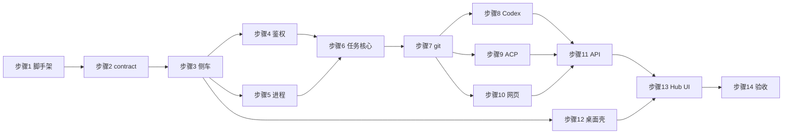

# 一次实现的步骤

> 上级文档：[../README.md](../README.md)。按 D55 一次做完：下面 14 步顺序执行，每步一个提交，每步末尾跑该步的检查点命令，通过再进入下一步。错误路径编号见 [testing.md](testing.md) §4，安全清单见 [security.md](security.md) §10，桌面壳清单见 [desktop-shell.md](desktop-shell.md) §10。

## 1. 步骤总览

| 步骤 | 内容                                               | 依赖     | 检查点                                                                                                              |
| ---- | -------------------------------------------------- | -------- | ------------------------------------------------------------------------------------------------------------------- |
| 1    | 脚手架：四个包、commitlint scope、根脚本、CI       | —        | `pnpm install --frozen-lockfile && pnpm exec commitlint --edit "$MSG" && pnpm build`                                |
| 2    | `@agent-hub/contract`（CommonJS，zod ^4.6.6）      | 1        | `pnpm --filter @agent-hub/contract test`                                                                            |
| 3    | 侧车骨架，含 AH-001 的 `node:sqlite`               | 2        | `pnpm --filter @agent-hub/server test`                                                                              |
| 4    | 鉴权与 API 框架                                    | 3        | `pnpm --filter @agent-hub/server test`                                                                              |
| 5    | 进程管理、JSON-RPC、假 Agent                       | 3        | `pnpm --filter @agent-hub/server test`                                                                              |
| 6    | 任务核心：调度、事件、审批、恢复                   | 4、5     | `pnpm --filter @agent-hub/server test`                                                                              |
| 7    | 工作区与 git：快照、diff、worktree、应用、推送守卫 | 6        | `pnpm --filter @agent-hub/server test`                                                                              |
| 8    | Codex 适配器                                       | 7        | `pnpm --filter @agent-hub/server test`                                                                              |
| 9    | ACP 适配器与 profile                               | 7        | `pnpm --filter @agent-hub/server test`                                                                              |
| 10   | 网页适配器与 `PushService`                         | 7        | `pnpm --filter @agent-hub/server test`                                                                              |
| 11   | REST、WebSocket、本地郎示例                        | 8、9、10 | `pnpm --filter @agent-hub/server test`                                                                              |
| 12   | 桌面壳 Rust + `web/src/desktop/`                   | 3        | `cargo check`（macOS）与 `pnpm --filter @agent-hub/web test`                                                        |
| 13   | Hub UI                                             | 11、12   | `pnpm --filter @agent-hub/web typecheck && pnpm --filter @agent-hub/web test && pnpm --filter @agent-hub/web build` |
| 14   | 打包与手工验收                                     | 全部     | `pnpm desktop:bundle`（macOS）与 [testing.md](testing.md) §7                                                        |

8、9、10 都只依赖 7，写完 7 之后可以按这个顺序做，不要并行改同一批文件。

## 2. 通用完成标准

每一步都要满足：

1. `pnpm lint && pnpm typecheck && pnpm test && pnpm build` 通过。改了 `desktop/` 时，在 macOS 上额外跑 `cargo check`，并跑该步点名的手工清单。Rust 不要求别的检查。
2. 该步验收里列出的错误路径编号都有测试，测试名以编号开头。层为 M 的编号留到 §7，检查脚本把它们算作手工项。
3. 改了协议、接口、数据模型或配置的，同步更新本目录对应分册。新发现的坑写进 [decisions-and-risks.md](decisions-and-risks.md)（新的 D 编号）或对应分册，不要另建风险文档。
4. 不引入外部遥测、自动更新或外网请求。
5. 第 1 步之后的提交用 scope `agent-hub`（D56）。
6. 凡是会加载 `node:sqlite` 的命令（侧车 `start`、`dev`、jest）都带 `NODE_OPTIONS=--disable-warning=ExperimentalWarning`。Rust 壳拉起 Node 时同样加上（[data-model.md](data-model.md) §2）。

侧车开发脚本固定为 `AGENT_HUB_DEV=1 nest start --watch --preserveWatchOutput`。

## 3. 各步骤细则

### 步骤 1 脚手架

- **范围**：新建 `contract/`、`server/`、`web/`、`desktop/`，包名 `@agent-hub/contract`、`@agent-hub/server`、`@agent-hub/web`、`@agent-hub/desktop`。tsconfig 继承 `@repo/config-ts`。接入根 ESLint 与 Prettier。commitlint 的 `scope-enum` 加上 `agent-hub`（D56）。根 `package.json` 增加 `dev:agent-hub`、`desktop:bundle`，`build` 排除 `@agent-hub/desktop`（[desktop-shell.md](desktop-shell.md) §8.1）。CI 按 [testing.md](testing.md) §5 修改。根 `.gitignore` 已覆盖 `apps/**/src-tauri/target/` 与 `gen/`。
- **依赖**：无。
- **验收**：四个包各有一个占位测试，并且出现在 `pnpm test` 里。`pnpm build` 不构建 `@agent-hub/desktop`。`git commit -m "chore(agent-hub): scaffold"` 能通过 commitlint。
- **检查点**：`pnpm install --frozen-lockfile && pnpm lint && pnpm typecheck && pnpm test && pnpm build`。

### 步骤 2 contract

- **范围**：把 [adapter-interface.md](adapter-interface.md) §2–§5、[architecture.md](architecture.md) §8、[local-api.md](local-api.md) §4 落到 `contract/src/`。`package.json` 照 `@repo/shared`：`main` / `types` / `exports` 指向 `dist`，CommonJS，`zod` ^4.6.6（D58）。`labels.ts` 按 [hub-ui.md](hub-ui.md) §2.1。错误路径矩阵检查脚本接进 `pnpm test`（[testing.md](testing.md) §4）；这一步允许全部编号还在“未覆盖”白名单里。
- **依赖**：步骤 1。
- **验收**：schema 正反例；`AgentEvent` 每个变体能往返。
- **检查点**：`pnpm --filter @agent-hub/contract test && pnpm --filter @agent-hub/contract build`。

### 步骤 3 侧车骨架

- **范围**：Nest 11。`AGENT_HUB_HOME` 与权限（[data-model.md](data-model.md) §1）。配置读写（[architecture.md](architecture.md) §8）。日志接到 `redact`（[security.md](security.md) §5、§6）。`--lifeline stdin`、ready / fatal 行、只听 `127.0.0.1`、`GET /api/v1/health`、优雅停机（[architecture.md](architecture.md) §10）。开发脚本用 §2 的那一行。
- **依赖**：步骤 2。

#### AH-001 侧车数据库

这张卡只做本机库，用 Node 内置的 `node:sqlite`（`DatabaseSync`，D13、D16）。

- **范围**：打开 `hub.db`（WAL）。迁移是手写 SQL 数组，`PRAGMA user_version` 记版本，启动时调用 `migrate()`（[data-model.md](data-model.md) §3、§5）。失败转成 fatal `DB_MIGRATION_FAILED`，并留下备份路径。不要引入 ORM，不要生成客户端，不要在启动时执行外部迁移命令。
- **验收**：E33（库版本比程序新）、E47 的单测部分（每种密钥模式）、E68（stdin 关闭后退出）。`lsof` 只显示 `127.0.0.1`。
- **检查点**：`pnpm --filter @agent-hub/server test`。

### 步骤 4 鉴权与 API 框架

- **范围**：Host / Origin 守卫；token 生成、哈希、`bridge-token`（`0600`）、scope、吊销（[local-api.md](local-api.md) §2）；统一错误格式（§3.2）；幂等只对桥接 token 生效（§3.3，D67）；审计写入。管理接口默认只认 UI token。
- **依赖**：步骤 3。
- **验收**：E49。吊销后已连接的 WebSocket 以 `4401` 断开。审计里有 token 的创建和吊销。
- **检查点**：`pnpm --filter @agent-hub/server test`。

### 步骤 5 进程管理与 JSON-RPC

- **范围**：`ProcessSupervisor` 与 `agentEnv()`（[security.md](security.md) §3.2、§4.2）；`JsonRpcConnection`（[adapter-interface.md](adapter-interface.md) §7、§8）；`fake-codex.mjs`、`fake-acp.mjs` 与 `scenario.ts`（[testing.md](testing.md) §3.1）。
- **依赖**：步骤 3。
- **验收**：E01、E02、E03、E06、E07、E08、E09、E10、E11、E12、E13、E23、E24、E25。`jsonrpc.spec.ts` 与 `supervisor.spec.ts` 覆盖 §3.3 点名的场景。
- **检查点**：`pnpm --filter @agent-hub/server test`。

### 步骤 6 任务核心

- **范围**：状态机、`Scheduler`、`EventStore`、`EventBus`、`ApprovalService`、取消与恢复（[architecture.md](architecture.md) §3–§6）。事件流不进 Hub UI 的 Query 缓存（D21），那是步骤 13 的事；这里只保证 `seq` 和增量合并。
- **依赖**：步骤 4、步骤 5。
- **验收**：状态机合法迁移全部通过，非法迁移全部 `ILLEGAL_TRANSITION`。E14 的合并部分、E28、E36。
- **检查点**：`pnpm --filter @agent-hub/server test`。

### 步骤 7 工作区与 git

- **范围**：树快照与 diff（[architecture.md](architecture.md) §7.2）、worktree、应用到本地分支、`GitGuard.ensure()`、`push-target.ts`、`hooks.ts`（[security.md](security.md) §3）。只读越界检测的服务层。
- **依赖**：步骤 6。
- **验收**：E34、E35、E37 的服务层、E38、E40、E41、E42、E43、E44、E45、E46、E48。在本仓库的副本上，Agent 提交仍会跑到仓库自己的 `commit-msg`。
- **检查点**：`pnpm --filter @agent-hub/server test`。

### 步骤 8 Codex 适配器

- **范围**：[adapter-codex.md](adapter-codex.md) 全文。类型手写，不在 CI 里生成。
- **依赖**：步骤 7。
- **验收**：E05、E14、E15、E16、E17、E21、E26、E27、E29、E30 的 Codex 部分。夹具回放留到有录制之后补上。
- **检查点**：`pnpm --filter @agent-hub/server test`。

### 步骤 9 ACP 适配器与 profile

- **范围**：[adapter-acp.md](adapter-acp.md) 全文。`qoder`、`claude-code`、`gemini`、`generic` 都是 profile，不复制适配器。`fake-acp.mjs` 与 `sdk-agent.mjs`。
- **依赖**：步骤 7。
- **验收**：E04、E18、E23、E24、E25、E26、E27 的 ACP 部分、E31、E37 的适配器部分、E39。与 `sdk-agent.mjs` 的互通测试通过。
- **检查点**：`pnpm --filter @agent-hub/server test`。

### 步骤 10 网页适配器与 PushService

- **范围**：[web-agent.md](web-agent.md) 的人工协作流程：`PushService`、镜像 ref、轮询、完成本轮、快进本地分支。不实现页面自动化。v1 不提供 MCP server（D47）。
- **依赖**：步骤 7。
- **验收**：E44、E45、E56、E57、E58、E59、E60、E61、E62。
- **检查点**：`pnpm --filter @agent-hub/server test`。

### 步骤 11 REST、WebSocket 与本地郎示例

- **范围**：[local-api.md](local-api.md) §5–§8。Hub UI 与本地郎共用这一套。示例脚本能在本机对假侧车跑通派发、`wait`、取 diff。
- **依赖**：步骤 8、步骤 9、步骤 10。
- **验收**：E19、E20、E22、E32、E50、E51、E52、E53、E54、E55。WS 首条鉴权超时以 `4401` 关闭。
- **检查点**：`pnpm --filter @agent-hub/server test`。

### 步骤 12 桌面壳

- **范围**：按 [desktop-shell.md](desktop-shell.md) 复制 Rust 全文和 `web/src/desktop/`。capability 只授给 `hub`。开 `unstable`。
- **依赖**：步骤 3（开发期可以用打印 ready 行的假侧车）。
- **验收**：macOS 上 `cargo check` 通过。`web/test/desktop/` 的 17 个行为测试通过。手工： [desktop-shell.md](desktop-shell.md) §10 与 E63、E64、E65、E66、E67，结果贴在该步的 PR 说明里。
- **检查点**：`cargo check --manifest-path apps/agent-hub/desktop/src-tauri/Cargo.toml`（仅 macOS）以及 `pnpm --filter @agent-hub/web test`。

### 步骤 13 Hub UI

- **范围**：[hub-ui.md](hub-ui.md) 全文。新建任务和设置是页面（D62）。不发幂等键（D67）。
- **依赖**：步骤 11、步骤 12。浏览器开发模式可以先于 Rust 壳把界面跑起来（[desktop-shell.md](desktop-shell.md) §8.2）。
- **验收**：[hub-ui.md](hub-ui.md) §8。侧车断开再恢复后界面自动重连。
- **检查点**：`pnpm --filter @agent-hub/web typecheck && pnpm --filter @agent-hub/web test && pnpm --filter @agent-hub/web build && pnpm lint`。

### 步骤 14 打包与手工验收

- **范围**：`pnpm desktop:bundle` 产出 ad-hoc 签名的 `.app`（D5、D12）。保留策略（[data-model.md](data-model.md) §6）和诊断包导出（脱敏后再打包）。
- **依赖**：步骤 1–13。
- **验收**：从 Finder 打开 `.app` 能连上本机已登录的 Codex 与 Qoder。诊断包里扫不到 [security.md](security.md) §5 的模式。[testing.md](testing.md) §7 整表勾完。
- **检查点**：`pnpm lint && pnpm typecheck && pnpm test && pnpm build`，macOS 上再加 `pnpm desktop:bundle` 与 §7 的记录。

## 4. 最终验收

14 步都合并之后，对照 [testing.md](testing.md) §7 的手工表再走一遍，并把命令输出留在最后一个 PR 里。桌面壳用 `cargo check` 的结果，不要用别的 Rust 测试命令代替。
