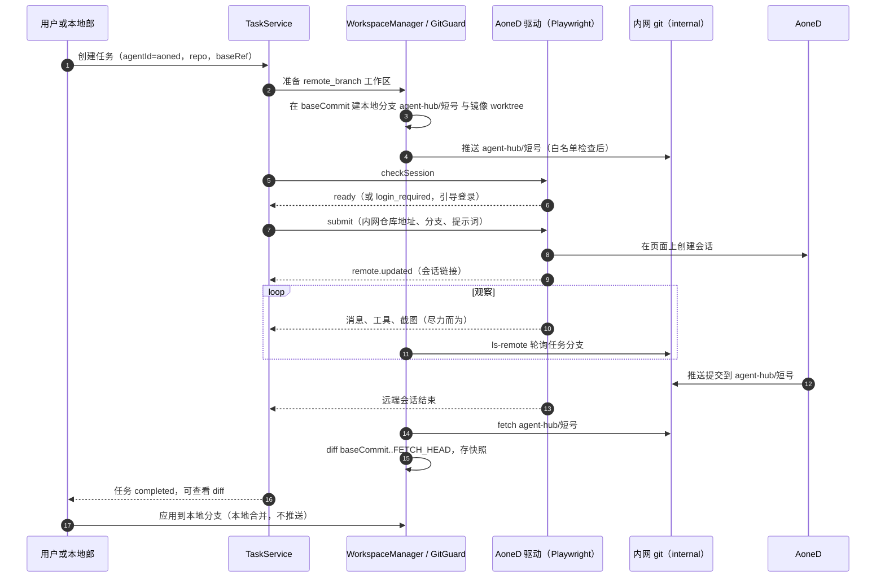

# 网页 Agent（以 AoneD 为例）

> 上级文档：[adapter-interface.md](adapter-interface.md)。网页 Agent 是第三类适配器（`kind: "web"`）：Agent 跑在云端，只能通过浏览器会话使用，代码通过内网 git 远端交换。
>
> 写这份文档时还拿不到 AoneD 的页面结构和接口，所以本文只定**机制**（驱动接口、git 流程、浏览器管理、错误处理）；页面选择器、接口解析由 M4 的探查任务卡（AH-401）填进驱动的配置文件。

## 1. 约束

- AoneD 是阿里内网的云端 CLI Agent，需要公司 SSO 登录，只能在浏览器里使用。
- 它跑在云端，**看不到本机文件**，只能从内网 git 拉代码、把结果推回内网 git。
- 本地仓库是双源：`origin` = GitHub（**禁止推送**），`internal` = 公司内网 git（允许推送）。
- 因此网页 Agent 的任务必须经过“本地基线 → 推到 `internal` 的任务分支 → AoneD 在该分支上工作 → 推回 → Hub 拉取并算 diff”这条路径。

## 2. 接入方案对比

| 方案                                       | 做法                                                                                                                                                            | 优点                                                                                 | 缺点                                                                                                                        | 结论                                             |
| ------------------------------------------ | --------------------------------------------------------------------------------------------------------------------------------------------------------------- | ------------------------------------------------------------------------------------ | --------------------------------------------------------------------------------------------------------------------------- | ------------------------------------------------ |
| A. 官方 API / CLI                          | AoneD 若提供 OpenAPI 或命令行（个人 token），直接调用                                                                                                           | 结构化、稳定                                                                         | 不确定有没有                                                                                                                | **优先**，owner 确认是否可用（待决问题 Q4）      |
| B. Playwright 驱动专用 Chrome（管道模式）  | `playwright-core` 以 `launchPersistentContext` 启动**系统 Chrome**、**专用 profile**；Playwright 默认经管道（`--remote-debugging-pipe`）通信，不开 TCP 调试端口 | Chrome 兼容内网站点；能在网络层观察接口响应和 WebSocket 帧；能截图；登录后可无头运行 | 页面或接口改版会失效；SSO 过期时要弹出有界面的窗口登录；多一个浏览器进程                                                    | **默认实现**                                     |
| C. Tauri 子 WebView（WKWebView）+ 注入脚本 | 主窗口里再放一个子 WebView 加载 AoneD，初始化脚本观察 DOM，经一个最小权限的 IPC 命令上报                                                                        | 真正的单窗口                                                                         | 不能拦截网络，只能读 DOM；内网站点未必支持 Safari 内核；设备可信 / SSO 可能要求 Chrome；要给远程页面开 IPC 权限，攻击面变大 | 备选：仅当 B 被证明不可行且 AoneD 支持 WebKit 时 |
| D. 连接用户日常 Chrome 的调试端口          | `--remote-debugging-port` 连日常浏览器，复用登录                                                                                                                | 不用再登录                                                                           | Chrome 136 起不再允许对默认用户数据目录开启远程调试；开 TCP 调试端口后本机任何进程都能控制浏览器、读走全部 Cookie           | **禁止**                                         |

方案 B 的浏览器窗口平时不显示（无头或最小化），用户不需要在它和 Hub 之间切换：进度、截图、diff 都在 Hub 的任务详情里看；只有登录过期时才弹出窗口让用户登录。

## 3. 双源 git 流程



### 3.1 Hub 自己推送时的规则

Hub 只有这一处会推送，统一经 `GitGuard.pushTaskBranch()`，规则全部满足才执行：

1. 远端名在 `security.allowedPushRemotes` 里（默认只有 `internal`）。
2. 用 `git remote get-url --push <remote>` 取**改写后**的最终 URL（它会应用用户配置里的 `insteadOf` 规则）；解析出主机名，必须在 `security.allowedPushHosts` 里，且不匹配 `security.blockedPushHosts`（默认 `github.com` 及其子域）；协议必须在 `security.allowedPushProtocols` 里（默认 `ssh`、`https`；测试里设为 `git`，以便使用本机 `git daemon`，见 testing.md §3.4）。
3. refspec 只能是 `<本地提交>:refs/heads/agent-hub/<taskShortId>`；不带 `--force`、`--mirror`、`--all`、`--tags`，加 `--no-follow-tags`。
4. 执行时设置 `GIT_ALLOW_PROTOCOL=<上一步的协议>`、`GIT_TERMINAL_PROMPT=0`；凭据用用户已有的 git 凭据助手或 SSH agent（Hub 进程自己保留 `SSH_AUTH_SOCK`，Agent 子进程里没有，见 security.md §4.2）。
5. 每次推送写审计记录：远端名、去掉 userinfo 的 URL、ref、提交号、结果。
6. Hub 的 hooks 目录里的 `pre-push` 再检查一次（security.md §3.2）。

拉取（`fetch`、`ls-remote`）同样只对白名单里的远端和主机执行。

### 3.2 提示词约定

驱动提交给 AoneD 的提示词在用户原文后面追加：“请在分支 `agent-hub/<短号>` 上工作，完成后提交并推送到这个分支；不要推送到其他分支，不要创建合并请求。” 这只是约定；Hub 只拉取这一个分支，AoneD 推到别处的内容 Hub 不认。

### 3.3 结束、应用与清理

- **结束判定**：驱动报告远端会话结束，或者任务分支出现新提交且远端会话处于空闲状态。两者都没有时，按 `web.maxDurationMinutes`（默认 120）超时。
- **没有新提交**：远端会话已结束但任务分支没有新提交 → 任务 `completed`，diff 为空，并发 `notice`（warning）“未在任务分支上发现新提交”。
- **应用到本地分支**：把本地 `agent-hub/<短号>` 快进到拉取的提交，用户可再选择合并到当前分支（architecture.md §6.4）。**不推送。**
- **清理远端分支**：归档时提供“删除内网任务分支”按钮（`git push internal --delete agent-hub/<短号>`，同样过 §3.1 的检查，只允许 `agent-hub/*`），默认不删。

## 4. 驱动接口

```ts
// server/src/adapters/web/types.ts
import type { Page } from 'playwright-core';
import type { ModelOption } from '@agent-hub/contract';
import type { AgentEventSink } from '../types';

export interface WebTaskInput {
  /** 去掉 userinfo 的内网仓库地址。 */
  repoUrl: string;
  branch: string;
  baseCommit: string;
  prompt: string;
  model?: string;
}

export interface WebTaskOutcome {
  status: 'completed' | 'failed' | 'cancelled';
  message?: string;
  /** 驱动能从页面上读到时填写；Hub 仍以 fetch 到的分支为准。 */
  headCommit?: string;
}

export interface WebAgentDriver {
  readonly id: string;
  /** 打开站点并判断登录态。 */
  checkSession(page: Page): Promise<'ready' | 'login_required'>;
  listModels?(page: Page): Promise<ModelOption[]>;
  submit(page: Page, input: WebTaskInput): Promise<{ remoteTaskId: string; url: string }>;
  /** 一直观察到远端任务结束；通过 sink 产出事件；signal 触发时尽快返回。 */
  watch(
    page: Page,
    remoteTaskId: string,
    sink: AgentEventSink,
    signal: AbortSignal,
  ): Promise<WebTaskOutcome>;
  followUp?(page: Page, remoteTaskId: string, text: string): Promise<void>;
  cancel(page: Page, remoteTaskId: string): Promise<void>;
}
```

- `WebAgentAdapter` 实现 `AgentAdapter`，负责浏览器生命周期、git 流程（§3）和超时；驱动只管“页面上怎么操作、怎么读”。
- 页面选择器、接口路径、状态文案放在驱动目录的 `selectors.json`（带版本号），页面改版时改配置即可。必需的选择器在超时内找不到 → `WEB_DOM_DRIFT`：保存截图、发 `notice`、任务 `failed`（不可重试），远端会话链接保留给用户手动跟进。

## 5. 浏览器管理

| 项目     | 约定                                                                                                                              |
| -------- | --------------------------------------------------------------------------------------------------------------------------------- |
| 库       | `playwright-core`（不下载自带浏览器），`channel: "chrome"` 用系统 Chrome；没装 Chrome 时健康状态 `unavailable`                    |
| profile  | `<AGENT_HUB_HOME>/browser-profiles/<driverId>`，目录权限 `0700`；不复制、不进诊断包                                               |
| 有无界面 | `web.headless`：`"auto"`（默认，先无头；判定需要登录或被站点拦截时，以有界面方式重启让用户登录，登录后回到无头）、`true`、`false` |
| 并发     | 每个驱动一个浏览器进程，每个任务一个标签页；AoneD 默认 `maxConcurrent: 1`                                                         |
| 回收     | 空闲 10 分钟关闭浏览器                                                                                                            |
| 其他     | 禁止下载；不装扩展（公司 SSO 是否依赖扩展或本机客户端，见待决问题 Q4）                                                            |

## 6. 事件来源（按优先级）

1. **接口响应 / WebSocket 帧**：`page.on('response')`、`page.on('websocket')` 拿到 JSON，由驱动解析成 `message.*`、`tool.*`、`plan.updated` 事件。
2. **DOM 观察**：用 Playwright 的 `addInitScript` + `exposeBinding` 注入 `MutationObserver`，把消息区的变化回传。注意这是在 Playwright 管理的 Chrome 里，不涉及 Tauri IPC。
3. **兜底**：每 30 秒截图一张（`screenshots/<taskId>/`，产出 `remote.updated.screenshotPath`），加上结束后的 git diff。

M4 的最低验收只要求第 3 层 + 远端会话链接 + 结束判定 + diff；第 1、2 层能做多少取决于探查结果。

## 7. 界面

- 网页任务的详情页显示：远端会话链接（“打开 AoneD 会话”会在**专用 profile 的 Chrome 窗口**里打开，因为登录态在那里，不在用户的日常浏览器里）、最新截图（30 秒刷新）、任务分支与最新提交、结束后的 diff。
- 需要登录时：任务详情顶部横幅 + 系统通知 + “打开登录窗口”按钮。

## 8. 方案 C 的实现要点（仅在采用时）

- 第三个子 WebView，label `web-aoned`，独立数据存储，默认隐藏；用户在任务详情的“网页”页签里查看时，像 Bot 面板一样由 Hub UI 上报位置（desktop-shell.md §2.2）。
- 初始化脚本通过 IPC 命令 `web_agent_report` 上报 DOM 变化。需要一个单独的 capability：`webviews: ["web-aoned"]`，`remote.urls` 只写 AoneD 的 origin，权限**只有** `allow-web-agent-report`。
- 风险：AoneD 站点上的任何脚本都能调用这个命令伪造事件。影响限于事件内容（git 结果仍以 fetch 为准），可以接受，但要在 PR 里写明。

## 9. 错误路径

| 情况                                  | 处理                                                                                                                             |
| ------------------------------------- | -------------------------------------------------------------------------------------------------------------------------------- |
| 提交前发现需要登录                    | 健康状态 `auth_required`；任务留在 `preparing`，弹出登录窗口并发通知；10 分钟内未登录 → `failed`（`WEB_LOGIN_REQUIRED`，可重试） |
| 观察中途登录过期                      | 发 `error`（`WEB_LOGIN_REQUIRED`，可重试）和通知；登录后用远端会话链接继续观察                                                   |
| 页面结构变化                          | `WEB_DOM_DRIFT`，见 §4                                                                                                           |
| 推送任务分支失败                      | 远端已有同名分支 → 换短号重试一次；鉴权失败或主机不在白名单 → `GIT_PUSH_BLOCKED`，任务 `failed`                                  |
| 远端会话超过 `web.maxDurationMinutes` | 尝试 `cancel`，任务 `failed`（`WEB_TIMEOUT`）                                                                                    |
| 浏览器崩溃                            | 重启浏览器，用远端会话链接恢复观察；连续失败 3 次 → `failed`（`AGENT_CRASHED`）                                                  |
| 用户在 Hub 里取消                     | 驱动 `cancel`；不管远端是否确认，Hub 停止观察，任务 `cancelled`；任务分支保留                                                    |
