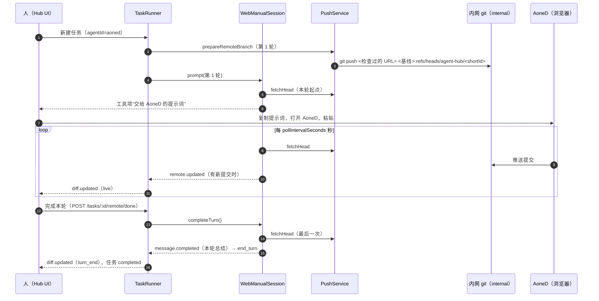

# 网页 Agent（AoneD）：人工协作

> 上级文档：[adapter-interface.md](adapter-interface.md)。网页 Agent 是第三类适配器（`kind: "web"`）。v1 是**人工协作驱动**（D40）：Hub 管 git（任务分支、拉取、diff、应用），人在浏览器里和 AoneD 对话。
>
> 本文的 git 命令都在 git 2.43.0 上用本地裸仓库实测过；嵌入的源码用 TypeScript 6.0.3 编译通过，并跑过 §8 列出的行为测试，原样复制即可。

## 1. 概览

### 1.1 约束

- AoneD 是公司内网的云端 Agent，需要公司 SSO 登录，只能在浏览器里用。它**看不到本机文件**，只能从内网 git 拉代码、把提交推回内网 git。
- 本地仓库是双远端：`origin` = GitHub（**禁止推送**），`internal` = 公司内网 git（仓库配置的 `internalRemote`，默认 `internal`）。
- 所以网页任务走这条路：本地基线 → Hub 推到 `internal` 的任务分支 `agent-hub/<shortId>` → 人让 AoneD 在这个分支上工作 → AoneD 推回 → Hub 拉取、算 diff → 人点“完成本轮”。

### 1.2 分工

| 谁    | 做什么                                                                                                                                            | 不做什么                                                     |
| ----- | ------------------------------------------------------------------------------------------------------------------------------------------------- | ------------------------------------------------------------ |
| Hub   | 建任务分支并推到 `internal`；生成交给 AoneD 的提示词；每 30 秒拉取任务分支，有新提交就更新 diff；“完成本轮”时最后拉一次并写总结；应用到本地分支。 | 不打开、不读、不操作 AoneD 的页面；不保存 AoneD 的任何凭据。 |
| 人    | 点“复制提示词”“打开 AoneD”，在浏览器里把提示词交给 AoneD；可以把 AoneD 会话链接粘回 Hub；看 diff；点“完成本轮”。                                  | —                                                            |
| AoneD | 在 `agent-hub/<shortId>` 上提交并推送。                                                                                                           | Hub 只认这一个分支；推到别处的内容 Hub 不拉取。              |

### 1.3 一轮的时序



### 1.4 v1 不做

- 不做页面自动化，不引入 Playwright，不连浏览器调试端口（D40；扩展点见 §7）。
- 不删除 `internal` 上的任务分支（§4.4）。
- 除了 `agent-hub/<shortId>`，Hub 不向任何远端推送任何东西（[security.md](security.md) §3）。

## 2. 代码与类型

### 2.1 文件

| 文件                                   | 内容                                                              | 本文位置                                |
| -------------------------------------- | ----------------------------------------------------------------- | --------------------------------------- |
| `server/src/adapters/web/types.ts`     | 镜像 ref、`RemoteBranchGit`、提示词与本轮总结、自动化驱动扩展点。 | §2.2                                    |
| `server/src/workspace/push.service.ts` | `PushService`：任务分支的推送、拉取、提交统计、快进本地分支。     | §2.3                                    |
| `server/src/adapters/web/session.ts`   | `WebManualSession`：一轮的轮询、完成、取消、超时、释放。          | §2.4                                    |
| `server/src/adapters/web/adapter.ts`   | `WebManualAdapter`。                                              | §2.5                                    |
| `server/src/workspace/git.ts`          | 侧车执行 git 的唯一入口 `createGit()`。                           | [architecture.md](architecture.md) §7.2 |
| `server/src/workspace/snapshot.ts`     | `snapshotTree()`、`snapshotRemoteBranch()`。                      | [architecture.md](architecture.md) §7.2 |
| `server/src/workspace/push-target.ts`  | URL 解析、去 userinfo、`checkPushTarget()`。                      | [security.md](security.md) §3.1         |
| `server/src/workspace/hooks.ts`        | hooks 目录里的 `pre-push` 与转发脚本。                            | [security.md](security.md) §3.3         |
| `server/test/web/*.spec.ts`            | §8 的场景改写成 jest 用例。                                       | [testing.md](testing.md) §3             |

### 2.2 类型与纯函数

```ts
// server/src/adapters/web/types.ts
import type { RemoteBranchWorkspace } from '../types';

/** 远端任务分支拉到这里：不动 FETCH_HEAD 和 refs/remotes/*（security.md §3.4 的审计只看后者）。 */
export function remoteMirrorRef(shortId: string): string {
  return `refs/agent-hub/remote/${shortId}`;
}

export interface CommitSummary {
  sha: string;
  subject: string;
}

export interface CommitRange {
  /** from..to 的提交数；rewritten 时是 baseCommit..to 的提交数。 */
  count: number;
  /** from 不是 to 的祖先：远端分支被强推改写过。 */
  rewritten: boolean;
  /** 新的在前，最多 limit 条。 */
  commits: CommitSummary[];
}

/** PushService 实现（§2.3），WebManualSession 调用。 */
export interface RemoteBranchGit {
  /**
   * 把远端任务分支拉到 remoteMirrorRef(shortId)，返回它指向的提交。
   * 远端没有这个分支时返回 null；其他失败（网络、鉴权、主机不在白名单）抛 Error，message 是中文说明。
   */
  fetchHead(
    repoPath: string,
    shortId: string,
    remote: RemoteBranchWorkspace,
  ): Promise<string | null>;
  /** from..to 之间的提交（from 不是 to 的祖先时改从 baseCommit 算）。失败抛 Error。 */
  commitsSince(
    repoPath: string,
    remote: RemoteBranchWorkspace,
    from: string,
    to: string,
    limit: number,
  ): Promise<CommitRange>;
}

export const WEB_SUMMARY_COMMIT_LIMIT = 20;

export function handoffTitle(displayName: string): string {
  return `交给 ${displayName} 的提示词`;
}

export interface HandoffInput {
  prompt: string;
  turnIndex: number;
  remote: RemoteBranchWorkspace;
  /** 本轮开始时远端任务分支的提交。 */
  headCommit: string;
}

/** 人复制到网页 Agent 里的完整提示词（§3.2）。 */
export function buildHandoffText(input: HandoffInput): string {
  const { remote } = input;
  return [
    input.prompt.trimEnd(),
    '',
    '---',
    `（Agent Hub 任务第 ${input.turnIndex} 轮）请在仓库 ${remote.repoUrl} 的分支 ${remote.branch} 上工作，` +
      `当前最新提交是 ${input.headCommit.slice(0, 12)}。`,
    '完成后把提交推送到这个分支；不要推送到其他分支，不要强推，不要创建合并请求。',
  ].join('\n');
}

/** 本轮结束时的总结，作为本轮最后一条 message.completed（即 finalMessage，§3.3）。 */
export function buildTurnSummary(
  displayName: string,
  branch: string,
  range: CommitRange | null,
  headCommit: string,
): string {
  if (range === null)
    return `没能拉取 ${branch}，本轮的提交情况未知；diff 以最近一次成功拉取为准。`;
  if (range.count === 0) return `本轮没有在 ${branch} 上发现新提交。`;
  const lines = [
    range.rewritten ? `${branch} 的历史被改写过，以下从基线算起。` : null,
    `本轮 ${displayName} 在 ${branch} 上有 ${range.count} 个新提交（最新 ${headCommit.slice(0, 8)}）：`,
    ...range.commits.map((c) => `- ${c.sha.slice(0, 8)} ${c.subject}`),
    range.count > range.commits.length ? `- …另有 ${range.count - range.commits.length} 个` : null,
  ];
  return lines.filter((l): l is string => l !== null).join('\n');
}

/**
 * 自动化驱动（§7，v1 不实现）：替代“人在浏览器里操作”的那一段。
 * webAgentSchema.driver 加一个取值、在 WebManualAdapter 里按 driver 选实现即可，适配器接口不变。
 */
export interface WebAgentDriver {
  readonly id: string;
  /** 把提示词交给网页 Agent；返回会话链接（写进 tasks.remote_url）。 */
  submit(handoffText: string, signal: AbortSignal): Promise<{ sessionUrl: string | null }>;
  /** 网页 Agent 本轮做完时 resolve，等价于人点“完成本轮”；signal 中止时尽快 resolve。 */
  waitForTurnEnd(signal: AbortSignal): Promise<void>;
  /** 尽力让网页 Agent 停下；不抛错。 */
  cancel(): Promise<void>;
}
```

- **镜像 ref** `refs/agent-hub/remote/<shortId>`：远端任务分支每次拉取都写到这里。它不在 `refs/remotes/*` 下，所以不会出现在用户的 `git branch -r` 里，也不会触发远端跟踪分支审计（[security.md](security.md) §3.4）。
- 提示词与总结的文案就是上面的函数，界面和测试都以它们为准，不要另写。

### 2.3 `PushService`

```ts
// server/src/workspace/push.service.ts
import type { JsonValue } from '@agent-hub/contract';
import {
  AgentFailure,
  agentError,
  type AdapterLogger,
  type RemoteBranchWorkspace,
} from '../adapters/types';
import { remoteMirrorRef, type CommitRange, type RemoteBranchGit } from '../adapters/web/types';
import { ApiError } from '../api/api-error';
import { redact } from '../common/redact';
import type { Git } from './git';
import { checkPushTarget, stripUserinfo } from './push-target';

const NETWORK_TIMEOUT_MS = 60_000;
/** pre-push 钩子拒绝时写到 stderr 的标记（security.md §3.3）。 */
export const PUSH_BLOCKED_MARKER = 'AGENT_HUB_PUSH_BLOCKED';

export type PushAuditAction = 'git.push' | 'git.fetch' | 'security.push_blocked';

export interface PushServiceDeps {
  git: Git;
  /** paths.hooks。 */
  hooksPath: string;
  /** config.security.blockedPushHosts（每次现取，设置改了立即生效）。 */
  blockedPushHosts(): readonly string[];
  /** 写 audit_log（actor 为 system）。 */
  audit(action: PushAuditAction, detail: JsonValue, taskId: string | null): void;
  logger: AdapterLogger;
  /** 只在测试里为 true：允许推到本机路径的裸仓库。 */
  allowLocalRemotes?: boolean;
}

export interface PrepareRemoteInput {
  taskId: string;
  shortId: string;
  repoPath: string;
  /** 已解析并写进 tasks.base_commit 的基线。 */
  baseCommit: string;
  /** repos[].internalRemote。 */
  internalRemote: string;
  /** repos[].allowedPushHosts。 */
  allowedPushHosts: readonly string[];
}

export function taskBranch(shortId: string): string {
  return `agent-hub/${shortId}`;
}

const BOILERPLATE =
  /^(Please make sure you have the correct access rights|and the repository exists\.)$/;

/** git stderr → 一行中文界面可用的说明：去掉套话，取前 3 行，脱敏。 */
export function gitProblem(stderr: string): string {
  const lines = stderr
    .split('\n')
    .map((l) => l.trim())
    .filter((l) => l !== '' && !BOILERPLATE.test(l));
  return redact(lines.slice(0, 3).join(' / ') || '没有错误输出').slice(0, 500);
}

function setupFailed(message: string): AgentFailure {
  return new AgentFailure(agentError('WORKSPACE_SETUP_FAILED', message, false));
}

/** 网页 Agent 任务分支的推送、拉取与快进（web-agent.md §2.3）。Hub 唯一会推送的地方。 */
export class PushService implements RemoteBranchGit {
  private readonly queues = new Map<string, Promise<unknown>>();
  private readonly fetchFailing = new Set<string>();

  constructor(private readonly d: PushServiceDeps) {}

  /**
   * 第 1 轮的工作区准备（web-agent.md §3.1）。可以重复调用：上次停在半路时接着做。失败抛 AgentFailure。
   * 推到检查过的 URL 而不是远端名：按远端名推送会顺带写 refs/remotes/<remote>/agent-hub/*。
   */
  async prepareRemoteBranch(input: PrepareRemoteInput): Promise<RemoteBranchWorkspace> {
    const { git } = this.d;
    const { repoPath, shortId, baseCommit, internalRemote: remote, taskId } = input;
    const branch = taskBranch(shortId);
    const url = await this.pushUrl(repoPath, remote);
    const safeUrl = stripUserinfo(url);

    const reason = checkPushTarget(url, {
      allowedHosts: input.allowedPushHosts,
      blockedHosts: this.d.blockedPushHosts(),
      allowLocal: this.d.allowLocalRemotes === true,
    });
    if (reason) {
      this.d.audit('security.push_blocked', { remote, url: safeUrl, reason }, taskId);
      throw new AgentFailure(
        agentError('GIT_PUSH_BLOCKED', `不能把任务分支推到 ${remote}：${reason}。`, false),
      );
    }

    try {
      const local = await this.revParse(repoPath, `refs/heads/${branch}`);
      if (local === null) await git.run(repoPath, ['branch', '--no-track', branch, baseCommit]);
      else if (local !== baseCommit) throw setupFailed(`本地已有分支 ${branch}，且不在任务基线上`);

      const pushed = await git
        .exec(
          repoPath,
          [
            '-c',
            `core.hooksPath=${this.d.hooksPath}`,
            'push',
            '--porcelain',
            '--no-follow-tags',
            '--recurse-submodules=no',
            url,
            `${baseCommit}:refs/heads/${branch}`,
          ],
          {
            env: { AGENT_HUB_PUSH_ALLOWED_HOSTS: input.allowedPushHosts.join(',') },
            timeoutMs: NETWORK_TIMEOUT_MS,
          },
        )
        .catch((err: Error) => ({ code: -1, stdout: '', stderr: err.message }));
      if (pushed.code !== 0) {
        const error = gitProblem(pushed.stderr);
        this.d.audit('git.push', { remote, branch, ok: false, error }, taskId);
        if (pushed.stderr.includes(PUSH_BLOCKED_MARKER)) {
          this.d.audit(
            'security.push_blocked',
            { remote, url: safeUrl, reason: 'pre-push 钩子拒绝' },
            taskId,
          );
          throw new AgentFailure(
            agentError(
              'GIT_PUSH_BLOCKED',
              `推送 ${branch} 被 Hub 的 pre-push 钩子拦截：${error}`,
              false,
            ),
          );
        }
        if (/^!\s/m.test(pushed.stdout)) {
          throw setupFailed(`${remote} 上已有分支 ${branch} 且指向别的提交；Hub 不强推`);
        }
        throw setupFailed(`推送 ${branch} 到 ${remote} 失败：${error}`);
      }
      this.d.audit('git.push', { remote, branch, ok: true }, taskId);

      await git.run(repoPath, ['update-ref', remoteMirrorRef(shortId), baseCommit]);
      return { remote, branch, baseCommit, repoUrl: safeUrl };
    } catch (err) {
      if (err instanceof AgentFailure) throw err;
      throw setupFailed(`准备任务分支 ${branch} 失败：${(err as Error).message}`);
    }
  }

  /** 第 2 轮起组装 StartSessionParams.remote；不联网。失败抛 AgentFailure。 */
  async describeRemote(
    repoPath: string,
    internalRemote: string,
    shortId: string,
    baseCommit: string,
  ): Promise<RemoteBranchWorkspace> {
    const url = await this.pushUrl(repoPath, internalRemote);
    return {
      remote: internalRemote,
      branch: taskBranch(shortId),
      baseCommit,
      repoUrl: stripUserinfo(url),
    };
  }

  /**
   * 同一任务的拉取串行执行（每次都真的拉一次，不复用进行中的结果）。
   * --refmap= 关掉“顺带更新 refs/remotes/*”，--no-write-fetch-head 不动 FETCH_HEAD。
   */
  fetchHead(
    repoPath: string,
    shortId: string,
    remote: RemoteBranchWorkspace,
  ): Promise<string | null> {
    return this.serial(shortId, async () => {
      const ref = remoteMirrorRef(shortId);
      const before = await this.revParse(repoPath, ref);
      const r = await this.d.git
        .exec(
          repoPath,
          [
            'fetch',
            '--refmap=',
            '--no-tags',
            '--no-write-fetch-head',
            '--recurse-submodules=no',
            remote.remote,
            `+refs/heads/${remote.branch}:${ref}`,
          ],
          { timeoutMs: NETWORK_TIMEOUT_MS },
        )
        .catch((err: Error) => ({ code: -1, stdout: '', stderr: err.message }));
      if (r.code !== 0) {
        if (/couldn't find remote ref/i.test(r.stderr)) return null;
        const error = gitProblem(r.stderr);
        if (!this.fetchFailing.has(shortId)) {
          this.fetchFailing.add(shortId);
          this.d.audit(
            'git.fetch',
            { remote: remote.remote, branch: remote.branch, ok: false, error },
            null,
          );
        }
        throw new Error(error);
      }
      this.fetchFailing.delete(shortId);
      const head = await this.revParse(repoPath, ref);
      if (head !== before) {
        this.d.audit('git.fetch', { remote: remote.remote, branch: remote.branch, ok: true }, null);
      }
      return head;
    });
  }

  async commitsSince(
    repoPath: string,
    remote: RemoteBranchWorkspace,
    from: string,
    to: string,
    limit: number,
  ): Promise<CommitRange> {
    const { git } = this.d;
    const ancestor =
      (await git.exec(repoPath, ['merge-base', '--is-ancestor', from, to])).code === 0;
    const start = ancestor ? from : remote.baseCommit;
    const count = Number(
      (await git.run(repoPath, ['rev-list', '--count', `${start}..${to}`])).trim(),
    );
    const log = await git.run(repoPath, [
      'log',
      `--max-count=${limit}`,
      '--format=%H%x00%s',
      `${start}..${to}`,
    ]);
    const commits = log
      .split('\n')
      .filter((line) => line !== '')
      .map((line) => {
        const [sha = '', subject = ''] = line.split('\0');
        return { sha, subject };
      });
    return { count, rewritten: !ancestor, commits };
  }

  /**
   * “应用到本地分支”的 remote_branch 部分（web-agent.md §4.3）：把本地 agent-hub/<shortId> 快进到镜像 ref。
   * 不联网：应用的就是 diff 里看到的提交。失败抛 ApiError。
   */
  async fastForwardLocalBranch(
    repoPath: string,
    shortId: string,
    baseCommit: string,
  ): Promise<string> {
    const { git } = this.d;
    const branch = taskBranch(shortId);
    const head = await this.revParse(repoPath, remoteMirrorRef(shortId));
    if (head === null || head === baseCommit) {
      throw new ApiError('NOTHING_TO_APPLY', `${branch} 上还没有新提交`);
    }
    const local = await this.revParse(repoPath, `refs/heads/${branch}`);
    if (local === head) return branch;
    if (local === null) {
      await git.run(repoPath, ['branch', '--no-track', branch, head]);
      return branch;
    }
    if ((await git.exec(repoPath, ['merge-base', '--is-ancestor', local, head])).code !== 0) {
      throw new ApiError(
        'MERGE_CONFLICT',
        `本地分支 ${branch} 有内网上没有的提交（或内网分支被强推改写过），不能快进；请手动处理后再应用`,
      );
    }
    const checkedOut = await this.checkedOutAt(repoPath, branch);
    if (checkedOut !== null) {
      throw new ApiError(
        'WORKSPACE_DIRTY',
        `${branch} 正检出在 ${checkedOut}，请先切到别的分支再应用`,
      );
    }
    await git.run(repoPath, ['update-ref', `refs/heads/${branch}`, head, local]);
    return branch;
  }

  /** 删除任务时调用（web-agent.md §4.4）；ref 不存在也不报错。 */
  async deleteMirrorRef(repoPath: string, shortId: string): Promise<void> {
    await this.d.git.exec(repoPath, ['update-ref', '-d', remoteMirrorRef(shortId)]);
  }

  private async pushUrl(repoPath: string, remote: string): Promise<string> {
    const r = await this.d.git.exec(repoPath, ['remote', 'get-url', '--push', remote]);
    if (r.code !== 0) throw setupFailed(`仓库没有名为 ${remote} 的远端`);
    return r.stdout.trim();
  }

  private async revParse(repoPath: string, ref: string): Promise<string | null> {
    const r = await this.d.git.exec(repoPath, [
      'rev-parse',
      '--verify',
      '--quiet',
      `${ref}^{commit}`,
    ]);
    return r.code === 0 ? r.stdout.trim() : null;
  }

  private async checkedOutAt(repoPath: string, branch: string): Promise<string | null> {
    const out = await this.d.git.run(repoPath, ['worktree', 'list', '--porcelain']);
    for (const block of out.split('\n\n')) {
      const lines = block.split('\n');
      if (lines.includes(`branch refs/heads/${branch}`)) {
        return lines.find((l) => l.startsWith('worktree '))?.slice('worktree '.length) ?? repoPath;
      }
    }
    return null;
  }

  private serial<T>(key: string, fn: () => Promise<T>): Promise<T> {
    const prev = this.queues.get(key) ?? Promise.resolve();
    const next = prev.then(fn);
    const settled = next.catch(() => undefined);
    this.queues.set(key, settled);
    void settled.then(() => {
      if (this.queues.get(key) === settled) this.queues.delete(key);
    });
    return next;
  }
}
```

Nest provider 的构造（`app.module.ts`）：

| 依赖                | 取值                                                                                                              |
| ------------------- | ----------------------------------------------------------------------------------------------------------------- |
| `git`               | 全局唯一的 `createGit(process.env)`（[architecture.md](architecture.md) §7.2）。                                  |
| `hooksPath`         | `paths.hooks`（[data-model.md](data-model.md) §1）。                                                              |
| `blockedPushHosts`  | `() => configService.get().security.blockedPushHosts`。                                                           |
| `audit`             | `(action, detail, taskId) => appendAudit(db, { actor: 'system', action, taskId: taskId ?? undefined, detail })`。 |
| `logger`            | 侧车日志（[architecture.md](architecture.md) §11）。                                                              |
| `allowLocalRemotes` | 不传（`false`）。只有测试传 `true`，以便推到本机路径的裸仓库。                                                    |

每条 git 命令的参数为什么这样写（都已实测）：

| 命令                                                                                                                                         | 要点                                                                                                                                                                                                                                                               |
| -------------------------------------------------------------------------------------------------------------------------------------------- | ------------------------------------------------------------------------------------------------------------------------------------------------------------------------------------------------------------------------------------------------------------------ |
| `git remote get-url --push internal`                                                                                                         | 返回**应用过 `insteadOf` / `pushInsteadOf` 之后**的地址，检查的就是真正要连的主机。输出可能带 token，只在内存里用，落盘和显示前 `stripUserinfo`。                                                                                                                  |
| `git -c core.hooksPath=<hooks> push --porcelain --no-follow-tags --recurse-submodules=no <URL> <基线>:refs/heads/agent-hub/<id>`             | 推到**检查过的 URL**，不写远端名：按远端名推送会顺带写 `refs/remotes/internal/agent-hub/<id>`（实测）。不带 `--force`；远端已有同名分支且指向别的提交时 stdout 有 `!` 开头的行。重复推同一提交返回 0（`[up to date]`），所以准备可以重做。                         |
| 推送时的环境                                                                                                                                 | `AGENT_HUB_PUSH_ALLOWED_HOSTS=<repos[].allowedPushHosts，逗号分隔>`：Hub 的 `pre-push` 只在有这个变量时才放行（[security.md](security.md) §3.3）。钩子拒绝时 stdout 为空、stderr 有 `AGENT_HUB_PUSH_BLOCKED`。                                                     |
| `git fetch --refmap= --no-tags --no-write-fetch-head --recurse-submodules=no internal +refs/heads/agent-hub/<id>:refs/agent-hub/remote/<id>` | 写明了目标 ref，git 仍会顺带更新 `refs/remotes/internal/agent-hub/<id>`，`--refmap=` 才能关掉（实测）；`--no-write-fetch-head` 不动 `FETCH_HEAD`；`+` 允许远端被强推后照样更新。远端没有这个分支时 stderr 有 `couldn't find remote ref`（`LC_ALL=C` 保证是英文）。 |
| `git merge-base --is-ancestor <from> <to>`                                                                                                   | 退出码 0 = 是祖先；非 0 一律当作“被改写过”。                                                                                                                                                                                                                       |
| `git update-ref refs/heads/agent-hub/<id> <新> <旧>`                                                                                         | 带旧值：本地分支在检查之后被别人改过时失败，不会覆盖。                                                                                                                                                                                                             |
| `git worktree list --porcelain`                                                                                                              | 找 `branch refs/heads/agent-hub/<id>` 所在的块，判断任务分支是否正被检出。                                                                                                                                                                                         |

- 网络命令（push、fetch）超时 60 秒，其余 30 秒；超时由 `createGit` 结束 git 的整个进程组（含 ssh）。
- 同一任务的 `fetchHead` 串行执行：轮询、“完成本轮”的最后一次拉取、`live` diff 不会同时写同一个 ref，后来的调用等前一个结束后**重新拉一次**，不会拿到点击之前的旧结果。
- 审计：每次推送记 `git.push`；拉取只在镜像 ref 变了、或一段连续失败的第一次时记 `git.fetch`（轮询每 30 秒一次，全记会刷屏）；推送目标检查不过或被钩子拦截时另记 `security.push_blocked`（[data-model.md](data-model.md) §7）。

### 2.4 `WebManualSession`

```ts
// server/src/adapters/web/session.ts
import {
  agentError,
  type AdapterLogger,
  type AgentEventSink,
  type DisposeReason,
  type PromptInput,
  type RemoteBranchWorkspace,
  type TurnResult,
  type WebSession,
} from '../types';
import {
  buildHandoffText,
  buildTurnSummary,
  handoffTitle,
  WEB_SUMMARY_COMMIT_LIMIT,
  type CommitRange,
  type RemoteBranchGit,
} from './types';

export interface WebSessionOptions {
  nativeSessionId: string;
  displayName: string;
  /** 原仓库路径（StartSessionParams.cwd）。 */
  repoPath: string;
  shortId: string;
  remote: RemoteBranchWorkspace;
  pollIntervalMs: number;
  maxTurnMs: number;
  git: RemoteBranchGit;
  sink: AgentEventSink;
  logger: AdapterLogger;
}

type TurnEnd = 'complete' | 'timeout' | 'cancel' | { dispose: DisposeReason };

const ABORTED = Symbol('aborted');

const isAbort = (end: TurnEnd | null): boolean =>
  end === 'cancel' || (typeof end === 'object' && end !== null);

/** 一轮的结束信号。complete / timeout 之后还会最后拉取一次；cancel / dispose 立即结束。 */
class TurnControl {
  end: TurnEnd | null = null;
  readonly woken: Promise<void>;
  readonly aborted: Promise<typeof ABORTED>;
  private wake!: () => void;
  private abort!: (v: typeof ABORTED) => void;

  constructor() {
    this.woken = new Promise((r) => (this.wake = r));
    this.aborted = new Promise((r) => (this.abort = r));
  }

  finish(end: TurnEnd): void {
    if (this.end !== null && (isAbort(this.end) || !isAbort(end))) return;
    this.end = end;
    this.wake();
    if (isAbort(end)) this.abort(ABORTED);
  }
}

interface PollState {
  startHead: string;
  lastHead: string;
  failing: boolean;
  rewrittenNoticed: boolean;
}

type FetchResult = { head: string } | { problem: string };

function message(err: unknown): string {
  return err instanceof Error ? err.message : String(err);
}

function sleep(ms: number): { done: Promise<void>; cancel(): void } {
  let timer: NodeJS.Timeout | undefined;
  const done = new Promise<void>((r) => (timer = setTimeout(r, ms)));
  return { done, cancel: () => clearTimeout(timer) };
}

export class WebManualSession implements WebSession {
  readonly nativeSessionId: string;
  readonly closed: Promise<void>;
  private resolveClosed!: () => void;
  private current: { control: TurnControl; done: Promise<TurnResult> } | null = null;
  private disposedWith: DisposeReason | null = null;

  constructor(private readonly o: WebSessionOptions) {
    this.nativeSessionId = o.nativeSessionId;
    this.closed = new Promise((r) => (this.resolveClosed = r));
  }

  async prompt(input: PromptInput): Promise<TurnResult> {
    if (this.disposedWith !== null) return this.abortResult({ dispose: this.disposedWith });
    if (this.current) throw new Error('同一会话同一时刻只能有一个 prompt');
    const control = new TurnControl();
    const done = this.runTurn(input, control);
    this.current = { control, done };
    try {
      return await done;
    } finally {
      this.current = null;
    }
  }

  async cancelTurn(): Promise<void> {
    this.current?.control.finish('cancel');
  }

  /** “完成本轮”：最后拉取一次、发出总结，等本轮的 prompt() resolve 后返回。没有进行中的轮时什么都不做。 */
  async completeTurn(): Promise<void> {
    const turn = this.current;
    if (!turn) return;
    turn.control.finish('complete');
    await turn.done;
  }

  async dispose(reason: DisposeReason): Promise<void> {
    if (this.disposedWith !== null) return;
    this.disposedWith = reason;
    this.current?.control.finish({ dispose: reason });
    this.resolveClosed();
  }

  private async runTurn(input: PromptInput, c: TurnControl): Promise<TurnResult> {
    const { sink, remote } = this.o;
    const timer = setTimeout(() => c.finish('timeout'), this.o.maxTurnMs);
    try {
      const start = await Promise.race([this.fetch(), c.aborted]);
      if (start === ABORTED) return this.abortResult(c.end);
      if ('problem' in start) {
        return {
          stopReason: 'error',
          error: agentError(
            'GIT_ERROR',
            `本轮开始时${start.problem}。检查内网 git 的网络和登录后追问重试。`,
            true,
          ),
        };
      }

      const itemId = `t${input.index}-handoff`;
      sink.emit({
        type: 'tool.started',
        itemId,
        toolKind: 'other',
        title: handoffTitle(this.o.displayName),
      });
      sink.emit({
        type: 'tool.output.delta',
        itemId,
        text: buildHandoffText({
          prompt: input.text,
          turnIndex: input.index,
          remote,
          headCommit: start.head,
        }),
      });
      sink.emit({ type: 'tool.completed', itemId, status: 'completed' });

      const p: PollState = {
        startHead: start.head,
        lastHead: start.head,
        failing: false,
        rewrittenNoticed: false,
      };
      while (c.end === null) {
        const nap = sleep(this.o.pollIntervalMs);
        await Promise.race([nap.done, c.woken]);
        nap.cancel();
        if (c.end !== null) break;
        if ((await Promise.race([this.poll(p, c, false), c.aborted])) === ABORTED) break;
      }
      if (isAbort(c.end)) return this.abortResult(c.end);

      const summary = await Promise.race([this.finalSummary(p, c), c.aborted]);
      if (summary === ABORTED) return this.abortResult(c.end);
      sink.emit({ type: 'message.completed', itemId: `t${input.index}-summary`, text: summary });
      if (c.end === 'timeout') {
        const minutes = Math.round(this.o.maxTurnMs / 60_000);
        return {
          stopReason: 'error',
          error: agentError(
            'WEB_TURN_TIMEOUT',
            `${this.o.displayName} 本轮超过 ${minutes} 分钟还没有完成。已推送的提交都在 diff 里；` +
              '可以追问继续，或在设置里调大“单轮最长时间”。',
            true,
          ),
        };
      }
      return { stopReason: 'end_turn' };
    } finally {
      clearTimeout(timer);
    }
  }

  private async fetch(): Promise<FetchResult> {
    const { git, repoPath, shortId, remote } = this.o;
    try {
      const head = await git.fetchHead(repoPath, shortId, remote);
      return head === null
        ? { problem: `内网上找不到 ${remote.branch}（可能被删除了）` }
        : { head };
    } catch (err) {
      return { problem: `拉取 ${remote.branch} 失败：${message(err)}` };
    }
  }

  /**
   * 拉取一次；有新提交时发 remote.updated。
   * 返回本轮至今的提交范围；拉取或统计失败、或 head 没变且 !needRange 时为 null。
   */
  private async poll(
    p: PollState,
    c: TurnControl,
    needRange: boolean,
  ): Promise<CommitRange | null> {
    const { sink, remote } = this.o;
    const got = await this.fetch();
    if (isAbort(c.end)) return null;
    if ('problem' in got) {
      if (!p.failing) {
        p.failing = true;
        sink.emit({
          type: 'notice',
          level: 'warning',
          code: 'WEB_FETCH_FAILED',
          message: `${got.problem}。每 ${Math.round(this.o.pollIntervalMs / 1000)} 秒重试一次，恢复前 diff 不会更新。`,
        });
      }
      return null;
    }
    p.failing = false;
    if (got.head === p.lastHead && !needRange) return null;
    let range: CommitRange;
    try {
      range = await this.o.git.commitsSince(
        this.o.repoPath,
        remote,
        p.startHead,
        got.head,
        WEB_SUMMARY_COMMIT_LIMIT,
      );
    } catch (err) {
      this.o.logger.warn('网页任务：统计新提交失败', {
        branch: remote.branch,
        error: message(err),
      });
      return null;
    }
    if (isAbort(c.end)) return null;
    if (got.head !== p.lastHead) {
      p.lastHead = got.head;
      sink.emit({
        type: 'remote.updated',
        branch: remote.branch,
        headCommit: got.head,
        newCommits: range.count,
      });
      if (range.rewritten && !p.rewrittenNoticed) {
        p.rewrittenNoticed = true;
        sink.emit({
          type: 'notice',
          level: 'warning',
          code: 'WEB_BRANCH_REWRITTEN',
          message: `${remote.branch} 的历史被改写过（有人强推），新提交数改为从任务基线算起；diff 以最新提交为准。`,
        });
      }
    }
    return range;
  }

  private async finalSummary(p: PollState, c: TurnControl): Promise<string> {
    const range = await this.poll(p, c, true);
    return buildTurnSummary(this.o.displayName, this.o.remote.branch, range, p.lastHead);
  }

  private abortResult(end: TurnEnd | null): TurnResult {
    if (end !== null && typeof end === 'object') {
      if (end.dispose === 'shutdown') {
        return {
          stopReason: 'error',
          error: agentError('HUB_SHUTDOWN', 'Agent Hub 正在退出，本轮被中断。', true),
        };
      }
      if (end.dispose === 'agent_exited') {
        return {
          stopReason: 'error',
          error: agentError('AGENT_PROCESS_EXITED', '网页会话已结束。', true),
        };
      }
    }
    return { stopReason: 'cancelled' };
  }
}
```

### 2.5 `WebManualAdapter`

```ts
// server/src/adapters/web/adapter.ts
import type { AgentCapabilities, WebAgentConfig } from '@agent-hub/contract';
import type {
  AdapterDeps,
  AgentAdapter,
  AgentEventSink,
  AgentSession,
  ProbeResult,
  StartSessionParams,
} from '../types';
import type { RemoteBranchGit } from './types';
import { WebManualSession } from './session';

export class WebManualAdapter implements AgentAdapter {
  readonly id: string;
  readonly kind = 'web' as const;
  private readonly caps: AgentCapabilities;
  private readonly sessions = new Set<WebManualSession>();

  constructor(
    private readonly config: WebAgentConfig,
    private readonly deps: AdapterDeps,
    private readonly git: RemoteBranchGit,
  ) {
    this.id = config.id;
    this.caps = {
      models: [],
      modelsSource: 'none',
      sandbox: false,
      resume: true,
      userVisibleSessions: false,
      workspaces: ['remote_branch'],
      fetchedAt: deps.now().toISOString(),
    };
  }

  capabilities(): AgentCapabilities {
    return this.caps;
  }

  /** 没有本地进程可查：始终就绪。内网 git 的连通性在任务准备时检查（web-agent.md §3.1）。 */
  async probe(): Promise<ProbeResult> {
    return {
      health: { status: 'ready', version: null, versionVerified: true, executablePath: null },
      capabilities: this.caps,
    };
  }

  async startSession(params: StartSessionParams, sink: AgentEventSink): Promise<AgentSession> {
    if (params.remote === null) throw new Error('网页 Agent 的任务必须是 remote_branch 工作区');
    if (params.signal.aborted) throw new Error('任务在准备阶段被取消');
    const resumed = params.resumeNativeSessionId !== null;
    const session = new WebManualSession({
      nativeSessionId: params.resumeNativeSessionId ?? `web-${params.shortId}`,
      displayName: this.config.displayName,
      repoPath: params.cwd,
      shortId: params.shortId,
      remote: params.remote,
      pollIntervalMs: this.config.pollIntervalSeconds * 1000,
      maxTurnMs: this.config.maxTurnMinutes * 60_000,
      git: this.git,
      sink,
      logger: this.deps.logger,
    });
    this.sessions.add(session);
    void session.closed.then(() => this.sessions.delete(session));
    sink.emit({
      type: 'session.started',
      nativeSessionId: session.nativeSessionId,
      model: null,
      resumed,
    });
    return session;
  }

  async shutdown(): Promise<void> {
    await Promise.all([...this.sessions].map((s) => s.dispose('shutdown')));
  }
}
```

- `AdapterRegistry` 对 `kind: "web"` 的配置执行 `new WebManualAdapter(config, deps, pushService)`（[adapter-interface.md](adapter-interface.md) §9.2）。`webAgentSchema.driver` 目前只有 `"manual"`。
- 能力固定：不能选模型（`modelsSource: "none"`，创建任务时带 `model` 返回 `MODEL_NOT_SUPPORTED`）；只有 `remote_branch` 工作区（只能建可写任务）；`resume: true`（会话只是内存里的一个对象，侧车重启后用同一个 `nativeSessionId` 重建即可）。
- 健康状态固定为 `ready`，`version` 为 `null`：没有本地进程可查；内网 git 连不上会在任务准备或轮询时报出来。
- 没有子进程，`envPassthrough`、`maxConcurrentTasks` 之外的通用字段不起作用；`maxConcurrentTasks` 默认 1（D41）。网页任务在等人操作时一直占着槽位，这是有意的：同时只跟进一个 AoneD 任务。

## 3. 流程

### 3.1 准备任务分支

`TaskRunner` 在 [architecture.md](architecture.md) §5 第 2 步、工作区为 `remote_branch` 且 `tasks.base_tree` 为 `NULL`（第 1 轮，或上次准备没做完）时执行：

| 步骤 | 动作                                                                                                                                                                                              | 失败                                                                          |
| ---- | ------------------------------------------------------------------------------------------------------------------------------------------------------------------------------------------------- | ----------------------------------------------------------------------------- |
| 1    | 取仓库配置（`repos[]` 里按 `repoId`）。`baseCommit` = `tasks.base_commit`（上次准备写过就沿用），否则解析 `baseRef ?? repo.defaultBaseRef ?? "HEAD"`：`git rev-parse --verify <ref>^{commit}`。   | `WORKSPACE_SETUP_FAILED`“基线 <ref> 不存在”                                   |
| 2    | 同步写 `tasks.base_commit`、`tasks.branch = "agent-hub/<shortId>"`（`workspace_path` 保持 `NULL`）。                                                                                              | —                                                                             |
| 3    | `pushService.prepareRemoteBranch({ taskId, shortId, repoPath, baseCommit, internalRemote: repo.internalRemote, allowedPushHosts: repo.allowedPushHosts })`，得到 `RemoteBranchWorkspace`。        | 抛出的 `AgentFailure`（`GIT_PUSH_BLOCKED` / `WORKSPACE_SETUP_FAILED`，见 §6） |
| 4    | 通用步骤：`baseTree = snapshotRemoteBranch(git, repoPath, shortId)`（此时镜像 ref 指向基线，结果就是基线的树），`git update-ref refs/agent-hub/base/<shortId> <baseTree>`，写 `tasks.base_tree`。 | `GIT_ERROR`                                                                   |
| 5    | `adapter.startSession({ ..., cwd: repoPath, workspace: "remote_branch", remote })`。                                                                                                              | 不会失败（§2.5）                                                              |

任何一步失败：本轮与任务 → `failed`，`lastError` 写错误码（[architecture.md](architecture.md) §5）。用户修好问题后追问，`base_tree` 仍为 `NULL`，于是重新从第 1 步做；第 3 步对已经推过的分支是幂等的。

第 2 轮起不再准备，`TaskRunner` 用 `pushService.describeRemote(repoPath, repo.internalRemote, shortId, task.baseCommit)` 组装 `remote`（不联网）。

前提（设置页的仓库体检会提示，[local-api.md](local-api.md) §5.10）：

- 仓库有名为 `internalRemote` 的远端。
- `repos[].allowedPushHosts` 不为空。它不由用户填写：保存设置时，Hub 对每个仓库执行 `git remote get-url --push <internalRemote>`，用 `parsePushTarget` 取主机名。主机名匹配 `security.blockedPushHosts` → 拒绝保存（`400 REPO_INVALID`，D49）；主机名存在且协议是 `ssh` / `https` → 写入 `[主机名]`；其余情况（没有这个远端、本机路径、其他协议）写 `[]`，仓库体检加一条问题“internal 的推送地址不可用：<原因>”。
- 不要求 `origin` 已禁用推送（网页任务只推 `internal`），但体检照样建议禁用（[security.md](security.md) §3.1）。

### 3.2 一轮开始与轮询

1. `TaskRunner` 第 4 步的轮前快照 `beforeTree = snapshotRemoteBranch(...)`，**不联网**（§4.1）。
2. `session.prompt(input)` 先拉取一次，得到本轮起点 `startHead`。拉取失败或远端分支不见了 → 本轮以 `GIT_ERROR`（`retryable: true`）失败，不发提示词。
3. 发出一个工具项：`itemId = "t<轮序号>-handoff"`，`toolKind: "other"`，标题 `handoffTitle(displayName)`，输出 = `buildHandoffText(...)`，随即 `tool.completed`。界面的“复制提示词”复制的就是**当前轮**这个工具项的输出（§5.2）。
4. 每 `pollIntervalSeconds` 秒（默认 30，最小 10）拉取一次：
   - head 变了 → `commitsSince(startHead, head)`，发 `remote.updated`（`newCommits` = 本轮起点以来的提交数）。核心收到后立即算一次运行中的 diff（§4.2）。
   - `startHead` 不再是 head 的祖先（有人强推）→ 新提交数改为从任务基线算，本轮第一次发现时发 `notice`（`warning`，`WEB_BRANCH_REWRITTEN`）。
   - 拉取失败或远端分支不见了 → 一段连续失败只发一次 `notice`（`warning`，`WEB_FETCH_FAILED`），之后静默重试；成功一次后再失败会再提示。
5. 这一轮一直保持 `running`，直到“完成本轮”（§3.3）、停止、超时或停机（§3.4）。

交给 AoneD 的提示词示例（`buildHandoffText` 的实际输出）：

```text
把登录页的表单校验改成 zod，并补上单测。

---
（Agent Hub 任务第 1 轮）请在仓库 ssh://git@git.example/team/multi-apps.git 的分支 agent-hub/5f0c2a9e 上工作，当前最新提交是 9b1c2d3e4f5a。
完成后把提交推送到这个分支；不要推送到其他分支，不要强推，不要创建合并请求。
```

仓库地址是 `internal` 的推送地址去掉 userinfo 后的样子（`ssh://git@…` 的用户名保留，http(s) 的整段 userinfo 去掉）。

### 3.3 完成本轮

| 步骤 | 谁                                   | 动作                                                                                                                                                                                                        |
| ---- | ------------------------------------ | ----------------------------------------------------------------------------------------------------------------------------------------------------------------------------------------------------------- |
| 1    | Hub UI                               | 人点“完成本轮”→ `POST /tasks/:id/remote/done`（只有 UI token 能调，桥接方 `403 ADMIN_ONLY`）。                                                                                                              |
| 2    | `TaskService.completeRemoteTurn(id)` | 任务不是网页任务、不在 `running`、或 `taskRunner.activeSession(id)` 不是 `WebSession`（`isWebSession`）→ `409 ILLEGAL_TRANSITION`。                                                                         |
| 3    | `WebManualSession`                   | `completeTurn()`：最后拉取一次；head 变了照常发 `remote.updated`；发 `message.completed`（`itemId = "t<轮序号>-summary"`，文本 = `buildTurnSummary(...)`）；`prompt()` 以 `end_turn` resolve。              |
| 4    | `TaskService`                        | `completeTurn()` resolve 后返回 `200 TaskDto`。此刻 `TaskRunner` 可能还在算轮后 diff，状态可能仍是 `running`；最终状态经 WebSocket 推送。                                                                   |
| 5    | `TaskRunner`                         | 照常执行 [architecture.md](architecture.md) §5 第 7 步：`afterTree = snapshotRemoteBranch(...)`（最后一次拉取已经更新了镜像 ref），存本轮与整个任务的 diff，`finalMessage` = 本轮总结，任务 → `completed`。 |

- 重复点击：第二次请求到达时第一次还没结束 → 等同一个结果；已经结束 → 任务不在 `running`，`409`。
- 最后一次拉取失败也照样以 `end_turn` 结束，总结写“没能拉取……diff 以最近一次成功拉取为准”。
- 桥接方（本地郎）建的网页任务，用 `GET /tasks/:id/wait` 等到本轮结束，`GET /tasks/:id/result` 拿到的就是这段总结。

本轮总结示例：

```text
本轮 AoneD 在 agent-hub/5f0c2a9e 上有 3 个新提交（最新 c3d4e5f6）：
- c3d4e5f6 test(web): 补登录表单校验单测
- b2c3d4e5 feat(web): 登录表单改用 zod 校验
- a1b2c3d4 chore(web): 引入 zod
```

### 3.4 取消、超时与释放

| 情况                                      | `prompt()` 的结果                                                                                                  | 之后                                                                              |
| ----------------------------------------- | ------------------------------------------------------------------------------------------------------------------ | --------------------------------------------------------------------------------- |
| 人点“停止本轮”或桥接方取消                | 立即 `{ stopReason: 'cancelled' }`，不再拉取、不发总结；正在进行的拉取在后台结束，结果丢弃。                       | 轮后 diff 用镜像 ref（最近一次成功拉取）。AoneD 那边的会话 Hub 管不了，人自己停。 |
| 超过 `maxTurnMinutes`（默认 240）         | 和“完成本轮”一样最后拉一次、发总结，然后 `{ stopReason: 'error', error: WEB_TURN_TIMEOUT }`（`retryable: true`）。 | 任务 `failed`；追问即可继续。                                                     |
| `dispose('shutdown')`（侧车停机）         | 立即 `HUB_SHUTDOWN`（`retryable: true`）。                                                                         | 任务 `interrupted`。                                                              |
| `dispose` 其他原因                        | 立即 `{ stopReason: 'cancelled' }`。                                                                               | —                                                                                 |
| 本轮开始的那次拉取还没回来时就停止 / 停机 | 同上，立即返回。                                                                                                   | —                                                                                 |

- `cancelTurn()`、`completeTurn()`、`dispose()` 都幂等、不抛错（[adapter-interface.md](adapter-interface.md) §6.1）。架构里“取消后最多等 10 秒再强制”的流程对网页任务同样适用，只是它总能立即结束。
- 网页会话没有子进程：`TaskRunner` 对 `kind: "web"` **不启动闲置计时器**，会话留在活动会话表里，直到删除任务、该 Agent 配置变更（`dispose('config_changed')`）或停机。

### 3.5 追问与恢复

- 追问 = 新的一轮：新的 `startHead`、新的提示词工具项（`t<新轮序号>-handoff`），人把它交给 AoneD（同一个 AoneD 会话里接着说即可）。
- 两轮之间 AoneD 又推了提交：下一轮的 `beforeTree` 来自镜像 ref（上一轮最后一次拉取的结果），所以这些提交会算进下一轮的 diff，不会丢。
- 侧车重启过：运行中的网页任务被标为 `interrupted`（`HUB_SHUTDOWN`）。追问时活动会话表里没有会话，`TaskRunner` 调 `startSession({ resumeNativeSessionId: "web-<shortId>" })`，`session.started.resumed = true`。远端任务分支和镜像 ref 都还在（ref 存在仓库里），不需要重新准备。
- `interrupted` 任务的追问框预填“上次执行被中断，请从中断处继续。”（[architecture.md](architecture.md) §3.4），网页任务照用。

## 4. 快照、diff 与应用

### 4.1 快照不联网

`SnapshotService.snapshot(task)` 对 `remote_branch` 调 `snapshotRemoteBranch(git, repoPath, shortId)`：只读镜像 ref 的树，不拉取。镜像 ref 什么时候更新：

| 时机                               | 谁                                         | 方式                                                     |
| ---------------------------------- | ------------------------------------------ | -------------------------------------------------------- |
| 准备任务分支                       | `PushService.prepareRemoteBranch`          | `git update-ref` 指向基线（不联网）                      |
| 每轮开始、每次轮询、完成本轮、超时 | `WebManualSession` → `fetchHead`           | `git fetch`                                              |
| `GET /tasks/:id/diff?live=true`    | `TaskRunner.liveDiff(id, { fetch: true })` | `git fetch`；失败时记 `warn` 日志，用现有的镜像 ref 继续 |

这样 `TaskRunner` 的轮前 / 轮后快照不会因为网络失败而让一轮失败；diff 永远对应“最近一次成功拉取”的内容。

网页任务**不做**远端跟踪分支审计（[security.md](security.md) §3.4）：Hub 本机没有替它执行命令的 Agent 进程，而用户在这期间自己 `git fetch` 会造成误报。

### 4.2 运行中的 diff

- `TaskRunner` 给每个会话建的 sink（[adapter-interface.md](adapter-interface.md) §6.3）收到 `remote.updated` 后，在事件落库之后调用 `void taskRunner.liveDiff(taskId, { fetch: false })`：适配器刚拉过，不必再拉。
- `liveDiff` 的行为与 `GET /tasks/:id/diff?live=true` 相同（[architecture.md](architecture.md) §7.2）：算 `baseTree → 现在` 与 `beforeTree → 现在`，追加 `diff.updated`（`scope: "live"`，只带统计）；同一任务同一时刻只算一次，并发调用共享结果；出错只记日志。
- 所以人在 Diff 页签里不用手动刷新，AoneD 每推一次，最多 `pollIntervalSeconds` 秒后就能看到。

### 4.3 应用到本地分支

`POST /tasks/:id/apply`（[local-api.md](local-api.md) §5.9）对 `remote_branch` 的执行顺序：

| 步骤 | 动作                                                                                                                        | 失败                                 |
| ---- | --------------------------------------------------------------------------------------------------------------------------- | ------------------------------------ |
| 1    | 任务在终态。                                                                                                                | `409 TASK_BUSY`                      |
| 2    | `pushService.fastForwardLocalBranch(repoPath, shortId, baseCommit)`：**不联网**，应用的就是 diff 里看到的提交。             | 见下                                 |
| 2a   | 镜像 ref 不存在或仍是基线。                                                                                                 | `409 NOTHING_TO_APPLY`               |
| 2b   | 本地 `agent-hub/<shortId>` 不存在 → 在镜像 ref 上新建；已经等于镜像 ref → 什么都不做（幂等）。                              | —                                    |
| 2c   | 本地分支不是镜像 ref 的祖先（本地多了提交，或远端被强推改写过）。                                                           | `409 MERGE_CONFLICT`                 |
| 2d   | 本地分支正被某个 worktree 检出（快进会让那个工作区和分支对不上）。                                                          | `409 WORKSPACE_DIRTY`                |
| 2e   | `git update-ref refs/heads/agent-hub/<shortId> <镜像 ref> <旧值>`。                                                         | —                                    |
| 3    | `merge: true` 时按 [architecture.md](architecture.md) §7.4 合并到原仓库当前分支（要求工作区干净，冲突时 `merge --abort`）。 | `WORKSPACE_DIRTY` / `MERGE_CONFLICT` |
| 4    | 写审计 `git.apply`，返回 `{ branch, commit: null, merged, mergeCommit }`。                                                  | —                                    |

**任何情况下都不推送。** 想把结果推到别处，用户自己用 git 操作。

### 4.4 删除任务与远端分支

- 删除任务（只对已归档任务开放）时，在 [architecture.md](architecture.md) §3.1 的清理之外再执行 `pushService.deleteMirrorRef(repoPath, shortId)`；本地分支 `agent-hub/<shortId>`、`refs/agent-hub/base/<shortId>` 照通用规则删除。
- **`internal` 上的任务分支 Hub 不删**：Hub 的 `pre-push` 钩子禁止任何删除（[security.md](security.md) §3.3），v1 也不为此开口子。任务详情页“详情”页签显示一条可复制的命令 `git push internal --delete agent-hub/<shortId>`，由用户自己在终端执行。

## 5. 会话链接与界面

### 5.1 设置

设置页 Agent 区域，`kind: "web"` 的条目只显示这些字段：

| 字段                  | 标签                 | 说明                                                                                                    |
| --------------------- | -------------------- | ------------------------------------------------------------------------------------------------------- |
| `enabled`             | 启用                 | 默认关闭（D39）。                                                                                       |
| `displayName`         | 名称                 | 默认 `AoneD`。                                                                                          |
| `openUrl`             | AoneD 地址           | “打开 AoneD”按钮打开的页面；为空时按钮不可用并提示“在设置里填写 AoneD 地址”。文档和代码里不写真实地址。 |
| `pollIntervalSeconds` | 拉取间隔（秒）       | 10–600，默认 30。                                                                                       |
| `maxTurnMinutes`      | 单轮最长时间（分钟） | 10–1440，默认 240。                                                                                     |
| `maxConcurrentTasks`  | 同时进行的任务数     | 默认 1。                                                                                                |

### 5.2 任务详情里的网页任务卡片

`adapterKind === "web"` 的任务，详情页标题栏下方、页签上方显示 `WebTaskPanel`（[hub-ui.md](hub-ui.md) §5）：

```text
┌ AoneD · 第 2 轮 · 等你在 AoneD 里操作 ─────────────────────────────────────────┐
│ 分支 agent-hub/5f0c2a9e  @ ssh://git@git.example/team/multi-apps.git            │
│ 最新提交 c3d4e5f6 · 本轮 3 个新提交 · 每 30 秒自动拉取                           │
│ [复制提示词] [打开 AoneD] [打开会话]   会话链接 [https://…              ][保存]  │
│                                                       [停止本轮] [完成本轮]      │
└──────────────────────────────────────────────────────────────────────────────────┘
```

| 元素       | 数据来源 / 行为                                                                                                          | 何时可用             |
| ---------- | ------------------------------------------------------------------------------------------------------------------------ | -------------------- |
| 状态文案   | `running` → “等你在 AoneD 里操作”；终态 → 任务状态标签（`contract/src/labels.ts`）。                                     | 总是                 |
| 分支与仓库 | `task.branch`；仓库地址取 `GET /repos` 里该仓库 `inspection.remotes` 中 `internalRemote` 的 `pushUrl`（已去 userinfo）。 | 总是                 |
| 最新提交   | 当前轮最后一条 `remote.updated` 的 `headCommit`（前 8 位）与 `newCommits`；本轮还没有时显示“本轮还没有新提交”。          | 总是                 |
| 复制提示词 | 复制当前轮 `t<轮序号>-handoff` 工具项的输出（`navigator.clipboard.writeText`），提示“已复制”。                           | 当前轮已有这个工具项 |
| 打开 AoneD | `openUrl(config.openUrl)`（`@tauri-apps/plugin-opener`，用系统默认浏览器，那里有 SSO 登录态）。                          | `openUrl` 不为空     |
| 打开会话   | `openUrl(task.remoteUrl)`。                                                                                              | `remoteUrl` 不为空   |
| 会话链接   | 输入框 + 保存 → `POST /tasks/:id/remote/link`，只接受 `http` / `https`；任何状态都能改。                                 | 总是                 |
| 停止本轮   | `POST /tasks/:id/cancel`。                                                                                               | `running`            |
| 完成本轮   | `POST /tasks/:id/remote/done`；请求期间按钮显示“正在拉取…”并禁用。                                                       | `running`            |

- 输出页签里，提示词工具项和本轮总结照常显示（工具项默认折叠，标题“交给 AoneD 的提示词”）。
- 任务列表里，`running` 的网页任务在状态旁显示“待你操作”徽标。
- 系统通知（D28 的第三类）：收到某个网页任务的 `t<n>-handoff` 工具项时，若主窗口不在前台，发“AoneD 任务 #<shortId> 等你操作：提示词已就绪”。

## 6. 错误路径

| 情况                                                                             | 结果                                                             | 错误码 / 提示                                                                |
| -------------------------------------------------------------------------------- | ---------------------------------------------------------------- | ---------------------------------------------------------------------------- |
| 基线 ref 不存在                                                                  | 任务 `failed`                                                    | `WORKSPACE_SETUP_FAILED`                                                     |
| 仓库没有 `internalRemote` 这个远端                                               | 任务 `failed`                                                    | `WORKSPACE_SETUP_FAILED`“仓库没有名为 internal 的远端”                       |
| 推送地址是本机路径、协议不是 ssh/https、主机在黑名单、主机不在白名单、白名单为空 | 任务 `failed`，审计 `security.push_blocked`                      | `GIT_PUSH_BLOCKED`，消息带原因                                               |
| 本地已有同名分支且不在基线上                                                     | 任务 `failed`                                                    | `WORKSPACE_SETUP_FAILED`                                                     |
| `internal` 上已有同名分支且指向别的提交                                          | 任务 `failed`；Hub 不强推                                        | `WORKSPACE_SETUP_FAILED`                                                     |
| `pre-push` 钩子拦截                                                              | 任务 `failed`，审计 `git.push`（失败）与 `security.push_blocked` | `GIT_PUSH_BLOCKED`                                                           |
| 推送鉴权失败、网络不通、超时                                                     | 任务 `failed`，消息带 git 的报错（去掉套话、脱敏）               | `WORKSPACE_SETUP_FAILED`                                                     |
| 本轮开始时拉取失败，或远端分支被删                                               | 本轮 `failed`，不发提示词                                        | `GIT_ERROR`（`retryable: true`）                                             |
| 轮询拉取失败                                                                     | 继续轮询，diff 暂停更新                                          | `notice` `WEB_FETCH_FAILED`（每段连续失败一次）                              |
| 远端分支被强推改写                                                               | 继续；新提交数从基线算                                           | `notice` `WEB_BRANCH_REWRITTEN`（每轮一次）                                  |
| AoneD 推到了别的分支                                                             | Hub 看不到；本轮总结写“本轮没有在 … 上发现新提交”                | —                                                                            |
| 完成本轮时最后一次拉取失败                                                       | 仍 `end_turn`；总结写“没能拉取……”                                | —                                                                            |
| 一轮超过 `maxTurnMinutes`                                                        | 最后拉一次、发总结，本轮 `failed`                                | `WEB_TURN_TIMEOUT`（`retryable: true`）                                      |
| 侧车停机                                                                         | 任务 `interrupted`                                               | `HUB_SHUTDOWN`                                                               |
| 任务不在 `running` 时调 `remote/done`                                            | 拒绝                                                             | `409 ILLEGAL_TRANSITION`                                                     |
| 应用：没有新提交 / 不能快进 / 分支被检出 / 合并冲突                              | 拒绝，不改任何东西                                               | `NOTHING_TO_APPLY` / `MERGE_CONFLICT` / `WORKSPACE_DIRTY` / `MERGE_CONFLICT` |

## 7. 扩展点：自动化驱动

`types.ts` 里的 `WebAgentDriver` 是给以后接自动化（官方 API 或浏览器自动化）留的口子，v1 不实现。接入时：

1. `webAgentSchema.driver` 加一个取值（例如 `"aoned-api"`），配置里加该驱动需要的字段。
2. `WebManualSession` 在发出提示词工具项之后，若配置了驱动：调 `driver.submit(handoffText, signal)`，同时让 `driver.waitForTurnEnd(signal)` 的 resolve 等价于 `completeTurn()`；`cancelTurn()` / `dispose()` 时调 `driver.cancel()`。轮询、总结、diff、应用都不变。
3. 驱动返回的会话链接要写进 `tasks.remote_url`：届时在 `AgentEvent` 里加 `{ type: 'remote.session'; url: string }`，由 `TaskRunner` 的 sink 写库（适配器不访问数据库）。
4. 约束：不连用户日常浏览器的调试端口（开了以后本机任何进程都能读走全部 Cookie）；需要凭据时存 macOS 钥匙串，不进 `config.json`；在 [decisions-and-risks.md](decisions-and-risks.md) 追加决策。

## 8. 已实测

设计时在 git 2.43.0 上用本地裸仓库（不联网）逐条验证了：

- 按远端名推送会写 `refs/remotes/<remote>/agent-hub/<id>`，推到 URL 不会；写明目标 ref 的 `fetch` 仍会顺带更新 `refs/remotes/*`，加 `--refmap=` 后不会；`--no-write-fetch-head` 不产生 `FETCH_HEAD`。
- 远端已有不同提交的同名分支：推送失败，`--porcelain` 的 stdout 以 `!` 开头；重复推同一提交返回 0。
- `pre-push` 拒绝时 stdout 为空，stderr 有钩子输出；钩子的 12 种 URL / ref 组合（含 `insteadOf` 后的 GitHub 地址、带 token 的 https、scp 写法、IPv6、本机路径、删除远端分支、推标签）结果符合 [security.md](security.md) §3.3；拦截记录里没有 token。
- 转发钩子能把 `commit-msg` 交还给仓库自己的 hooks（不合规的提交被拒，合规的通过）。
- 远端没有分支时 `fetch` 的 stderr 含 `couldn't find remote ref`；`merge-base --is-ancestor`、`rev-list --count`、`log --format=%H%x00%s` 在正常推进与强推改写两种情况下的结果；`update-ref` 带旧值的快进；`worktree list --porcelain` 判断检出。
- `createGit`：中文提交信息在 `LC_ALL=C` 下原样返回；超时结束整个进程组（`sleep` 一并结束）；stdout 超限；侧车环境里的 `GIT_DIR` 被剔除。
- `WebManualSession` 的 9 组行为（假 `RemoteBranchGit`、毫秒级真实计时器）：正常一轮、连续拉取失败只提示一次、强推改写、拉取卡住时停止立即返回、停机、超时、开始时拉取失败、完成本轮的最后一次拉取卡住时停机、适配器的能力与会话恢复标记。[testing.md](testing.md) §3 把它们改写成 jest 用例。
