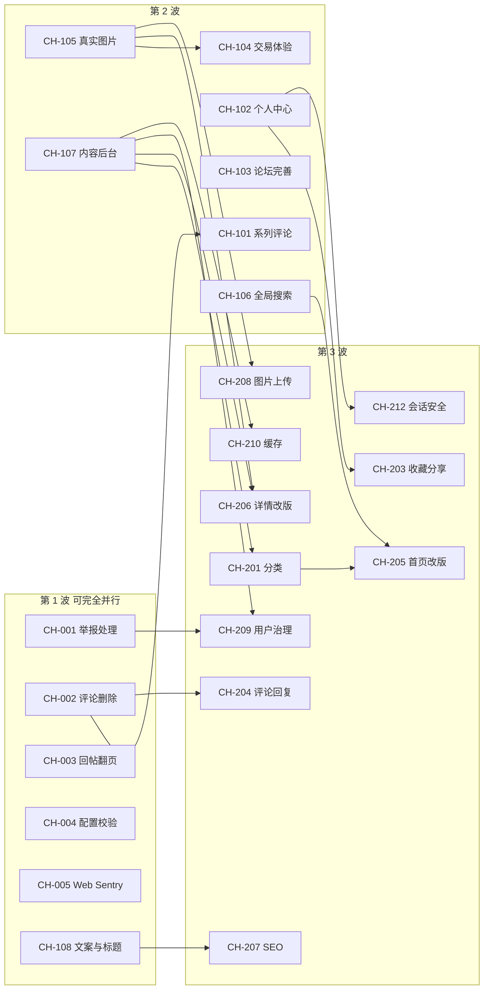

# Cardhub 接力开发任务池

> 面向接力实现功能的 Agent。每张任务卡都写明了背景、改动范围、验收标准和依赖，领取后不需要再回头问“要做成什么样”。
>
> 现状基线见 [feature-inventory.md](feature-inventory.md)，环境与踩坑见 [handoff-context.md](handoff-context.md)。任务卡里的文件路径都相对仓库根目录。

---

## 0. 使用方式

1. **领取**：优先做 P0，再做 P1；确认“依赖”列中的任务已完成。在 §2 总览表把状态改成 `进行中（分支名）`，随第一个 commit 一起提交。
2. **分支与 PR**：一个任务一个分支、一个 PR，分支名带任务编号（如 `cardhub/ch-001-report-resolve`），squash 合并到 `main`。合并后 staging 会自动部署，生产由 owner 手动发布。
3. **commit 规范**：`<type>(<scope>): <subject>`，scope 只能用 `commitlint.config.cjs` 的白名单（业务代码一般是 `api` / `web` / `miniapp` / `shared`，文档是 `docs`）。
4. **决策点**：标 🔶 的是产品决策。写明“默认方案”的直接按默认方案做；写明“需用户确认”的，在得到确认前**不要改动现有行为**，只做不受影响的部分。全部决策点汇总在 §6。
5. **完成**：满足 §1 的完成标准后，把总览表状态改为 `✅ PR #xx`，并更新 feature-inventory.md 中对应条目。

## 1. 通用完成标准（每个任务都适用）

- [ ] `pnpm typecheck && pnpm lint && pnpm test && pnpm build` 全部通过。
- [ ] **Schema 变更**：用 `pnpm --filter @cardhub/api exec prisma migrate dev --name <snake_case>` 生成迁移并提交。生产启动时自动执行 `prisma migrate deploy`，回滚镜像不会撤销迁移，所以**只做向前兼容的增量变更**：新列可空或带默认值；删列 / 改名分两次发布。
- [ ] **共享包**：改了 `packages/*` 要 build 对应包；改了任何 router 的输入输出要 `pnpm --filter @repo/trpc-contract build`，否则客户端拿到旧类型。
- [ ] **输入校验**：新的输入 schema 放 `packages/shared/src/zod/index.ts`，前后端共用；前端提交前 `safeParse`。
- [ ] **权限**：需要登录用 `t.authedProcedure`；“本人或管理员”沿用现有写法（先比对所有者，不是本人时再查库确认 `role === 'admin'`）；管理员接口每次请求都重新查库确认角色，不信任 token 里的信息。
- [ ] **限流**：新增的写接口评估是否需要限流。需要时在 `apps/cardhub/api/src/bootstrap/rate-limiters.ts` 同时补 `RateLimitName` 和 `productionRateLimitConfigs`，并在 `apps/cardhub/api/src/common/rate-limit-proxy.spec.ts` 覆盖。
- [ ] **测试**：每个新 procedure 至少覆盖成功、权限拒绝、目标不存在或输入非法三类；写法参考 `apps/cardhub/api/src/modules/forum/forum.router.spec.ts`（mock Prisma + `createCaller`）。
- [ ] **界面**：zh-CN 和 en-US 文案都要加（新 key 放在所属模块的分组里，不要都追加到字典末尾，减少并行冲突）；有加载 / 错误 / 空状态；键盘可操作；移动端布局正常。能本地跑起来就用浏览器走一遍。
- [ ] **文档**：更新 feature-inventory.md 的状态；遇到新坑写进 handoff-context.md §6。
- [ ] 不要把任何密钥、真实密码写进代码、文档或 PR 描述。

### 1.1 新增一个 tRPC 模块的步骤

1. 新建 `apps/cardhub/api/src/modules/<name>/<name>.router.ts`：`@Injectable()` 类，构造函数注入 `TrpcBase` 和 `PrismaService`（`PrismaModule` 是全局模块），`build()` 返回 `t.router({...})`。
2. 新建 `<name>.module.ts`：`imports: [TrpcBaseModule]`，`providers / exports: [<Name>Router]`。
3. 在 `apps/cardhub/api/src/trpc/trpc.module.ts` 的 `imports` 注册模块；在 `trpc.service.ts` 的构造函数注入 router 并挂到 `this.t.router({...})`。
4. 输出里的 `Date` 一律转 ISO 字符串，`Decimal` 转字符串，`Json` 收窄成扁平类型（否则客户端类型推导会爆 `TS2589`，见 handoff §6.7）。
5. build `@repo/shared` 和 `@repo/trpc-contract` 后，Web 端 `trpc.<name>.*` 即可获得类型。

### 1.2 并行开发的冲突热点

- `apps/cardhub/api/prisma/schema.prisma` 和迁移目录：合并前 rebase 到最新 `main`；解决 schema 冲突后运行 `prisma migrate dev --create-only --name check`，确认没有生成多余的 diff 再删掉这个临时迁移。
- `packages/shared/src/i18n/index.ts`：按模块分组插入新 key。
- `rate-limiters.ts`、`trpc.service.ts`、`trpc.module.ts`、`apps/cardhub/web/src/app.tsx`、`site-header.tsx`：只追加自己的条目，不要顺手重排。

## 2. 任务总览

规模：S ≈ 半天，M ≈ 1–2 天，L ≈ 3 天以上（按单 Agent 估算）。

| 编号   | 任务                                            | 优先级 | 规模 | 依赖                 | 状态   |
| ------ | ----------------------------------------------- | ------ | ---- | -------------------- | ------ |
| CH-001 | 举报处理闭环                                    | P0     | M    | —                    | 待领取 |
| CH-002 | 卡牌评论删除 + 发表限流                         | P0     | S    | —                    | 待领取 |
| CH-003 | 话题详情回帖翻页                                | P0     | S    | —                    | 待领取 |
| CH-004 | 生产配置启动校验（JWT_SECRET 等）               | P0     | S    | —                    | 待领取 |
| CH-005 | Web 端 Sentry 运行时注入 + 清理 Zeabur 残留     | P0     | S    | —                    | 待领取 |
| CH-101 | 系列页评论（PRD FR4）                           | P1     | M    | CH-002（建议）       | 待领取 |
| CH-102 | 个人中心 `/me`                                  | P1     | M    | —                    | 待领取 |
| CH-103 | 论坛完善：话题编辑、置顶、纯文本摘要            | P1     | M    | —                    | 待领取 |
| CH-104 | 交易信息板体验：卡名展示、卡牌选择器、缩略图    | P1     | M    | CH-105（缩略图部分） | 待领取 |
| CH-105 | 卡牌 / 系列真实图片渲染                         | P1     | S    | —                    | 待领取 |
| CH-106 | 全局搜索：Header 搜索框、系列搜索、trigram 索引 | P1     | M    | —                    | 待领取 |
| CH-107 | 内容管理后台（系列 / 卡牌 CRUD + JSON 导入）    | P1     | L    | —                    | 待领取 |
| CH-108 | 文案清理、页面标题、小型无障碍修复              | P1     | S    | —                    | 待领取 |
| CH-201 | 分类体系 + 系列发售日期 + 卡牌编号              | P2     | M    | CH-107               | 待领取 |
| CH-202 | 系列详情：系列内搜索 / 排序 / 分页 + 属性本地化 | P2     | M    | —                    | 待领取 |
| CH-203 | 收藏与分享                                      | P2     | M    | CH-102               | 待领取 |
| CH-204 | 评论回复（单层）                                | P2     | M    | CH-002               | 待领取 |
| CH-205 | 首页改版                                        | P2     | M    | CH-201、CH-106       | 待领取 |
| CH-206 | 卡牌详情页改版（大图、长描述）                  | P2     | M    | CH-105、CH-107       | 待领取 |
| CH-207 | SEO：sitemap / robots / 页面 meta               | P2     | M    | CH-108               | 待领取 |
| CH-208 | 图片上传（阿里云 OSS 直传）                     | P2     | L    | CH-105               | 待领取 |
| CH-209 | 用户治理：封禁、用户管理、操作审计              | P2     | M    | CH-001、CH-107       | 待领取 |
| CH-210 | Redis 缓存 + 限流 Redis 存储                    | P2     | M    | CH-107               | 待领取 |
| CH-211 | API 错误信息国际化                              | P2     | M    | —                    | 待领取 |
| CH-212 | 会话安全：token 吊销、修改密码、`auth.me` 改造  | P2     | M    | CH-102               | 待领取 |
| CH-301 | 小程序补齐论坛 / 交易 / 举报                    | P3     | L    | CH-003、CH-104       | 待领取 |
| CH-302 | 小程序上线准备                                  | P3     | S    | CH-301               | 待领取 |
| CH-303 | Tauri 桌面发布（签名、更新、CORS）              | P3     | M    | —                    | 待领取 |
| CH-304 | iOS / Android 真机构建与上架流程                | P3     | L    | CH-303               | 待领取 |
| CH-305 | 深色模式                                        | P3     | M    | —                    | 待领取 |
| CH-306 | 测试补齐 + E2E 冒烟                             | P3     | M    | —                    | 待领取 |
| CH-307 | 可观测性：结构化日志 + request id               | P3     | S    | —                    | 待领取 |
| CH-308 | 产品指标统计                                    | P3     | M    | —                    | 待领取 |
| CH-309 | Web 安全响应头 + Tauri CSP                      | P3     | S    | CH-005               | 待领取 |
| CH-310 | 邮箱验证与找回密码                              | P3     | M    | CH-212               | 待领取 |
| CH-311 | 站内通知与 @提及                                | P3     | L    | CH-204               | 待领取 |
| CH-312 | 内容多语言                                      | P3     | L    | CH-107               | 待领取 |

## 3. 推荐执行顺序

CH-202、CH-211 与 P3 任务没有强依赖，可在任意空档插入。P3 中 CH-301 依赖 CH-003 / CH-104，CH-302 依赖 CH-301。

---

## 4. 任务卡

### P0 · 闭环缺陷与安全

#### CH-001 举报处理闭环

- **背景**：`ReportStatus` 有 `RESOLVED`，但没有任何接口能把举报标记为已处理；管理员只能看到队列不断增长。
- **目标**：管理员在 `/reports` 能“标记已处理”，或“删除 / 关闭被举报内容并处理”。
- **改动范围**
  - Prisma：`Report` 新增 `resolvedAt DateTime?`、`resolvedById String?`（关联 `User`，`onDelete: SetNull`）、`resolution String?`。`User` 上出现两条指向 `Report` 的关系，需要命名：`@relation("ReportReporter")` / `@relation("ReportResolver")`。迁移名 `add_report_resolution`。
  - shared：`reportResolveInput = { id: uuid, action: 'MARK_RESOLVED' | 'REMOVE_TARGET', resolution?: string(≤500) }`。
  - API：`reports.resolve`（admin）。`REMOVE_TARGET` 时按类型处置：TOPIC / REPLY / COMMENT 删除，LISTING 置为 `CLOSED`；同一目标的其它 `PENDING` 举报一并标记为已处理。用 `prisma.$transaction` 保证原子性。已处理的举报再次调用直接返回成功（幂等）；目标已不存在时允许 `MARK_RESOLVED`。`reports.list` 输出补充 `resolvedAt`、`resolver{ id, username }`、`resolution`。
  - Web：`apps/cardhub/web/src/pages/reports-list.tsx` 中每条 `PENDING` 举报增加两个按钮和一个可选的“处理说明”输入框；“删除内容并处理”需二次确认；成功后 invalidate `reports.list`。已处理的条目显示处理人、时间、说明。
  - i18n：`reports.resolve.*`。
- **验收标准**
  1. 非 admin 调用 `reports.resolve` 返回 `FORBIDDEN`。
  2. 标记后该举报从“待处理”筛选消失，出现在“已处理”中，并显示处理人和时间。
  3. 选择“删除内容并处理”后，原内容不可访问（意向变为已关闭），同一目标的其它待处理举报同时变为已处理。
  4. 目标已被删除的举报也能标记为已处理。
- **测试**：`reports.router.spec.ts` 补充 admin 成功、非 admin 拒绝、四种目标的 `REMOVE_TARGET`、重复调用幂等。
- **依赖**：无。

#### CH-002 卡牌评论删除 + 发表限流

- **背景**：schema 注释承诺管理员可以删评论，但 `comments` 没有删除接口；`comments.create` 也没有限流。
- **改动范围**
  - API：`comments.delete({ id })`，本人或 admin；`rate-limiters.ts` 新增 `commentCreate`（匹配 `comments.create`，1 小时 30 次）。
  - Web：`apps/cardhub/web/src/components/comment-section.tsx` 对本人和 admin 显示“删除”，二次确认后调用，成功后 invalidate `comments.listForCard`。
  - i18n：`card.detail.commentDelete`、`card.detail.confirmDeleteComment`。
- **验收标准**
  1. 作者能删自己的评论；admin 能删任意评论；其他人返回 `FORBIDDEN`，界面也不显示按钮。
  2. 同一 IP 一小时内第 31 次发评论返回 `TOO_MANY_REQUESTS`，前端显示错误信息。
- **测试**：`comments.router.spec.ts` 补删除的三种权限；`rate-limit-proxy.spec.ts` 补新限流器。
- **依赖**：无。小程序同步放在 CH-301。

#### CH-003 话题详情回帖翻页

- **背景**：`forum.topics.bySlug` 只内联前 20 条回帖并返回 `replyNextCursor`，详情页忽略了它，第 21 条起的回帖用户看不到。
- **改动范围**
  - Web：`apps/cardhub/web/src/pages/forum-detail.tsx` 在内联回帖之后，用 `trpc.forum.replies.list.useInfiniteQuery({ topicId, limit: 20 }, { initialCursor: replyNextCursor, enabled: !!replyNextCursor, getNextPageParam })` 继续加载，底部放“加载更多回帖”按钮。发帖、删帖成功后同时 invalidate `forum.topics.bySlug` 和 `forum.replies.list`。
  - i18n：`forum.detail.loadMoreReplies`。
- **验收标准**
  1. 话题有 25 条回帖时，首屏显示 20 条，点击“加载更多”后显示剩余 5 条，顺序正确、没有重复。
  2. 发表新回帖后能在列表中看到自己的回帖（可自动加载到最后一页，或在末尾乐观追加）。
  3. 删除后续页中的回帖后列表正确刷新。
- **测试**：可以写组件测试；至少用脚本造 25 条回帖手动验证。
- **依赖**：无。

#### CH-004 生产配置启动校验

- **背景**：`apps/cardhub/api/src/modules/auth/auth.module.ts` 在 `JWT_SECRET` 缺失时回退到固定值 `dev-insecure-secret`，生产环境配置遗漏时会静默使用弱密钥。
- **改动范围**
  - API：在 `ConfigModule.forRoot({ validate })` 中用 zod 校验环境变量。`NODE_ENV=production` 时要求：`JWT_SECRET` 至少 32 个字符，且不能等于 `dev-insecure-secret`、`change-me-in-production`、`change-me-generate-with-openssl-rand-hex-32`；`DATABASE_URL` 必填。开发环境保持现有默认值。
- **注意**：合并前请 owner 确认生产和预发 env 文件中的 `JWT_SECRET` 符合规则，否则新镜像启动失败，部署脚本会自动回滚并让 job 失败。
- **验收标准**：生产模式下缺失或使用占位值时进程启动失败，并输出明确的错误信息；开发模式不受影响。
- **测试**：为校验函数写单测。
- **依赖**：无。

#### CH-005 Web 端 Sentry 运行时注入 + 清理 Zeabur 残留

- **背景**：Web 只在构建时读取 `VITE_SENTRY_DSN`，而 `images.yml` 构建镜像时没有传 `BUILDTIME_VITE_SENTRY_DSN`，生产 Web 端实际不上报。`Dockerfile.web` 头部注释还在描述 Zeabur，并声称“未设置 `TRPC_URL` 时回退同源”，但入口脚本在未设置时会直接退出。
- **改动范围**
  - `apps/cardhub/web/docker-entrypoint.d/10-cardhub-runtime-config.sh`：可选读取 `SENTRY_DSN`、`SENTRY_ENVIRONMENT`，以及镜像内已有的 `GIT_SHA`，写入 `window.__CARDHUB_CONFIG__`；沿用现有的控制字符与引号校验；未设置时不写入。
  - `apps/cardhub/web/src/types/runtime-config.d.ts` 补字段；`apps/cardhub/web/src/main.tsx` 优先读运行时配置，再回退 `VITE_SENTRY_DSN`；设置 `release = GIT_SHA`。
  - `deploy/docker-compose.yml` 的 web 服务增加 `SENTRY_DSN: ${WEB_SENTRY_DSN:-}`、`SENTRY_ENVIRONMENT: ${ENV_NAME:-}`；`deploy/.env.example` 增加 `WEB_SENTRY_DSN=`。
  - 重写 `Dockerfile.web` 头部注释，去掉 Zeabur 内容，如实说明 `TRPC_URL` 必填。
- **验收标准**：设置 `WEB_SENTRY_DSN` 后 `/config.js` 含 DSN，浏览器错误能上报并带 environment 和 release；不设置时不初始化 Sentry；`TRPC_URL` 的现有校验行为不变。
- **测试**：扩展 `apps/cardhub/web/test/runtime-config-entrypoint.test.ts`。
- **依赖**：无。

### P1 · 核心功能完善

#### CH-101 系列页评论（PRD FR4）

- **背景**：PRD FR4 要求“登录用户能在卡牌和系列介绍页面下发表、查看评论”，目前只有卡牌评论。
- **默认方案**（无需再确认）：`Comment` 增加可空外键 `seriesId`，`cardId` 改为可空，并在迁移 SQL 中手写 CHECK 约束 `num_nonnulls("cardId", "seriesId") = 1`（Prisma 不能声明 CHECK）。不采用历史架构文档的多态 `commentable_type/commentable_id`，以保留外键和级联删除。
- **改动范围**
  - Prisma：如上，加 `@@index([seriesId])`。迁移名 `add_series_comments`。
  - API：新增 `comments.listForSeries({ seriesSlug, limit })` 和 `comments.createForSeries({ seriesSlug, content })`，复用卡牌评论的逻辑与限流；保持现有卡牌评论接口不变（小程序在用）。`reports.list` 的 COMMENT 上下文要兼容系列评论：输出 `cardSlug / cardName` 可空，并新增 `seriesSlug / seriesTitle`。
  - Web：把 `CommentSection` 泛化为 `target: { kind: 'card' | 'series'; slug }`，在 `series-detail.tsx` 卡牌网格下方挂载；`reports-list.tsx` 的 `TargetSummary` 支持系列评论。
  - 小程序（可选）：系列详情页同步评论区，也可留给 CH-301。
- **验收标准**
  1. 系列页能看评论；登录后能发表；未登录显示登录入口并能回跳。
  2. 系列评论可以举报，举报队列正确显示所属系列；可以删除（CH-002 的规则同样适用）。
  3. 删除系列时其评论被级联删除。
- **依赖**：建议在 CH-002 之后做，复用删除逻辑。

#### CH-102 个人中心 `/me`

- **背景**：UI 规范站点地图有“用户个人页”；`listings.mine` 已有接口但没有界面；用户无法查看自己发过的内容。
- **改动范围**
  - API：新建 `users` 模块：`users.me`（登录；读 `ctx.user`，返回 id、email、username、role、注册时间，以及话题、回帖、评论、意向的数量）、`users.myTopics`、`users.myComments`（cursor 分页，评论附卡牌 slug 和名称）。我的意向直接用 `listings.mine`。
  - Web：新增 `/me`（未登录跳转 `/login` 并带 `from`），包含概览、我的意向（可关闭、显示已关闭）、我的话题、我的评论几个分区；Header 用户名改为链接到 `/me`（桌面端和移动端抽屉都改）。
  - i18n：`me.*`、`nav.me`。
- **验收标准**：登录用户能看到自己的资料和四类内容；能在“我的意向”里关闭意向；未登录访问被引导登录后回到 `/me`。
- **依赖**：无。后续 CH-203（收藏）和 CH-212（修改密码）会往这个页面加分区。

#### CH-103 论坛完善：话题编辑、置顶、纯文本摘要

- **背景**：`forum.topics.update` 没有界面；`Topic.pinned` 没有设置入口，列表也不按它排序；列表摘要直接显示原始 Markdown 符号。
- **改动范围**
  - Prisma：新增 `@@index([pinned, createdAt])`。
  - API：新增 `forum.topics.setPinned({ id, pinned })`（admin）；`topics.list` 改为 `orderBy: [{ pinned: 'desc' }, { createdAt: 'desc' }, { id: 'desc' }]`（Prisma cursor 分页在确定性排序下仍然正确）；`topics.bySlug` 返回服务端计算的 `editableUntil`（`createdAt + 5 分钟`），前端据此显示编辑按钮，避免客户端时钟偏差。
  - shared：`markdownToPlainText(md, maxLength)`，去掉代码块、图片、链接语法、标题和强调符号，附单测。
  - Web：话题详情页对作者在窗口期内显示“编辑”，编辑表单复用发布页的标题 / 正文 / 预览；admin 显示“置顶 / 取消置顶”；列表页显示置顶标记，摘要用纯文本。
- **验收标准**
  1. 作者在 5 分钟内能编辑并立即看到更新；超时后按钮消失，直接调用接口返回 `FORBIDDEN`。
  2. admin 置顶后话题出现在列表最前，分页没有重复或遗漏。
  3. 列表摘要中不再出现 `#`、`**`、`` 等 Markdown 符号。
- **依赖**：无。

#### CH-104 交易信息板体验

- **背景**：列表显示 `cardSlug` 而不是卡名；发布时要手动输入 slug；图片只显示为链接。
- **改动范围**
  - API：`listings.list / byCard / mine` 输出增加 `card: { name, seriesSlug, seriesTitle, imageUrl } | null`，用一次 `card.findMany({ where: { slug: { in } } })` 批量补齐；卡牌已不存在时为 `null`（`cardSlug` 是软指针）。
  - Web：列表项显示卡名 + 系列并链接到卡牌页；把“按 slug 筛选”输入框换成卡牌搜索选择器（基于 `cards.search`，250ms 防抖，键盘可选），保留 `/trade/new?cardSlug=` 预填；发布页同样使用选择器并显示所选卡牌预览；图片显示为最多 4 张缩略图（`loading="lazy"`、`referrerPolicy="no-referrer"`，加载失败退回链接），点击新窗口打开原图。
  - 🔶 **D1 联系方式可见性（需用户确认）**：是否只对登录用户显示联系方式。确认前保持现状（公开）。若确认要隐藏：匿名请求时 `list / byCard` 返回 `contact: null`，前端显示“登录后查看联系方式”。
- **验收标准**：列表和卡牌页都显示卡名；发布时无需知道 slug 也能选中卡牌；带图意向显示缩略图且坏图不破版；卡牌被删除的意向仍可展示（显示 slug 和“卡牌已下架”）。
- **依赖**：缩略图的渲染组件可复用 CH-105 的 `Artwork`。

#### CH-105 卡牌 / 系列真实图片渲染

- **背景**：`imageUrl` / `coverUrl` 字段一直存在，但前端从不渲染真实图片，只按 slug 查渐变映射。新增卡牌如果不在 `gradients.ts` 映射里就是灰色块。
- **改动范围**
  - shared：`resolveArtwork(url)`：`http(s)://` 开头视为图片，`gradient:` 或空值视为渐变占位。
  - Web：新增 `apps/cardhub/web/src/components/artwork.tsx`，替换首页精选、系列列表、系列头图、系列卡牌网格、卡牌详情、搜索结果中的渐变块。`` 使用 `loading="lazy"`、`decoding="async"` 和固定宽高比（避免布局抖动）；`alt` 用卡名或系列名；加载失败退回渐变。
  - 小程序：用 Taro `Image`（`mode="aspectFill"`、`lazyLoad`），同样的回退逻辑。
- **验收标准**：数据里是 https 图片时显示图片；坏链接回退渐变；现有 `gradient:` 数据显示不变；没有明显布局抖动。
- **注意**：小程序加载外部图片需要配置 `downloadFile` 合法域名（记入 CH-302）；将来启用 CSP 时 `img-src` 要放行图片域名（CH-309）。
- **依赖**：无。真实图片的来源由 CH-107（后台填 URL）和 CH-208（上传）提供。

#### CH-106 全局搜索

- **背景**：PRD Story 2.5 和 UI 规范要求在醒目位置放搜索框；目前只能进入 `/search` 页面，且只搜卡牌名。`@@index([name])` 是 btree，对 `ILIKE '%q%'` 无效。
- **改动范围**
  - Prisma：在 schema 中用 `@@index([name(ops: raw("gin_trgm_ops"))], type: Gin)` 给 `Card.name`、`Series.title` 声明 trigram 索引，并在生成的 `migration.sql` 顶部手动加 `CREATE EXTENSION IF NOT EXISTS pg_trgm;`（部署用的官方 postgres 镜像中 `POSTGRES_USER` 是超级用户，有建扩展权限）。
  - API：新增 `search.global({ q, limit })` 返回 `{ cards[], series[] }`；`cards.search` 增加可选筛选 `rarity`、`seriesSlug`。
  - Web：Header 增加搜索框（桌面端内联，移动端在抽屉里），按 ARIA combobox 模式实现下拉建议（最多 5 张卡 + 3 个系列，↑↓ 选择、Enter 打开、Esc 关闭），底部“查看全部结果”跳转 `/search?q=`；`/search` 页读写 URL 的 `q` 参数（可分享），并增加稀有度和系列筛选。
- **验收标准**：任意页面都能直接搜索；纯键盘可完成搜索并进入详情；`/search?q=极光` 直接打开即有结果；搜索系列标题能命中。
- **依赖**：无。

#### CH-107 内容管理后台（系列 / 卡牌）

- **背景**：知识库是产品核心，但内容只能改代码里的 `seed-data.ts` 再跑 seed。
- **改动范围**
  - API：在 `TrpcBase` 增加 `adminProcedure`（每次请求查库确认 `role === 'admin'`；`reports.list` 可顺带改用它）。新建 `admin` 模块：`admin.series.create / update / delete`、`admin.cards.create / update / delete`、`admin.catalog.import`（JSON，结构同 `SeedSeries[]`，按 slug upsert，支持 `dryRun` 返回将新增 / 更新的数量）。
  - shared：`seriesUpsertInput`（slug、title ≤120、description ≤5000、coverUrl 为 https URL 或 `gradient:` 或空）、`cardUpsertInput`（slug、name、description、rarity 枚举、imageUrl、attributes 为 `Record<string, string | number | boolean>`、seriesSlug）。
  - 约束：
    - **slug 创建后不可修改**（URL 和 `Listing.cardSlug` 依赖它）。
    - 删除系列会级联删除卡牌和评论：有卡牌时拒绝，除非显式 `force: true`，前端二次确认。
    - 当前 `seed-catalog` 按 slug upsert 会**覆盖**后台编辑。改为“只插入不存在的记录”（`update: {}`），同步更新 `seed-catalog.spec.ts`，并在 deploy/README.md 注明。
  - Web：新增 `/admin/catalog`（admin）：系列表格 + 新建 / 编辑表单；进入系列后是卡牌表格 + 表单（attributes 用键值对编辑器）；JSON 导入页（粘贴或上传文件，先预览再执行）。Header 把“举报队列”和“内容管理”收进一个“管理”入口。
- **验收标准**：admin 不改代码即可新增、编辑、删除系列和卡牌，前台立即可见；非 admin 调用全部返回 `FORBIDDEN`；导入同一份 JSON 两次结果一致；重跑 `seed:catalog` 不会覆盖后台的修改。
- **依赖**：无。完成后解锁 CH-201、CH-206、CH-209、CH-210。

#### CH-108 文案清理、页面标题、小型无障碍修复

- **改动范围**
  - 首页去掉 `Cardhub · MVP` 徽标；`home.stats.sourceNote`（“实时由 NestJS + tRPC + PostgreSQL 提供（Epic 2）”）改成面向用户的文案。
  - 每个页面设置 `<title>`（React 19 支持在组件内直接渲染 `<title>` 并提升到 head），格式 `{页面名} · Cardhub`；卡牌、系列、话题页使用实际名称。可封装 `<PageMeta title description />`，CH-207 会复用。
  - `forum-list.tsx`、`trade-list.tsx` 中的 `<Link><Button/></Link>` 改为 `<Button asChild><Link/></Button>`（首页已有同样写法），避免嵌套两个可交互元素。
  - 删除 `trade-list.tsx`、`trade-publish.tsx` 末尾无人引用的 `useTradeListPage`、`useTradePublishPage` 别名导出。
- **验收标准**：浏览器标签页标题随页面变化；axe 开发扫描对上述页面没有新增问题；全仓 grep 不到被删除的别名。
- **依赖**：无。

### P2 · 知识库能力增强

以下任务融合了 UI 规范和历史设计文档（外部 `fullstack-architecture.md`、`ai-frontend-development-prompts.md`）中的设计意图，技术实现一律遵循当前仓库的栈。

#### CH-201 分类体系 + 系列发售日期 + 卡牌编号

- **来源**：PRD §3.2“按系列、年份、类型浏览”、§3.3“分类列表页”；UI 规范站点地图“首页 → 分类列表 → 系列列表”；历史 ERD 中的 `categories`、`series.release_date`、`cards.card_number`。
- **改动范围**
  - Prisma：新增 `Category { id, slug @unique, name, description?, sortOrder Int @default(0), createdAt, updatedAt }`；`Series` 增加 `categoryId String?`（`onDelete: SetNull`）和 `releaseDate DateTime? @db.Date`；`Card` 增加 `cardNumber String?`。
  - API：`categories.list`（含系列数）、`categories.bySlug`（含系列）；`series.list` 增加 `categorySlug?`、`year?`、`sort`（发售日期升序 / 降序、收录时间）筛选，输出带 `releaseDate` 和 `category`；`cards.bySlug` 输出 `cardNumber`。CH-107 的后台表单补这些字段，并新增分类管理。
  - Web：`/categories`、`/categories/:slug` 页面；系列列表增加分类和年份筛选；系列头图显示发售日期；卡牌详情显示编号；Header 导航加“分类”。
  - 演示数据：`seed-data.ts` 补 1–2 个分类。
- **不采用**：历史架构的 `name_i18n_key` + `i18n_texts` 长表，见 CH-312。
- **依赖**：CH-107。

#### CH-202 系列详情：系列内搜索 / 排序 / 分页 + 属性本地化

- **来源**：历史 AI 前端指令 3（系列详情页工具栏：系列内搜索、排序、分页）。
- **改动范围**
  - API：新增 `cards.listBySeries({ seriesSlug, q?, rarity?, sort: 'name' | 'rarity' | 'created', page, pageSize })`。`series.bySlug.cards` 暂时保留（小程序在用），在代码中标注待废弃。
  - Web：系列详情增加工具栏（搜索框、排序下拉、稀有度筛选）和分页，状态同步到 URL 参数。
  - 属性本地化：已知键（`cost`、`attack`、`health`、`type`）在字典里加 `card.attr.<key>`，未知键显示原文。Web 和小程序共用。
  - 测试：补上目前缺失的 `series.router.spec.ts`。
- **依赖**：无。

#### CH-203 收藏与分享

- **来源**：UI 规范 §4 卡牌详情“收藏 / 分享按钮”；历史 AI 前端指令 2。
- **改动范围**
  - Prisma：`Favorite { id, userId, cardId, createdAt, @@unique([userId, cardId]) }`，两个外键都级联删除。
  - API：`favorites.toggle({ cardSlug }) → { favorited, count }`；`cards.bySlug` 在已登录时额外返回 `isFavorited`，并返回 `favoriteCount`；`favorites.list`（cursor）。toggle 加限流（每分钟 60 次）。
  - Web：卡牌详情加收藏按钮（乐观更新，未登录跳转登录）；分享按钮优先用 `navigator.share`，不支持时复制链接并提示；`/me` 增加“我的收藏”。
- **依赖**：CH-102。

#### CH-204 评论回复（单层）

- **来源**：历史架构文档的 `parent_comment_id` 评论树。
- **改动范围**
  - Prisma：`Comment.parentId String?` 自关联，级联删除。只允许一层：回复的回复挂到同一个顶层评论下，正文自动带 `@用户名`。
  - API：评论列表返回顶层评论，每条附最多 3 条回复和 `replyCount`；新增 `comments.listReplies({ parentId, cursor })`；创建评论接受可选 `parentId`，必须属于同一张卡牌（或同一个系列，若 CH-101 已完成）且是顶层评论。
  - Web：评论下“回复”按钮、内联输入框、缩进显示，“展开更多回复”。
- **依赖**：CH-002（删除顶层评论会级联删除回复，需要界面提示）。

#### CH-205 首页改版

- **来源**：历史 AI 前端指令 1 + UI 规范 §4 首页布局（页眉区、精选分类区、最新收录系列区）。
- **改动范围**
  - Hero 保留主副标题和行动按钮，嵌入 CH-106 的搜索框。
  - 精选分类网格（移动端 2 列，桌面端 4 列；没有分类数据时隐藏）。
  - 最新收录系列：可横向滚动的 6–8 个系列卡片，需要 `series.list` 支持按收录时间倒序。
  - 全站页脚组件（放进 `PageShell`）：关于、免责声明、语言切换。
  - 滚动入场动效：IntersectionObserver + CSS，遵守 `prefers-reduced-motion`。
  - 🔶 **D2 品牌色（需用户确认）**：UI 规范写的是深紫 `#6D28D9`，`packages/design-tokens` 当前是蓝色系。确认前保持蓝色。
- **依赖**：CH-201、CH-106。

#### CH-206 卡牌详情页改版

- **来源**：历史 AI 前端指令 2 + UI 规范 §4 卡牌详情（固定功能区 + 自由内容区 + 评论区）。
- **改动范围**
  - Prisma：`Card.body String?`（Markdown 长描述，≤ 20000 字），在 CH-107 后台编辑，用现有 `MarkdownView` 渲染。历史文档写的“富文本编辑器”统一落地为 Markdown，与论坛保持一致且已有防 XSS 方案。
  - Web：桌面端双栏，左栏随滚动固定（大图，点击放大为灯箱，支持 Esc 关闭和焦点圈定；收藏 / 分享按钮）；右栏是面包屑、标题、稀有度、编号、长描述，下面依次是属性、交易意向、评论。移动端单栏。
- **依赖**：CH-105、CH-107；收藏按钮依赖 CH-203（未完成时先不放）。

#### CH-207 SEO：sitemap / robots / 页面 meta

- **改动范围**
  - API：新增 REST 端点 `GET /sitemap.xml`，从数据库生成系列、卡牌、话题的 URL；Caddy 在 Web 域名上把 `/sitemap.xml` 反代到 API（修改 `deploy/edge/optional/root-web.caddy` 和 staging 站点块）。
  - Web：`public/robots.txt`（指向 sitemap，禁止抓取 `/reports`、`/admin`、`/me`）；在 CH-108 的 `<PageMeta>` 上补 `description`。
  - 🔶 **D7 预渲染（需用户确认）**：微信、社交平台的抓取器不执行 JS，单页应用无法提供每页的 OG 卡片。是否做针对爬虫的预渲染或迁移 SSR 需要用户决定；确认前只做 sitemap、robots 和客户端 meta。
- **依赖**：CH-108。

#### CH-208 图片上传（阿里云 OSS 直传）

- **前置（需用户提供）**：香港区域 OSS bucket（或 CDN 域名）、只允许 `PutObject` 到指定前缀的 RAM 凭据，以及 bucket 的 CORS 设置（允许 Web 域名 PUT）。
- **改动范围**
  - API：`uploads.createPresignedPut({ purpose: 'listing' | 'card' | 'series', contentType, size })` → `{ uploadUrl, publicUrl }`；只接受 `image/jpeg | png | webp`，≤ 5 MB；对象键 `purpose/userId/yyyymm/uuid.ext`；`card` / `series` 用途仅限 admin；加限流。凭据通过新环境变量注入，同步更新 `apps/cardhub/api/.env.example` 和 `deploy/.env.example`（只写占位符）。
  - Web：交易发布页和后台表单增加上传组件（保留粘贴 URL 作为备选），显示上传进度和预览。
  - 运维：给上传前缀配置 OSS 生命周期规则清理未引用对象（写进 deploy/README.md）。
- **依赖**：CH-105。小程序上传放到 CH-301 之后再做。

#### CH-209 用户治理：封禁、用户管理、操作审计

- **改动范围**
  - 角色新增 `banned`。在 `TrpcBase` 增加 `activeUserProcedure`：查库确认未被封禁，所有写接口（评论、话题、回帖、意向、举报、收藏）改用它。token 仍有效也会被拦截。
  - Prisma：`ModerationLog { id, actorId, action, targetType, targetId, note?, createdAt }`。写入时机：处理举报、admin 删除话题 / 回帖 / 评论、admin 关闭意向、封禁 / 解封、角色变更。
  - API：`admin.users.list({ q, cursor })`、`admin.users.setRole({ userId, role })`（不能修改自己的角色）、`admin.moderationLog.list`。
  - Web：`/admin/users`、`/admin/logs`，纳入 CH-107 的“管理”入口。被封禁用户在发布时看到明确提示。
- **依赖**：CH-001、CH-107。

#### CH-210 Redis 缓存 + 限流 Redis 存储

- **改动范围**
  - 在 `RedisService` 增加 `getOrSet(key, ttl, loader)`：Redis 不可用时直接走数据库，不能导致 500。缓存 `series.list`、`series.bySlug`、`cards.bySlug`、`categories.*`，TTL 5 分钟，key 前缀 `cardhub:cache:v1:`；CH-107 的后台写操作中按 key 失效。
  - 限流存储换成 `rate-limit-redis`，各限流器独立前缀，开启 `passOnStoreError: true`，Redis 故障时放行而不是报错。
- **验收标准**：命中缓存时不查数据库；后台修改后前台立即看到新数据；停掉 Redis 后接口和限流仍可用。
- **依赖**：CH-107。

#### CH-211 API 错误信息国际化

- **背景**：路由里的 `TRPCError.message` 和 shared 中的 zod 校验文案都是中文字面量，英文界面也显示中文。
- **默认方案**：错误信息改为稳定 key（如 `errors.card.notFound`、`errors.validation.usernameTooShort`），客户端用 `translateError(err, locale)` 翻译，找不到 key 时显示原文。不采用“按请求头返回不同语言”，因为 zod 文案在 schema 定义时就固定了。
- **改动范围**：全部 router 的 `TRPCError`、`packages/shared/src/zod` 的校验文案、Web 与小程序展示错误的位置、断言错误文案的测试；字典新增 `errors.*`。
- **依赖**：无，但改动面广，建议在 P1 大部分合入后再做，以减少冲突。

#### CH-212 会话安全

- **改动范围**
  - Prisma：`User.tokenVersion Int @default(0)`。JWT 载荷增加 `tv`；`makeCreateContext` 校验 `tv` 与数据库一致（每个已登录请求多一次查询，当前规模可接受；CH-210 完成后可加短 TTL 缓存）。
  - API：`auth.changePassword({ currentPassword, newPassword })` 成功后递增 `tokenVersion` 并返回新 token；`auth.logoutAll`；`auth.me` 改为不带 input、从请求头读取身份（只有 Web 的 `AuthBootstrap` 在用，小程序没有调用）。
  - Web：`/me` 增加“修改密码”和“退出所有设备”。
  - 不做 refresh token：保留 7 天 access token，在 handoff 文档注明这一决定。
- **依赖**：CH-102。

### P3 · 多端与长期

#### CH-301 小程序补齐论坛 / 交易 / 举报

- 新增页面：论坛列表 / 详情 / 发帖，交易列表 / 发布，举报（ActionSheet + 表单）；增加 tabBar（首页 / 论坛 / 交易 / 我的）。每个页面目录要有 `index.tsx`、`index.config.ts`、`index.scss`（见 handoff §6.16）。
- 🔶 **D6 小程序 Markdown 渲染**（默认方案）：先按纯文本显示并保留换行；如需富文本，再评估在小程序运行时可用的 Markdown → 安全 HTML 方案配合 `RichText`。
- 同步 CH-002 的评论删除、CH-003 的回帖翻页、CH-104 的卡名展示。
- **依赖**：CH-003、CH-104。

#### CH-302 小程序上线准备

- 需要用户手动完成：注册微信 AppID，配置 `request` 和 `downloadFile` 合法域名（API 域名和图片域名）。
- 代码侧：`project.config.json` 换成真实 AppID；`apps/cardhub/miniapp/README.md` 和 `src/lib/trpc.ts` 注释中的 Render / Cloudflare Pages 说法改为当前部署方式；`release-miniapp.yml` 接入 `miniprogram-ci`（上传私钥放 GitHub Secret）。
- **依赖**：CH-301。

#### CH-303 Tauri 桌面发布

- **必须先解决 CORS**：生产 `CORS_ORIGIN` 增加 `tauri://localhost`、`https://tauri.localhost`、`http://tauri.localhost`（同步 `deploy/.env.example` 和 deploy/README.md），否则桌面端请求生产 API 会被拦截。
- macOS Developer ID 签名与公证、Windows 代码签名；接入 `tauri-plugin-updater`（更新清单放 GitHub Releases 或 OSS）；版本号与 git tag 同步；确认 `VITE_TRPC_URL_TAURI` 指向生产。
- **依赖**：无。

#### CH-304 iOS / Android 真机构建与上架流程

- Android：安装 JDK / Android SDK / NDK 后执行 `pnpm --filter @cardhub/native android:init`，跑通模拟器（开发环境 API 地址 `10.0.2.2` 的逻辑已在 `trpc.tsx`）和真机。iOS：签名证书、TestFlight。补全 `release-native.yml` 中的移动端占位任务。详细工具链见 `apps/cardhub/native/MOBILE_SETUP.md`。
- **依赖**：CH-303（CORS 与生产 URL）。

#### CH-305 深色模式

- `packages/design-tokens` 增加深色调色板；新增 `ThemeStore`（跟随系统 / 浅色 / 深色，持久化方式同 `LocaleStore`）；Tailwind `dark:` 变体；检查玻璃拟态在深色下的对比度（WCAG AA）。

#### CH-306 测试补齐 + E2E 冒烟

- 补 `series.router.spec.ts`；替换 `apps/cardhub/api/test/placeholder.e2e-spec.ts` 为基于 supertest 的真实链路测试。
- 引入 Playwright 冒烟用例：浏览 → 卡牌详情 → 登录 → 评论；发帖 → 回帖；发布意向 → 关闭；admin 处理举报。CI 中以独立 job 运行（可设为 nightly）。

#### CH-307 可观测性

- API 使用结构化 JSON 日志（如 `nestjs-pino`），每个请求带 request id（优先读取上游 `X-Request-Id`，没有则生成），写入 Sentry scope 和 tRPC 错误日志。
- `deploy/docker-compose.yml` 为各服务配置日志轮转（`json-file` 的 `max-size` / `max-file`）。

#### CH-308 产品指标统计

- 项目简报定义的 KPI：MAU、新注册数、次月留存、日均评论数。
- 🔶 **D3（需用户确认）**：方案 A 在同一台 VPS 自托管 Umami 等隐私友好的统计工具；方案 B 只做服务端统计（`User.lastSeenAt` 节流更新 + 管理员看板从数据库聚合）。确认前不实施。

#### CH-309 Web 安全响应头 + Tauri CSP

- `apps/cardhub/web/nginx-spa.conf` 增加 `X-Content-Type-Options: nosniff`、`Referrer-Policy: strict-origin-when-cross-origin`、`Permissions-Policy`、`frame-ancestors 'none'` 和 CSP。CSP 的 `connect-src` 要包含运行时 `TRPC_URL` 的源和 Sentry 上报域名，可借助 nginx 镜像的 `templates/*.template` + envsubst 生成。注意 nginx 的 `add_header` 在 location 块中会覆盖 server 级配置，需要用 include 片段在每个 location 复用。
- `tauri.conf.json` 的 `csp` 从 `null` 改为显式策略。
- **依赖**：CH-005（运行时配置里已有 Sentry DSN）。

#### CH-310 邮箱验证与找回密码

- 🔶 **D4（需用户确认）**：邮件服务商（阿里云邮件推送、Resend 等）需要用户开通。
- `User.emailVerifiedAt`、一次性令牌表（哈希存储、15 分钟过期）、发送限流；页面：验证结果页、忘记密码、重置密码。
- **依赖**：CH-212（重置密码后递增 `tokenVersion`）。

#### CH-311 站内通知与 @提及

- `Notification` 模型；触发场景：我的话题被回复、我的评论被回复（CH-204）、我的内容被管理员处理；Header 铃铛显示未读数（每 60 秒轮询）；Markdown 正文中解析 `@用户名` 并生成通知。
- **依赖**：CH-204。

#### CH-312 内容多语言

- 🔶 **D5（需用户确认）**：是否需要卡牌 / 系列内容的英文版本。若需要，推荐翻译表方案（`SeriesTranslation`、`CardTranslation`，按 `locale` 唯一），不采用历史架构的全局 `i18n_texts` 长表。确认前不实施。
- **依赖**：CH-107（后台需要支持编辑多语言字段）。

---

## 5. 来源对照

| 来源                                                                                                   | 已转化为任务                                                            |
| ------------------------------------------------------------------------------------------------------ | ----------------------------------------------------------------------- |
| PRD FR4（系列页评论）                                                                                  | CH-101                                                                  |
| PRD §3.2 / §3.3（分类浏览、醒目搜索框）、Story 2.4 AC4（搜索性能）                                     | CH-106、CH-201                                                          |
| 项目简报 KPI                                                                                           | CH-308                                                                  |
| UI 规范：用户个人页、收藏 / 分享、深色模式、首页布局                                                   | CH-102、CH-203、CH-305、CH-205                                          |
| 历史架构文档：分类、发售日期、卡牌编号、评论回复、媒体、Refresh Token、correlation id                  | CH-201、CH-204、CH-208、CH-212、CH-307                                  |
| 历史 AI 前端指令：首页、卡牌详情、系列详情                                                             | CH-205、CH-206、CH-202                                                  |
| 代码中已有接口但缺界面                                                                                 | CH-003、CH-102、CH-103                                                  |
| 代码审查发现的缺陷                                                                                     | CH-001、CH-002、CH-004、CH-005、CH-108、CH-303（CORS）                  |
| handoff 文档原 Backlog（PWA、Playwright、updater、离线、图片管线、版块标签、通知、@mention、第三语言） | CH-306、CH-303、CH-208、CH-311、CH-312；PWA、桌面离线、版块标签暂不排期 |

## 6. 待用户决策汇总

| 编号 | 问题                                     | 默认处理                                | 关联任务 |
| ---- | ---------------------------------------- | --------------------------------------- | -------- |
| D1   | 交易联系方式是否只对登录用户可见         | 确认前保持公开                          | CH-104   |
| D2   | 品牌主色是否改为 UI 规范的深紫 `#6D28D9` | 确认前保持当前蓝色                      | CH-205   |
| D3   | 产品指标采用自托管统计工具还是服务端统计 | 确认前不实施                            | CH-308   |
| D4   | 邮件服务商                               | 确认前不实施                            | CH-310   |
| D5   | 是否需要内容多语言                       | 确认前不实施                            | CH-312   |
| D6   | 小程序 Markdown 渲染方式                 | 默认纯文本显示，无需确认                | CH-301   |
| D7   | 是否做面向爬虫的预渲染 / SSR             | 确认前只做 sitemap、robots、客户端 meta | CH-207   |

系列评论的建模方式已在 CH-101 中定案（可空外键 + CHECK 约束），不需要再确认。
