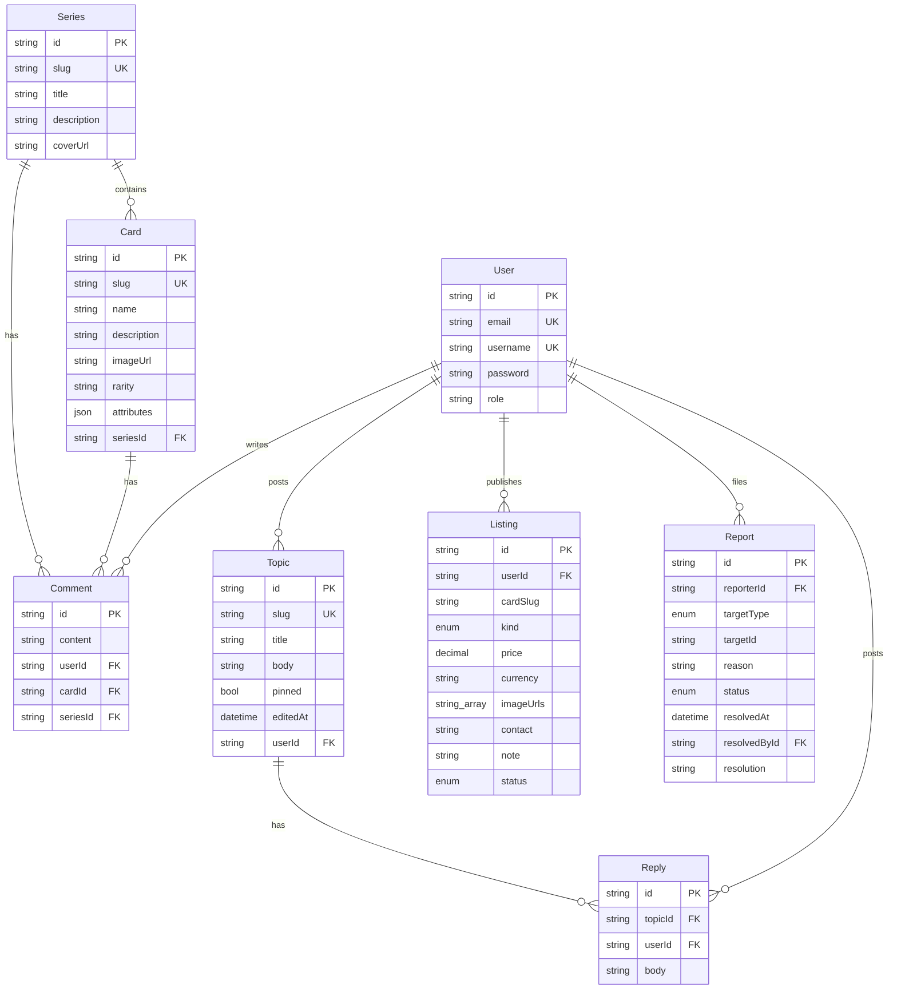

# Cardhub 功能全景（现状基线）

> 基线：`main` @ `origin/main`（2026-10-17，CH-001/002/003 打磨后）。
>
> 本文只记录**代码里已经存在的能力**和**已核实的缺口**。待做事项与验收标准在 [development-backlog.md](development-backlog.md)，编号形如 `CH-xxx`。业内站点里哪些能力要借、哪些明确不做，见 [industry-benchmark.md](industry-benchmark.md)。完成任务后请同步修改本文对应条目的状态，否则本文会与代码脱节。

图例：✅ 已实现　🟡 部分实现（有接口无界面，或存在已知缺口）　❌ 未实现

---

## 1. 现状概述

Cardhub 定位为“维基式卡牌知识库 + 社区”。PRD 的 MVP（Epic 1–3：系列/卡牌浏览、搜索、账户、卡牌评论）以及 Phase 2 的论坛、交易信息板、举报系统都已在 Web 端落地。生产环境已从 Zeabur 迁移到阿里云香港的一台 VPS，并通过 GitHub Actions 发布。

当前最影响产品完整度的缺口：

1. **内容后台已在 Web / Tauri 提供**：管理员可在 `/admin/catalog` 维护系列和卡牌，或用 JSON 导入。改卡牌所属系列会同时刷新旧系列；新建或编辑系列会刷新前台系列列表和详情。导入前检查 500 行和 1MB，成功后同一份内容不能再次导入，直到内容或文件变化。新建和编辑系列、卡牌时，未保存的修改会拦住站内链接和浏览器返回；关闭或刷新标签页用浏览器原生提示。没有修改、改回原值或保存成功后不提示。JSON 导入不在这项拦截里。小程序没有后台。
2. **卡牌没有真实图片**：数据里全是 `gradient:` 占位符，前端只渲染渐变色块（CH-105）。
3. **举报处理闭环已完成**：管理员可在队列中标记已处理，或删除 / 关闭被举报内容并处理相关待处理举报。
4. **小程序只覆盖 MVP**：论坛、交易、举报均未接入（CH-301）。

对标之后新出现、代码里仍然不存在的能力，不在下面各表展开成新模块：平行版本（CH-213）、资讯（CH-214）、发售日历（CH-215）、用户自报价格（CH-313，确认前不做）、赛事与卡组（CH-314，确认前不做）。收藏进度写在 CH-203，交易品相写在 CH-104。

## 2. 运行环境

| 环境 | Web                          | API（tRPC）                             | 发布方式                                                 |
| ---- | ---------------------------- | --------------------------------------- | -------------------------------------------------------- |
| 生产 | https://card-hub.app         | https://api.card-hub.app/trpc           | 手动触发 `deploy.yml`（`production` Environment 需审批） |
| 预发 | https://staging.card-hub.app | https://api-staging.card-hub.app/trpc   | main 上 CI + 镜像构建成功后自动部署                      |
| 本地 | http://localhost:5173        | http://localhost:4000/trpc（Vite 代理） | `pnpm db:up && pnpm db:migrate && pnpm dev`              |

部署拓扑：阿里云香港 Ubuntu 24.04 VPS → 共享 Caddy（自动 HTTPS、反向代理）→ `cardhub-prod` 与 `cardhub-staging` 两个 Docker Compose project（各自包含 api / web / Postgres 16 / Redis 7）。镜像在 GHCR，标签为不可变的 `sha-<完整 commit>`。数据库每日 `pg_dump`，可选上传阿里云 OSS（香港）做异地备份。完整运维手册见 [deploy/README.md](../../deploy/README.md)。

生产与预发只运行 catalog seed（3 个系列 / 9 张演示卡牌，中文），不创建 demo 账号。

## 3. 功能模块

### 3.1 卡牌目录（系列 / 卡牌）

| 能力                     | 状态 | 入口                  | 接口                                                        | 说明                                                                                                                                                                                                                                      |
| ------------------------ | ---- | --------------------- | ----------------------------------------------------------- | ----------------------------------------------------------------------------------------------------------------------------------------------------------------------------------------------------------------------------------------- |
| 系列列表（封面、卡牌数） | ✅   | `/series`             | `series.list`                                               | 接口支持 `page/pageSize`，前端只取第一页（默认 20 条）；无排序、无筛选                                                                                                                                                                    |
| 系列详情 + 卡牌网格      | ✅   | `/series/:seriesSlug` | `series.bySlug`                                             | 一次返回全部卡牌；无系列内搜索、排序、分页（CH-202）                                                                                                                                                                                      |
| 卡牌详情（属性、稀有度） | ✅   | `/cards/:cardSlug`    | `cards.bySlug`                                              | `attributes` 是扁平 JSON，键名原样显示（`cost`/`attack`…），未本地化（CH-202）。路由 chunk 到达前主包已画出 63:88 骨架（CH-109）                                                                                                          |
| 稀有度                   | ✅   | 各列表与详情          | `Card.rarity`                                               | `common / rare / epic / legendary`，标签写在 `rarity-badge.tsx`（Web）和 `@repo/ui-mini`（小程序）                                                                                                                                        |
| 卡牌 / 系列图片          | 🟡   | 全站图位              | `Card.imageUrl` / `Series.coverUrl`                         | Web / Tauri 已支持 https 真实图片：加载中固定灰底、加载完淡入、坏链或 `gradient:` 回退原渐变；卡牌详情用 63:88 contain，其余卡图按 63:88 cover，系列封面按 2:1 或现有背景容器 cover。现有 seed 仍是 `gradient:...`，小程序同步留给 CH-301 |
| 分类 / 年份 / 类型浏览   | ❌   | —                     | —                                                           | PRD §3.2/§3.3、UI 规范“分类列表页”要求（CH-201）。平行版本与限量编号见 CH-213                                                                                                                                                             |
| 内容维护                 | ✅   | `/admin/catalog`      | `admin.series.*` / `admin.cards.*` / `admin.catalog.import` | 管理员可新建、编辑、删除系列和卡牌，并先预览再导入 JSON。改系列刷新旧列表，保存刷新前台。超限不提交，未保存离开会确认。属性上限 40。空系列行内确认删除；仍有卡牌或评论时输入 slug 强制删除。`seed:catalog` 只插入缺失记录，不覆盖后台编辑 |
| 面包屑                   | ✅   | 所有深层页面          | —                                                           |                                                                                                                                                                                                                                           |

### 3.2 搜索

| 能力                           | 状态 | 入口        | 接口            | 说明                                                                                                                                                                                    |
| ------------------------------ | ---- | ----------- | --------------- | --------------------------------------------------------------------------------------------------------------------------------------------------------------------------------------- |
| 卡牌名模糊搜索（不区分大小写） | ✅   | `/search`   | `search.global` | 名称词、`r:` / `s:`、OR 与排除；输入防抖 250ms 后写入 URL `q`。匹配是 `ILIKE '%q%'`。`cards.name` 与 `series.title` 有 `pg_trgm` GIN 索引（CH-106）。线上只有几行时规划器仍可能全表扫描 |
| Header 常驻搜索框 / 下拉建议   | ✅   | 顶栏 / 抽屉 | `search.global` | lg（≥1024）内联，最多 5 张卡 + 3 个系列；768–1023 只保留导航「搜索」链接（已定例外）；更窄时搜索框在抽屉顶部                                                                            |
| 搜索系列、按稀有度/系列筛选    | ✅   | `/search`   | `search.global` | 系列结果在卡牌之前，带 `cardCount` / `coverUrl`；稀有度和系列筛选与搜索框写入同一条 `q`。系列按标题搜，描述未参与搜索                                                                   |

### 3.3 账户与会话

| 能力                         | 状态 | 入口                 | 接口            | 说明                                                                                                                        |
| ---------------------------- | ---- | -------------------- | --------------- | --------------------------------------------------------------------------------------------------------------------------- |
| 注册（邮箱 + 用户名 + 密码） | ✅   | `/register`          | `auth.register` | bcryptjs 10 轮；邮箱或用户名重复返回 `CONFLICT`                                                                             |
| 登录（邮箱或用户名）         | ✅   | `/login`             | `auth.login`    | 邮箱转小写匹配，**用户名区分大小写**；登录后按 `location.state.from` 回跳                                                   |
| 会话恢复                     | ✅   | 全局 `AuthBootstrap` | `auth.me`       | 启动时用本地 token 拉取最新 `role`；返回 `UNAUTHORIZED` 自动登出。`auth.me` 用 **input** 传 token，而不是读请求头（CH-212） |
| 登出                         | ✅   | Header               | —               | 只清本地存储，服务端不吊销 token                                                                                            |
| 角色                         | ✅   | —                    | `User.role`     | `user` / `admin`。admin 目前只能直接改库或由 demo seed 创建                                                                 |
| 个人中心                     | ✅   | `/me`                | `users.me`      | 概览显示资料和本人话题 / 回帖 / 评论 / 交易意向计数；交易意向计数使用包含已关闭的新字段 `listingTotalCount`                 |
| 资料编辑、改密码、找回密码   | ❌   | —                    | —               | CH-212 / CH-310                                                                                                             |

Token：JWT（HS256，`JWT_EXPIRES_IN` 默认 7 天），无 refresh token，Web 存在 `localStorage['cardhub:session']`，小程序存在 `Taro.setStorageSync`。

### 3.4 卡牌评论

| 能力                         | 状态 | 入口       | 接口                                                  | 说明                                                                                                          |
| ---------------------------- | ---- | ---------- | ----------------------------------------------------- | ------------------------------------------------------------------------------------------------------------- |
| 查看评论（最新 50 条，倒序） | ✅   | 卡牌详情页 | `comments.listForCard`                                | 无分页                                                                                                        |
| 发表评论（≤ 500 字）         | ✅   | 卡牌详情页 | `comments.create`                                     | 需登录；按 IP 限流 30 次 / 小时                                                                               |
| 删除评论（本人 / 管理员）    | ✅   | 卡牌详情页 | `comments.delete`                                     | Web / Tauri 使用行内二次确认；成功后显示可见状态提示并聚焦提示，失败后焦点回到删除按钮。小程序同步留到 CH-301 |
| 举报评论                     | ✅   | 评论旁     | `reports.create`                                      | 自己的评论不显示举报按钮                                                                                      |
| 系列页评论                   | ✅   | 系列详情页 | `comments.listForSeries` / `comments.createForSeries` | Web / Tauri 复用卡牌评论区交互；小程序同步留到 CH-301                                                         |
| 评论加载失败可重试           | ✅   | 卡牌和系列 | `comments.listForCard` / `comments.listForSeries`     | 评论加载失败可以重试；重试时保留错误框，按钮显示「重试中」且焦点留在按钮上                                    |
| 评论回复                     | ❌   | —          | —                                                     | 历史架构文档设计了 `parent_comment_id`（CH-204）                                                              |

### 3.5 论坛

| 能力                              | 状态 | 入口                | 接口                     | 说明                                                                                                                                                                |
| --------------------------------- | ---- | ------------------- | ------------------------ | ------------------------------------------------------------------------------------------------------------------------------------------------------------------- |
| 话题列表（cursor 分页、加载更多） | ✅   | `/forum`            | `forum.topics.list`      | 按 `pinned desc, createdAt desc, id desc` 排序；列表摘要用 `excerpt` 纯文本，`body` 仍保留给兼容调用方                                                              |
| 发布话题（Markdown + 预览）       | ✅   | `/forum/new`        | `forum.topics.create`    | slug = 标题英文化 + 6 位随机后缀（中文标题会退化成 `topic-xxxxxx`）                                                                                                 |
| 话题详情 + Markdown 渲染          | ✅   | `/forum/:slug`      | `forum.topics.bySlug`    | `react-markdown` + `remark-gfm` + `rehype-sanitize`；返回 `editableUntil` 和 `serverNow` 校正编辑倒计时；详情页只用 `editedAt` 显示“已编辑”                         |
| 编辑话题（发布后 5 分钟内）       | ✅   | `/forum/:slug/edit` | `forum.topics.update`    | 仅作者可在发布后 5 分钟内编辑；页面标题为「编辑话题」；`editedAt` 只在 update 写入，置顶不算编辑                                                                    |
| 删除话题（本人 / 管理员）         | ✅   | 话题详情            | `forum.topics.delete`    | Web / Tauri 使用行内二步确认；成功后返回列表并显示可聚焦的删除提示；级联删除回帖                                                                                    |
| 回帖（Markdown）                  | ✅   | 话题详情            | `forum.replies.create`   |                                                                                                                                                                     |
| 回帖翻页                          | ✅   | `/forum/:slug`      | `forum.replies.list`     | 详情页先渲染 `bySlug` 内联的前 20 条；有 `replyNextCursor` 时可点击“加载更多回帖”继续按正序追加；首个后续页加载中显示忙态，失败重试中禁用按钮，新回帖可见高亮并聚焦 |
| 删除回帖（本人 / 管理员）         | ✅   | 回帖旁              | `forum.replies.delete`   | Web / Tauri 使用行内二步确认；成功后本地更新已展开分页、游标和回帖数，避免分页收回或 refetch 使用已删除游标                                                         |
| 置顶                              | ✅   | 话题详情 / 列表     | `forum.topics.setPinned` | admin 可置顶 / 取消置顶；置顶话题显示 Pin chip 并排在列表最前                                                                                                       |
| 版块 / 标签                       | ❌   | —                   | —                        | 长期需求，暂未排期                                                                                                                                                  |

### 3.6 交易信息板（仅撮合信息，站外交易）

| 能力                                          | 状态 | 入口                                    | 接口               | 说明                                                                                                                                                                                                                                                                                                                                        |
| --------------------------------------------- | ---- | --------------------------------------- | ------------------ | ------------------------------------------------------------------------------------------------------------------------------------------------------------------------------------------------------------------------------------------------------------------------------------------------------------------------------------------- |
| 意向列表（出/求、卡牌、品相、语言、价格筛选） | ✅   | `/trade`                                | `listings.list`    | 只显示 `OPEN`；卡牌用软指针批量补卡名 / 系列 / 缩略图。只传货币也会过滤。价格区间和价格排序必须带货币，且只比较该币种里有价格的意向。价格排序默认请求 CNY，但不把这份自动货币写入 URL；用户自己选的货币才保留。切回最新发布或清空价格区间时去掉自动货币。分享链接带 min/max 但没有货币时，忽略价格区间，并用 replace 从 URL 去掉 min 和 max |
| 列表加载失败可重试                            | ✅   | `/trade`                                | `listings.list`    | 列表加载失败可以重试，不显示服务器原文；重试时保留错误框，按钮显示「重试中」且焦点留在按钮上                                                                                                                                                                                                                                                |
| 发布意向                                      | ✅   | `/trade/new`（卡牌页可带 `?cardSlug=`） | `listings.publish` | 卡牌搜索选择器；价格可空（显示“面议”）；货币下拉默认 CNY；品相、语言、版本备注可空；最多 4 个 https 外链图片；联系方式空值走字段错误文案，不用浏览器原生 required                                                                                                                                                                           |
| 卡牌页内意向（最多 5 条）                     | ✅   | 卡牌详情页                              | `listings.byCard`  | 显示品相 / 语言 / 版本备注与联系方式，仍只显示 `OPEN`                                                                                                                                                                                                                                                                                       |
| 关闭意向（本人 / 管理员）                     | ✅   | 列表项、`/me`                           | `listings.close`   | 共用 `ListingCloseControl` 行内两步确认，同一时间只展开一条；关闭成功后刷新列表                                                                                                                                                                                                                                                             |
| 我的意向（含已关闭）                          | ✅   | `/me#me-listings`                       | `listings.mine`    | `/me` 上混合显示 OPEN / CLOSED，可用行内两步确认关闭；页面仍显示 slug，接口已附带卡牌摘要                                                                                                                                                                                                                                                   |
| 图片展示                                      | ✅   | 列表项、发布预览                        | —                  | https 图片显示缩略图；非 https 或加载失败显示“图片 n”文字链接（列表与发布预览）；已有非 https 数据不迁移                                                                                                                                                                                                                                    |
| 免责声明                                      | ✅   | 列表页 + 发布页                         | —                  |                                                                                                                                                                                                                                                                                                                                             |
| 联系方式可见性                                | 🟡   | 列表项 + 卡牌页区块                     | `listings.*`       | D1 未定，API 仍保持公开；前端已兼容未来 `contact: null` 并显示“登录后查看联系方式”                                                                                                                                                                                                                                                          |

### 3.7 举报与管理

| 能力                                          | 状态 | 入口                                             | 接口                                                                                                      | 说明                                                                                                                                                                         |
| --------------------------------------------- | ---- | ------------------------------------------------ | --------------------------------------------------------------------------------------------------------- | ---------------------------------------------------------------------------------------------------------------------------------------------------------------------------- |
| 举报话题 / 回帖 / 评论 / 意向                 | ✅   | 各内容旁“举报”                                   | `reports.create`                                                                                          | 校验目标存在；每用户 24 小时最多 10 次                                                                                                                                       |
| 举报队列（待处理 / 已处理筛选，附目标上下文） | ✅   | `/reports`（Header「管理」菜单，仅 admin）       | `reports.list`                                                                                            | 每次请求都重新查库校验 admin 身份；目标已删除时 `target` 为 `null`；交易意向目标返回可选 `cardName` 并在 Web 显示卡名与本地化开放/关闭状态；已处理条目显示处理人、时间和说明 |
| 内容管理（系列 / 卡牌 / JSON 导入）           | ✅   | `/admin/catalog`（Header「管理」菜单，仅 admin） | `admin.series.*` / `admin.cards.*` / `admin.catalog.import`                                               | 系列表、卡牌表、新建 / 编辑页和 JSON 导入（有面包屑）。删除空系列走行内确认；删除仍有卡牌或评论的系列要输入 slug。非管理员不请求 admin 接口。成功后不可重复导入；未保存拦截  |
| 处理举报（标记已处理）                        | ✅   | `/reports`                                       | `reports.resolve`                                                                                         | 记录处理人、处理时间和可选说明；重复处理幂等                                                                                                                                 |
| 删除 / 关闭被举报内容并处理                   | ✅   | `/reports`                                       | `reports.resolve`                                                                                         | `TOPIC` / `REPLY` / `COMMENT` 删除，`LISTING` 关闭；同一目标其它待处理举报一并处理                                                                                           |
| 管理员删除 / 关闭任意内容                     | 🟡   | 原页面 + `/reports`                              | `comments.delete` / `forum.topics.delete` / `forum.replies.delete` / `listings.close` / `reports.resolve` | 卡牌详情页可用 `comments.delete` 删除评论；`/reports` 可删除被举报评论并处理举报                                                                                             |
| 封禁用户、用户管理、操作审计                  | ❌   | —                                                | —                                                                                                         | CH-209                                                                                                                                                                       |

### 3.8 国际化

| 能力                      | 状态 | 说明                                                                                               |
| ------------------------- | ---- | -------------------------------------------------------------------------------------------------- |
| 界面双语（zh-CN / en-US） | ✅   | 字典在 `packages/shared/src/i18n/index.ts`；Header 切换，`localStorage` 持久化，同步 `<html lang>` |
| 内容多语言                | ❌   | Series / Card 只有单语字段（CH-312）                                                               |
| API 错误信息              | 🟡   | 后端 `TRPCError.message` 硬编码中文，英文界面也显示中文（CH-211）                                  |

### 3.9 体验与无障碍

| 能力                                       | 状态 | 说明                                                                                                            |
| ------------------------------------------ | ---- | --------------------------------------------------------------------------------------------------------------- |
| 响应式布局 + 移动端汉堡菜单                | ✅   |                                                                                                                 |
| skip-to-content、focus-visible、aria 标注  | ✅   | 开发模式下 `@axe-core/react` 自动扫描                                                                           |
| 路由懒加载 + 双层 ErrorBoundary            | ✅   |                                                                                                                 |
| 加载 / 错误 / 空状态、骨架屏               | ✅   | 卡牌详情主包预留 63:88 骨架，避免路由 chunk 到达前跳动（CH-109）                                                |
| 刘海屏 safe-area + 页面横向留白            | ✅   | `.app-safe-top / .app-safe-x / .app-safe-bottom`；`.app-safe-x` 同时保证页面最小横向留白（< sm 16px，sm+ 24px） |
| 页面级 `<title>` / description             | 🟡   | 页面 `<title>` 已按 `{页面名} · Cardhub` 设置；description 留给 CH-207                                          |
| 首页精选分类、最新系列横滑、页脚、入场动效 | ❌   | UI 规范与历史 AI 前端指令要求（CH-205）                                                                         |
| 收藏、分享                                 | ❌   | CH-203（含集齐进度）                                                                                            |
| 深色模式                                   | ❌   | CH-305                                                                                                          |

### 3.10 平台与运维

| 能力                                                              | 状态 | 说明                                                                                                                                    |
| ----------------------------------------------------------------- | ---- | --------------------------------------------------------------------------------------------------------------------------------------- |
| `GET /health`（db / redis / gitSha / buildTime，DB 异常返回 503） | ✅   | 部署脚本用 `gitSha` 校验上线版本；另有 `health.ping`                                                                                    |
| 写接口限流（express-rate-limit，按 IP）                           | ✅   | 内存存储，单实例足够；多实例需要 Redis store（CH-210）。`trust proxy` 只信任 1 跳（Caddy）                                              |
| helmet（API，CSP 关闭）+ CORS 白名单                              | ✅   | `CORS_ORIGIN` 逗号分隔。代码默认值包含 Tauri 来源，但 `deploy/.env.example` 的生产值只有 `https://card-hub.app`，会覆盖默认值（CH-303） |
| Sentry（API）                                                     | ✅   | 配置 `SENTRY_DSN` 才启用；只上报 5xx / `INTERNAL_SERVER_ERROR`                                                                          |
| Sentry（Web）                                                     | ✅   | Web 容器启动时从 `WEB_SENTRY_DSN` / `SENTRY_ENVIRONMENT` / `GIT_SHA` 生成运行时 `/config.js`；空 DSN 时不上报                           |
| 生产配置启动校验                                                  | ✅   | `NODE_ENV=production` 时启动前校验 `JWT_SECRET`（≥ 32 字符且不是占位值）与 `DATABASE_URL`；开发 / 测试保留现有默认值                    |
| Redis                                                             | 🟡   | 只用于健康检查 ping，未用于缓存（CH-210）                                                                                               |
| CI（lint / typecheck / build / test / audit / compose 校验）      | ✅   | `.github/workflows/ci.yml`                                                                                                              |
| 镜像构建、staging 自动部署、prod 手动部署、健康校验、失败自动回滚 | ✅   | `images.yml` / `deploy.yml` / `deploy/remote-deploy.sh`                                                                                 |
| 数据库备份（7 日 + 4 周，可选 OSS 异地）                          | ✅   | OSS 生命周期规则仍待 owner 配置（见 deploy/README.md 的 TODO）                                                                          |
| Web 安全响应头（CSP、nosniff、Referrer-Policy）                   | ❌   | nginx 只设置了缓存头（CH-309）                                                                                                          |
| 结构化日志 / request id                                           | ❌   | CH-307                                                                                                                                  |
| 产品指标（MAU、注册、留存、日评论数）                             | ❌   | 项目简报定义了 KPI，但没有任何埋点（CH-308）                                                                                            |

## 4. 多端覆盖矩阵

Desktop / iOS / Android 加载的是同一份 Web 产物，所以功能与 Web 一致；差异只在发布状态。小程序是用 Taro 重写的 UI，功能需要逐页补齐。

| 功能            | Web        | Desktop（Tauri）                      | iOS / Android（Tauri）                                               | 小程序 / H5（Taro）            |
| --------------- | ---------- | ------------------------------------- | -------------------------------------------------------------------- | ------------------------------ |
| 系列 / 卡牌浏览 | ✅         | ✅                                    | ✅                                                                   | ✅                             |
| 搜索            | ✅         | ✅                                    | ✅                                                                   | ✅                             |
| 登录 / 注册     | ✅         | ✅                                    | ✅                                                                   | ✅                             |
| 卡牌评论        | ✅         | ✅                                    | ✅                                                                   | 🟡 无举报入口                  |
| 论坛            | ✅         | ✅                                    | ✅                                                                   | ❌（CH-301）                   |
| 交易信息板      | ✅         | ✅                                    | ✅                                                                   | ❌（CH-301）                   |
| 举报 / 举报队列 | ✅         | ✅                                    | ✅                                                                   | ❌（CH-301）                   |
| 内容管理后台    | ✅         | ✅                                    | ✅                                                                   | ❌                             |
| 发布状态        | 生产已上线 | `release-native.yml` 手动出包，未签名 | iOS 需本机 `ios:init` 生成工程；Android 未初始化；均未上架（CH-304） | 未申请 AppID、未上线（CH-302） |

## 5. tRPC 接口清单

所有业务接口都挂在 `/trpc`，定义在 `apps/cardhub/api/src/modules/*/*.router.ts`，汇总在 `apps/cardhub/api/src/trpc/trpc.service.ts`。客户端通过 `@repo/trpc-contract` 获取 `AppRouter` 类型。

| Procedure                  | 类型     | 权限                    | 输入                                                                                                                  | 输出要点                                                                                                                 |
| -------------------------- | -------- | ----------------------- | --------------------------------------------------------------------------------------------------------------------- | ------------------------------------------------------------------------------------------------------------------------ |
| `health.ping`              | query    | 公开                    | —                                                                                                                     | `status / timestamp / message / gitSha / buildTime`                                                                      |
| `series.list`              | query    | 公开                    | `{ page?=1, pageSize?=20(≤100) }`                                                                                     | `{ items[{…, cardCount}], page, pageSize, total }`                                                                       |
| `series.bySlug`            | query    | 公开                    | `{ slug }`                                                                                                            | 系列 + `cards[{ id, slug, name, rarity, imageUrl }]`                                                                     |
| `cards.bySlug`             | query    | 公开                    | `{ slug }`                                                                                                            | 卡牌 + 扁平 `attributes` + `seriesSlug / seriesTitle`                                                                    |
| `cards.search`             | query    | 公开                    | `{ q(1–200), limit=20(≤50), rarity?, seriesSlug? }`                                                                   | `{ query, results[] }`，支持 `r:` / `s:` 解析；旧调用只传 `q + limit` 仍可用                                             |
| `search.global`            | query    | 公开                    | `{ q(1–200), limit=20(≤50), cardLimit?(≤50), seriesLimit?(≤20) }`                                                     | `{ query, cards[], series[{…, cardCount, coverUrl}] }`，`limit` 作为两个分组的兜底                                       |
| `auth.register`            | mutation | 公开（限流）            | `{ email, username, password }`                                                                                       | `{ token, user{ id, email, username, role } }`                                                                           |
| `auth.login`               | mutation | 公开（限流）            | `{ identifier, password }`                                                                                            | 同上                                                                                                                     |
| `auth.me`                  | query    | 公开（token 走 input）  | `{ token }`                                                                                                           | `user`                                                                                                                   |
| `comments.listForCard`     | query    | 公开                    | `{ cardSlug, limit=50(≤100) }`                                                                                        | `[{ id, content, createdAt, user }]`                                                                                     |
| `comments.listForSeries`   | query    | 公开                    | `{ seriesSlug, limit=50(≤100) }`                                                                                      | `[{ id, content, createdAt, user }]`                                                                                     |
| `comments.create`          | mutation | 登录（限流）            | `{ cardSlug, content }`                                                                                               | 新评论                                                                                                                   |
| `comments.createForSeries` | mutation | 登录（限流）            | `{ seriesSlug, content }`                                                                                             | 新系列评论                                                                                                               |
| `comments.delete`          | mutation | 作者或 admin            | `{ id }`                                                                                                              | `{ ok }`                                                                                                                 |
| `forum.topics.list`        | query    | 公开                    | `{ cursor?, limit=20(≤50) }`                                                                                          | `{ items[TopicSummary + excerpt], nextCursor }`；`body` 保留                                                             |
| `forum.topics.bySlug`      | query    | 公开                    | `{ slug }`                                                                                                            | `TopicSummary + editableUntil + serverNow + replies(前 20) + replyNextCursor`                                            |
| `forum.topics.create`      | mutation | 登录（限流）            | `{ title, body }`                                                                                                     | `TopicSummary`                                                                                                           |
| `forum.topics.update`      | mutation | 作者，发布后 5 分钟内   | `{ id, title, body }`                                                                                                 | `TopicSummary`                                                                                                           |
| `forum.topics.setPinned`   | mutation | admin                   | `{ id, pinned }`                                                                                                      | `TopicSummary`                                                                                                           |
| `forum.topics.delete`      | mutation | 作者或 admin            | `{ id }`                                                                                                              | `{ ok }`                                                                                                                 |
| `forum.replies.list`       | query    | 公开                    | `{ topicId, cursor?, limit }`                                                                                         | `{ items, nextCursor }`（正序）                                                                                          |
| `forum.replies.create`     | mutation | 登录（限流）            | `{ topicId, body }`                                                                                                   | 新回帖                                                                                                                   |
| `forum.replies.delete`     | mutation | 作者或 admin            | `{ id }`                                                                                                              | `{ ok }`                                                                                                                 |
| `listings.list`            | query    | 公开                    | `{ cursor?, limit, cardSlug?, kind?, condition?, language?, minPrice?, maxPrice?, currency?, sort? }`                 | `{ items[Listing + card?], nextCursor }`，仅 `OPEN`；价格区间或价格排序必须带 `currency`；只传 `currency` 也按该货币过滤 |
| `listings.byCard`          | query    | 公开                    | `{ cardSlug, limit=5(≤20) }`                                                                                          | `Listing[]`，仅 `OPEN`                                                                                                   |
| `listings.mine`            | query    | 登录                    | `{ cursor?, pageCursor?, limit=20(≤50) }`                                                                             | 含 `CLOSED`；附带卡牌摘要                                                                                                |
| `listings.publish`         | mutation | 登录（限流）            | `{ cardSlug, kind, price?, currency='CNY', imageUrls≤4(https), contact, note?, condition?, language?, variantNote? }` | `Listing`（`price` 为两位小数字符串）                                                                                    |
| `listings.close`           | mutation | 作者或 admin            | `{ id }`                                                                                                              | `{ ok }`                                                                                                                 |
| `reports.create`           | mutation | 登录（限流 + 每日配额） | `{ targetType, targetId, reason }`                                                                                    | `{ id, createdAt }`                                                                                                      |
| `reports.list`             | query    | admin                   | `{ cursor?, limit, status? }`                                                                                         | `items[]` 含 `target` 上下文（目标已删除时为 `null`）、`resolvedAt`、`resolver`、`resolution`                            |
| `reports.resolve`          | mutation | admin                   | `{ id, action, resolution? }`                                                                                         | `MARK_RESOLVED` 或 `REMOVE_TARGET`；删除 / 关闭目标时同步处理同目标待处理举报                                            |
| `users.me`                 | query    | 登录                    | —                                                                                                                     | 资料 + `listingCount`（开放）/ `listingTotalCount`（含已关闭）/ 话题 / 回帖 / 评论计数                                   |
| `users.myTopics`           | query    | 登录                    | `{ pageCursor?, limit }`                                                                                              | 本人话题 cursor 分页；每条含 `slug / title / replyCount / createdAt`                                                     |
| `users.myComments`         | query    | 登录                    | `{ pageCursor?, limit }`                                                                                              | 本人评论 cursor 分页；`target` 为卡牌（含 `imageUrl`）或系列                                                             |
| `admin.series.list`        | query    | admin                   | —                                                                                                                     | 全部系列，含原始 `coverUrl`、`updatedAt`、`cardCount`、`commentCount`                                                    |
| `admin.series.create`      | mutation | admin                   | `{ slug, title, description?, coverUrl? }`                                                                            | 新系列；slug 冲突返回 `SLUG_TAKEN`                                                                                       |
| `admin.series.update`      | mutation | admin                   | `{ slug, title, description?, coverUrl? }`                                                                            | 按 slug 更新；slug 不可改                                                                                                |
| `admin.series.delete`      | mutation | admin                   | `{ slug, force? }`                                                                                                    | 有卡牌或系列评论且未 force 时拒绝并返回 `SERIES_HAS_CARDS` 计数；force 级联删卡和评论                                    |
| `admin.cards.get`          | query    | admin                   | `{ slug }`                                                                                                            | 原始 `imageUrl`、`attributes`、`updatedAt`、`commentCount`                                                               |
| `admin.cards.create`       | mutation | admin                   | `{ slug, name, description?, rarity, imageUrl?, attributes, seriesSlug }`                                             | 新卡牌；slug 冲突返回 `SLUG_TAKEN`                                                                                       |
| `admin.cards.update`       | mutation | admin                   | 同 create                                                                                                             | 按 slug 更新；可移动所属系列                                                                                             |
| `admin.cards.delete`       | mutation | admin                   | `{ slug }`                                                                                                            | 删除卡牌并级联评论                                                                                                       |
| `admin.catalog.import`     | mutation | admin                   | `{ data, dryRun }`                                                                                                    | dryRun 逐行返回 `created/updated/unchanged/error`；正式导入在单个 `$transaction` 内执行                                  |

另有 NestJS REST 端点 `GET /health`（不经过 tRPC，跳过全局 Throttler）。

## 6. 数据模型

Schema：[apps/cardhub/api/prisma/schema.prisma](../../apps/cardhub/api/prisma/schema.prisma)。主键全部是 `String @default(uuid())`。

需要知道的建模约定：

- `User.role` 是自由字符串（`user` / `admin`），新增角色不需要迁移。
- `Listing.cardSlug` 是**软指针**，不是外键：目录重建或改名时不会连带删除用户发布的意向。
- `Comment` 通过可空的 `cardId` / `seriesId` 指向卡牌或系列；数据库 CHECK 约束保证两者恰好有一个非空。
- `Report.targetType + targetId` 是多态指针，没有外键；目标被删后举报记录保留用于审计。已处理记录通过可空的 `resolvedAt`、`resolvedById` 和 `resolution` 保存处理信息；处理人被删除时保留举报记录并把处理人置空。
- 所有关联用户的外键都是 `onDelete: Cascade`。
- 迁移顺序：`20260501165944_init` → `20260502184922_add_user_role_and_forum` → `20260502185947_add_listings_and_reports` → `20261016185000_add_report_resolution` → `20261017070000_add_series_comments` → `20261017071000_add_listing_facets` → `20261017080000_add_topic_editing_and_pinning`。

## 7. 页面清单

### 7.1 Web（同时供 Desktop / iOS / Android 使用）

| 路由                                    | 页面文件                                | 访问控制                     |
| --------------------------------------- | --------------------------------------- | ---------------------------- |
| `/`                                     | `pages/home.tsx`                        | 公开                         |
| `/series`                               | `pages/series-list.tsx`                 | 公开                         |
| `/series/:seriesSlug`                   | `pages/series-detail.tsx`               | 公开                         |
| `/cards/:cardSlug`                      | `pages/card-detail.tsx`                 | 公开（评论、发布意向需登录） |
| `/search`                               | `pages/search.tsx`                      | 公开                         |
| `/login` `/register`                    | `pages/login.tsx` 等                    | 公开                         |
| `/forum`                                | `pages/forum-list.tsx`                  | 公开                         |
| `/forum/new`                            | `pages/forum-new.tsx`                   | 登录，未登录跳转 `/login`    |
| `/forum/:slug/edit`                     | `pages/forum-edit.tsx`                  | 作者，发布后 5 分钟内        |
| `/forum/:slug`                          | `pages/forum-detail.tsx`                | 公开（回帖需登录）           |
| `/trade`                                | `pages/trade-list.tsx`                  | 公开                         |
| `/trade/new`                            | `pages/trade-publish.tsx`               | 登录，未登录显示登录提示     |
| `/reports`                              | `pages/reports-list.tsx`                | admin                        |
| `/admin/catalog`                        | `pages/admin/catalog-series.tsx`        | admin                        |
| `/admin/catalog/import`                 | `pages/admin/catalog-import.tsx`        | admin                        |
| `/admin/catalog/series/new`             | `pages/admin/series-form-page.tsx`      | admin                        |
| `/admin/catalog/series/:slug`           | `pages/admin/catalog-series-detail.tsx` | admin                        |
| `/admin/catalog/series/:slug/edit`      | `pages/admin/series-form-page.tsx`      | admin                        |
| `/admin/catalog/series/:slug/cards/new` | `pages/admin/card-form-page.tsx`        | admin                        |
| `/admin/catalog/cards/:slug/edit`       | `pages/admin/card-form-page.tsx`        | admin                        |
| `/me`                                   | `pages/me.tsx`                          | 登录，未登录跳转 `/login`    |
| `*`                                     | `pages/not-found.tsx`                   | 公开                         |

页面文件都在 `apps/cardhub/web/src/` 下。除首页外均通过 `React.lazy` 懒加载。

### 7.2 小程序 / H5

注册在 `apps/cardhub/miniapp/src/app.config.ts`：首页、系列列表、系列详情、卡牌详情（含评论）、搜索、登录、注册，共 7 页。没有 tabBar。

## 8. 校验规则与限额

输入校验的唯一来源是 [packages/shared/src/zod/index.ts](../../packages/shared/src/zod/index.ts)，前端提交前用同一份 schema 做 `safeParse`。

| 字段                | 规则                                          |
| ------------------- | --------------------------------------------- |
| slug                | kebab-case，1–64 字符                         |
| 用户名              | 3–24 字符，`[A-Za-z0-9_-]`                    |
| 密码                | 8–128 字符                                    |
| 邮箱                | 合法邮箱，存储前 trim + 转小写                |
| 卡牌评论            | 1–500 字                                      |
| 话题标题 / 正文     | 1–120 字 / 1–10000 字                         |
| 回帖                | 1–5000 字                                     |
| 举报原因            | 4–500 字                                      |
| 交易联系方式 / 备注 | 2–200 字 / ≤ 500 字                           |
| 交易图片            | ≤ 4 个 URL                                    |
| 交易价格            | 0–9,999,999,999.99，四舍五入到 2 位小数；可空 |
| 货币                | `^[A-Z]{3}$`（ISO 4217）                      |
| cursor 分页 `limit` | 1–50，默认 20                                 |

限流（`apps/cardhub/api/src/bootstrap/rate-limiters.ts`，按 IP，超限返回 tRPC `TOO_MANY_REQUESTS`）：

| 名称               | 匹配的 procedure              | 窗口   | 上限 |
| ------------------ | ----------------------------- | ------ | ---- |
| `authMutation`     | `auth.register`、`auth.login` | 1 分钟 | 10   |
| `commentCreate`    | `comments.create`             | 1 小时 | 30   |
| `forumTopicCreate` | `forum.topics.create`         | 1 小时 | 5    |
| `forumReplyCreate` | `forum.replies.create`        | 1 小时 | 30   |
| `listingPublish`   | `listings.publish`            | 1 小时 | 10   |
| `reportCreate`     | `reports.create`              | 1 小时 | 20   |

另外：`reports.create` 在 procedure 内按用户限制 24 小时 10 次；NestJS 全局 Throttler（60 次/分钟/IP）只作用于 REST controller，`/health` 已豁免。

## 9. 已知缺陷与技术债

按对用户的影响排序，括号内是对应任务。

1. 现有 seed 仍只有渐变占位图；真实图片需要 CH-107/CH-208 后填入 https URL，小程序渲染同步留给 CH-301。
2. `cards.name` 的 btree 索引对 `ILIKE '%q%'` 无效。`cards.name` 与 `series.title` 已加 `pg_trgm` GIN 索引（CH-106）。线上 cards 9 行、series 3 行时全表扫描是正常的；短于 3 个字符的词可能仍不走索引。
3. API 错误信息只有中文（CH-211）。
4. 按 `deploy/.env.example` 配置的生产 `CORS_ORIGIN` 只包含 `https://card-hub.app`，Tauri 桌面 / 移动端（`tauri://localhost`、`https://tauri.localhost`、`http://tauri.localhost`）请求生产 API 会被 CORS 拦截；桌面端发布前必须处理（CH-303）。
5. `series` 路由没有单测；API e2e 只有占位文件；小程序与原生壳没有测试（CH-306）。

## 10. 测试基线

- API（Jest）：`apps/cardhub/api/src/**/*.spec.ts`，覆盖 auth、cards、comments、forum、listings、reports、health、限流代理、seed 脚本。覆盖率门槛：全局语句 60%、分支 50%；`auth/*` 语句 80%。
- Web（Vitest + RTL，jsdom）：评论区组件、登录回跳、渐变映射、运行时配置脚本、ui-web 表单控件、全局搜索页与顶栏搜索。Combobox 键盘（第一次 Esc 只关闭列表并保留输入；select 模式编辑后 Esc 恢复已选值；末项 ArrowDown 取消高亮并回到输入框；0 条结果时 `aria-expanded` 不为 true）另有 Chromium 测试 `combobox.browser.test.tsx`（Vitest browser mode + Playwright）。jsdom 复现不了 Radix 在 document capture 阶段拦截 Esc。
- CI 用 Postgres 16 service container 执行 `prisma migrate deploy` 后跑全量测试，并在测试前安装 Playwright Chromium。
- 缺口：`series` 路由、小程序、原生壳、端到端流程（CH-306）。
