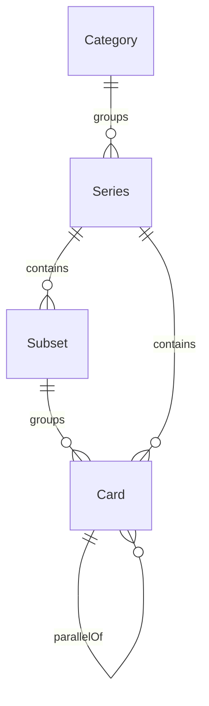

# Cardhub 业内对标

> 把 8 个研究方向里的公开产品模式，收成 Cardhub 可以做和明确不做的边界。执行合同以 [development-backlog.md](development-backlog.md) 为准；代码现状以 [feature-inventory.md](feature-inventory.md) 为准。本文不授权抓取任何参考站点的图、正文或价格。

调研日期：2026-10-17。基线是 `main` 上的 `ffe7f12`。

---

## 1. 调研范围与方法

用户指定了 8 个方向。参考表里的 “Cardboard Checklist” 按公开站点 Cardboard Connection（`cardboardconnection.com`）理解。若实际指另一个同名产品，需要改本节对应结论。

每个方向只总结信息架构、数据形状和交互模式。不保存卡图，不摘录清单正文、成交价或赛事排名。

本机在公司网络下直接请求各站点首页或文档页。返回 “域名不在安全策略允许范围” 的，视为云壳拦截，没有再试其他出口。人机验证页、访问挑战页和连接超时，同样视为没有读到站点正文。这两类都在下表标成 “未能实地核验”，结论改用官方文档、帮助中心或搜索摘要。

| 站点                 | 本机结果         | 结论依据                                 |
| -------------------- | ---------------- | ---------------------------------------- |
| Scryfall             | 文档页打开成功   | 本机读到的 API 与搜索文档                |
| TCGplayer            | 首页打开成功     | 首页标题，加上官方目录 API 文档          |
| Limitless            | 首页打开成功     | 首页导航，加上开发者文档                 |
| Fanatics Collect     | 首页打开成功     | 首页入口，加上帮助中心                   |
| Pokéllector          | 云壳拦截         | 搜索摘要。未能实地核验                   |
| Cardmarket           | 云壳拦截         | 官方 API 文档。官网未能实地核验          |
| TCDB                 | 人机验证页       | 用户手册、FAQ 与论坛说明。未能实地核验   |
| Card Ladder          | 人机验证页       | 帮助中心文章。未能实地核验               |
| Beckett              | 人机验证页       | 新闻归档与发售日历文章摘要。未能实地核验 |
| PokéBeach            | 人机验证页       | 文章页摘要。未能实地核验                 |
| Topps                | 人机验证页       | 帮助中心中的清单与发售说明。未能实地核验 |
| Panini America       | 未得到可阅读正文 | 商品列表与即将发售页的摘要。未能实地核验 |
| Pokémon 官网         | 访问挑战页       | 产品图库页摘要。未能实地核验             |
| Cardboard Connection | 连接超时         | 清单文的公开结构摘要。未能实地核验       |

公开资料入口（只作索引，不构成授权）：

- Scryfall API 与搜索语法：<https://scryfall.com/docs/api>、<https://scryfall.com/docs/syntax>
- TCGplayer 目录 API 与 API 条款：<https://docs.tcgplayer.com/reference/catalog_getskusbyproductid>
- Cardmarket Marketplace API：<https://apiv2.cardmarket.com/ws/documentation/API_2.0:Market_Place_Information>
- Limitless 赛事文档：<https://docs.limitlesstcg.com/developer/tournaments>
- TCDB 用户手册：<https://www.tcdb.com/UserManual.cfm>

---

## 2. 品牌官网视觉

参考：Topps、Panini America、Pokémon 官网。三家官网本机都没有读到正文，本节未能实地核验，依据帮助中心和产品列表摘要。

### 关键做法

三家都是品牌商城，不是数据库。首页第一屏放当前主打产品，下面是一条在售或即将发售的产品带，再按运动、品牌线或系列主题分组。产品页用大图、配置名称（例如 Hobby 盒、补充包、训练箱）和发售信息；清单经常是附页、PDF 或支持文档，不是可筛选的表。

Topps 的帮助中心把 “去哪里找清单” 和 “去哪里看发售” 写成固定入口，并说明印量不一定公开。Panini 有独立的即将发售列表，条目本身就是商品。Pokémon 的产品图库把同一个主题下的补充包、礼盒和牌组放在一起，视觉上先看到主题，再看到单品。

### 值得借鉴的模式

Cardhub 首页可以学这三层，不学购买：一个主视觉系列、一组分类入口、一排最新收录。主视觉只指向系列页。即将发售和资讯如果还没有数据，整块隐藏，不要放空的商城骨架。系列页和卡牌页保持大图优先、文字其次，这和 UI 规范里 “内容为本” 一致。

### 不适合 Cardhub 的部分

官网的购物车、倒计时、折扣券、邮件订阅和盒配比，服务的是卖货。Cardhub 不销售封盒产品，也没有库存。把首页做成商店会把知识库让到第二位。官方清单 PDF 不能当成可导入的数据源，里面的照片和版式受版权保护。

对应任务：增强 CH-205。发售日期本身在 CH-201，日历页在 CH-215。

---

## 3. 卡牌资讯门户

参考：Beckett、PokéBeach。两站本机都停在人机验证页，未能实地核验。

### 关键做法

Beckett 新闻按运动和集换式卡牌游戏分栏。文章类型包括新品说明、清单导读、市场观察和热度名单。发售日历按月排列，每条有日期和名称，并链到后续的清单文章；正文会声明日期可能变动。价格指南和评级是另一套付费或服务业务。

PokéBeach 的文章页有标题、日期和讨论。新品稿会写发售日、大致的产品形态，并在文末列后续日程。社区曾经自己维护发售日历，说明一张按日期浏览的表，比在论坛里翻新闻更有用。

### 值得借鉴的模式

Cardhub 增加两条旁路，不替代系列清单：

- 资讯：栏目、列表、文章详情。正文用现有 Markdown 渲染。只由管理员发布。
- 发售日历：一条记录就是标题、日期、可选的地区和可选的系列链接。日期允许以后修改。来源如果需要，只保存一个外链，服务器不去抓那一页。

文章负责讲背景，卡号和平行版本进结构化字段（CH-201、CH-213），避免 Beckett / Cardboard Connection 那种 “一篇长文就是整个数据库” 的维护方式。

### 不适合 Cardhub 的部分

Beckett 的在线价格指南、热度榜和评级提交，依赖付费数据和鉴定流程。PokéBeach 的整套卡图扫描不能转载。两站的评论区也不必重做，Cardhub 已有卡牌评论和论坛。资讯文章本阶段不开放用户投稿，否则会多出一个审核队列。

对应任务：新增 CH-214、CH-215。首页上的摘要块写在 CH-205，没有数据时隐藏。

---

## 4. 卡牌百科系统

参考：TCDB、Scryfall、Pokéllector。Scryfall 文档本机已读。TCDB 与 Pokéllector 未能实地核验。

### 关键做法

Scryfall 把一张卡拆成两层。规则身份（同一张卡跨系列重印后仍然相同）和某一次印刷（系列、卡号、稀有度、工艺、画师、语言）分开存。多面卡是一条记录加多个面。搜索是键值语法：可以用前缀限定类型、系列、稀有度、颜色和年份，可以用比较符，也可以用正则。结果能按名称、系列卡号、稀有度或价格排序。价格是每日更新的字符串，并指向外部商店，Scryfall 自己不是交易所。API 要求调用方自带明确的 User-Agent，流量须保持在大约每秒 10 次以内；条款禁止把这份数据付费转售或原样再发布，图片还有裁切和署名限制，并受威世智粉丝内容政策约束。

TCDB 按品类浏览系列。系列下有插入套和相关系列。收藏、想要和待交易是用户自己的账，见第 7 节。清单可以由用户提交，再经站方处理。

Pokéllector 的首页按世代分组，并分开最新套和即将发售、英语和日语。套内逐张标记 “已拥有”，完成条跟着变。变体可以单独占一行；关掉变体时，用户看到的格子和完成度分母会不一致。筛选 “未拥有” 就是缺卡清单。

### 值得借鉴的模式

Cardhub 已经有系列和卡牌。接下来补的是 “这一次印刷” 的字段，不是魔法风云的规则引擎：

- 搜索框同时接受普通关键词和很少的几个前缀（稀有度、系列）。空格表示并且，`OR` 表示或者，减号表示排除。筛选条件和地址栏同步。
- 卡牌详情按固定顺序放：大图、名称、稀有度、卡号、所属系列、属性、长描述、交易意向、评论。
- 同一系列里提供上一张和下一张，顺序与清单页的卡号一致。

正则、法术力符号、赛制合法性、多面卡结构和外部商店价格，都不进入这一版搜索。

### 不适合 Cardhub 的部分

镜像 Scryfall 会直接碰到它的再发布限制和威世智的权利。TCDB 让用户自由提交整套清单，审核量不适合一个人维护。Pokéllector 的完成度如果和变体开关缠在一起，用户会算不清自己到底齐没齐；Cardhub 把变体（平行版本）做成显式记录，进度默认只数基础卡，见 CH-203 和 CH-213。

对应任务：增强 CH-106、CH-206。分类层级在第 5 节，落到 CH-201。

---

## 5. 球星卡清单

参考：Topps 的清单入口、Cardboard Connection。两者都未能实地核验。TCDB 的系列结构放在这里一起用，因为它和清单是同一件事。

### 关键做法

这类页面回答的是 “这盒里有哪些卡”，不是 “这张卡怎么打”。层级是：品类，下面是系列（一套产品），系列下面是子集（基础卡或插入卡），再下面是卡号。平行版本共享卡号和球员（或角色），但工艺、颜色和限量分母不同。限量有时写在卡上（例如分母 99，或 1/1），有时厂商不公布，字段必须允许为空。

TCDB 的讨论区里有一条对建模很有用的教训：把基础清单复制成平行清单时，如果顺手覆盖备注，子集信息会丢。平行版本应当是自己的字段，不能靠一段备注硬编码。

Cardboard Connection 的清单文用表格列出平行名称、限量分母和备注，前面再加一段产品介绍。它是文章，不是数据库。SetList 一类新站点把 “平行属于子集” 做成两张表，和上面的教训一致；它不在本次参考表里，只用来核对这个形状，不单独立项。

### 值得借鉴的模式

Cardhub 的落地拆成两张可以独立交付的任务：

1. CH-201 做品类、系列、子集、发售日期和卡号。子集只有两种：基础、插入。
2. CH-213 做平行版本：指向同一系列里的一张基础卡，加上平行名称和可选的限量分母。只允许一层，平行卡不能再挂平行卡。

系列页改成清单（CH-202）：按子集分组，组内按卡号的自然顺序排，可以搜索和分页。默认不把平行卡铺进主表，避免一张基础卡变成十几行。

### 不适合 Cardhub 的部分

厂商的盒配置、每包保底和签字卡概率，营销属性强，又经常改。个人项目维持不了。批量 “复制一整套清单再改备注” 的后台也不做，管理员用 CH-107 的逐张编辑和 JSON 导入即可。印量未知就留空，不要猜一个数字。

---

## 6. 卡牌交易系统

参考：TCGplayer、Cardmarket。TCGplayer 首页本机可打开，SKU 模型来自官方文档。Cardmarket 官网被云壳拦截，未能实地核验，模型来自其 API 文档。

### 关键做法

两家都是真的市场，不是留言板。

TCGplayer 的目录单位是 Product。可售单位是 SKU，由产品、品相、语言和工艺拼成。魔法风云一类品类的品相包括 Near Mint、Lightly Played、Moderately Played、Heavily Played、Damaged，另有未拆封。工艺可以是普通和闪，别的品类会更多。搜索筛选按品类配置，没有一套全世界通用的字段。官方文档写明已经停止发放新的 API 权限。API 条款禁止用爬虫收集站内内容（包括价格），也禁止拿别人爬来的价格再使用。

Cardmarket 的 Product 属于某个游戏和扩展，单卡带编号和稀有度。Article 是卖家挂单，带语言、品相、是否闪卡、是否签名或改绘、价格和卖家信息。品相档位比上面更细。价格指南给出趋势价、最低价和 1 日、7 日、30 日均价；文档写明价格指南只对选定用户开放，建议售价的算法不公开。

### 值得借鉴的模式

Cardhub 的交易信息板只吸收 “买家筛选时真正用得上的三个事实”：品相、语言、一句版本备注。品相用五档，允许不填。语言只用中文、英文、日文和其他。版本备注是短句，例如 “反向闪” 或 “金标”，不是工艺主数据。列表可以按品相和价格区间筛选。按价格排序时只比较同一种货币，默认人民币，避免把美元和人民币的数字排在一起。

一条意向仍然是：某人想出或想收某一张卡，留下联系方式，在站外沟通。这和 [project-brief.md](project-brief.md) 里 Phase 2 的信息板一致。

### 不适合 Cardhub 的部分

以下能力都依赖资金、履约或对方的商业数据，Cardhub 不做，也不建任务：

- 产品到 SKU 的库存矩阵、数量、购物车、站内支付和卖家保证金。
- 市场价、趋势价、成交均价和 “好价格” 徽章。
- 卖家等级、职业卖家和购物车级的纠纷处理。
- 对接或抓取 TCGplayer、Cardmarket 的目录与价格。新 API 权限本身也拿不到。

对应任务：增强 CH-104。联系方式是否登录可见，仍是 backlog 里的 D1。

---

## 7. 收藏管理

参考：TCDB、Fanatics Collect，进度交互参考 Pokéllector。Fanatics Collect 首页本机可打开。TCDB 与 Pokéllector 未能实地核验。

### 关键做法

TCDB 的用户手册把收藏做成一套私人账本：可以有多本收藏，可以按卡号批量加入，可以记录评级、未拆盒和未裁切张，还可以把收藏标成待交易、生成想要清单，并在用户之间记账。完成度由用户自己定义，因为有人只收基础 700 张，有人把变体都算进大师套。

Pokéllector 更窄：登录后在套里点 “已拥有”，看完成条，再滤出未拥有的卡。公开评价里，整库估值经常被认为不准。

Fanatics Collect 首页的主入口是周拍、高估值专场、一口价、已售记录、私下交易和卖卡。帮助中心说明金库负责保管和保险，估值依赖 Card Ladder，一口价和即时报价都挂在这个估值上。这是仓储加市场。

### 值得借鉴的模式

在 CH-203 里把 “收藏按钮” 做成私人收藏，而不是公开的点赞数：

- 一张卡对一个用户只有一行：拥有数量，以及是否想要。
- 个人中心按系列显示 “已有多少 / 共多少”。
- 分母默认不含平行版本。用户可以在本地打开 “把平行版本计入进度”。想要但还没有的卡不计入分子。
- 分享按钮保持不变，分享的是卡牌页链接。

### 不适合 Cardhub 的部分

多本收藏、评级分、未拆盒、用户之间的成交记账，是 TCDB 的第二产品，维护界面和规则的成本高。Fanatics Collect 的金库、保险、拍卖、一口价、经销商计划和即时报价涉及保管与资金，和 “站外交易” 的边界冲突。收藏页不显示根据外部行情算出的总价值。

---

## 8. 行情数据产品

参考：Card Ladder。首页被人机验证拦住，未能实地核验。依据其帮助中心。

### 关键做法

Card Ladder 有两层数据。Sales History 收纳公开渠道上的成交。Ladder 档案是研究团队核对过的子集，用来做指数。球员或角色指数把该对象名下卡的最近成交汇总成一个时间序列，每晚重算，新卡加入后还会回溯历史。没有档案的评级卡，会拿近期成交去掉异常值，再按指数从成交日走到今天的变化，推出一个估计值。人口报告来自合作数据，不是页面上能抄走的公开表。产品功能包括收藏估值、筛选、到价提醒。

### 值得借鉴的模式

个人项目能做的只有 “用户自己记下看到或成交的价格”：谁、哪张卡、金额、货币、观察日期、可选备注。卡牌页用这些点画一张简单折线，并在图旁写明这是用户自报，不是市场指数，也不构成买卖建议。同一用户、同一张卡、同一天只保留一条，后写的覆盖先写的。管理员可以隐藏明显不当的记录。

不保存来源网站的名字作为抓取频道，避免做成 “我们在跟踪某拍卖行” 的印象。

### 不适合 Cardhub 的部分

成交库、指数、异常值算法、人口报告、到价提醒和每日自动重估，都建立在别人的成交数据上。抓取拍卖行或商店的成交记录通常违反对方条款，也没有授权。Card Ladder 与 Fanatics Collect 的估值合作说明，这是一门数据生意，不是知识库的附赠页。

对应任务：CH-313。涉及价格展示，D8 确认前不实施。任何外部导入另受 D12 约束。

---

## 9. 赛事与卡组

参考：Limitless。首页本机可打开。赛事字段来自开发者文档。占比和胜率表的形状来自其 Labs 页面的公开摘要，本机没有逐场点开赛事详情。

### 关键做法

首页导航把锦标赛、卡组、卡牌、高级搜索、选手排名、博客和工具并列。工具里包括瑞士轮计算、组牌和代打打印。锦标赛分成已结束和即将开始。一场赛事可以有阶段、局数、线上或线下、是否提交卡组。名次记录包含选手、名次、胜负平、卡组列表，以及可选的卡组类型。卡组类型靠规则表归类：若干关键卡的名称、系列和编号达到指定张数。Labs 把多场赛事加总，给出卡组占比、战绩和胜率。

开发者文档说明，读取赛事数据有频率限制；更高配额和卡组规则接口要申请，且面向公开项目，不是给私人镜像用的。

### 值得借鉴的模式

若以后要做，范围停在管理员手工录入：

- 赛事：名称、日期、地点、可选的参赛人数。
- 卡组：名称、名次、胜、负、平。
- 卡组用卡：指向站内已有卡牌，加张数。
- 胜率只按胜除以胜加负来算，平局单独显示。占比是该名称的卡组数除以已录入卡组数。页面上写明分母是 “站内已录入”，不是全行业。

卡牌页最多显示 “在已录入卡组里出现过多少次”。不做对阵矩阵，不做自动卡组归类。

### 不适合 Cardhub 的部分

Limitless 是赛事运营工具加元游戏媒体。每周的地区赛都要有人录入，否则数据一周就过时。自动归类规则要随环境改。代打打印会把卡图重新排成可打印页，版权风险高，Cardhub 不做。对接其 API 等于做一家镜像站，不在授权范围内，也不符合 D12。

对应任务：CH-314。D9 确认前不实施。确认时还要选定第一种游戏，否则 “卡组” 没有共同的张数规则。

---

## 10. 横向能力矩阵

现状用 feature-inventory.md 的图例：已实现、部分实现、未实现。

| 能力                   | Cardhub 现状                         | 借鉴来源                         | 任务           |
| ---------------------- | ------------------------------------ | -------------------------------- | -------------- |
| 首页主视觉与分类入口   | 未实现                               | Topps、Panini、Pokémon           | CH-205         |
| 资讯栏目与文章         | 未实现                               | Beckett、PokéBeach               | CH-214         |
| 发售日历               | 未实现。系列还没有发售日期           | Beckett、PokéBeach、品牌官网     | CH-201、CH-215 |
| 品类、系列、子集、卡号 | 未实现。只有系列和卡牌               | TCDB、Cardboard Connection       | CH-201、CH-202 |
| 平行版本与限量         | 未实现                               | TCDB、Cardboard Connection       | CH-213         |
| 带筛选的搜索           | 部分实现。只有卡名模糊匹配           | Scryfall                         | CH-106         |
| 卡牌详情层次           | 部分实现。无真实大图，无长描述       | Scryfall、Pokéllector            | CH-105、CH-206 |
| 品相、语言、意向筛选   | 部分实现。只有出/求，卡牌显示为 slug | TCGplayer、Cardmarket            | CH-104         |
| 站内库存与结算         | 明确不做                             | TCGplayer、Cardmarket            | 不建任务       |
| 私人收藏与系列进度     | 未实现                               | Pokéllector、TCDB                | CH-203         |
| 金库、拍卖、保管估值   | 明确不做                             | Fanatics Collect                 | 不建任务       |
| 用户自报价格与折线     | 未实现。确认前不做                   | Card Ladder 的 “记下价格” 这一层 | CH-313         |
| 指数、成交库、人口报告 | 明确不做                             | Card Ladder                      | 不建任务       |
| 手工录入的赛事与卡组   | 未实现。确认前不做                   | Limitless                        | CH-314         |
| 元游戏对阵与代打打印   | 明确不做                             | Limitless                        | 不建任务       |

---

## 11. 差异化定位

Cardhub 继续做中文用户的维基式知识库，加上已经上线的评论、论坛和交易信息板。权威性来自编辑维护的结构化字段（系列、子集、卡号、平行版本），社区负责讨论和意向，不负责改目录。

建议的浏览路径很短：首页进入分类或搜索，进入系列清单，进入卡牌。卡牌页挂评论和交易意向。登录之后在个人中心看自己的收藏进度。资讯和发售日历是旁路。价格和赛事即使将来打开，也只是卡牌页上的附加块，而且必须带 “站内录入、不是行业统计” 的说明。

和参考站点比，Cardhub 主动让出这些位置：官方商城、担保交易、评级、扫描估价、增强现实鉴卡、金库、行情终端、赛事数据公司。项目简报把其中几项放在长期愿景里。以当前一个人、一台香港 VPS 的条件，它们仍然不是开发任务。

---

## 12. 数据来源与合规风险

下面是产品边界，不是法律意见。真要对接任何外部数据，先由 owner 确认（D12）。

### 卡图

卡牌图案、官方产品照片和扫描图通常由厂商或画师持有权利。可行路径只有三条：编辑或用户上传自己有权使用的图（CH-208）、管理员粘贴已经获得授权的地址、页面上只放外链而不把图抓回自己的存储。批量抓取 Scryfall、PokéBeach、品牌官网或商店图床，不在可行路径里。Scryfall 即便允许在粉丝内容范围内用图，也有署名、禁止变形和禁止再包装的限制，不能当成 Cardhub 的图库。

### 卡牌文字与游戏数据

规则文本、官方清单和卡牌名称受权利人控制。Cardhub 的目录由编辑手工录入事实字段（名称、编号、稀有度、子集）。不导入 Scryfall 批量数据，不爬厂商 PDF。搜索语法只借鉴交互，不复制他们的卡池。

### 价格

TCGplayer 禁止爬取和转手其价格。Cardmarket 的价格指南不对一般应用开放。Card Ladder 的成交和指数是其产品本身。抓取这些来源不应当成 “技术上能跑” 的方案。可行路径是 CH-313 的用户自报，并且在确认 D8 之前连这条也不做。图上不能出现 “市场价” “指导价” “指数” 这类字样。

### 球员肖像、商标与赛事

球员姓名、球队、游戏角色和赛事名称是识别信息，也是商标或肖像权的敏感区。页面用文字标出名称即可，不使用官方标志，不写成合作或授权。页脚保留非官方说明。赛事记录如果要做，只记录管理员录入的名次和用卡，不直播、不转载官方对阵表。

### 用户上传

交易图片和将来的上传已经有举报入口。目录图片目前主要由管理员写入，投诉时由管理员改 URL 或删除。若以后开放大量用户上传卡图，再把 “图片” 纳进举报对象。那是后续问题，这次不单独立项。

### 可行路径（汇总）

| 路径                           | 可否现在做                         |
| ------------------------------ | ---------------------------------- |
| 编辑在后台手填目录、文章、日历 | 可以。CH-107 之后的内容任务        |
| 用户标记自己的收藏             | 可以。CH-203                       |
| 用户发布交易意向               | 可以。保持信息板，CH-104 只加筛选  |
| 用户自报一条价格               | 等 D8                              |
| 管理员录入赛事和卡组           | 等 D9                              |
| 只保存外链，服务器不抓取       | 可以。日历和文章的来源字段按此设计 |
| 官方书面授权后再做导入         | 等 D12。确认前不写导入器           |
| 爬取图库、清单、行情、赛事     | 不做                               |

---

## 13. 对任务池的影响

优先改已有任务，避免两张卡做同一件事。

增强：

| 任务   | 吸收的结论                                                 |
| ------ | ---------------------------------------------------------- |
| CH-104 | 品相、语言、版本备注、同币种价格筛选。仍然是信息板         |
| CH-106 | 稀有度和系列前缀、并且 / 或者 / 排除。不做正则和价格比较   |
| CH-201 | 品类、系列、子集、发售日期、卡号。平行版本不塞进这张卡     |
| CH-202 | 系列页变成可筛选的清单，卡号按自然顺序                     |
| CH-203 | 私人收藏、数量、想要、系列进度。不做估值和多本收藏         |
| CH-205 | 主视觉、分类、最新系列。资讯和日历没有数据时隐藏           |
| CH-206 | 面包屑、卡号、同系列上一张和下一张。价格曲线不放在这张卡   |
| CH-207 | 文章和日历上线之后，把它们的地址补进站点地图。未上线不阻塞 |

新增：

| 任务   | 优先级 | 标题                   | 为什么单独成卡                                     |
| ------ | ------ | ---------------------- | -------------------------------------------------- |
| CH-213 | P2     | 平行版本与限量编号     | 会改变清单行数和收藏分母，和分类字段不是同一次迁移 |
| CH-214 | P2     | 资讯文章与分类         | 新的内容类型，和卡牌目录无关                       |
| CH-215 | P2     | 发售日历               | 比文章小，应能单独上线                             |
| CH-313 | P3     | 用户自报价格记录与走势 | 有误导和合规风险，D8 确认前不实施                  |
| CH-314 | P3     | 赛事与卡组数据库       | 持续录入成本高，D9 确认前不实施                    |

明确不建任务的能力：站内担保交易、SKU 库存与购物车、金库与拍卖、评级提交、扫描估价、行情指数与人口报告、爬虫导入、代打打印、元游戏对阵矩阵。
