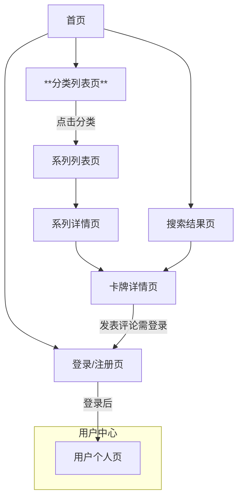

# UI/UX 规格文档：Cardhub

#### **1. 总体用户体验目标与原则**

##### **1.1 目标用户画像 (Target User Personas)**

- **新手入门者：** 对卡牌充满好奇，需要清晰、友好的引导和权威的知识。
- **核心玩家与收藏家：** 拥有专业知识，寻求深度交流和高效的信息获取。

##### **1.2 可用性目标 (Usability Goals)**

- **易学性：** 新用户能在首次访问的5分钟内，独立完成一次完整的卡牌信息查询。
- **效率性：** 核心玩家可以快速、准确地通过搜索或分类找到目标卡牌。
- **满意度：** 用户在视觉上感到愉悦，在交互上感到流畅自然。

##### **1.3 设计原则 (Design Principles)**

- **现代精致的美学：** 设计风格追求现代化与精致感，采用高质量的排版、充足的留白和优质的视觉元素。
- **内容为本，清晰易读：** 核心焦点始终是卡牌内容本身，确保信息层次分明，易于阅读和理解。
- **有意义的动效：** 动效的目的是为了提供流畅的反馈、引导视觉焦点和增强操作的直观性。
- **策略性地使用玻璃拟态效果 (Glassmorphism):** 在导航栏、弹窗等区域使用，增加设计的层次感和精致度。

#### **2. 信息架构 (Information Architecture)**

##### **2.1 网站地图 / 核心页面清单 (Site Map / Screen Inventory)**

##### **2.2 导航结构 (Navigation Structure)**

- **主导航 (Primary Navigation):** 网站顶部的全局导航栏，将包含 Logo/首页、浏览分类、全局搜索框、登录/个人中心入口。在移动端将收起到“汉堡包”菜单中，并多使用图标。
- **面包屑导航 (Breadcrumb Navigation):** 在深度页面提供，清晰展示用户当前所处的位置。

#### **3. 用户流程 (User Flows)**

(包含四个核心流程：搜索查找、浏览发现、用户注册登录、发表评论的流程图)

#### **4. 线框图与视觉稿 (Wireframes & Mockups)**

- **主要设计工具:** Figma
- **视觉稿与指南:** 无，待后续设计。
- **布局概念 (首页):** 包含页眉区域、精选分类区、最新收录系列区。
- **布局概念 (卡牌详情页):** 采用模块化设计，包含一个固定的功能组件区（含高清图片、收藏/分享按钮）和一个自由的富文本内容区，底部为评论区。

#### **5. 组件库 / 设计系统 (Component Library / Design System)**

- **设计系统方法:** 采用组合式设计系统，使用 **shadcn/ui** 作为基础，通过 **TailwindCSS** 进行深度定制，以实现独特的品牌风格。
- **核心组件清单:** Button, Input/Search Bar, Card (UI容器), Navigation, Dialog/Modal, Comment等。

#### **6. 品牌与风格指南 (Branding & Style Guide)**

- **Logo:** 采用\*\*概念 A（卡片与对话）\*\*的设计方向。
- **调色板:** 使用简洁的基色，搭配一个活力的主色调（如深紫色 `#6D28D9`），并已规划好完整的深色模式方案。
- **字体:** 采用“优先系统字体，并为 CJK 语言优雅降级”的字体栈策略，以实现最佳的跨平台排版效果。
- **图标:** 使用 **Lucide Icons** 图标库。
- **间距:** 采用 **8px 网格系统**。

#### **7. 无障碍设计要求 (Accessibility Requirements)**

- **合规目标:** WCAG 2.1 AA 级别。
- **核心要求:** 覆盖视觉（色彩对比度、焦点指示）、交互（键盘可访问性）、内容（图片描述、标题结构）等方面的具体要求。

#### **8. 响应式策略 (Responsiveness Strategy)**

- **原则:** 移动优先 (Mobile-First)。
- **断点:** 采用与 TailwindCSS 兼容的标准断点 (sm, md, lg, xl, 2xl)。
- **适配模式:** 定义了从单栏到多栏的布局变化、导航变化和内容优先级调整策略。

#### **9. 动画与微交互 (Animation & Micro-interactions)**

- **动效原则:** 功能性、精致克制、流畅高性能、可访问性。
- **关键动画示例:** 页面过渡、元素加载（骨架屏、入场动画）、悬停状态、点击反馈。

#### **10. 性能考量 (Performance Considerations)**

- **性能目标:** 遵循 Google 的核心网页指标 (Core Web Vitals)。
- **设计策略:** 图片优化、懒加载、骨架屏、优先使用系统字体等。
